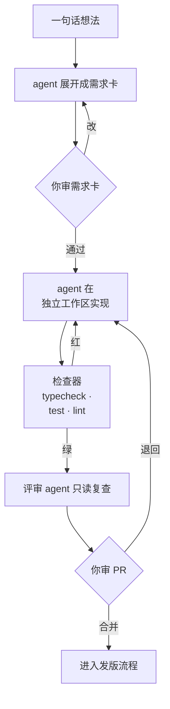
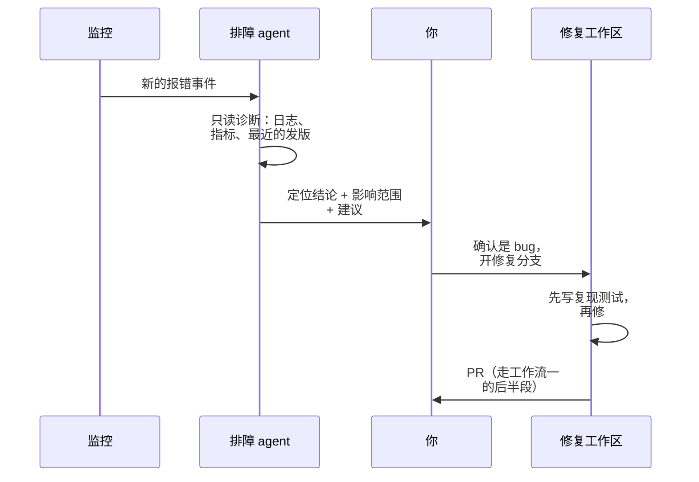

# 研发

研发是一人公司里最先、也最彻底被 agent 改变的岗位。编码 agent 已经能从读需求一路干到测试通过，这部分[《编码 Agent 实战》](../coding-agents/)讲得很细。这一章不再讲怎么让 agent 写好代码，而是退一步，把「研发」当成一个岗位来设计：从一个想法到线上稳定运行，中间有哪些环节，每个环节交给谁、交到第几级，人在哪几道闸门上必须在场，以及当 agent 产出的速度远超你审阅的速度时怎么办。

## 研发岗管什么

在有团队的公司里，研发被拆成产品经理、前端、后端、测试、运维好几个角色。一人公司里，它们是同一个岗位的几个环节：

| 环节 | 产出 | 放到第几级 | 理由 |
|---|---|---|---|
| 需求澄清 | 一张需求卡 | 2 起草待审 | agent 能把一句话展开成验收条件，但「做不做、做到哪」是你的判断 |
| 设计 | 数据模型、接口、模块边界 | 2 起草待审 | 改起来最贵的部分，必须过人 |
| 实现 | 分支上的提交 | 4 自主执行 | 在隔离的分支和工作区里，错了可以整个扔掉 |
| 测试 | 测试代码和运行结果 | 4 自主执行 | 由检查器验证，不靠人看 |
| 代码评审 | 评审意见 | 1 只读诊断 | 第二个 agent 只读、只提意见；合并决定是你的 |
| 发版 | 线上新版本 | 3 白名单执行 | 走事先写好的流水线，不让 agent 临场发挥 |
| 排障 | 定位结论和修复 PR | 1 → 2 | 定位只读，修复走正常的 PR 流程 |
| 维护 | 依赖升级、文档同步、清理 | 2 起草待审 | 量大、零散，适合批量起草再一次审完 |

这张表里，实现和测试放得最开，是因为它们满足了两个条件：**在分支里发生**（代价低，可以整个扔掉），**有类型检查和测试兜底**（好验证）。需求和设计放得最紧，不是因为 agent 写不好，而是因为它们决定了后面所有工作的方向，一旦错了，返工的不是一个提交，而是一周。

## 工作流一：从需求卡到合并请求

这是研发岗最主要的一条工作流。它的形状是：



人只在两个菱形处出现：需求卡和 PR。中间的循环全部由 agent 和检查器完成。

### 需求卡

需求卡是你和 agent 之间的合同。它比「帮我加个导出功能」多写了三样东西：边界、验收、不做什么。

```markdown
# 需求卡：书籍导出为 zip

## 背景
用户想把书架上的书备份到电脑。目前只能导入，不能导出。

## 要做
- 书籍详情页加「导出」按钮，生成 zip，调起系统分享面板
- zip 结构与导入时一致（book.yaml + 章节 + assets/），能被再次导入

## 不做
- 不导出阅读进度和笔记（下一期）
- 不做批量导出

## 验收
- 导出的 zip 经 @shelf/spec 的校验函数检查通过
- 导出再导入，书籍内容逐字节一致（加一条往返测试）
- pnpm typecheck 和 pnpm test 通过

## 风险
- 大书（几百张图）生成 zip 可能阻塞 UI，需要确认在哪个线程做
```

「不做」和「验收」两节最值钱。前者防止 agent 顺手多做（它很爱顺手多做），后者让「做完了」从一种感觉变成一条命令。「风险」一节留给 agent 填：让它在动手前先列出它看到的风险，你常常会在这里发现需求卡本身没想清楚的地方。

让 agent 起草需求卡的 prompt 可以存成 `prompts/eng-spec.md`，核心要求是：**只写卡，不写代码；读相关代码后再写风险；拿不准的地方写成问题而不是猜**。

### 独立工作区

实现阶段让 agent 在独立的 Git 工作区里干，主工作区留给你自己：

```bash
# 为这张需求卡开一个工作区和分支
git worktree add ../shelf-export -b feat/export-zip

# 在工作区里启动 agent，把需求卡作为任务
cd ../shelf-export
claude "按 specs/export-zip.md 实现。先写往返测试，再写实现。完成标准是需求卡里的验收全部通过。"
```

独立工作区的意义不只是「不打架」。它把实现阶段的出错代价降到了几乎为零：做砸了，`git worktree remove` 一条命令全部扔掉，主分支一个字节都没被碰过。这是研发岗能放到第 4 级的物理基础。并行开几条工作区、怎么分配子 agent，见[《编码 Agent 实战》第 5 章](../coding-agents/05-subagents-parallel.md)。

### 检查器是这个岗位的质检员

agent 说「完成了」不算完成，检查器说完成才算。研发岗的检查器分三层：

| 层 | 检查什么 | 怎么接入 |
|---|---|---|
| 静态 | 类型、lint、格式 | hooks 在每次改文件后跑，见[《编码 Agent 实战》第 4 章](../coding-agents/04-hooks.md) |
| 动态 | 单元测试、往返测试、e2e | 写进 CLAUDE.md 的完成标准，agent 必须跑通 |
| 结构 | 需求卡的验收条款逐条核对 | 评审 agent 的任务之一 |

hatch-shelf 的 CLAUDE.md 里有一句「声明任务完成前必须通过 `pnpm typecheck` 和 `pnpm test`」，hatch-counter 的仓库没有 CI，它的 CLAUDE.md 写明「这四条本地跑是唯一的早期反馈」。这两句话就是这个岗位最重要的岗位规则：**把「完成」定义成可执行的命令**。

### 评审 agent

合并之前，让另一个 agent 用全新的上下文只读地看一遍 diff。它和写代码的 agent 没有共享上下文，不会被同一个思路带偏：

```text
你是代码评审。只读，不修改任何文件。

对照 specs/export-zip.md 审查当前分支相对 main 的改动：
1. 验收条款逐条核对：哪条有测试覆盖、哪条没有
2. 「不做」里的内容有没有被做了
3. 涉及文件系统路径、用户输入、权限的代码，单独列出并说明风险
4. 和仓库 CLAUDE.md 里的约定有冲突的地方

输出：第一行写「可以合并」或「需要修改：N 项」，然后按严重程度列出。
```

评审 agent 的价值不在于它能发现所有问题，而在于**它把你的审阅从「通读 diff」变成「核对一份清单」**。你先看它标出的风险点，再看测试，最后扫一遍实现。交叉验证为什么有效、什么时候会失效，见[《多 Agent 编排》第 6 章](../multi-agent/06-cross-validation.md)。

## 工作流二：从线上报错到修复

第二条工作流由事件触发：线上出了错。



关键在于把「定位」和「修复」拆开：

- **定位是第 1 级**。排障 agent 只拿只读的诊断通道：能看日志、查容器状态、读最近的提交，不能改任何东西。怎么搭一条安全的只读通道，[《个人 Agent 工作流》第 6 章](../personal-agent-workflow/06-ops.md)有完整的脚本
- **修复走正常的研发流程**。不要让排障 agent 顺手在生产机上改配置。修复就是一张小需求卡，进工作区、先写一个能复现问题的测试、修到测试变绿、走评审、走发版

这样拆的好处是：凌晨三点被报警叫醒时，你需要做的决定只有一个，「这个定位结论对不对」。agent 已经把日志翻完了，你看结论和证据就行。事故的分级、止血和复盘流程见[《一人运维手册》](../production-ops/)第 3、4 章。

### 复现测试是修复的验收

「先写复现测试」这条规则对 agent 格外重要。没有复现测试，agent 的修复可能只是让症状消失，而它自己会很自信地说「已修复」。有了一个修复前红、修复后绿的测试，「修好了」就有了客观的定义，而且这个测试会永远留在仓库里，防止同一个问题回来。

## 工作流三：夜间维护

第三类是没人催、但不做就会慢慢腐烂的活：

| 活 | 频率 | 产出 |
|---|---|---|
| 依赖巡检 | 每周 | 有漏洞或主版本落后的依赖清单 |
| 文档同步 | 每周 | 代码改了但文档没跟上的地方 |
| 死代码与 TODO | 每月 | 可以删的导出、过期的 TODO |
| 升级演练 | 按需 | 在工作区里试升一个大版本，报告哪里坏了 |

这些活的共同点是**量大、低风险、适合批量**。让它们在夜里由定时任务跑，早上你收到的不是十几个零散的提醒，而是一份汇总：「需要处理：3 项」或者「一切正常」。定时任务怎么写包装脚本、怎么在无人值守时限制权限，见[《个人 Agent 工作流》第 4 章](../personal-agent-workflow/04-scheduled-tasks.md)。

升级演练值得单独一提。Expo、React Native 这类框架每个大版本都有破坏性变更（hatch-shelf 的 CLAUDE.md 专门提醒「不要凭记忆写 API」）。让 agent 在一个丢弃式的工作区里试升，跑完构建和测试，把报错整理成清单，你就能在真正升级之前知道这次升级要花一小时还是一周。

## 发版：能用脚本就不用模型

发版这个环节，本书建议**不用 LLM agent 做决策**，而是用确定性的流水线和脚本。原因很简单：发版的每一步都是明确的，不需要判断；而一旦出错，影响的是所有用户。

hatch-counter 的部署里有一个叫「上线代理」的程序，名字里带着 agent，但它是一个 shell 脚本：systemd 拉着它常驻，每隔十几秒读一次下载桶里各个静态站的版本指针，发现新的一次发布就拉包、核对 sha256、解压、切软链、请求一次本机首页确认新版本生效，认不出就切回去。它手里没有任何密钥，能被指使的只有「把桶里某一版切上去」这一个动作。

这个设计体现了第 3 级「白名单执行」的精髓：

- **动作是穷举的**：切版本、回滚、看状态，就这三个，写死在脚本里
- **每个动作自带验证**：切完立刻验首页，失败自动回滚
- **权限最小**：没有钥匙，被攻破了也只能在已发布的版本之间切换

LLM agent 在发版环节的合适角色是**写和改这些脚本**（在工作区里，走 PR），以及**发版之后读日志判断有没有异常**（第 1 级）。流水线本身、怎么做灰度和回滚，见[《部署与 CI/CD》](../deploy-release/)。

## 人守的闸门

把上面三条工作流里人出现的地方汇总起来，研发岗有五道闸门：

| 闸门 | 你要判断什么 | 为什么不能交出去 |
|---|---|---|
| 需求卡 | 做不做、做到哪、不做什么 | 方向错了，后面全白干 |
| 数据模型和迁移 | 表结构、字段含义、迁移是否可逆 | 改起来最贵，数据丢了找不回来 |
| 安全边界 | 认证、权限、输入校验、密钥 | 出错的代价由用户承担 |
| 合并 | 这个 PR 是否符合需求卡、是否引入风险 | 合并后就进入了「代价高」的区域 |
| 发版时机 | 现在发还是等一等 | 涉及对用户的承诺和你自己的值班能力 |

其中数据模型和安全边界值得在仓库里用按路径加载的规则单独标出来。hatch-counter 把「改坏了不报错的规矩」按路径放在 `.claude/rules/` 下，动到服务端代码才加载 `server.md`，动到业务口径才加载 `business.md`。这样 agent 碰到这些文件时会自动看到警告，你审 PR 时也知道该在哪几个文件上多停一会儿。规则文件怎么按路径组织，见[《编码 Agent 实战》第 3 章](../coding-agents/03-rules-by-path.md)。

## 审阅成为瓶颈之后

当 agent 能同时在三个工作区里写代码时，你很快会发现：瓶颈不再是写，而是审。几个经过验证的办法：

- **先审测试，再审实现**。测试描述了「它应该做什么」，如果测试本身是对的、完整的，实现的细节可以看得粗一些
- **PR 描述要有固定结构**。要求 agent 在 PR 描述里写：改了什么、为什么这么改、风险在哪、怎么验证的。你从「风险」那一节开始读
- **控制在途数量**。同时在途的 PR 不超过你一天审得完的数量。超过了，再开新工作区只会让队列变长，不会让东西更快上线
- **把反复出现的评审意见写成规则**。同一类问题你在评审里说了第二遍，就写进 CLAUDE.md 或 rules；说了第三遍，考虑写成 lint 规则或 hook，让检查器替你说

[《AI 认知进阶》第 4 章](../ai-cognition/04-human-ai-division.md)讲过「审核是新的瓶颈」背后的道理：自动化程度越高，人在少数需要介入的时刻面对的问题越难。所以审阅不能靠堆时间，要靠把问题提前到检查器里解决，让真正需要你判断的东西变少、变清楚。

## 一人公司特有的研发问题

### 多个项目共用的口径

一人公司常常不只一个产品，或者一个产品有好几端。hatch-shelf 把判断书籍结构的逻辑全部放在 `@shelf/spec` 一个包里，App 和命令行工具都调用它；hatch-counter 把多端共用的业务口径放在 `@counter/core`。这类共享包对 agent 格外重要：**规则只有一份，agent 改一处就是改所有端**，不会出现网页端改了、移动端忘了的情况。在需求卡的「验收」里写上「口径改动只能发生在共享包里」，评审 agent 会帮你盯着。

### 决策记录

agent 每次进入仓库都是新的，它不记得三个月前你为什么选了 SQLite 而不是别的。把架构决策写进文档（hatch-shelf 的 README 有专门一节决策记录，hatch-counter 的现行页在规矩旁边或页末写「为什么这么定」），agent 读到它就不会提议推翻一个你已经想清楚的决定。这也是给未来的自己写的。

## 去哪里深入

| 想深入的环节 | 读什么 |
|---|---|
| 让 agent 写好代码的全部细节 | 《编码 Agent 实战》 |
| 前端、移动端、桌面端、后端的技术纵深 | [《React 19 原理与模式》](../react-internals/)[《React Native 与 Expo》](../rn-expo/)[《Electron 桌面应用》](../electron-desktop/)[《NestJS 后端架构》](../nestjs-backend/) |
| 数据模型和架构决策 | [《数据库原理与实战》](../database-practice/)[《软件架构与系统设计》](../system-design/) |
| 安全边界 | [《应用安全》](../app-security/) |
| 发版流水线 | 《部署与 CI/CD》 |
| 排障和线上稳定 | [《可观测性与性能》](../observability-performance/)《一人运维手册》 |
| monorepo 管理 | [《前端工程化与 Web 平台》](../frontend-engineering/)、[《编码 Agent 实战》第 6 章](../coding-agents/06-monorepo.md) |

## 本章要点

- 研发岗的环节按出错代价定级：实现和测试在隔离分支里可以全自主，需求和设计必须过人
- 需求卡是人和 agent 的合同，「不做」和「验收」两节最值钱；验收要能写成命令
- 独立工作区让实现阶段的出错代价接近零，这是研发能放到第 4 级的物理基础
- 评审 agent 用全新上下文只读复查，把你的审阅从通读 diff 变成核对清单
- 排障拆成只读定位和正常修复两段；修复先写复现测试
- 发版用确定性脚本和白名单动作，LLM agent 负责写脚本和事后读日志
- 五道闸门：需求卡、数据模型、安全边界、合并、发版时机
- 审阅成为瓶颈后：先审测试、固定 PR 结构、控制在途数量、把重复的评审意见变成规则
