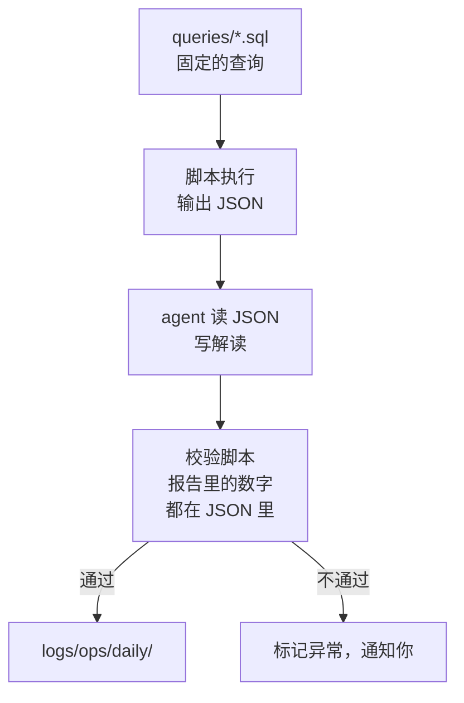
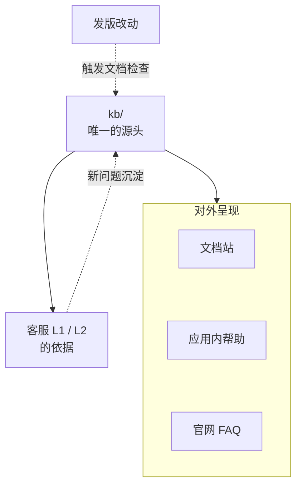

# 运营与内容

客服是用户找上门来；运营是你主动去看用户过得怎么样。在有团队的公司里，运营管着数据、用户成功、社群、版本发布的对外沟通、帮助文档，一人公司里这些活没人专门管，结果往往是：数据想起来才看，用户流失了才发现，更新日志三个版本没写，文档和产品早就对不上了。这一章把运营当成一个岗位来设计，核心原则只有一条：**数字和信号由代码算，agent 负责读懂它们、把它们变成文字和待办，人负责和用户的关系**。

## 运营岗管什么

| 职责 | 产出 | 放到第几级 |
|---|---|---|
| 指标监测 | 每日、每周的指标简报 | 1 只读诊断 |
| 用户跟进 | 今天该联系哪些用户、说什么 | 2 起草待审 |
| 版本沟通 | 更新日志、版本播报、应用商店的更新说明 | 2 起草，播报走 3 |
| 帮助文档 | 文档站、FAQ、应用内帮助 | 2 起草，机械修复走 4 |
| 社群 | 讨论摘要、公告草稿 | 1 摘要，2 起草 |
| 数据健康 | 埋点缺失、统计口径漂移 | 1 只读诊断 |

这里的「内容」指的是**围绕产品本身**的内容：文档、更新日志、公告。面向潜在用户的营销内容放在下一章。两者的区别在于读者：运营内容写给已经在用的人，目标是让他们用得好；营销内容写给还没用的人，目标是让他们来。

## 一个原则：数字不让模型算

运营岗处理大量数字，而模型在数字上的表现是不可靠的：它可能把 1,284 抄成 1,248，可能把环比算错，可能在没有数据的地方「合理推测」一个数。所以运营岗有一条硬规矩：

> **报告里的每一个数字，都来自一条确定的查询；agent 只负责解释，不负责计算。**

落到实现上：



查询写成 SQL 文件放进公司仓库，口径改了有 Git 记录。脚本跑查询、把结果存成 JSON，agent 读 JSON 写解读。最后一个校验脚本把报告里出现的所有数字抽出来，和 JSON 里的值核对，对不上就不发。这个校验写起来不难，却把「模型抄错数字」这一整类错误挡在了外面。

hatch-counter 的后台在设计运营分析时有一条类似的规矩：每个数都先算出「是哪几家店」再数个数，点开的名单走同一段代码按同一个桶筛。理由写得很直白：卡片上说 5、名单里列 4 家，是最招人问的那种界面。数字和名单同源，数字和解读也要同源。

## 工作流一：指标简报

每天早上一份简报，每周一份周报。简报的格式要让你三十秒看完：

```text
读 data/daily/2026-11-02.json，这是今天的指标查询结果。只读。

写 logs/ops/daily/2026-11-02.md：
- 第一行：「一切正常」或「需要关注：N 项」
- 关键指标一行一个：名称、今天、七天均值、变化方向
- 只有变化超出 data/thresholds.json 里阈值的指标才写解读，每条不超过两句
- 解读只能引用 JSON 里的数字和 logs/ 里的发版、事故记录，不要猜测原因；
  原因不明就写「原因不明，建议查看 ×××」

不要在报告里写任何 JSON 中不存在的数字。
```

几个设计上的考虑：

- **阈值由你定，写在文件里**。什么算异常是业务判断，不能让 agent 每天自己决定
- **解读只能引用已有的记录**。「注册数下降可能是因为周末」这类猜测没有价值；「注册数下降，昨天 22:10 有一次发版（见 logs/release/）」才有价值，它把你引向一个可以验证的方向
- **正常时一行就够**。大部分日子的简报应该是「一切正常」加几行数字，让你安心地去干别的

要看哪些指标、怎么埋点、留存和漏斗怎么算，是[《数据分析与埋点》](../product-analytics/)的内容。运营岗只是把那本书里搭好的指标体系接上了一个每天读它的 agent。

## 工作流二：用户跟进

用户跟进是运营岗里最有价值、也最容易被忽视的工作：在用户流失之前发现他，在用户卡住时拉他一把。

hatch-counter 的管理后台有一个「今日待办」页，是这件事的一个完整样本。它按急缓把门店分成四档，一家店一张卡：

| 档 | 信号（由代码算出） |
|---|---|
| 登不进来 / 用不了 | 停用、到期后还在点被拦的，登录没成功的，版本太旧被挡住的 |
| 用着出错 | 一天里撞上的报错、识别没成、导入没成 |
| 账不对 | 体检出来的漏导、负库存、哪几个月没记开支，只摆这一周新冒出来或变严重的 |
| 要跟进 | 快到期或已过期、开通 14 天还没录过数据、上周常用这周没开 |

注意两个细节。第一，这些信号**全部由后端代码计算**，是确定的规则，不是模型的判断。第二，「账不对」那一档只摆本周新出现或变严重的问题，老问题沉到门店详情里，「不然这一档永远满屏」。一个永远满屏的待办列表等于没有待办列表。

在这个基础上，agent 能做的是把每张卡变成一次可以执行的联系：

```text
读 data/today.json（今日待办的导出）和 kb/。只读。

对「要跟进」和「账不对」两档的每一家店，写一张跟进卡到 outbox/ops/followup/：
- 一句话：这家店卡在哪
- 建议的联系方式：电话或消息（停用、到期类一律电话）
- 开场的两三句话：说清你看到了什么、能帮什么，不要推销
- 如果有 kb 里的操作说明能直接解决，附上位置

不要承诺任何折扣、延期或新功能。
```

打电话的是你。agent 把「今天该给谁打、打过去说什么」准备好，你只需要拿起电话。打完记一句说了什么、过几天再看，这条记录回到用户档案里，下次的跟进卡会读到它。

为什么不让 agent 直接发消息？因为跟进的价值恰恰在于「是一个真人在关心我」。一条模板味很重的自动消息，效果可能比不发还差。这一点和客服的 L1 不同：L1 回答的是用户主动问的问题，用户要的是答案；跟进是你主动找用户，用户感受到的是态度。

## 工作流三：更新日志与版本播报

每次发版，用户应该知道多了什么、改了什么。这件事人人都知道该做，但很少有人坚持做，因为把提交记录翻译成用户能懂的话很烦。这正是 agent 擅长的。

前提是提交信息本身写得好。hatch-counter 的提交规范要求写「改完之后是什么样」，而不是「改了哪个文件」：

```text
feat: 后台员工管理能给别人重置密码：随机生成一串、只给看一次，旧密码和他所有的登录当场作废
fix: 配方管理跳下一道的快捷键按平台认：Mac 只认 ⌘↵，Windows 只认 Ctrl+↵
```

它的更新日志按路径收集提交：碰了哪个 app 的目录就进那个 app 的日志，`chore:` 不收，发版时播进用户群里。所以只给开发者看的改动要用 `chore:`，否则会被播出去。

有了这样的提交记录，更新日志工作流很简单：

1. **收集**：脚本按路径和前缀筛出这个版本给用户看的提交
2. **改写**：agent 把它们改写成面向用户的语言，按「新增 / 改进 / 修复」分组，合并相关的条目，去掉技术细节
3. **审阅**：你看一遍，重点检查有没有把还没准备好宣传的东西写进去
4. **播报**：批准后由脚本发到各个渠道：用户群、应用内公告、应用商店的更新说明

第 4 步是第 3 级白名单执行：渠道是固定的几个，内容是你批准过的那一份，脚本只负责搬运。

把提交信息写给用户看，还有一个副作用：编码 agent 写提交信息时会遵守 CLAUDE.md 里的这条规范，于是研发岗的产出天然就是运营岗的输入。岗位之间的接口，就是这样一份一份的约定。

## 工作流四：文档维护

帮助文档有两种腐烂方式：**内容过时**（产品改了，文档没改）和**结构损坏**（链接断了、目录页漏了新页面）。两种分开处理：

| 问题 | 检测 | 修复 | 级别 |
|---|---|---|---|
| 断链、目录页缺项 | 脚本检查 | agent 直接修，检查通过即提交 | 4 |
| 截图、按钮名过时 | agent 对比代码里的界面文案和文档 | 起草修改，走 PR | 2 |
| 功能说明过时 | 发版时 agent 对比本次改动涉及的文档 | 起草修改，走 PR | 2 |
| 新功能缺文档 | 需求卡合并时检查 | 起草新页面，走 PR | 2 |

hatch-counter 把文档目录页和断链检查放进了 `pnpm test`，和代码测试一起跑。这让结构类问题有了一个确定的检查器，agent 修完跑一遍测试就知道对不对，可以放到第 4 级。内容类问题没有这样的检查器，「文档说的和产品做的是否一致」需要理解，只能起草待审。

### kb 是所有内容的源头

客服用的 `kb/`、文档站、应用内帮助、FAQ 页面，最好是**同一份内容的不同呈现**，而不是四份各自维护的文档：



hatch-counter 的文档站就是把仓库里的 `docs/` 渲染成站，使用手册和开发文档在同一个仓库里，改代码时顺手改文档、agent 读代码时顺手读文档。源头只有一份，客服岗沉淀的新问题和研发岗的发版改动都流回同一个地方，内容才不会分叉。

## 社群

用户群是一人公司很重要的渠道，但也是最难自动化的：个人微信通常没有官方接口，而且群里的气氛高度依赖「群主是一个真人」。

agent 在社群里能做的事有限，但有用：

- **每日摘要**：你把群聊记录导出或复制进 `inbox/community/`，agent 整理出提问、抱怨、功能建议、需要回应的消息，问题转进客服流程，建议进产品待办
- **公告起草**：版本播报、停机维护通知、活动说明，起草后你发
- **识别需要你出面的时刻**：有人情绪激动、有人反复问同一个问题没人回、有人在群里发了别人的个人信息

不要用任何非官方手段让 agent 自动在群里发言。除了平台规则的风险，一个被发现是机器人在说话的群主，会失去这个群最核心的价值。社群怎么运营，见[《获客与增长》第 4 章](../growth-marketing/04-community.md)。

## 人留着什么

运营岗交出去的是读数、整理、起草、搬运。留在你手里的是：

- **和用户的关系**：电话、一对一的消息、群里的出面
- **看完数之后的判断**：这个下降要不要管、这个功能要不要砍
- **阈值和口径**：什么算异常、指标怎么定义
- **对外的措辞**：每一条播出去的更新、每一份公告

## 去哪里深入

| 想深入的方面 | 读什么 |
|---|---|
| 指标、埋点、留存、漏斗 | 《数据分析与埋点》 |
| 从反馈到迭代 | [《产品思维》](../product-thinking/) |
| 文档和更新日志的文字 | [《文案与内容》](../copywriting-content/) |
| 社群与留存 | [《获客与增长》](../growth-marketing/)第 4、7 章 |
| 线上状况的监测 | [《可观测性与性能》](../observability-performance/) |

## 本章要点

- 运营岗的分工：数字和信号由代码算，agent 读懂并写成文字和待办，人负责和用户的关系
- 报告里的每个数字都来自确定的查询，用校验脚本核对报告和查询结果
- 简报的阈值由你写在文件里；解读只能引用已有记录，不猜原因；正常时一行就够
- 用户跟进的信号由后端规则计算，只摆新出现的问题；agent 准备跟进卡，打电话的是你
- 提交信息写「改完之后是什么样」，研发的产出就成了更新日志的输入；播报由脚本搬运批准过的内容
- 文档的结构问题有检查器可以放到第 4 级，内容问题只能起草待审
- kb 是客服、文档、帮助、FAQ 的唯一源头
- 社群里 agent 只做摘要和起草，不代替你发言
