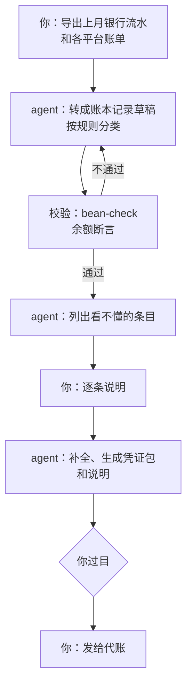

# 财务与行政

财务与行政是一人公司里频率最低、后果最重的岗位。一个月只碰几次，但每一次都涉及钱、税、证照和合同：记错一笔账，月底对不上；漏了一个年报期限，可能影响主体状态；没注意一个合同的自动续约条款，多付一年钱。这个岗位的活大多枯燥、格式固定，非常适合 agent 做，但它的定位必须清楚：**agent 是整理员和提醒员，不是出纳，也不是税务顾问**。这一章讲清这个岗位的边界，再给出月结、收款核对、支出巡检、行政日历四条工作流。

## 财务与行政岗管什么

| 职责 | 产出 | 放到第几级 |
|---|---|---|
| 管理账 | 按月更新的账本 | 2 起草待审，校验通过才合并 |
| 凭证与发票 | 归档好的票据、给代账的凭证包 | 3 按规则重命名归档 |
| 收款核对 | 订单和到账的匹配结果 | 2 提议匹配，你确认 |
| 现金流 | 跑道测算、下季度预测 | 1 只读诊断 |
| 支出巡检 | 订阅和云服务的清单与建议 | 1 只读诊断 |
| 行政日历 | 年报、续费、合同、备案的到期提醒 | 提醒由脚本做，agent 负责录入 |
| 合同 | 关键条款摘要、异常条款标注 | 1 只读诊断 |
| 付款、报税、签约 | 钱和法律效力 | 不放权 |

最后一行要单独强调：**付款、报税、签约，agent 一样都不碰**。不是它做不到，而是这三件事的出错代价不可逆，而且有法律后果，责任只能由你承担。

## 三条底线

[《财务与税务》第 6 章](../opc-finance/06-tools-and-bookkeeper.md)讲「让 agent 帮你整理」时定了几条底线，这里不重复细节，只把它们提升为岗位卡的硬规则：

```markdown
---
role: finance
reads: [finance/in/, finance/out/, finance/ledger/, admin/]
writes: [finance/ledger/, finance/drafts/, logs/finance/]
never:
  - 接触网银、电子税务局、支付平台后台的登录凭据
  - 修改 finance/in/ 和 finance/out/ 里的原始文件
  - 对「能不能扣除」「该交多少税」给出结论
  - 在任何输出里写入银行卡号、身份证号、税号
escalate: 第一行写「需要老板」
---
```

一句话概括：**agent 只处理你导出给它的文件，只产出草稿和清单，税务判断以代账和税务机关为准**。税种、申报期限、发票规则会变，具体以最新的官方规定为准，这一点在这个岗位上比任何地方都重要。

## 工作流一：月结

月结是财务岗最核心的一条工作流，每月初跑一次。它的目标是两个产出：一份更新好的管理账，一个可以直接交给代账的凭证包。



### 让检查器先说话

月结里最好用的检查器是**余额断言**。《财务与税务》第 6 章用 Beancount 记管理账，它支持在账本里写一行断言：某天某个账户的余额应该是多少。

```text
2026-11-01 balance Assets:Bank:Company     48210.35 CNY
2026-11-01 balance Assets:Alipay:Company    3120.00 CNY
```

断言里的数字由你从银行和平台的后台抄过来（这一步不要让 agent 做，它没有、也不该有登录权限）。agent 把上个月的流水转成记录后，跑一遍 `bean-check`：如果它漏了一笔、重复了一笔、正负号写反了，余额断言就会失败。这把「月底对不上」从你肉眼核对几百行，变成了一条命令的结果。

agent 的任务 prompt 里要写明：**断言失败时，找出原因并修正记录，不允许修改断言本身**。断言是外部的真相，记录才是要被修正的东西。

### 看不懂的条目问你

每个月总有一些流水看不出用途：一笔没有备注的转账、一个陌生商户名的扣款。agent 不要猜，而是列成清单：

```markdown
# 2026-10 需要说明的条目

| 日期 | 金额 | 对方 | 我的猜测 | 需要你说明 |
|---|---|---|---|---|
| 10-12 | -199.00 | ××科技 | 可能是某个 SaaS 年费 | 是什么服务？公司还是个人？ |
| 10-23 | +2000.00 | 个人转账 | 可能是客户线下付款 | 对应哪个订单？ |
| 10-28 | -36.50 | 某便利店 | 不确定 | 是否与经营有关？ |
```

你花五分钟填完这张表，agent 补全记录，同时把你的说明沉淀成分类规则（比如「××科技的扣款归为 Expenses:Software」），下个月同一个商户就不会再问。

### 凭证包

给代账的凭证包按代账公司的要求整理：哪些票据、怎么命名、附什么说明。《财务与税务》第 6 章有凭证包的结构，把它写进 `prompts/finance-monthly.md`，agent 每月照着生成。发给代账这一步由你做，顺便过目一遍。

## 工作流二：收款核对

如果你的产品有线下转账、对公汇款这类不经过支付平台自动回调的收款方式，就需要有人把「到账的钱」和「待付的订单」对上。

hatch-counter 目前就是这样：订单、收款确认、到期提醒都在管理后台，钱是线下转账，由人在后台确认收款，确认之后门店的到期日才会延长。这一步如果漏了，客户付了钱却被拦在门外，是最伤信任的事故之一。

agent 在这里能做的是**提议匹配**：

```text
读 finance/in/2026-11/ 下的银行流水导出，和 data/orders-pending.json（待确认收款的订单）。只读。

对每一笔入账，按以下顺序尝试匹配订单：
1. 转账备注里包含订单号
2. 金额完全相等，且付款人名称与客户档案里的付款人一致
3. 金额完全相等，但付款人不一致：标记为「疑似」

输出 finance/drafts/match-2026-11-02.md：
- 确定匹配：订单号、金额、依据
- 疑似匹配：需要老板确认的理由
- 没有匹配的入账
- 超过 7 天仍未到账的待付订单

不要在后台执行任何确认操作。
```

确认收款由你在后台点。这一步会改变客户的状态（续期、开通），属于「动钱 + 对外承诺」，不放权。但 agent 把匹配做好之后，你的工作从「翻流水找订单」变成「核对一张清单、逐条点确认」，几十秒的事。

「超过 7 天仍未到账的待付订单」这一项会流向运营岗：这些客户可能需要一次礼貌的提醒，跟进卡由运营岗起草。

## 工作流三：支出巡检

一人公司的支出不多，但很散：几个 SaaS 订阅、域名、云服务器、对象存储、模型 API、开发者账号年费。散的支出最容易出现「早就不用了还在扣钱」。

每月让 agent 根据账本生成一份支出清单：

| 项目 | 月均 | 趋势 | 最近一次使用的证据 | 建议 |
|---|---|---|---|---|
| 模型 API | 按账本 | 上升 | 每日工作流在用 | 见第 8 章，按工作流拆分成本 |
| 某设计工具 | 按账本 | 持平 | 三个月内没有相关文件 | 考虑取消 |
| 云服务器 | 按账本 | 持平 | 线上服务在用 | 保留 |

「最近一次使用的证据」由 agent 去找：公司仓库的提交记录、服务器上的访问日志、你的文件。找不到证据的订阅就列为「考虑取消」。取消这个动作由你做，因为有些服务停掉之后数据就没了。

模型 API 的成本值得单独看。随着工作流越来越多，它会成为支出里增长最快的一项。第 8 章会讲怎么给每条工作流设预算、怎么把成本归到岗位上；模型调用成本的监控方法见[《LLM 应用上线》第 4 章](../llmops/04-cost-monitoring.md)，云和服务器的成本控制见[《一人运维手册》第 6 章](../production-ops/06-cost-control.md)。

## 工作流四：行政日历

行政事务的特点是**很久才一次，一忘就麻烦**：主体的年报、域名续费、开发者账号年费、合同到期、备案信息变更、软件著作权和商标的各种期限。这些事项各自的规则和时间要求见[《国内合规实务》](../opc-compliance-cn/)和[《出海实务》](../going-global/)，具体以主管部门的最新规定为准。

这个工作流的分工很清楚：**提醒用确定性脚本，agent 只负责把新文件里的日期录进日历**。

日历是一份 JSON 文件：

```json
[
  {
    "id": "domain-main",
    "title": "主域名续费",
    "due": "2027-03-15",
    "remind_days": [30, 7, 1],
    "owner_action": "登录注册商后台续费，确认自动续费是否开启",
    "source": "注册商后台截图 admin/docs/domain-2026.png"
  },
  {
    "id": "annual-report-2026",
    "title": "主体年度报告",
    "due": "2027-06-30",
    "remind_days": [60, 14, 3],
    "owner_action": "在主管部门的系统里填报，具体时间以当年通知为准",
    "source": "《国内合规实务》第 2 章"
  }
]
```

提醒脚本每天跑一次，不调用模型：

```ts
// bin/deadlines.ts —— 每天由定时任务运行，Node 22.18+ 可直接 node bin/deadlines.ts
import { readFileSync } from "node:fs";

interface Deadline {
  id: string;
  title: string;
  due: string; // YYYY-MM-DD
  remind_days: number[];
  owner_action: string;
}

const items: Deadline[] = JSON.parse(readFileSync("admin/deadlines.json", "utf8"));
// 按本地日期算「今天」，统一换成 UTC 零点再相减，避免时区让天数差一天
const now = new Date();
const today = Date.UTC(now.getFullYear(), now.getMonth(), now.getDate());
const DAY = 24 * 60 * 60 * 1000;

const hits = items
  .map((d) => ({ ...d, left: Math.round((Date.parse(d.due) - today) / DAY) })) // "YYYY-MM-DD" 按 UTC 零点解析
  .filter((d) => d.left < 0 || d.remind_days.includes(d.left));

if (hits.length === 0) {
  console.log("一切正常");
} else {
  console.log(`需要处理：${hits.length} 项`);
  for (const d of hits) {
    const when = d.left < 0 ? `已过期 ${-d.left} 天` : `还剩 ${d.left} 天`;
    console.log(`- ${d.title}（${d.due}，${when}）：${d.owner_action}`);
  }
}
```

为什么提醒不用 agent？因为提醒这件事没有任何需要判断的地方，而它的可靠性要求极高。一个确定性脚本几年都不会出错，一个 agent 某天可能因为模型服务不可用、上下文理解偏差而漏掉一条。**能用脚本的地方不用模型**，这条原则在财务岗比在任何地方都适用。

输出的第一行遵循「一切正常 / 需要处理」的约定，包装脚本用 `grep` 决定要不要通知你，这是[《个人 Agent 工作流》第 4 章](../personal-agent-workflow/04-scheduled-tasks.md)的做法。

agent 的角色在日历的入口：你收到一份新合同、一张新的证照、一封续费通知邮件，丢进 `inbox/admin/`，agent 读出里面的关键日期，起草新的日历条目，你确认后合并。

## 合同与票据：识别 + 人来拍板

合同和票据都是「从非结构化文件里抽出结构化信息」的活，agent 做得很好，但抽错的代价不低。它们共用一个模式：**识别结果分成「确定」和「不确定」，不确定的停下来等人**。

hatch-counter 的进货单识别是这个模式的样本：手写的进货单拍一张照片，视觉模型逐行识别出品名、数量、单位、金额；认不准的那一行（比如「生抽 2 桶」到底是几斤）停下来等店主拍板，没拍板之前「确认补仓」的按钮按不了。项目的规矩是「数据对不上、名字认不出这类情况交给人拍板，列出来让用户选，不自动猜」。

把这个模式搬到财务岗：

| 文件 | agent 抽取 | 停下来等你的情况 |
|---|---|---|
| 发票 | 开票方、金额、税额、日期、抬头 | 抬头不是公司、金额和流水对不上 |
| 收据和小票 | 商户、金额、日期、用途 | 字迹不清、用途无法判断 |
| 合同 | 双方、金额、期限、续约、违约、管辖 | 自动续约、单方变更、不常见的责任条款 |

合同摘要要特别说明一点：agent 可以把合同和你常用的模板对比，标出不一样的条款，但它的输出不是法律意见。金额大、期限长、条款陌生的合同，请专业的律师看。

视觉模型识别票据的工程做法见[《多模态应用》](../multimodal-ai/)；识别准不准、怎么建测试集和评分器，[《评测与质量》](../llm-evals/)用的正是进货单识别这个案例。

## 和外部员工协作

财务与行政岗是外包最多的岗位：代账公司、律师、可能还有知识产权代理。他们是组织图上的「外部员工」，agent 的一大价值是让你和他们的协作更顺：

- **交给代账的材料**：凭证包按约定的格式每月准时生成
- **代账反馈的问题**：代账问「这笔是什么」，agent 先从账本和你的说明记录里找答案，找到了起草回复，你过目后发
- **交给律师的材料**：合同摘要、异常条款清单、你的问题，让律师按小时计费的时间花在判断上，而不是读材料上

怎么选代账、合同里写什么、月度怎么配合，见《财务与税务》第 6 章。

## 人留着什么

- **所有动钱的操作**：付款、退款、转账、确认收款
- **所有有法律效力的操作**：报税、签约、年报填报、备案提交
- **所有登录凭据**：网银、电子税务局、支付平台、注册商后台
- **税务和法律判断**：以代账、律师和主管部门为准
- **余额断言里的数字**：外部的真相由你从源头抄来

## 去哪里深入

| 想深入的方面 | 读什么 |
|---|---|
| 记账、税种、发票、现金流、代账 | [《财务与税务》](../opc-finance/) |
| 主体、备案、著作权、个人信息、生成式 AI 规定 | 《国内合规实务》 |
| 海外主体、收款、税务与汇款 | 《出海实务》 |
| 收费方式和退款 | [《定价与商业模式》](../pricing-monetization/) |
| 票据识别 | 《多模态应用》《评测与质量》 |

## 本章要点

- agent 是整理员和提醒员，不是出纳和税务顾问；付款、报税、签约一样不碰
- 岗位卡写死底线：不碰凭据、不改原始文件、不做税务判断、不输出敏感号码
- 月结用余额断言当检查器：断言来自你抄的外部真相，agent 只能改记录不能改断言
- 看不懂的流水列成清单问你，你的说明沉淀成下个月的分类规则
- 收款核对由 agent 提议匹配，确认收款这一改变客户状态的动作由你执行
- 支出巡检找「没有使用证据的订阅」，取消由你做；模型成本按工作流拆分
- 行政提醒用确定性脚本，agent 只负责把新文件里的日期录进日历
- 合同和票据识别分「确定」和「不确定」，不确定的停下来等人拍板
