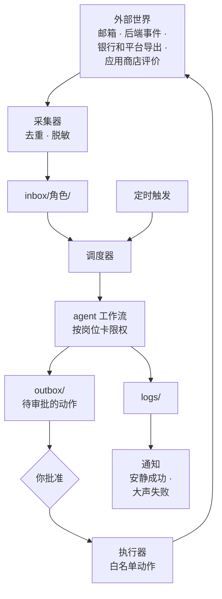
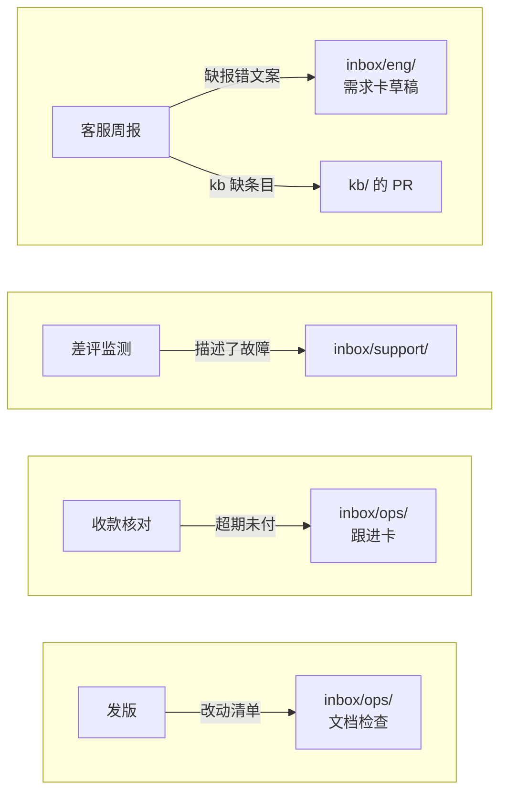

# 自动化流水线

前五章分岗位讲了十几条工作流：客服分类起草、指标简报、更新日志、月结、行政提醒……如果每条都是一个独立的定时任务、各自有一套采集逻辑、各自用不同的方式通知你，几个月后你会得到一团谁也理不清的脚本。这一章把它们收拢成一条流水线：**采集器把输入汇进 inbox，调度器按岗位运行工作流，产出进入审批队列，你批准后由执行器完成对外的动作**。整条流水线只用文件、脚本和系统自带的调度器，不引入新框架。

## 全景



图里有一条清晰的分界线：**agent 只在中间那一段工作**。它读 inbox、写 logs 和 outbox，和外部世界之间隔着两层：进来的路上有采集器做去重和脱敏，出去的路上有你的批准和执行器的白名单。agent 本身不持有任何外部系统的凭据。

这个形状不是为了好看，而是[《Agent 安全》](../agent-safety/)反复强调的那件事的落地：prompt 注入防不住，所以要在架构上保证，即使 agent 被一封邮件里藏着的指令操纵了，它能造成的最坏结果也只是在 outbox 里写一份奇怪的草稿。

## 组件一：采集器

每个外部来源一个采集脚本，职责很单一：

| 职责 | 为什么 |
|---|---|
| 拉取新内容 | 邮件、事件、评价，各自用官方接口或导出文件 |
| 去重 | 用来源自带的 ID 生成文件名，已存在就跳过，重复运行不会产生重复工单 |
| 脱敏 | 邮箱、手机号、姓名换成内部 ID，映射表单独存放，不进 Git |
| 补上下文 | 用户的套餐、版本、最近报错，从后端查好附上 |
| 落盘 | 写成带头部字段的 Markdown，放进对应岗位的 `inbox/` 子目录 |

采集器是**确定性的脚本，不调用模型**。它们是流水线里接触凭据最多的部分（邮箱密码、后端的只读令牌），所以要写得简单、可审查，凭据放在系统钥匙串或环境变量里。

| 来源 | 采集方式 | 进哪个 inbox |
|---|---|---|
| 客服邮箱 | IMAP 或邮件服务商的 API | `inbox/support/` |
| 应用内反馈 | 后端接口导出 | `inbox/support/` |
| 应用商店评价 | 平台提供的接口或导出 | `inbox/support/`、`inbox/marketing/` |
| 后端报错事件 | 监控系统的导出或 webhook 落盘 | `inbox/eng/` |
| 今日待办、指标 | 跑固定查询，存 JSON | `data/` |
| 银行和平台账单 | 你手动导出，放进目录 | `finance/in/` |
| 群聊记录、合同、通知 | 你手动放进来 | `inbox/community/`、`inbox/admin/` |

手动来源不丢人。银行流水、电子税务局这些地方，本来就不该给自动化脚本登录权限，每月花两分钟手动导出，比维护一个能登录网银的脚本安全得多。

## 组件二：调度器

调度器决定什么时候运行哪条工作流。最简单的实现是：**一个配置文件列出所有工作流，一个脚本每隔几分钟被系统调度器调用一次，检查哪些工作流该跑了**。

配置文件 `workflows.json`：

```json
[
  {
    "name": "support-triage",
    "role": "support",
    "inbox": "inbox/support",
    "prompt": "prompts/support-triage.md",
    "tools": ["Read", "Write(outbox/support/**)", "Write(logs/support/**)"],
    "max_turns": 20,
    "timeout_min": 10
  },
  {
    "name": "ops-daily",
    "role": "ops",
    "every_minutes": 1440,
    "prompt": "prompts/ops-daily.md",
    "tools": ["Read", "Write(logs/ops/**)"],
    "max_turns": 15,
    "timeout_min": 10
  }
]
```

两种触发方式：有 `inbox` 的，inbox 里有新文件就跑；有 `every_minutes` 的，按间隔跑。`tools` 是这条工作流在非交互模式下被允许使用的工具，直接对应岗位卡里的 `reads` 和 `writes`。工具权限规则的写法以你所用版本的 Claude Code 文档为准。

调度脚本：

```ts
// bin/dispatch.ts —— 由 launchd / systemd timer 每 5 分钟调用一次
import { spawnSync } from "node:child_process";
import { existsSync, mkdirSync, readFileSync, readdirSync, renameSync, writeFileSync } from "node:fs";
import { join } from "node:path";

interface Workflow {
  name: string;
  role: string;
  inbox?: string;
  every_minutes?: number;
  prompt: string;
  tools: string[];
  max_turns: number;
  timeout_min: number;
}

const STATE = "logs/_state";
mkdirSync(STATE, { recursive: true });
mkdirSync("logs/runs", { recursive: true });

const workflows: Workflow[] = JSON.parse(readFileSync("workflows.json", "utf8"));

function pendingItems(w: Workflow): string[] {
  if (!w.inbox) return [];
  return readdirSync(w.inbox).filter((f) => f.endsWith(".md"));
}

function isDue(w: Workflow, items: string[]): boolean {
  if (w.inbox) return items.length > 0;
  const stamp = join(STATE, `${w.name}.last`);
  const last = existsSync(stamp) ? Number(readFileSync(stamp, "utf8")) : 0;
  return Date.now() - last >= (w.every_minutes ?? 60) * 60_000;
}

function notify(msg: string): void {
  // 接你自己的通知渠道；地址和令牌放在环境变量里，不写进仓库
  spawnSync("bin/notify.sh", [msg], { stdio: "inherit" });
}

for (const w of workflows) {
  const items = pendingItems(w);
  if (!isDue(w, items)) continue;

  // 只处理启动时就在的文件：运行期间新进来的，留给下一轮
  const task = readFileSync(w.prompt, "utf8") +
    (items.length ? `\n\n本次要处理的文件：\n${items.map((f) => `- ${w.inbox}/${f}`).join("\n")}` : "");

  const stamp = new Date().toISOString().replace(/[:.]/g, "-");
  const r = spawnSync(
    "claude",
    ["-p", task, "--output-format", "json", "--max-turns", String(w.max_turns), "--allowedTools", ...w.tools],
    { encoding: "utf8", timeout: w.timeout_min * 60_000 },
  );
  writeFileSync(`logs/runs/${w.name}-${stamp}.json`, r.stdout ?? "");

  if (r.error || r.status !== 0) {
    notify(`${w.name} 失败：${r.error?.message ?? `退出码 ${r.status}`}`);
    continue; // inbox 原样保留，下一轮重试
  }

  // 成功后才把处理过的文件移走，失败不会丢工单
  if (w.inbox) {
    mkdirSync(join(w.inbox, "_done"), { recursive: true });
    for (const f of items) renameSync(join(w.inbox, f), join(w.inbox, "_done", f));
  }
  writeFileSync(join(STATE, `${w.name}.last`), String(Date.now()));

  const result: string = JSON.parse(r.stdout).result ?? "";
  if (/^(需要老板|需要处理)/.test(result.trim())) notify(`${w.name}：${result.split("\n")[0]}`);
}
```

几个设计选择：

- **成功后才移走 inbox 文件**。agent 跑到一半超时了，工单还在原地，下一轮会再处理。代价是同一张工单可能被起草两次，但 outbox 里多一份草稿远比丢一张工单好
- **顺序执行，不并发**。一人公司的工作流数量不多，顺序跑完全够用，还省掉了并发带来的锁和竞争问题。整个调度脚本外面套一层锁，防止上一轮没跑完下一轮又起来，锁和超时的写法见[《个人 Agent 工作流》第 4 章](../personal-agent-workflow/04-scheduled-tasks.md)
- **通知只在两种情况下发**：失败，或者 agent 的输出以约定的词开头。其他时候安静

## 组件三：审批队列

审批队列是整条流水线的心脏。所有对外的动作，发邮件、发帖、播报、在后台改状态，都必须以文件的形式进入 `outbox/`，经你批准，再由执行器完成。

一个待审批的动作长这样（第 3 章客服草稿就是一例）：

```markdown
---
action: send_email
to_user: u_1842
ticket: 2026-11-02-0931-mail-7f3a
---

您好，
……
```

批准这一步有一个关键要求：**批准绑定的是确切的内容**。你批准了一封邮件，之后如果这个文件被改动了（被 agent 的下一轮运行覆盖、被你手滑改了一个字），这个批准就应该失效。做法是在批准时记下文件内容的哈希：

```ts
// bin/approve.ts —— 用法：node bin/approve.ts outbox/support/xxx.md
import { createHash } from "node:crypto";
import { mkdirSync, readFileSync, writeFileSync } from "node:fs";
import { dirname, join } from "node:path";
import { createInterface } from "node:readline/promises";

const file = process.argv[2];
const content = readFileSync(file);
console.log(content.toString("utf8"));

const rl = createInterface({ input: process.stdin, output: process.stdout });
const answer = await rl.question("\n批准执行以上动作？(y/N) ");
rl.close();

if (answer.trim().toLowerCase() === "y") {
  const sha256 = createHash("sha256").update(content).digest("hex");
  // 批准记录放在 agent 写不到的 approvals/ 下，路径和 outbox 里的文件一一对应
  const record = join("approvals", `${file}.json`);
  mkdirSync(dirname(record), { recursive: true });
  writeFileSync(record, JSON.stringify({ sha256, approvedAt: new Date().toISOString() }));
  console.log("已批准");
}
```

这几个脚本用了顶层 `await`，要以 ES 模块运行：公司仓库的 `package.json` 里写上 `"type": "module"`。

批准只能来自人，来自终端里你敲下的那个 `y`。agent 的工具权限里没有 `bin/approve.ts`，批准记录也放在 `approvals/` 这个 agent 没有写权限的目录里：如果和草稿放在同一个目录，`Write(outbox/support/**)` 这样的权限就等于允许 agent 自己批准自己。为什么批准要绑定参数、为什么批准不能来自 agent、确认界面该展示什么，[《Agent 安全》第 5 章](../agent-safety/05-human-in-the-loop.md)有完整的讨论。

审批的节奏建议固定：每天两次，比如上午开始工作前和下午收工前，一次把队列清空。你可以写一个小命令列出所有待审的文件，逐个过一遍。不要每来一份就处理一份，那样审批队列就失去了「把打断集中起来」的意义。

## 组件四：执行器

执行器读取已批准的动作，检查哈希，按动作类型调用对应的处理函数：

```ts
// bin/act.ts —— 定时运行，执行所有已批准且未执行的动作
import { createHash } from "node:crypto";
import { existsSync, readFileSync, readdirSync, writeFileSync } from "node:fs";
import { join } from "node:path";

type Meta = Record<string, string>;
type Handler = (meta: Meta, body: string) => Promise<string>;

// 白名单：只有这里列出的动作能被执行。新增一种动作 = 改这个文件 = 走 PR
const handlers: Record<string, Handler> = {
  send_email: async (meta, body) => {
    // 在这里把 meta.to_user 换回真实邮箱，调用邮件服务；凭据只在执行器的环境变量里
    return `sent to ${meta.to_user}`;
  },
  publish_post: async (meta, body) => {
    // 调用博客或邮件通讯服务的官方接口
    return `published ${meta.slug}`;
  },
};

function parse(md: string): { meta: Meta; body: string } {
  const m = md.match(/^---\n([\s\S]*?)\n---\n([\s\S]*)$/);
  if (!m) throw new Error("缺少头部字段");
  const meta: Meta = {};
  for (const line of m[1].split("\n")) {
    const i = line.indexOf(":");
    if (i > 0) meta[line.slice(0, i).trim()] = line.slice(i + 1).trim();
  }
  return { meta, body: m[2].trim() };
}

const files = readdirSync("outbox", { recursive: true, encoding: "utf8" })
  .filter((f) => f.endsWith(".md"))
  .map((f) => join("outbox", f));

for (const file of files) {
  const approval = join("approvals", `${file}.json`);
  if (!existsSync(approval) || existsSync(`${file}.done`)) continue;

  const content = readFileSync(file);
  const { sha256 } = JSON.parse(readFileSync(approval, "utf8"));
  if (createHash("sha256").update(content).digest("hex") !== sha256) {
    writeFileSync(`${file}.failed`, "批准后内容被改动，批准作废，需要重新审批");
    continue;
  }

  const { meta, body } = parse(content.toString("utf8"));
  const handler = handlers[meta.action];
  if (!handler) {
    writeFileSync(`${file}.failed`, `不在白名单里的动作：${meta.action}`);
    continue;
  }

  try {
    const result = await handler(meta, body);
    writeFileSync(`${file}.done`, JSON.stringify({ result, at: new Date().toISOString() }));
  } catch (e) {
    writeFileSync(`${file}.failed`, String(e)); // 有副作用的动作不自动重试，交给你判断
  }
}
```

执行器的三条规矩：

- **白名单**。只有 `handlers` 里列出的动作能执行。agent 在 outbox 里写一个 `action: delete_user`，执行器只会记一条「不在白名单里」
- **先记 done 再算完成，有 done 就跳过**。同一封邮件不会因为执行器重跑而发两遍
- **失败不自动重试**。发邮件失败了，可能是邮件服务挂了，也可能是其实发出去了只是响应超时。有副作用的动作重试之前需要人判断

执行器是流水线里唯一持有对外凭据的部分，它的代码要像生产代码一样对待：走 PR、有测试、改动要审。

## 岗位之间的接力

有了统一的 inbox 和 outbox，岗位之间的协作就变成了**一个工作流的产出写进另一个岗位的 inbox**：



接力的规则写在发起方的 prompt 里：「发现缺报错文案的工单，在 `inbox/eng/` 写一份需求卡草稿」。接收方的岗位卡里不需要知道它从哪来，它只看自己的 inbox。这样岗位之间是松耦合的，你可以随时调整某个岗位的内部实现而不影响别人。

注意不要形成环：A 写进 B 的 inbox，B 又写进 A 的 inbox，可能来回打转。每张跨岗位的单子带上 `from` 字段，接收方处理时如果发现要再转回去，就停下来交给你。

## 让流水线自己被监控

流水线最危险的故障是**静默停止**：调度器因为一次系统更新没再被拉起来，或者某个采集器的凭据过期了一直在失败，而你以为「没有通知就是一切正常」。

几个简单的防线：

- **心跳**。调度器每次运行都更新 `logs/_state/heartbeat`；另一个独立的检查（可以放在你的服务器监控里，也可以是手机上的一个提醒）在心跳超过一段时间没更新时报警
- **每条工作流的最后成功时间**。每天早上的简报里列出各工作流上次成功运行的时间，一眼看出谁掉队了
- **采集器的空结果告警**。一个通常每天有十几封邮件的邮箱连续两天采集到零封，多半不是用户突然都满意了，而是采集器坏了

hatch-counter 的后台在这一点上有一个好习惯：每晚的定时体检如果没跑过、没跑成、没跑完，「今日待办」那一档的档头会直接写出来，比如「昨晚的体检没跑成」加上原因。**自动化的状态本身就是需要展示的信息**，不能默认它一直在正常工作。

## 什么时候需要更重的方案

这套「文件 + 脚本 + 系统调度器」的流水线能撑很久，但有几种情况说明它到头了：

| 信号 | 说明 | 去哪里找答案 |
|---|---|---|
| 需要实时响应 webhook | 五分钟一轮的轮询不够快 | [《动手构建 Agent》第 7 章](../build-your-agent/07-deploy.md)，部署成常驻服务 |
| 工作流内部有多个必须按顺序完成的步骤 | 一次 agent 调用装不下，需要编排 | [《多 Agent 编排》第 4 章](../multi-agent/04-workflow-deterministic.md)，确定性编排 |
| 要在多台机器上运行 | 文件队列不再适用 | [《软件架构与系统设计》](../system-design/) |
| 模型调用量大、要多供应商降级 | 需要统一的网关 | [《LLM 应用上线》](../llmops/)第 1、2 章 |

在出现这些信号之前，不要提前引入消息队列、工作流引擎、agent 框架。一人公司最宝贵的是简单：出了问题，你能在十分钟内读懂整条流水线的每一个环节。

## 安全清单

把这一章的安全要点汇总成一份清单，每加一条新工作流对照一遍：

- agent 不持有任何外部系统的凭据；凭据只在采集器和执行器里
- 每条工作流的工具权限按岗位卡最小化，只读的工作流不给写权限
- inbox 里的所有内容都视为不可信输入，可能包含注入指令
- 对外动作一律经过 outbox，批准绑定内容哈希，批准只来自人，批准记录放在 agent 写不到的地方
- 执行器只认白名单动作，新增动作走 PR
- 有副作用的动作不自动重试
- 流水线有心跳，静默停止会被发现

更完整的 agent 安全设计清单见[《Agent 安全》第 7 章](../agent-safety/07-security-checklist.md)。

## 本章要点

- 流水线由采集器、调度器、审批队列、执行器四部分组成，只用文件、脚本和系统调度器
- agent 只在中间工作：读 inbox，写 logs 和 outbox，不持有外部凭据
- 采集器是确定性脚本，负责去重、脱敏、补上下文；手动导出的来源不必强行自动化
- 调度器按配置运行工作流，成功后才移走 inbox 文件，失败不丢工单
- 审批绑定内容哈希，内容一变批准作废；批准只能来自人，按固定节奏集中处理
- 执行器只执行白名单动作，有 done 就跳过，失败不自动重试
- 岗位之间的协作是一个工作流写进另一个岗位的 inbox，带上来源防止打转
- 流水线要有心跳和最后成功时间，防止静默停止
- 出现实时、多步编排、多机器的需求之前，不引入更重的方案
