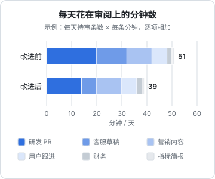

# 一个人的组织设计

搭好前几章的岗位和流水线之后，你的角色变了：从一个什么都自己干的开发者，变成了十几条工作流的管理者。管理者要面对的问题，和执行者完全不同：注意力怎么分配、节奏怎么定、怎么知道每个岗位干得好不好、钱花在哪、什么时候加一个岗位、什么时候砍掉一条工作流、自己病倒两周公司会怎样。这一章讨论这些问题。它们没有标准答案，但有一些可以算、可以照着做的框架。

## 老板只做四件事

在一家 AI 原生的一人公司里，你的工作可以收敛成四件事：

| 事 | 内容 | 不做会怎样 |
|---|---|---|
| 定方向 | 做什么产品、服务谁、主攻哪个渠道、这个季度的目标 | agent 很勤奋，但会勤奋地往错的方向跑 |
| 批准 | 审阅 outbox、合并 PR、确认收款 | 对外的动作停摆，或者你放弃审阅、风险失控 |
| 处理例外 | 「需要老板」的工单、失败的工作流、L3 的客诉 | 例外堆积，最终变成事故 |
| 改进系统 | 补 kb、改岗位卡、加检查器、调整放权级别 | 同样的错误反复出现，审阅负担只增不减 |

注意这四件事里没有「执行」。当你发现自己在亲手做某个岗位的执行工作时，问自己：这是一次性的例外，还是这个岗位的设计有缺口？如果是后者，花时间改进系统，而不是继续执行。

第四件事最容易被挤掉。批准和处理例外是被动的，有东西在队列里等着你；改进系统是主动的，不做也不会立刻出问题。但只有它能让前两件事变少。建议每周固定留出一段时间专门做它，比如周五下午。

## 注意力预算

第 1 章说过，AI 原生的一人公司，产能上限是老板的注意力。这个上限可以粗略地算出来。

每条工作流每天消耗你的审阅时间，大致是：

$$
T_i = r_i \times m_i
$$

其中 $r_i$ 是这条工作流每天产生多少需要你审阅的条目，$m_i$ 是每条平均花几分钟。所有工作流加起来，就是你每天花在审阅上的总时间 $T = \sum_i T_i$。

用一组示例数字算一遍（数字是假设的，换成你自己的）：

| 工作流 | 每天待审条数 | 每条分钟 | 改进前 | 改进措施 | 改进后 |
|---|---|---|---|---|---|
| 研发 PR | 2 | 10 → 7 | 20 | 评审 agent + 先审测试 | 14 |
| 客服草稿 | 8 → 4 | 1.5 | 12 | 一半问题升到 L1 | 6 |
| 营销内容 | 2 | 5 | 10 | 无 | 10 |
| 用户跟进 | 3 | 2 | 6 | 无 | 6 |
| 财务（月结摊到每天） | 1 | 2 | 2 | 无 | 2 |
| 指标简报 | 1 | 1 | 1 | 无 | 1 |
| 合计 | | | 51 | | 39 |



这个计算有几个用处：

- **给自己定一个上限**。比如每天审阅不超过一小时。总量接近上限时，不再新增工作流，先想办法降低现有的 $r_i$ 或 $m_i$
- **知道该优化哪一条**。上表里研发 PR 占了大头，优化它的收益最大；指标简报只占一分钟，再怎么优化也省不了多少
- **知道怎么优化**。降低 $r_i$：把一部分条目升级到无需审阅（客服 L1、文档断链自动修复），前提是有检查器兜底。降低 $m_i$：让每条更好审，草稿带出处、PR 带风险说明、评审 agent 先筛一遍

审阅时间之外，还有一项隐性成本：**上下文切换**。十条只需一分钟的审阅，如果分散在一天里的十个时刻，代价远大于集中在一起的十分钟。这就是第 7 章建议每天固定两个审批窗口的原因。注意力为什么是一人公司真正的瓶颈，《一人公司方法论》第 5 章有更多讨论。

## 节奏

把各岗位的工作流按频率排开，你就有了一份公司的运营节奏：

| 频率 | 你做什么 | 输入来自 |
|---|---|---|
| 每天早上 | 看简报（十分钟以内），清空审批队列 | 指标简报、各工作流的「需要老板」 |
| 每天下午 | 第二次清空审批队列 | outbox |
| 每周一 | 读各岗位周报，定本周最重要的一件事 | 客服周报、渠道数据、研发在途清单 |
| 每周五 | 改进系统：补 kb、改岗位卡、处理降级的工作流 | 本周的失败记录和你的修改记录 |
| 每月初 | 月结、渠道复盘、成本复盘 | 财务、营销、运行日志 |
| 每季度 | 修订方向和岗位卡，决定增减岗位 | 季度数据、你自己的判断 |

周复盘的模板和季度目标的定法，见《一人公司方法论》第 5 章。这里补充一点：周复盘时把各岗位的周报放在一起读，常常能发现单看一个岗位时看不到的关联，比如客服周报里某个功能的抱怨增多，和研发上周的一次发版、营销上周的一篇文章带来的新用户，可能是同一件事。

## 每个岗位看什么数

每个岗位选一两个数，每周看趋势。前几章已经分别讲过，这里汇总：

| 岗位 | 看什么 | 健康的趋势 |
|---|---|---|
| 研发 | 需求卡从批准到上线的天数；线上事故数 | 稳定或下降 |
| 客服 | 草稿采纳率；每百活跃用户的工单数 | 采纳率上升，工单数下降 |
| 运营与内容 | 跟进后的用户留存；文档检查发现的问题数 | 留存上升，问题数下降 |
| 营销 | 主攻渠道带来的注册；每篇内容的人均耗时 | 注册上升，耗时下降 |
| 财务与行政 | 月结耗时；遗漏的到期事项 | 耗时下降，遗漏为零 |
| 整个公司 | 每天审阅分钟数；模型和工具的月度成本 | 在预算内 |

这些数大部分可以由流水线自动统计。不要追求精确，追求的是趋势：如果某个岗位的数连续几周往坏的方向走，就是它需要你花「改进系统」时间的信号。

## 成本

随着工作流增多，模型调用会成为支出中增长最快的一项。管住它的办法和管住任何预算一样：**分摊到每条工作流，设上限，定期看**。

Claude Code 在 `--output-format json` 模式下会在结果里返回本次调用的花费字段（字段名以你所用版本的输出为准，常见的是 `total_cost_usd`）。第 7 章的调度器把每次运行的输出存在 `logs/runs/` 下，文件名带工作流名，月底汇总一下：

```bash
# 按工作流汇总上个月的模型花费
for wf in $(jq -r '.[].name' workflows.json); do
  total=$(cat logs/runs/"$wf"-2026-10-*.json 2>/dev/null \
    | jq -s 'map(.total_cost_usd // 0) | add // 0')
  printf '%-20s %8.2f\n' "$wf" "$total"
done
```

看这份汇总时关注三件事：

- **哪条工作流的单次花费异常高**。通常意味着它在原地打转：工具调用失败后反复重试、prompt 没说清楚停止条件。查它的运行记录，修 prompt 或工具
- **花费和价值是否匹配**。一条每月花费不低、但你已经三周没读过它产出的工作流，应该砍掉
- **能不能用便宜的模型**。分类、提取、格式转换这类任务，小模型通常够用；只有起草、推理才需要强模型。多模型路由的做法见《LLM 应用上线》

`--max-turns` 和超时是每条工作流的硬上限，写在 `workflows.json` 里。它们不是为了省钱，而是为了让「失控」有一个确定的边界。

## 岗位的增减

### 什么时候加一条工作流

一类工作满足下面三条，就值得为它建一条工作流：

1. **每周至少发生一次**。频率太低，搭建和维护的成本摊不薄。回本的算法见《个人 Agent 工作流》第 7 章
2. **输入能落成文件**。如果输入散落在你的脑子里或者某个无法导出的界面里，agent 接不住
3. **产出能被检查**。至少能做到「看一眼就知道对不对」，最好有脚本检查

三条里缺一条，就先别建。缺第 2 条，先想办法把输入落成文件；缺第 3 条，先想办法加一个检查器。这就是《个人 Agent 工作流》第 1 章说的「把活往左上角挪」。

### 什么时候砍掉一条工作流

- **三周没读过它的产出**。说明它不重要，或者它的产出形式不对
- **审阅时几乎每次都要重写**。说明它不适合交给 agent，或者岗位卡、kb 有大缺口；修不好就承认它应该由人主导
- **它服务的业务已经不存在了**。产品下线了一个功能，相关的监测和文档工作流要一起下线

维护一张所有工作流的清单（名称、岗位、触发方式、上次成功运行、月度花费、最近一次修改），每季度过一遍。清单的格式见《个人 Agent 工作流》第 7 章。

## 招人还是招 agent

一人公司不雇全职员工，但不等于不和人合作。有些工作交给人比交给 agent 更合适：

| 情况 | 例子 | 为什么交给人 |
|---|---|---|
| 需要资质和签字 | 代账、律师、专利代理 | 法律要求由有资质的人承担责任 |
| 需要在场 | 线下拜访客户、行业展会 | agent 无法到场 |
| 需要品味且无法验证 | 品牌视觉、产品插画 | 你自己没有判断力的领域，agent 的产出你也审不了 |
| 量大到超出审阅预算 | 客服量增长到每天上百封 | 一个兼职客服加上 agent 起草，比你一个人审更可持续 |

最后一种情况值得多说一句。当某个岗位的审阅量超出了你的预算，而且已经没有办法再降低 $r_i$ 和 $m_i$ 时，引入一个兼职的人来做审阅是合理的。这时你的流水线设计会体现出价值：岗位卡、kb、审批队列都是现成的，新人读一遍岗位卡就能上手，和 agent 读岗位卡是同一件事。**给 agent 写的文档，也是给未来的合作者写的。**

## 当你不在的时候

一人公司最大的风险是那一个人。生病、休假、家里有事，两周不在电脑前，公司会怎样？

### 休假模式

提前设计好一个「休假模式」，让流水线在你不在时有序降级：

| 岗位 | 休假模式下的行为 |
|---|---|
| 客服 | L1 照常；L2、L3 的工单发送一封**事先批准过的固定回复**，告知会在某日之后处理 |
| 研发 | 不合并、不发版；只读排障照常，严重故障按预案通知你 |
| 运营与内容 | 简报照常生成，但不通知；更新日志和播报暂停 |
| 营销 | 已批准的排期照常发布，或者全部暂停，事先决定 |
| 财务与行政 | 提醒照常，到期事项提前处理掉 |

「事先批准过的固定回复」是一个白名单动作：内容固定、你提前审过，执行器在休假模式下可以对 L2、L3 的新工单发送它。这是第 7 章审批机制的一个自然延伸：**批准可以提前给，只要它绑定的是确定的内容**。

休假模式本身是 `workflows.json` 里的一个开关，或者一份替代的配置文件。休假前切换，回来后切回，切换本身也写进日志。

### 如果我出事了

比休假更极端的情况，需要一份「如果我出事了」的文档，写给你信任的家人或朋友：

- 公司有哪些产品、多少付费用户、每月固定支出是多少
- 用户的数据在哪里，怎么导出交还给用户
- 代账公司、律师的联系方式
- 怎么停止所有自动扣费的服务、怎么暂停流水线
- 密码管理器的紧急访问怎么用（大多数密码管理器都提供紧急访问或遗产联系人一类的功能，具体以你所用产品为准）

这份文档不需要很长，但需要真实存在，并且每年更新一次。它对用户负责，也对你的家人负责。

## 别让自己退化

《AI 认知进阶》第 4 章讲过「自动化的反讽」：自动化程度越高，人越少亲手做，在需要介入的少数时刻就越不会做。一人公司的老板尤其要警惕这一点，因为你是唯一的后备。

几个实用的做法：

- **定期亲手干一天**。每个月挑一个岗位，关掉它的工作流，自己干一天：自己回客服邮件、自己写一篇文章、自己做一次月结。你会重新感受到用户的语气、发现 kb 里过时的条目、想起某个检查为什么重要
- **审阅时保持追问**。不要只看草稿对不对，偶尔问一句「为什么这么写」，让 agent 解释它的依据。依据站不住的时候，你会发现自己的判断力还在
- **核心能力不外包**。你的产品赖以成立的那项能力，无论是对某个行业的理解、某项技术的深度，还是写作的风格，要自己持续练习。agent 可以帮你练，但不能替你练

## 本章要点

- 老板只做四件事：定方向、批准、处理例外、改进系统；改进系统最容易被挤掉，要固定时间做
- 注意力预算 $T = \sum r_i \times m_i$：给自己定上限，优化占比最大的那条，降低条数或降低每条耗时
- 节奏分日、周、月、季，各有固定的输入和动作；审批集中在固定窗口
- 每个岗位一两个数看趋势，连续变坏就是需要改进系统的信号
- 模型成本按工作流分摊、设上限、每月汇总；三周没人读的工作流砍掉
- 新增工作流的三个条件：每周至少一次、输入能落成文件、产出能被检查
- 需要资质、需要在场、需要你没有的品味、量超出审阅预算时，交给人
- 设计休假模式让流水线有序降级；写一份「如果我出事了」的文档
- 定期亲手做每个岗位的活，防止自己在需要介入时已经不会做
