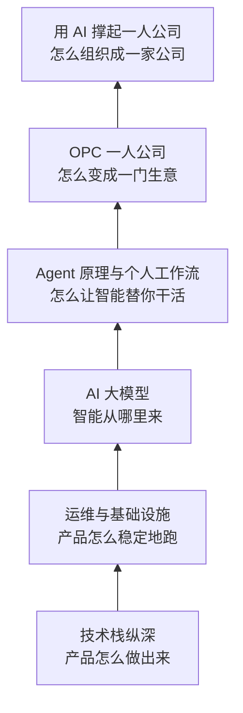
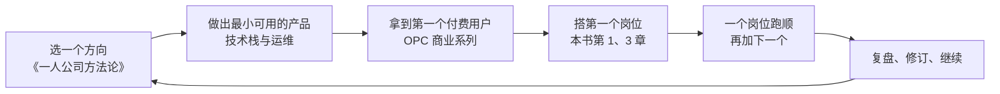

# 结语

这是这本书的最后一章，也是整个书架的最后一章。五十多本书，从神经网络讲到电子税务局，从 Fiber 树讲到退款政策，看起来是一堆互不相干的手艺。这一章把它们放回同一张图上，提炼出贯穿始终的几条原则，说说这套书本身是怎么来的、它会怎样过时，以及读完之后该做什么。

## 回看这套书

整套书分成五个系列，加上这一本收尾。它们恰好对应一家一人公司从下到上的几层：

| 系列 | 一句话 | 如果只记住一个观点 |
|---|---|---|
| 技术栈纵深 | 把你每天用的工具从「会用」读到「懂原理」 | 原理决定了出问题时你能不能自己查出来 |
| 运维与基础设施 | 一个人也能把线上管稳 | 备份没演练过就等于没有备份 |
| AI 大模型 | 模型是一个巨大的函数，应用是围绕它的工程 | 没有评测的 AI 功能，好坏全凭感觉 |
| Agent 原理与个人工作流 | agent 是一个循环，你的工作是给它规矩和闸门 | 错误不可避免，要让它可发现、可撤回 |
| OPC 一人公司 | 一个人做全部关键决策，靠杠杆交付价值 | 合规是一票否决项，不是事后补救项 |
| 本书 | 把手艺组织成岗位，把岗位交给 agent | 产能上限是你的注意力，不是工时 |

不需要读完所有的书。[《书架导读》](../reading-map/)里的阅读路线是一种建议，你眼前的问题才是最好的目录。但把它们放在一起看，会发现一些反复出现的东西。

## 贯穿始终的几条原则

### 文件即真相

hatch-shelf 的第一条设计原则是「书籍原文只存在文件里，数据库只存可以重建的索引」。这个原则在整套书里一再出现：[《个人 Agent 工作流》](../personal-agent-workflow/)用一个 Markdown 目录做知识库；[《财务与税务》](../opc-finance/)用纯文本记账；本书把整个公司放进一个 Git 仓库。

文件是人和 agent 都能读写的最朴素的接口。它可以被 diff、被回滚、被审计、被迁移到任何新工具里。当你不确定某样东西该存在哪里时，先问一句：能不能是一个文件？

### 先让它可验证，再让它自动

《个人 Agent 工作流》的任务四象限、[《Agent 安全》](../agent-safety/)的放权分级、[《评测与质量》](../llm-evals/)的「先写 eval 再改 prompt」、本书每个岗位的检查器，说的都是同一件事：**自动化的前提是验证**。一件事做对了没有，如果只能靠人看，它就只能停在「起草待审」；补上一个检查器，它才有资格往前走一步。

这条原则对代码、对内容、对财务都成立。`pnpm test`、`shelf-pack check`、`bean-check`、AI 腔检查脚本，是同一种东西在不同岗位上的样子。

### 能用脚本就不用模型

hatch-counter 的上线代理是一个 shell 脚本，行政提醒是一个几十行的 TypeScript 文件，运营报告里的数字来自固定的 SQL 查询。模型很强大，但它是概率性的；脚本很笨，但它是确定的。**需要判断的地方用模型，不需要判断的地方用脚本**，把两者的边界划清楚，系统才既聪明又可靠。

### 对外的承诺和钱留在人手里

从《Agent 安全》的人在回路，到本书每个岗位的「人留着什么」，有一条线从未松动：发出去收不回来的话、转出去收不回来的钱、有法律效力的签字，由你来做。这不是对 agent 能力的不信任，而是对责任归属的清醒认识。用户信任的是你这个人，这份信任不能委托。

### 写下「为什么」

hatch-counter 的现行文档在每条规矩旁边或页末写着「为什么这么定」，hatch-shelf 的 README 有一节决策记录，[《编码 Agent 实战》](../coding-agents/)反复强调规则文件要写原因。写下为什么，是为了让 agent 不提议推翻一个已经想清楚的决定，也是为了让三个月后的你不必重新想一遍。这套书本身也遵循这个原则：每一章都试图讲清「为什么」，而不只是「怎么做」。

### 保持简单

一人公司没有人帮你维护复杂的系统。本书的流水线只用文件、脚本和系统调度器；[《一人运维手册》](../production-ops/)的部署只用 Docker Compose 和 systemd；[《LLM 应用上线》](../llmops/)的网关是一层薄薄的 TypeScript。每次想引入一个新框架、新服务、新抽象时，先问：出了问题，我能在十分钟内读懂它吗？

## 这套书本身就是一个例子

坦白地说：你正在读的这些书，包括这一章，是由 agent 写出来的。

[《个人 Agent 工作流》第 5 章](../personal-agent-workflow/05-writing-books.md)和[《多 Agent 编排》第 8 章](../multi-agent/08-case-bookshelf.md)完整拆解过这套书的写作流程，这里只指出它和本书的对应关系：

| 本书的概念 | 在书架的写作中 |
|---|---|
| 公司仓库 | hatch-shelf 仓库里的 `books/` 目录 |
| 岗位卡 | 写书规范 `books/AGENTS.md` 和每批共用的简报 |
| 需求卡 | `ROADMAP.md` 里每本书的条目和大纲 |
| 检查器 | `shelf-pack check`，加上每张配图的渲染预览 |
| 审批队列 | 主会话统一审阅、更新进度、提交 |
| 改进系统 | 读者笔记导出到 `notes/`，作为下一次修订的输入 |

一个人规划书单、写规范、定简报、审阅产出，多个 agent 并行写作。这正是本书描述的那种组织：人定方向、写规则、守闸门，agent 执行。它也有本书提到的所有问题：审阅是瓶颈、事实可能出错、风格会漂移。书里每一处「以官方文档为准」「拿不准的地方讲原理」，都是对这些问题的防御。

所以，读这套书时请保持你在审阅 agent 产出时的那种警觉：**它大体可靠，但不保证每一句都对**。发现错误，记下来。

## 书会过时，原则不会

这套书写于 2026 年。其中有很多内容会过时：Expo 的 SDK 版本、Claude Code 的命令参数、各个平台的规则、税务和合规的具体流程。书里在这些地方都提醒过「以最新的官方文档为准」。

不会过时的，是那些原则：函数拟合的直觉、事件循环的模型、备份要演练、评测先行、错误要可撤回、合规一票否决、注意力是瓶颈。工具每年都在变，但用工具的方式变得很慢。

这个书架被设计成可以持续修订的。在手机上读的时候，高亮你觉得不对、不清楚、想展开的地方，写下你的想法，导出成读者笔记。下一次修订时，这些笔记是最优先的输入。更好的做法是，把你自己做产品的经历写回去：哪个建议在你的项目里不成立、哪个坑书里没提到。几年之后，这套书会变成一份你自己的、经过实践检验的知识库。

## 读完之后

如果你从第一本读到了这里，或者跳着读到了这里，接下来最重要的事情不是再读一本书，而是**去做**。

几条最后的建议：

- **从一个真实的问题开始**。不是为了用 agent 而用 agent，而是因为客服邮件真的把你淹没了，月结真的让你头疼了
- **小步走，留下资产**。每一条工作流、每一份岗位卡、每一条 kb 条目，都是可以复用的资产。它们会在你的下一个产品里继续工作
- **对用户诚实**。告诉他们你是一个人在做这个产品，告诉他们哪些回复有 AI 参与，出了错第一时间认错。一个人的公司，信任就是全部的护城河
- **照顾好自己**。你是这家公司唯一不可替代的部分。[《一人公司方法论》第 5 章](../opc-playbook/05-energy-rhythm.md)讲的精力与节奏，比任何技术都重要

[《一人公司方法论》](../opc-playbook/)开头给一人公司下过一个定义，它的目标一栏写的是「可持续的自由」。AI 没有改变这个目标，它改变的是通往这个目标的路：过去，一个人能做的事被工时限制；现在，一个人能做的事被判断力、责任心和注意力限制。前者很难突破，后者可以通过学习和设计不断扩展。

这正是这个书架想帮你做的事。

## 接下来读什么

这是整个书单的最后一本，但不是终点：

- 回到《书架导读》，按「按目标挑书」那张表，找到你眼下最需要的那几本，带着问题重读
- 书架上还有几本正在写：[《React Native 与 Expo》](../rn-expo/)[《Electron 桌面应用》](../electron-desktop/)[《NestJS 后端架构》](../nestjs-backend/)[《数据库原理与实战》](../database-practice/)[《软件架构与系统设计》](../system-design/)[《应用安全》](../app-security/)[《Kubernetes 入门到实战》](../kubernetes/)[《基础设施即代码》](../iac-gitops/)[《云与边缘》](../cloud-and-edge/)，它们补全的是技术栈纵深和基础设施的版图，写完后会出现在书架上
- 把你在本书第 1 章搭起来的公司仓库，当作你自己的下一本书来写

## 本章要点

- 五个系列对应一人公司从下到上的几层：做出来、跑稳、智能、让智能干活、变成生意，本书负责把它们组织起来
- 贯穿始终的原则：文件即真相；先可验证再自动；能用脚本不用模型；承诺和钱留在人手里；写下为什么；保持简单
- 这套书由 agent 写成，用的正是本书描述的组织方式；读它时保持审阅的警觉
- 版本和流程会过时，原则不会；用读者笔记和自己的实践持续修订
- 读完之后去做：从真实的问题开始，小步走，对用户诚实，照顾好自己
