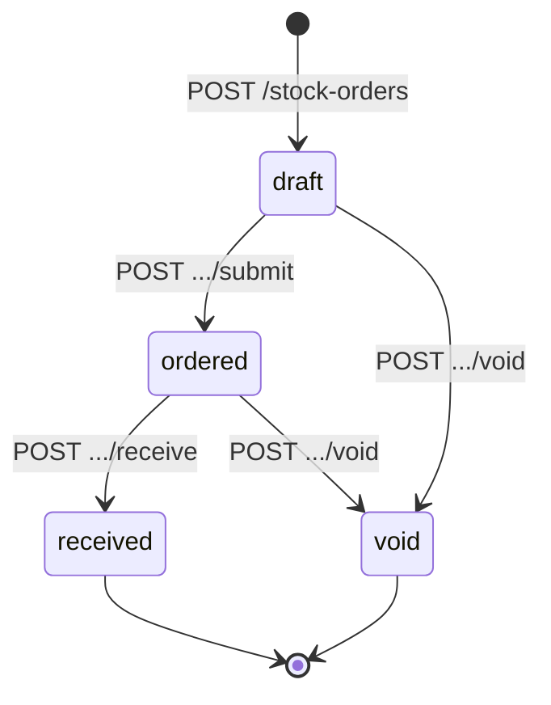

# 资源建模与 REST 风格

接口一旦有人用，就很难再改。数据库表结构写错了，一次迁移就能改过来；接口写错了，网页端可以当天发版，App 却有人三个月不升级，第三方集成的人甚至不知道你改了什么。所以 API 设计值得在写第一行代码之前多想十分钟。这一章先讲最基础的部分：把系统看成一组资源，用 HTTP 的方法和状态码表达对它们的操作，再定下字段、时间、金额、id 这些「小事」的统一写法。

## 你的接口给谁用

一人公司的后端，调用方通常就三类，它们对「改接口」的容忍度完全不同：

| 调用方 | 例子 | 发版节奏 | 改接口的代价 |
|---|---|---|---|
| 自己的网页端 | hatch-counter 的门店后台 | 和服务端同一天上线 | 低：一起部署就行 |
| 自己的 App | hatch-counter 的店员 App、recordwall 的手机端 | 审核 1–3 天，用户升级要几周到几个月 | 高：老版本会一直调旧接口 |
| 别人写的程序 | 门店接的收银系统、开放给用户的 Webhook | 你控制不了 | 最高：对方可能永远不改 |

这张表决定了本书后面很多取舍。只给自己网页端用的接口，可以随便改；只要有一个 App 版本在调，它就是一份要守住的契约，[第 4 章](04-versioning-evolution.md)专门讲怎么守。

## 资源，而不是动作

REST 风格的核心是：**URL 表示「东西」，HTTP 方法表示「对它做什么」**。对比两种写法：

| 动作式 | 资源式 |
|---|---|
| `POST /getExpenses` | `GET /expenses` |
| `POST /createExpense` | `POST /expenses` |
| `POST /updateExpense?id=42` | `PATCH /expenses/42` |
| `POST /deleteExpense` | `DELETE /expenses/42` |

资源式的好处不是「更优雅」，而是**HTTP 生态里的每一层都能看懂它**：

- 浏览器和 CDN 知道 GET 可以缓存、POST 不能
- nginx 的访问日志按路径一聚合，就能看出哪类资源最忙
- 客户端的重试库知道 GET、PUT、DELETE 可以安全重试，POST 不行
- 读接口文档的人看到 `DELETE /expenses/{id}` 不用再看说明

### 怎么找资源

从业务里的名词找起。hatch-counter 是门店管理，名词大概是：门店、员工、开支、补仓单、商品、库存、日报。每个名词一般对应两个 URL：

```text
GET    /expenses          列出开支
POST   /expenses          新增一笔
GET    /expenses/{id}     查看一笔
PATCH  /expenses/{id}     改一笔
DELETE /expenses/{id}     删一笔
```

几条约定：

- **集合用复数**：`/expenses` 而不是 `/expense`，整个 API 统一
- **路径用小写和连字符**：`/stock-orders`，不用驼峰，不用下划线
- **id 放路径，筛选条件放查询参数**：`/expenses?from=2026-11-01`，而不是 `/expenses/from/2026-11-01`
- **不带文件扩展名**：`/expenses.json` 是早年的习惯，格式交给 `Accept` 头

### 嵌套不超过一层

子资源可以挂在父资源下面：

```text
GET /stock-orders/{id}/lines      某张补仓单的明细行
```

但不要嵌套两层以上。`/stores/{sid}/stock-orders/{oid}/lines/{lid}` 看起来很「有结构」，实际上每个调用方都得先凑齐三个 id 才能操作一行明细。明细行有自己的 id，就直接给它一个顶层地址 `/stock-order-lines/{lid}`，或者干脆只允许通过补仓单整体修改。

### 租户放在令牌里，不放在路径里

多租户系统常见的写法是 `/stores/{storeId}/expenses`。hatch-counter 没有这样做：门店 id 从令牌里取，路径里只有 `/expenses`。原因有两个：

- **少一类越权漏洞**：路径里的 `storeId` 是客户端填的，服务端每次都要校验「这个人是不是这家店的」，漏一处就是 IDOR（详见[《应用安全》](../app-security/02-authorization.md#idor最常见的授权漏洞)）。从令牌里取，客户端根本没有机会填错
- **一个人同一时刻只在一家店里干活**：切换门店是换一个令牌，不是换一个 URL 前缀

反过来，管理后台要跨门店看数据，那里的路径就该带上门店 id，因为「看哪家店」本来就是参数。租户怎么渗透到每一层，见[《软件架构与系统设计》的多租户一章](../system-design/08-multi-tenancy.md)。

## 方法的语义

HTTP 方法不只是名字，它们带着两个承诺：**安全**（不改服务端状态）和**幂等**（做一次和做多次效果一样）。

| 方法 | 用途 | 安全 | 幂等 | 请求体 |
|---|---|---|---|---|
| GET | 读 | 是 | 是 | 无 |
| POST | 新建，或不好归类的操作 | 否 | **否** | 有 |
| PUT | 整体替换 | 否 | 是 | 有 |
| PATCH | 部分修改 | 否 | 看写法 | 有 |
| DELETE | 删除 | 否 | 是 | 一般无 |

这些承诺是给中间层和客户端看的。如果你写了一个 `GET /expenses/42/delete`，浏览器预取、爬虫、链接预览都可能悄悄把数据删掉。**GET 绝对不能改数据**，这是唯一一条没有例外的规则。

### PUT 还是 PATCH

PUT 的语义是「把这个资源整个换成我给的样子」，没给的字段应该被清空。实际项目里几乎没有客户端愿意每次都把整个对象发回来，所以大多数「修改」接口应该是 PATCH。

PATCH 的请求体有两种常见格式：

- **JSON Merge Patch**（RFC 7396，`application/merge-patch+json`）：给出要改的字段，`null` 表示删掉这个字段。简单直观，绝大多数场景够用
- **JSON Patch**（RFC 6902，`application/json-patch+json`）：一组 `add` / `remove` / `replace` 操作。能精确操作数组的某一项，但写起来繁琐

推荐默认用 Merge Patch 的语义，只是要提前想清楚 `null` 的含义：

```json
{ "note": null, "amount": 3200 }
```

这表示「备注清空、金额改成 32 元」，没出现的字段保持不变。服务端的校验 schema 要能区分「没传」和「传了 null」，用 zod 写就是：

```typescript
import { z } from "zod";

export const PatchExpense = z
  .object({
    amount: z.number().int().positive(),
    note: z.string().max(200).nullable(), // null = 清空
    paidAt: z.iso.datetime({ offset: true }),
  })
  .partial()                               // 每个字段都可以不传
  .strict()                                // 不认识的字段直接拒绝
  .refine((v) => Object.keys(v).length > 0, "至少改一个字段");
```

### 业务动作怎么表达

不是所有操作都能塞进增删改查。「作废一张补仓单」「把补仓单标记为已到货」「重发一次验证码」，这些是**有业务含义的状态迁移**，往往还带副作用（回滚库存、发通知）。

一种写法是 `PATCH /stock-orders/42 { "status": "void" }`。它的问题是把状态机藏在了一个普通字段后面：客户端以为可以随便改 `status`，服务端要在 PATCH 处理里写一堆「从什么状态能改到什么状态，改了要触发什么」。

更清楚的写法是把动作做成子资源，用 POST：

```text
POST /stock-orders/42/void        作废
POST /stock-orders/42/receive     到货入库
POST /verification-codes          重发验证码（新建一个验证码）
```

规则是：**能用名词表达的用名词，表达不了的业务动作用 `POST /资源/{id}/动词`**。`status` 字段在 PATCH 的 schema 里设成不可改，状态只能通过这些动作接口迁移。



这样状态机就写在了 API 的形状里，文档里一眼能看到「补仓单只能这么走」。

## 状态码：用一小组，用对

HTTP 有六十多个状态码，一个业务 API 常用的不超过十五个。下面这张是推荐的子集：

| 状态码 | 什么时候用 |
|---|---|
| 200 OK | 读成功；改成功并返回新内容 |
| 201 Created | 新建成功，回包是新资源，`Location` 头指向它 |
| 202 Accepted | 收下了，后台异步处理（如整店导出），回包给一个任务地址 |
| 204 No Content | 成功，没有回包（如删除） |
| 400 Bad Request | 请求格式或参数不对 |
| 401 Unauthorized | 没登录或令牌无效 |
| 403 Forbidden | 登录了，但不允许 |
| 404 Not Found | 不存在，或者存在但不让你知道 |
| 409 Conflict | 和当前状态冲突（重复、状态不允许） |
| 412 Precondition Failed | 条件请求的条件不满足（版本对不上） |
| 413 Content Too Large | 请求体太大 |
| 422 Unprocessable Content | 格式对，但业务上不成立 |
| 429 Too Many Requests | 被限流 |
| 500 Internal Server Error | 服务端的 bug |
| 503 Service Unavailable | 暂时不可用（维护、过载） |

400 和 422 的边界各家不一样。一个够用的划分：**schema 校验不过（缺字段、类型不对）回 400，schema 过了但业务规则不允许（日期前后反了、余额不够）回 422**。比划分本身更重要的是全 API 统一，并且客户端不靠这两个码做分支，具体原因要靠错误码，[第 2 章](02-errors.md)展开。

> [!IMPORTANT]
> 不要用 `200 { "ok": false }` 表示失败。所有 HTTP 中间层（监控、重试、缓存、日志告警）都只看状态码，失败回 200 会让它们全部失明。

## 回包的形状

### 不要给成功回包套信封

常见的「信封」写法：

```json
{ "code": 0, "msg": "success", "data": { "id": "exp_01J...", "amount": 3200 } }
```

信封里的 `code` 和 `msg` 与 HTTP 状态码重复，而且总有人在失败时也回 200，最后客户端要同时判断两处。推荐成功时**直接返回资源本身**：

```json
{ "id": "exp_01JC3Z8Q", "amount": 3200, "note": "买纸杯", "paidAt": "2026-11-03T09:12:00+08:00" }
```

列表是例外：它需要放分页信息，所以包一层对象，而不是裸数组：

```json
{ "items": [ /* ... */ ], "nextCursor": "eyJ0IjoiMjAyNi0xMS0wMyJ9" }
```

裸数组的问题是没有地方加东西。今天不分页，明天要加 `nextCursor` 就只能改成对象，那是一个破坏性变更。**列表从第一天起就用对象包着**，第 3 章会讲里面放什么。

### 新建要返回新资源

`POST /expenses` 成功后回 201，回包是完整的新资源（含服务端生成的 id、时间），并带上 `Location: /expenses/exp_01JC3Z8Q`。客户端拿到就能直接渲染，不用再 GET 一次。修改同理：PATCH 返回改完之后的完整资源，客户端以回包为准，而不是以自己发出去的为准。

## 字段的小事

这些规则单独看都很琐碎，但一旦不统一，每个客户端都要写一堆转换代码。在第一个接口上线前定下来，写进文档：

| 事项 | 推荐 | 理由 |
|---|---|---|
| 字段命名 | `camelCase` | 客户端是 TS，少一层转换；选了 `snake_case` 也行，但全 API 只能一种 |
| id | 字符串 | 数据库里的 `bigint` 超过 2^53 时 JS 会丢精度；字符串还能换生成方式而不改类型 |
| id 前缀 | `exp_`、`so_` 这样的类型前缀（可选） | 日志和工单里一眼看出是什么东西的 id，传错类型时能早报错 |
| 时间 | ISO 8601 带时区偏移：`2026-11-03T09:12:00+08:00` 或 UTC 的 `Z` | 只写 `2026-11-03 09:12` 谁也不知道是哪个时区 |
| 日期 | `2026-11-03` | 「营业日」这类概念本来就没有时区，不要硬转成时间戳 |
| 金额 | 整数，最小货币单位（分） | 浮点数加减会出 0.1 + 0.2 的问题；需要更高精度时用字符串 |
| 枚举 | 小写字符串：`"pending"` | 数字枚举在日志里没人看得懂，新增取值也容易撞 |
| 布尔 | 只有 true / false | 需要第三种状态时改成枚举，不要用 `null` 表示「未知」 |
| 空值 | 字段一律出现，没有值写 `null` | 客户端类型更简单：字段总在，只是可能为空 |

> [!NOTE]
> 时区的坑在门店系统里特别常见。「11 月 3 日的营业额」是按门店所在时区的那一天算的，不是 UTC 的那一天。接口参数里的「哪一天」用日期字符串，由服务端按门店时区换算成时间范围，不要让每个客户端各自换算。

## 案例：审视 hatch-shelf 的传书接口

hatch-shelf 是一个离线书架 App，打开「传书」后手机上会起一个局域网 HTTP 服务，电脑用浏览器或命令行把书推过来。它的接口是这样的：

| 方法 | 路径 | 说明 |
|---|---|---|
| GET | `/books` | 已有书的 id、标题、更新时间和内容指纹 |
| POST | `/upload` | 上传一本书的 zip |
| GET | `/cover/{id}` | 封面图 |
| GET | `/notes` | 阅读笔记 |
| GET | `/backup` | 阅读数据备份 |
| POST | `/restore` | 合并一份备份进来 |
| GET | `/ping` | 探活 |

回包统一是 `{ ok: boolean, error?: string, ... }`，鉴权是请求头 `X-Pin`。

用本章的标准看，它有不少「不 REST」的地方：`/upload` 和 `/restore` 是动词，成功回包套了 `ok` 信封。但这些选择在它的场景里**是合理的**：

- 调用方只有两个，一个是打包在 App 里的上传网页，一个是同仓库的命令行工具，它们和服务端永远同一个版本发布
- 服务跑在手机上，HTTP 解析是自己写的最小实现，接口越少越好
- 没有任何第三方会接入

如果有一天要把它开放出去，比如允许别人的工具往书架里推书，就该按资源重新整理：

```text
GET    /books               列出书（带 hash）
PUT    /books/{id}          上传或更新一本书（按 id 幂等，天然适合「推送」）
GET    /books/{id}/cover    封面
GET    /notes               笔记
GET    /backup              导出备份
POST   /backup/restore      合并备份（业务动作）
```

这里 `PUT /books/{id}` 比 `POST /upload` 更合适：同一本书推两次结果一样，客户端断网重试不用担心。这个例子想说明的是：**REST 风格是给「多方、长期」的接口准备的**。只有自己用、同步发布的内部接口，简单直接比形式正确更重要；但一旦要对外，就该按规矩来。

## 本章要点

- 先分清调用方：自己的网页端、自己的 App、别人的程序，改接口的代价依次升高
- URL 表示资源，方法表示操作；集合用复数、小写连字符，嵌套不超过一层
- 租户从令牌里取，不放在客户端可填的路径里
- GET 绝不改数据；修改默认用 PATCH（Merge Patch 语义），想清楚 `null` 表示什么
- 有副作用的状态迁移用 `POST /资源/{id}/动词`，状态字段不允许直接改
- 状态码用一小组、全 API 统一；失败绝不回 200
- 成功回包直接返回资源，列表从第一天起用对象包着；新建回 201 和完整资源
- 字段命名、id、时间、金额、枚举、空值的写法在第一个接口上线前定下来
