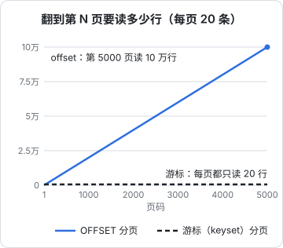

# 分页、过滤与排序

列表接口是 API 里最常被调用、也最容易随数据增长而变慢的一类。上线第一个月，一家门店的开支只有几十条，`GET /expenses` 直接全量返回毫无问题；一年后有几千条，App 打开开支页要转三秒；再过一年，某个大客户的数据让这个接口超时。这一章讲列表接口的三件事：怎么分页、怎么筛选、怎么排序，以及给离线 App 用的增量同步。

## 第一天就要分页

没有分页的列表接口，相当于在 API 里埋了一颗定时炸弹：

- 返回的数据量随时间无上限增长，回包大小、序列化时间、手机内存都跟着涨
- 某天想加分页时，老客户端不认识分页参数，只会拿到第一页，以为数据丢了

所以规则很简单：**任何返回集合的接口，从第一个版本起就要分页，并且有服务端强制的上限**。客户端不传 `limit` 时用默认值（比如 20），传了超过上限（比如 100）的值就截到上限，而不是报错或者照办。

回包从第一天起就是 `{ items, nextCursor }` 这样的对象，即使现在数据少到一页就能装下，`nextCursor` 永远是 `null`。理由在[第 1 章](01-resource-modeling.md)说过：裸数组没地方加东西。

## 两种分页

| | offset 分页 | 游标分页 |
|---|---|---|
| 参数 | `?page=3&pageSize=20` 或 `?offset=40&limit=20` | `?cursor=eyJ0Ijoi...&limit=20` |
| SQL | `LIMIT 20 OFFSET 40` | `WHERE (排序键) < (上一页最后一条) LIMIT 20` |
| 跳到第 N 页 | 能 | 不能，只能一页页往后翻 |
| 翻页越深越慢 | 是 | 否 |
| 翻页时有新数据插入 | 会重复或漏掉 | 不会 |
| 显示总页数 | 容易 | 要单独算总数 |
| 适合 | 管理后台的表格、数据量有上限的列表 | App 的无限滚动、同步、对外 API |

### offset 为什么越翻越慢

`LIMIT 20 OFFSET 99980` 的意思是「按顺序数出 99980 行扔掉，再取 20 行」。即使有索引，数据库也要沿着索引走过前面所有的行，没有办法直接跳到第 99981 行。所以翻到第 N 页的成本和 N 成正比：



对于一家门店几千条开支，这条线的右端永远到不了，offset 完全够用。但对于对外的 API，你控制不了调用方怎么翻：有人写个脚本从头翻到尾同步你的全部数据，后面每一页都比前一页慢。

### offset 还会重复和漏

更隐蔽的问题是数据在翻页过程中变化。用户在看按时间倒序的开支列表，看完第 1 页（第 1–20 条），这时店员新记了一笔。再请求第 2 页（`OFFSET 20`），原来的第 20 条被挤到了第 21 位，又出现了一次。反过来，如果中间删了一条，就会漏掉一条。

App 的无限滚动对此特别敏感：列表里出现两条一模一样的记录，用户会以为记重了。

## 游标分页（keyset）

游标分页的思路是：**不说「跳过多少条」，而说「从哪一条之后开始」**。上一页最后一条记录的排序键就是下一页的起点。

### SQL

按支付时间倒序列出开支。排序键只用 `paid_at` 不够，因为同一秒可能有多笔，必须加上唯一的 `id` 作为决胜键：

```sql
CREATE INDEX expenses_store_paid_at_id ON expenses (store_id, paid_at DESC, id DESC);

-- 第一页
SELECT id, amount, note, paid_at
FROM expenses
WHERE store_id = $1
ORDER BY paid_at DESC, id DESC
LIMIT 21;

-- 后续页：$2、$3 是上一页最后一条的 paid_at 和 id
SELECT id, amount, note, paid_at
FROM expenses
WHERE store_id = $1
  AND (paid_at, id) < ($2, $3)
ORDER BY paid_at DESC, id DESC
LIMIT 21;
```

几个要点：

- **行比较** `(paid_at, id) < ($2, $3)` 是 Postgres 支持的元组比较，语义是「先比 paid_at，相等再比 id」，能直接用上面那个复合索引
- **多取一条**：要 20 条就取 21 条。取到 21 条说明还有下一页，把第 21 条扔掉，用第 20 条生成游标；取不到 21 条说明到底了，`nextCursor` 返回 `null`。这样不用额外查一次「还有没有」
- 排序方向混合时（如 `paid_at DESC, id ASC`），元组比较就不成立了，要展开成 `paid_at < $2 OR (paid_at = $2 AND id > $3)`，索引也要按同样的方向建。最省事的办法是让决胜键和主排序键同方向

### 游标是不透明的

游标里装的是排序键的值，但不要让客户端知道这一点。把它编码成一个不透明的字符串：

```typescript
import { z } from "zod";

const CursorBody = z.object({
  v: z.literal(1),                 // 游标格式版本，改格式时能认出旧游标
  s: z.string(),                   // 排序方式，防止换了排序还拿旧游标
  k: z.tuple([z.string(), z.string()]), // 排序键：[paidAt, id]
});
type CursorBody = z.infer<typeof CursorBody>;

export const encodeCursor = (c: CursorBody) =>
  Buffer.from(JSON.stringify(c)).toString("base64url");

export function decodeCursor(raw: string, sort: string): CursorBody {
  let parsed: unknown;
  try {
    parsed = JSON.parse(Buffer.from(raw, "base64url").toString("utf8"));
  } catch {
    throw new ApiProblem("invalid_input", "翻页参数无效，请从第一页重新加载");
  }
  const c = CursorBody.safeParse(parsed);
  if (!c.success || c.data.s !== sort) {
    throw new ApiProblem("invalid_input", "翻页参数无效，请从第一页重新加载");
  }
  return c.data;
}
```

不透明的好处是**服务端可以随时改游标的内部结构**：今天按 `[paid_at, id]`，明天加一个字段，客户端代码一行都不用改。文档里要写明「游标是不透明字符串，不要解析、不要拼接、不要持久保存」。

游标不需要签名或加密：它只是查询起点，里面的值会经过 schema 校验，然后作为 SQL 参数传入，客户端伪造一个游标最多只能从另一个位置开始翻**自己有权看的数据**（租户条件在 SQL 里，不在游标里）。如果游标里放了不该让用户看到的东西，那是设计错误，不是加密能解决的。

### 服务端的完整实现

```typescript
type Page<T> = { items: T[]; nextCursor: string | null };

export async function listExpenses(
  db: Db,
  storeId: string,
  q: { cursor?: string; limit?: number },
): Promise<Page<Expense>> {
  const limit = Math.min(Math.max(q.limit ?? 20, 1), 100);
  const sort = "paidAt:desc";
  const after = q.cursor ? decodeCursor(q.cursor, sort).k : null;

  const rows = await db.query<ExpenseRow>(
    `SELECT id, amount, note, paid_at,
            paid_at::text AS paid_at_key   -- 游标用文本，保留微秒
       FROM expenses
      WHERE store_id = $1
        AND ($2::timestamptz IS NULL OR (paid_at, id) < ($2::timestamptz, $3::uuid))
      ORDER BY paid_at DESC, id DESC
      LIMIT $4`,
    [storeId, after?.[0] ?? null, after?.[1] ?? null, limit + 1],
  );

  const hasMore = rows.length > limit;
  const pageRows = hasMore ? rows.slice(0, limit) : rows;
  const last = pageRows.at(-1);

  return {
    items: pageRows.map(toExpense),
    nextCursor:
      hasMore && last
        ? encodeCursor({ v: 1, s: sort, k: [last.paid_at_key, last.id] })
        : null,
  };
}
```

> [!NOTE]
> 时间戳放进游标时要注意精度。Postgres 的 `timestamptz` 精确到微秒，JS 的 `Date` 只到毫秒。如果 `paid_at` 是 `now()` 写入的、带微秒，转成 `Date` 再转回来就丢了精度，元组比较会漏掉或重复同一毫秒内的行。办法是在 SQL 里把游标需要的值直接取成文本（`paid_at::text`），原样放进游标；或者写入时就截到毫秒。

## 总数：要不要给

管理后台的表格常常要显示「共 1234 条，第 3/62 页」。`COUNT(*)` 在 Postgres 里要扫描所有满足条件的行（MVCC 使它无法像某些引擎那样直接读一个计数），数据量大时比查一页还慢。

几种做法，按推荐顺序：

1. **不给总数**：App 的无限滚动根本不需要，只需要知道「还有没有下一页」
2. **给一个上限内的计数**：`SELECT count(*) FROM (SELECT 1 FROM ... LIMIT 1001) t`，超过 1000 就显示「1000+」
3. **单独的计数接口**：`GET /expenses/count?...`，只有表格真要显示页数时才调，列表接口本身保持快
4. **估算**：用 `EXPLAIN` 的行数估计或 `pg_class.reltuples`，只适合「大约有多少」的场景

不要把 `total` 默认塞进每一次列表回包。一旦给了，调用方就会依赖它，以后想去掉就是破坏性变更。

## 过滤

### 用平铺的查询参数

过滤条件用平铺的查询参数，每个参数一个含义：

```text
GET /expenses?from=2026-11-01&to=2026-11-30&category=supplies&unpaid=1
```

| 类型 | 写法 | 说明 |
|---|---|---|
| 等值 | `category=supplies` | |
| 多选 | `status=pending,confirmed` | 逗号分隔；也可以重复参数 `status=a&status=b`，选一种，全 API 统一 |
| 范围 | `from=2026-11-01&to=2026-11-30` | 写清是闭区间还是半开区间，推荐日期用闭区间（用户的直觉），时间用左闭右开 |
| 开关 | `unpaid=1` | 只认 `1` / `true`，其他一律当关 |
| 搜索 | `q=纸杯` | 只有一个全文搜索参数，搜哪些字段由服务端决定 |

不要发明查询语言。`?filter=amount>100 AND (category=a OR category=b)` 看起来很灵活，代价是你要写一个解析器、要防注入、要保证每种组合都有索引能用，而调用方用到的永远只有那几种组合。**先提供具体场景需要的过滤参数，有人真的需要更复杂的查询时，再针对那个场景加参数。**

需要真正灵活查询的场景（报表、数据分析），提供导出（CSV、异步导出任务），让人拿到自己的工具里去算，而不是把 API 做成数据库。

### 校验：严格还是宽松

查询参数全是字符串，空串、拼错、不认识的取值都很常见。[《NestJS 后端架构》的校验一章](../nestjs-backend/04-validation-dto.md#查询参数最容易写乱的地方)给出了 hatch-counter 的做法，其中一条和 API 演进直接相关：**只认几个值的筛选条件，遇到不认识的取值当没给，而不是报错**。

原因是老客户端。假设开支的 `status` 以前有 `skipped` 这个值，后来服务端撤掉了，老版本 App 的筛选菜单里还有它。严格校验的话，老用户点一下「已跳过」整页报错打不开；宽松处理的话，最坏只是筛选不起作用。

这条规矩只适用于**读**：筛选条件宽松，写入的数据严格。

## 排序

用一个 `sort` 参数，逗号分隔多个字段，`-` 前缀表示倒序：

```text
GET /expenses?sort=-paidAt
GET /products?sort=category,-updatedAt
```

规则：

- **白名单**：只允许文档里列出的排序字段，每个都要有对应的索引。不在白名单里的回 400，不要拼进 SQL
- **服务端总是追加唯一决胜键**：客户端说 `sort=category`，服务端实际按 `category, id` 排。否则同一类别里的顺序每次查询都可能不同，分页就会乱
- **游标绑定排序方式**：游标里记着生成它时的排序（上面代码里的 `s`），换了排序还拿旧游标来，回 400 让客户端从第一页重新开始
- **排序字段越少越好**：每多一个可排序字段，就多一个索引要维护。大多数列表只需要一两种排序

## 增量同步：给离线 App 用

无限滚动是「人往下翻」；还有一种列表需求是「客户端把服务端的数据同步到本地」，这对离线优先的 App 很常见。recordwall 手机端缓存曲库目录，hatch-counter 的 App 缓存商品和价格。每次全量拉取太浪费，需要的是**增量**：上次同步之后变了什么。

### 按更新时间的增量

最简单的方案是给表加 `updated_at`，每次修改都更新它，同步接口按它做游标分页：

```text
GET /products/changes?since=<上次拿到的游标>&limit=200
```

```json
{
  "items": [
    { "id": "prd_01", "name": "拿铁", "price": 1800, "updatedAt": "2026-11-03T10:00:00.123456Z", "deleted": false },
    { "id": "prd_07", "updatedAt": "2026-11-03T10:05:00.000001Z", "deleted": true }
  ],
  "nextCursor": "eyJ2IjoxLCJrIjpb...",
  "hasMore": false
}
```

和普通分页的区别：

- **按 `updated_at` 升序**：从旧到新，客户端处理完一页就把游标存下来，中途断了下次从断点接着同步
- **删除要留墓碑**：真删了一行，客户端永远不知道它没了。所以删除改为软删除（`deleted_at`），同步接口照样返回它，标上 `deleted: true`，客户端据此删本地副本。墓碑保留一段时间（比如 90 天）后再物理清理；超过这个时间没同步过的客户端要做一次全量
- **游标一直有效**：`hasMore: false` 时 `nextCursor` 仍然返回，指向当前的末尾，客户端下次拿它来问「之后又变了什么」
- **`updated_at` 的坑**：两个事务交错提交时，后提交的那个可能带着更早的时间戳，同步的客户端会错过它。要严格不漏，就要用单调递增的版本号（序列或事务提交时分配的版本号），而不是墙上时间。hatch-counter 的推送用的「提交时才加版本号」就是这个思路，见[《软件架构与系统设计》的实时推送一章](../system-design/05-realtime-push.md)

### 按内容指纹的对比

数据量小、条目少的场景可以更简单。hatch-shelf 的命令行工具推书前，先请求手机上的 `GET /books`，拿到每本书的 id 和内容指纹 `hash`，和本地算出的指纹对比，只推送不一样的。这相当于让客户端自己做 diff，不需要服务端记任何变更历史。几百条以内的同步，这往往是最省事的方案。

## 本章要点

- 返回集合的接口第一天就分页，服务端强制上限，回包用 `{ items, nextCursor }`
- offset 分页越翻越慢，翻页时会重复和漏；只在管理后台、数据量有上限时使用
- 游标分页用排序键的元组比较，排序键末尾必须有唯一决胜键，多取一条判断有没有下一页
- 游标对客户端不透明，里面记着版本和排序方式；注意时间戳精度
- 不默认给总数，需要时用上限计数或单独的计数接口
- 过滤用平铺的查询参数，不发明查询语言；读接口的不认识取值宽松处理
- 排序字段走白名单，服务端总是追加决胜键，游标绑定排序方式
- 离线同步按更新顺序增量拉取，删除留墓碑；严格不漏要用单调版本号而不是墙上时间

## 动手练习

在一次性容器里起一个 Postgres：`docker run --rm -d --name pg -e POSTGRES_PASSWORD=pw postgres:17`，用 `docker exec -it pg psql -U postgres` 进去，先建表并灌 100 万行：

```sql
CREATE TABLE expenses (id bigserial PRIMARY KEY, store_id int, paid_at timestamptz, amount int);
INSERT INTO expenses (store_id, paid_at, amount)
SELECT 1, now() - (g || ' seconds')::interval, g % 5000 FROM generate_series(1, 1000000) g;
CREATE INDEX ON expenses (store_id, paid_at DESC, id DESC);
ANALYZE expenses;
```

1. **看 offset 越翻越慢**：分别对 `OFFSET 0`、`OFFSET 100000`、`OFFSET 900000` 跑 `EXPLAIN ANALYZE SELECT * FROM expenses WHERE store_id=1 ORDER BY paid_at DESC, id DESC LIMIT 20 OFFSET ...`。

   验证：三次的 `Execution Time` 依次明显变大；计划里 Limit 节点下的 Index Scan 的实际 `rows` 约等于 offset + 20。

   参考答案：offset 要沿索引走过前面所有行再丢掉，成本和页码成正比，和本章的图一致。

2. **改成游标分页**：取 `OFFSET 900000` 那一页之前最后一条的 `(paid_at, id)`，改写成 `WHERE store_id=1 AND (paid_at, id) < ('...', ...) ORDER BY paid_at DESC, id DESC LIMIT 21` 再 `EXPLAIN ANALYZE`。

   验证：Index Scan 实际只读 21 行，`Execution Time` 和 `OFFSET 0` 同一量级。

   参考答案：元组比较能直接用复合索引定位起点；多取一条用来判断是否还有下一页。

3. **复现 offset 重复**：在 psql 里先查 `OFFSET 0 LIMIT 20` 记下最后一条 id，然后 `INSERT INTO expenses (store_id, paid_at, amount) VALUES (1, now(), 1);`，再查 `OFFSET 20 LIMIT 20`。再用游标方式重做一遍。

   验证：offset 版本第二页的第一条就是第一页的最后一条；游标版本第二页不包含它。

   参考答案：新行插在最前面，把旧数据整体往后挤了一位；游标说的是「从哪一条之后」，不受前面插入的影响。做完 `docker stop pg` 容器会自动删除。
