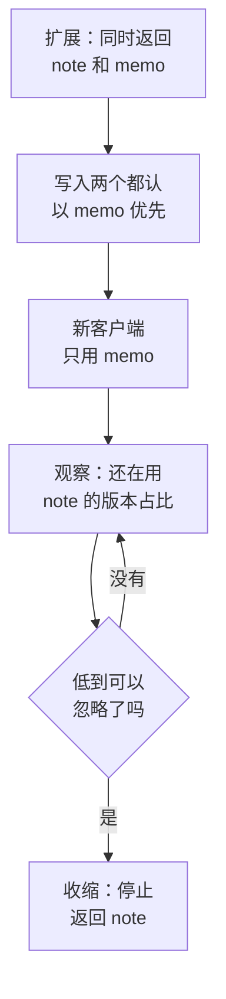
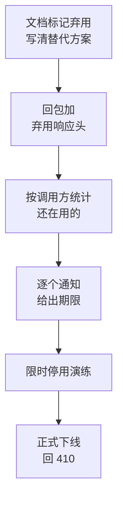

# 版本与演进

网页端的接口改了，刷新一下页面就是新代码；App 的接口改了，用户手机上的旧版本还会继续用旧的方式调你，可能持续好几个月。对外的 API 更甚，你甚至不知道调用方是谁。这一章讲怎么让接口能改：哪些改动是安全的、哪些会把老客户端弄坏，版本号放在哪里，以及一个字段从「打算去掉」到「真的去掉」要走的流程。

## 改动的两种

判断一个改动是否安全，只问一个问题：**一个按旧文档写好、不再更新的客户端，改动之后还能正常工作吗？**

| 改动 | 安全吗 | 说明 |
|---|---|---|
| 新增一个接口 | 安全 | |
| 回包里新增字段 | 安全（前提是客户端忽略不认识的字段） | |
| 请求里新增**可选**参数 | 安全 | 不传时的行为必须和以前一样 |
| 放宽校验（长度上限 50 → 100） | 安全 | |
| 新增一个错误码 | 基本安全 | 客户端要有兜底分支 |
| 枚举新增一个取值 | **看客户端** | 客户端如果对枚举做了穷尽处理，遇到新值会出错 |
| 删除或改名字段 | 破坏 | |
| 改字段类型（数字 → 字符串） | 破坏 | |
| 字段从必有变成可能为 `null` | 破坏 | 客户端没处理 `null` 就会崩 |
| 请求里新增**必填**参数 | 破坏 | |
| 收紧校验（100 → 50） | 破坏 | 以前能提交的现在提交不了 |
| 改变默认行为（默认排序、默认分页大小） | 破坏 | 没有报错，但结果变了，最难发现 |
| 改状态码或错误码 | 破坏 | |
| 改 URL | 破坏 | |

最后几行值得注意：**行为变化也是破坏性变更**，哪怕回包的形状一模一样。默认按创建时间排序改成按更新时间排序，所有没显式传 `sort` 的客户端看到的顺序都变了。

## 客户端也有义务

安全改动之所以安全，前提是客户端是一个「宽容的读者」：

- **忽略不认识的字段**：用 zod 解析回包时，`z.object()` 默认就会剥掉未知字段，不要在客户端用 `.strict()`
- **不认识的枚举值有兜底**：服务端加了一个新状态，老客户端不应该崩溃
- **不认识的错误码当作通用错误**：展示 `detail`，不要白屏

枚举的兜底在客户端 schema 里这样写：

```typescript
import { z } from "zod";

const OrderStatus = z
  .enum(["draft", "ordered", "received", "void"])
  .or(z.string().transform(() => "unknown" as const)); // 新状态不崩，显示成「其他」

const StockOrder = z.object({
  id: z.string(),
  status: OrderStatus,
  total: z.number().int(),
}); // 默认剥掉未知字段

type StockOrder = z.infer<typeof StockOrder>;
// status: "draft" | "ordered" | "received" | "void" | "unknown"
```

这件事要在**第一个 App 版本**里就做对，因为它决定了以后服务端能有多少自由。一个对枚举做了严格校验的 1.0 版本，会让你在它退场之前都不敢给那个枚举加值。

## 版本号放在哪

当破坏性变更不可避免时，需要版本号让新旧两套行为共存。常见的四种放法：

| 方式 | 例子 | 优点 | 缺点 |
|---|---|---|---|
| URL 路径 | `/v1/expenses` | 一眼可见，路由、日志、网关都好处理 | 版本粒度是整个 API |
| 请求头 | `Api-Version: 2` | URL 干净 | 不显眼，浏览器里不好试，缓存要加 `Vary` |
| 媒体类型 | `Accept: application/vnd.hatch.v2+json` | 理论上最「正确」 | 工具支持差，调用方容易写错 |
| 日期版本 | `Api-Version: 2026-11-01` | 每次小变更都能有版本，调用方按自己的节奏升级 | 服务端要维护一串版本转换层，成本高 |

> [!WARNING]
> 日期版本的做法以 Stripe 为代表，其具体机制（账号默认版本、请求头覆盖、版本转换）按公开文档凭记忆概括，可能已调整，以 Stripe 官方 API 文档的 Versioning 一节为准。

一个人维护的 API，推荐：

- **URL 里放一个主版本号**：`/v1/`。它几乎永远不变，只是给「万一要推倒重来」留一扇门
- **日常演进不升版本**：靠只做安全改动，加上下面的「扩展—收缩」流程
- **不做日期版本**：它是给有大量第三方集成、需要多年兼容的平台准备的，背后是一整套版本转换基础设施

`/v2` 出现的那一天，意味着你要同时维护两套接口直到 `/v1` 的最后一个调用方离开。对一人公司来说这几乎是最后的手段。

## 扩展—收缩：不升版本的改名

大多数「破坏性」需求其实可以拆成几个安全的步骤。以把开支的 `note` 字段改名为 `memo` 为例：



1. **扩展**：回包里同时有 `note` 和 `memo`，值相同。请求里两个都接受，同时给了以 `memo` 为准
2. **迁移**：新版本客户端只读写 `memo`
3. **观察**：统计还在发送或依赖 `note` 的客户端版本（下面讲怎么统计）
4. **收缩**：老版本退场后，去掉 `note`

同样的思路适用于改类型（新增一个新类型的字段，旧字段保留）、拆分接口（新接口上线，旧接口转调新接口）、改默认行为（新增显式参数，等调用方都显式传了再改默认值）。

数据库的迁移也是同一个模式：先加新列、双写、回填、切读、再删旧列。接口层和数据层的扩展—收缩通常是一起走的。

## App 老版本还在用时

前面几节对所有客户端都成立，这一节专门讲自己的 App。和第三方相比，自己的 App 有一个好处：**你能知道它是哪个版本，也能让它升级**。

### 每个请求都带上客户端版本

App 发出的每一个请求都带两个头：

```text
X-Client-Platform: ios
X-Client-Version: 1.4.2
```

> [!WARNING]
> 下面读取版本号用的 `expo-application` API 按 Expo SDK 5x 的文档凭记忆写成，Expo 每个 SDK 都可能有破坏性变更，以项目所用 SDK 版本的官方文档（docs.expo.dev/versions/）为准。

Expo 里取原生版本号：

```typescript
import * as Application from "expo-application";
import { Platform } from "react-native";

const clientHeaders = {
  "X-Client-Platform": Platform.OS,                                  // "ios" | "android"
  "X-Client-Version": Application.nativeApplicationVersion ?? "0.0.0", // app.json 里的 version
};

export function apiFetch(path: string, init: RequestInit = {}) {
  return fetch(`${API_BASE}${path}`, {
    ...init,
    headers: { ...clientHeaders, ...init.headers },
  });
}
```

网页端带 `X-Client-Platform: web` 和构建时注入的版本号。Electron 桌面端同理，用 `app.getVersion()`。

### 记下版本分布

服务端在访问日志里记下这两个头，就能回答演进中最关键的问题：「还有多少人在用 1.2？」

```sql
-- 假设访问日志进了一张表（或者用日志系统的查询语言做同样的事）
SELECT client_platform, client_version,
       count(DISTINCT device_id) AS devices,
       max(ts)                   AS last_seen
FROM access_log
WHERE ts > now() - interval '14 days'
GROUP BY 1, 2
ORDER BY 1, devices DESC;
```

按**设备数**而不是请求数统计：一个重度用户的请求数可能是轻度用户的一百倍，按请求数会高估老版本的分量。时间窗口取两周，覆盖一周只开一次 App 的用户。

### 最低版本：软提示和硬拦截

服务端维护两个数字：

- **建议版本**：低于它的客户端，提示「有新版本」，可以关掉
- **最低版本**：低于它的客户端，所有接口回 `client_too_old`，App 显示整屏的升级页，不能继续用

```typescript
import { Injectable, NestMiddleware } from "@nestjs/common";
import type { NextFunction, Request, Response } from "express";
import semver from "semver";

const MIN_VERSION: Record<string, string> = { ios: "1.3.0", android: "1.3.0" };

@Injectable()
export class ClientVersionMiddleware implements NestMiddleware {
  use(req: Request, _res: Response, next: NextFunction) {
    const platform = String(req.headers["x-client-platform"] ?? "");
    const version = semver.valid(String(req.headers["x-client-version"] ?? ""));
    const min = MIN_VERSION[platform];

    // 网页端、第三方、没带头的请求不受影响
    if (min && version && semver.lt(version, min)) {
      throw new ApiProblem(
        "client_too_old",
        "这个版本太旧了，有些功能已经用不了。去 App Store 更新到最新版就好，数据都在。",
      );
    }
    next();
  }
}
```

两点注意：

- **`client_too_old` 必须从 1.0 起就能被识别**。如果 1.0 版本不认识这个码，它只会把这句话当普通错误 toast 出来，用户每点一下弹一次，而不是看到一个清楚的升级页。最低版本机制的价值完全取决于第一个版本有没有做好
- **登录、续期、版本检查这几个接口不拦**：否则老版本连「你该升级了」这条信息都拿不到

建议版本通过一个公开的配置接口下发，App 启动时拉一次：

```json
{
  "minVersion": { "ios": "1.3.0", "android": "1.3.0" },
  "recommendedVersion": { "ios": "1.5.0", "android": "1.5.0" },
  "upgradeUrl": { "ios": "https://apps.apple.com/app/id0000000000" }
}
```

### 先发服务端，再发 App

新功能需要服务端和 App 同时改时，顺序永远是：

1. 服务端先上线，同时支持旧版 App 和即将发布的新版 App
2. 新版 App 提交审核。审核员用的是线上服务端，所以第 1 步必须已完成
3. App 上架，用户陆续升级
4. 老版本占比足够低后，服务端去掉兼容代码（扩展—收缩的收缩）

反过来先发 App 是行不通的：审核期间新版本调不通还没上线的接口，审核会被拒；就算过了，上架那一刻服务端还没准备好。

> [!TIP]
> 一个实用的习惯：服务端代码里每一段「为了兼容老版本」的分支都加上注释，写明是为哪个版本留的、到哪个版本可以删。比如 `// 兼容 iOS < 1.4：1.4 起改用 memo，老版本占比 < 1% 后删除`。半年后回来清理时，不用再回忆当初为什么这么写。

## 弃用流程

一个接口或字段从「打算去掉」到「真的去掉」，走这几步：



### 用响应头告诉调用方

> [!WARNING]
> 本节的响应头按 RFC 8594（Sunset）和 RFC 9745（Deprecation，2025 年发布）凭记忆整理，字段格式可能有出入，以 IETF 官方 RFC 文本为准。

两个标准响应头：

- `Deprecation`：这个资源已经（或将在某时）被弃用。RFC 9745 里它的值是一个结构化字段的日期，形如 `@1793491200`（Unix 秒数）
- `Sunset`：这个资源预计在什么时候停止服务，值是 HTTP 日期
- 配合 `Link` 头指向说明文档：`Link: <https://docs.example.com/changelog#memo>; rel="deprecation"`

```http
HTTP/1.1 200 OK
Deprecation: @1793491200
Sunset: Sat, 01 May 2027 00:00:00 GMT
Link: <https://docs.hatch-counter.example/changelog#expense-note>; rel="deprecation"
```

在 Nest 里用一个装饰器加拦截器，把弃用信息挂在路由上：

```typescript
import { SetMetadata, Injectable, NestInterceptor, ExecutionContext, CallHandler } from "@nestjs/common";
import { Reflector } from "@nestjs/core";
import { tap } from "rxjs";

type DeprecationInfo = { since: Date; sunset: Date; link: string };
export const Deprecated = (info: DeprecationInfo) => SetMetadata("deprecation", info);

@Injectable()
export class DeprecationInterceptor implements NestInterceptor {
  constructor(private reflector: Reflector, private usage: DeprecationUsage) {}

  intercept(ctx: ExecutionContext, next: CallHandler) {
    const info = this.reflector.get<DeprecationInfo>("deprecation", ctx.getHandler());
    if (!info) return next.handle();

    const req = ctx.switchToHttp().getRequest();
    const res = ctx.switchToHttp().getResponse();
    res.setHeader("Deprecation", `@${Math.floor(info.since.getTime() / 1000)}`);
    res.setHeader("Sunset", info.sunset.toUTCString());
    res.setHeader("Link", `<${info.link}>; rel="deprecation"`);

    // 记下是谁还在调：令牌对应的门店 / API key / 客户端版本
    return next.handle().pipe(tap(() => this.usage.record(req.route.path, req)));
  }
}
```

```typescript
@Get("legacy-summary")
@Deprecated({
  since: new Date("2026-11-01"),
  sunset: new Date("2027-05-01"),
  link: "https://docs.hatch-counter.example/changelog#daily-report",
})
legacySummary() { /* ... */ }
```

响应头是给程序看的，大多数调用方不会主动去读。它的真正价值在于**你自己的统计**：拦截器顺手记下的调用记录，告诉你还有谁在用。

### 主动通知，限时演练

- **主动通知**：对第三方，按统计结果逐个发邮件，写清楚哪个接口、替代方案、截止日期。对自己的 App，就是把最低版本提上去
- **限时停用演练**（brownout）：正式下线前，挑几个工作日的某一小时让旧接口直接返回错误。没看邮件的调用方会在这一小时里发现问题，而这时离真正下线还有缓冲
- **下线后回 410 Gone**：比 404 更明确地告诉调用方「这个东西以前有、现在没了」，带上一个 Problem Details 指向替代方案

期限要给够。对自己的 App，至少覆盖几个发版周期；对第三方，半年起步。一人公司的第三方集成方往往也是小团队，排期比你想的慢。

## 用工具守住兼容性

人工判断「这个改动安全吗」迟早会漏。如果 API 有 OpenAPI 描述（[第 7 章](07-openapi-codegen.md)），就可以在 CI 里自动比较：把主分支的 OpenAPI 文件和当前分支的做 diff，用 oasdiff 这类工具检测破坏性变更，检出就让 CI 失败，除非提交里显式标注了「有意的破坏性变更」。这比任何代码审查都可靠，因为它不会累，也不会因为「这个字段应该没人用吧」而放行。

## 本章要点

- 判断标准：一个按旧文档写好、不再更新的客户端还能不能工作；行为变化也算破坏性变更
- 客户端要做宽容的读者：忽略未知字段，未知枚举值有兜底，未知错误码当通用错误
- URL 里放一个几乎不变的主版本号，日常演进靠安全改动，不轻易出 `/v2`
- 不可避免的改名、改类型用扩展—收缩：先加新的、双写、观察、再删旧的
- App 每个请求带平台和版本头，按设备数统计版本分布
- 最低版本拦截回 `client_too_old`，这个码必须从 1.0 起就能被识别；登录和配置接口不拦
- 先发服务端（兼容新旧），再发 App；兼容分支注释写明何时可删
- 弃用流程：文档、`Deprecation` / `Sunset` 响应头、统计、通知、限时演练、410
- 在 CI 里自动比较 OpenAPI，检出破坏性变更就失败
