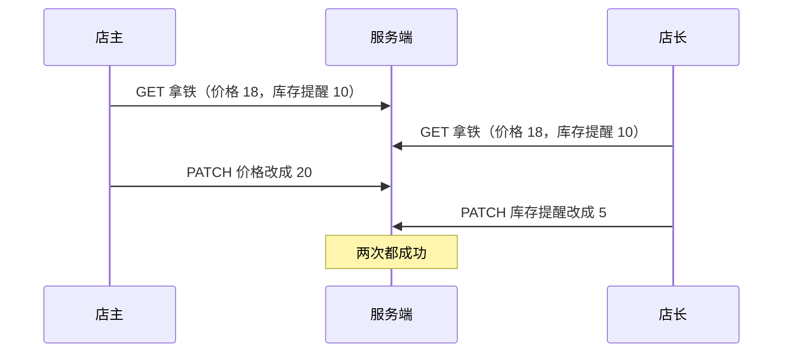

# 并发控制与幂等

两个人同时改同一件商品的价格，后保存的那个会悄悄覆盖先保存的；店员在信号不好的地方点「提交」，请求重发了一次，开支记了两笔。这两类问题在服务端的实现，[《软件架构与系统设计》的幂等与一致性一章](../system-design/06-idempotency-consistency.md)已经讲过：版本号条件写、幂等键表、拦截器。这一章站在**接口约定**的角度：这些机制怎么体现在 HTTP 上，请求头和状态码怎么用，文档里要写清什么，客户端该怎么配合。

## 丢失更新

先看并发编辑的问题长什么样。店主和店长同时打开了「拿铁」的编辑页：



如果两个人都只发了自己改的字段（PATCH），结果是对的：价格 20，提醒 5。但如果编辑页把整个表单都发了回去（很多表单库默认这样），店长那次请求里带着「价格 18」，就把店主的修改覆盖了。没有报错，没有提示，店主过几天才发现价格怎么又变回去了。

这叫**丢失更新**。解决办法是让写请求带上「我是基于哪个版本改的」，服务端发现版本已经变了就拒绝。

## ETag 与条件请求

HTTP 本身就有这套机制，不需要自己发明：

1. 读的时候，服务端在响应头里给出这个资源当前版本的标识 `ETag`
2. 写的时候，客户端在请求头 `If-Match` 里带上它
3. 服务端比较：一致才执行；不一致回 **412 Precondition Failed**

```http
GET /products/prd_01

HTTP/1.1 200 OK
ETag: "v12"
Content-Type: application/json

{ "id": "prd_01", "name": "拿铁", "price": 1800, "stockAlert": 10, "version": 12 }
```

```http
PATCH /products/prd_01
If-Match: "v12"
Content-Type: application/merge-patch+json

{ "price": 2000 }
```

成功则回 200 和新的 `ETag: "v13"`；如果这期间有人改过，回 412：

```json
{
  "type": "https://api.hatch-counter.example/problems/version-mismatch",
  "title": "数据已被别人修改",
  "status": 412,
  "detail": "你编辑的这段时间里，别人改过这件商品。刷新看看最新的内容，再决定要不要改。",
  "code": "version_mismatch"
}
```

### ETag 怎么生成

ETag 只要满足「内容变了它就变」。两种常见做法：

| 做法 | 例子 | 适合 |
|---|---|---|
| 版本号列 | 表里有 `version int`，每次更新加 1，ETag 是 `"v12"` | 可写的业务资源，条件写直接用这一列 |
| 内容哈希 | 对回包 JSON 算 SHA-256 取前 16 位 | 只读的、计算出来的资源（报表、目录），主要用于缓存 |

条件写用版本号列，因为比较可以下推到 SQL 里原子完成：

```sql
UPDATE products
SET price = $3, version = version + 1, updated_at = now()
WHERE id = $1 AND store_id = $4 AND version = $2
RETURNING *;
```

返回 0 行时，要再查一次区分两种情况：这条记录根本不存在（404），还是版本对不上（412）。

> [!NOTE]
> ETag 有强弱之分，`W/"v12"` 是弱 ETag，表示「语义上等价」而不保证逐字节相同。`If-Match` 要求强比较，弱 ETag 永远匹配不上。用版本号生成的 ETag 是强的，不要加 `W/` 前缀。有些网关在压缩回包时会把强 ETag 改成弱的，遇到条件写总是 412 时可以先查这里。

### 在 Nest 里实现

```typescript
import { Body, Controller, Get, Headers, Param, Patch, Res } from "@nestjs/common";
import type { Response } from "express";

const etagOf = (version: number) => `"v${version}"`;

function parseIfMatch(header: string | undefined): number | null {
  const m = header?.match(/^"v(\d+)"$/);
  return m ? Number(m[1]) : null;
}

@Controller("products")
export class ProductsController {
  constructor(private products: ProductsService) {}

  @Get(":id")
  async get(@StoreId() storeId: string, @Param("id") id: string, @Res({ passthrough: true }) res: Response) {
    const p = await this.products.get(storeId, id);
    res.setHeader("ETag", etagOf(p.version));
    return p;
  }

  @Patch(":id")
  async patch(
    @StoreId() storeId: string,
    @Param("id") id: string,
    @Headers("if-match") ifMatch: string | undefined,
    @Body(zBody(PatchProduct)) body: PatchProductInput,
    @Res({ passthrough: true }) res: Response,
  ) {
    const expected = parseIfMatch(ifMatch);
    if (expected === null) {
      // 428：要求客户端必须带条件，避免有人忘了带就退化成无条件覆盖
      throw new ApiProblem("precondition_required", "修改商品需要带上 If-Match 请求头");
    }
    const updated = await this.products.update(storeId, id, expected, body);
    res.setHeader("ETag", etagOf(updated.version));
    return updated;
  }
}
```

`precondition_required` 在[第 2 章](02-errors.md)的错误码表里对应 428。是否强制要求 `If-Match` 是一个选择：强制（缺了回 428 Precondition Required）更安全，但所有客户端都得改；不强制则老客户端照旧，新客户端带上就有保护。新接口建议从一开始就强制，已有接口先不强制，等客户端都升级了再收紧（收紧本身是破坏性变更，走第 4 章的流程）。

### 客户端收到 412 怎么办

412 不是 bug，是一次正常的冲突。客户端的处理方式取决于数据：

- **表单编辑**：重新拉取最新数据，告诉用户「别人改过」，最好把对方改了哪些字段标出来，让用户决定是在新数据上重做，还是放弃
- **程序自己合并的数据**（同步目录、计数器）：重读、重新应用自己的改动、带新的 ETag 再写，循环几次。recordwall 的曲库目录就是这么做的，见上面链接的那一章的「乐观并发控制」一节
- **绝不**：自动去掉 `If-Match` 再发一次。那等于把保护关掉

### 不用请求头也可以

ETag 和 `If-Match` 是标准做法，但不是唯一做法。把 `version` 放在请求体里也能实现同样的效果：

```json
{ "price": 2000, "version": 12 }
```

| | `If-Match` 头 | 请求体里的 `version` |
|---|---|---|
| 标准程度 | HTTP 标准，中间层认识 | 自定义 |
| 客户端实现 | 要额外读响应头、设请求头 | 回包里本来就有，原样带回 |
| 和缓存配合 | `If-None-Match` 同一个 ETag 可以做 304 | 无 |
| 文档负担 | 低，开发者都懂 | 要说明 |

对自己的 App 和网页端，请求体里的 `version` 更顺手；对外开放的 API，用标准的请求头。选一种，在全 API 统一。

## 条件读：省流量的 304

ETag 的另一个用途是缓存。客户端缓存了一份数据，下次请求带上 `If-None-Match`，服务端发现没变就回一个没有正文的 304：

```http
GET /catalog
If-None-Match: "a3f9c2e1b7d04512"

HTTP/1.1 304 Not Modified
ETag: "a3f9c2e1b7d04512"
```

对于体积大、变化少的资源（商品目录、配置、曲库索引），这能省下大部分流量，在手机网络下体验差别明显。实现上，服务端仍然要算出当前的 ETag 才能比较，所以省的是带宽和客户端的解析，不是服务端的查询；如果算 ETag 本身很贵，可以把它缓存起来，在数据变化时失效。

`If-None-Match: *` 还有一个写入的用法：「只有不存在时才创建」。两个设备同时想创建同一个文件或同一个 id 的资源，只有一个会成功，另一个收到 412。

## 重复提交与 Idempotency-Key

ETag 解决的是「两个人改同一个东西」，幂等键解决的是「同一个人的同一次提交被执行了两次」。

> [!WARNING]
> 按 2026 年 11 月 IETF datatracker 的记录，`Idempotency-Key` 请求头仍是 httpapi 工作组的草案（最新为 draft-ietf-httpapi-idempotency-key-header-08，2026 年 10 月更新），**尚未成为正式 RFC**，状态码等细节可能变化。-08 里的约定是：要求带 key 的接口缺了 key 回 400、同一个 key 换了请求内容回 422、第一次还在处理回 409，与下表一致；有效期、重放标记等其余条目来自 Stripe 等平台的公开做法。以 IETF 最新草案和各平台官方文档为准。

### 接口约定

服务端为什么要占行、记回包、比指纹，以及进程死在中间那个缝怎么办，是设计层面的取舍，见[《软件架构与系统设计》服务端的规矩](../system-design/06-idempotency-consistency.md#服务端的规矩)；落到 Nest 的代码在[下面](#服务端拦截器骨架)。先列出接口层面要对外说清的约定：

| 约定 | 推荐 |
|---|---|
| 请求头名 | `Idempotency-Key` |
| 值的格式 | 客户端生成的随机字符串，推荐 UUID，长度上限 255 |
| 哪些接口支持 | 所有不天然幂等的 POST；文档里逐个标出，或者统一说「所有 POST」 |
| 哪些接口必须带 | 涉及钱和库存的：记账、补仓、扣款。缺了回 400 |
| 有效期 | 24 小时，过期后同一个 key 当新请求处理 |
| 作用范围 | 按「调用方身份 + key」唯一，不同调用方撞了 key 互不影响 |
| 同 key 重放 | 原样返回第一次的状态码和回包，加响应头标明这是重放 |
| 同 key 不同内容 | 422，`idempotency_mismatch` |
| 第一次还在处理 | 409，客户端稍后用同一个 key 重试 |
| 第一次失败了 | 不记录，同一个 key 重试会真正执行 |

「加响应头标明这是重放」的做法来自 Stripe（`Idempotent-Replayed: true`），它让客户端和你自己排查问题时能分清「这次真的执行了」还是「这是第一次的结果」。

### 服务端：拦截器骨架

hatch-counter 用一张表记每个 key 的处理结果，按「店 + 设备 + key」唯一：

```sql
CREATE TABLE idempotent_requests (
  store_id     uuid        NOT NULL,
  device_id    text        NOT NULL,
  key          text        NOT NULL,
  fingerprint  text        NOT NULL,          -- 方法 + 路径 + 请求体的摘要
  status_code  int,                            -- NULL 表示还在跑
  response     jsonb,
  created_at   timestamptz NOT NULL DEFAULT now(),
  PRIMARY KEY (store_id, device_id, key)
);
```

拦截器把上面的约定逐条落地。占行、记回包各是一个短事务，和业务事务分开：

```typescript
import { CallHandler, ExecutionContext, Injectable, NestInterceptor } from "@nestjs/common";
import { Observable, catchError, from, mergeMap, of, throwError } from "rxjs";

// AppError、hash、statusCodeFor、IdempotencyRepo 是项目里自己的东西，这里只看骨架
@Injectable()
export class IdempotencyInterceptor implements NestInterceptor {
  constructor(private repo: IdempotencyRepo) {}

  async intercept(ctx: ExecutionContext, next: CallHandler): Promise<Observable<unknown>> {
    const req = ctx.switchToHttp().getRequest();
    const key = req.headers["idempotency-key"];
    if (req.method === "GET" || !key) return next.handle();

    const scope = { storeId: req.storeId, deviceId: req.deviceId, key };
    const fingerprint = hash(`${req.method} ${req.path} ${JSON.stringify(req.body)}`);

    const existing = await this.repo.claim(scope, fingerprint); // 短事务：插入或读出已有行
    if (existing) {
      if (existing.fingerprint !== fingerprint) throw new AppError("同一个提交换了内容", 422);
      if (existing.statusCode === null) throw new AppError("还在处理，等几秒", 409);
      ctx.switchToHttp().getResponse().status(existing.statusCode);
      return of(existing.response);
    }

    return next.handle().pipe(
      // 成功：记回包（另一个短事务）
      mergeMap(async (body) => {
        await this.repo.complete(scope, statusCodeFor(req), body);
        return body;
      }),
      // 失败：删掉占的行，让下次重试真跑
      catchError((err) => from(this.repo.release(scope)).pipe(mergeMap(() => throwError(() => err)))),
    );
  }
}
```

`statusCodeFor(req)` 这个细节也有坑：在拦截器里读 `res.statusCode` 拿到的还是默认的 200，Nest 回包时才按 `@HttpCode()` 定（没标的 POST 是 201）。要按同一条规则自己算出来。

### 客户端：key 跟着提交走

客户端最容易犯的错误是在发请求的函数里生成 key，每次重试都是新 key，等于没有幂等。key 要在**用户点下提交的那一刻**生成，跟着这一次提交，包括网络重试和续期令牌后的重发：

```typescript
import * as Crypto from "expo-crypto";

type Submission<T> = { key: string; body: T };

/** 用户点「提交」时调用一次，生成这次提交的 key */
export function newSubmission<T>(body: T): Submission<T> {
  return { key: Crypto.randomUUID(), body };
}

/** 发送；网络错误或 409 时用同一个 key 重试 */
export async function submit<T>(path: string, s: Submission<T>, attempts = 3): Promise<Response> {
  let lastErr: unknown;
  for (let i = 0; i < attempts; i++) {
    try {
      const res = await apiFetch(path, {
        method: "POST",
        headers: { "Content-Type": "application/json", "Idempotency-Key": s.key },
        body: JSON.stringify(s.body),
      });
      if (res.status !== 409) return res;
    } catch (err) {
      lastErr = err; // 网络错误：不知道服务端做没做，用同一个 key 再问一次
    }
    await new Promise((r) => setTimeout(r, 500 * 2 ** i));
  }
  throw lastErr ?? new Error("还在处理中，稍后在列表里确认一下");
}
```

> [!WARNING]
> `expo-crypto` 的 `randomUUID()` 按近几个 Expo SDK 的文档凭记忆写成，以项目所用 SDK 版本的官方文档为准。较新的 React Native 和 Hermes 也可能直接提供全局的 `crypto.randomUUID()`。

页面上的状态也要配合：提交失败后，用户点「重试」用的是同一个 `Submission`；用户改了表单内容，就丢掉旧的，再 `newSubmission` 一个新的。

离线优先的 App 还要多一步：把待发送的操作连同它的 key **一起存进本地队列**（SQLite），App 被杀掉重启后，从队列里取出来用原来的 key 重发。如果 key 只存在内存里，重启后就生成了新 key，之前那次可能已经成功的请求会再执行一遍。

## 更简单的办法：让客户端决定 id

幂等键需要服务端维护一张表，有一定的实现成本。对于「新建一条记录」这类操作，有一个更简单的替代：**让客户端生成新记录的 id**，服务端用唯一约束去重。

```http
PUT /expenses/0193a4f2-7c1e-7b3a-9f21-5d8e2c4a6b10
Content-Type: application/json

{ "amount": 3200, "note": "买纸杯", "paidAt": "2026-11-03T09:12:00+08:00" }
```

PUT 的语义本来就是「把这个地址上的资源设置成这样」，天然幂等：重发十次，结果都是这一条。服务端：

```sql
INSERT INTO expenses (id, store_id, amount, note, paid_at)
VALUES ($1, $2, $3, $4, $5)
ON CONFLICT (id) DO NOTHING
RETURNING *;
-- 没有返回行：说明这个 id 已经存在，查出来比对内容，一致就当成功返回，不一致回 409
```

几个要求：

- id 用 UUID v7 这类**时间有序**的 UUID，插入时对 B+ 树索引更友好；客户端生成，不需要和服务端协调
- 服务端必须校验 id 的格式，并且检查这个 id 如果已存在，是否属于同一个租户。否则别人可以拿你的 id 来探测记录是否存在
- 对已存在的 id，比较内容：一致是重放，回 200；不一致是冲突，回 409

| | 幂等键 | 客户端生成 id |
|---|---|---|
| 服务端成本 | 一张幂等表 + 拦截器 | 唯一约束，几乎为零 |
| 适用操作 | 任何 POST（含扣款、发短信这类没有「记录 id」的） | 新建记录 |
| 离线 App | 要持久化 key | 记录在本地创建时就有 id，离线时可以直接被其他本地记录引用 |
| 对外 API | 调用方熟悉（大平台都这么做） | 需要在文档里解释 |

hatch-counter 用的是幂等键，因为它的写操作里有不少不是「新建一条」，比如补仓入库会同时改库存和开支。新项目如果写操作以新建记录为主、又是离线优先，客户端生成 id 往往更省事。两者也可以并存。

## 长任务：202 加操作资源

有些操作几秒钟完成不了：整店导出、批量导入、重新计算一年的报表。不要让请求一直挂着等，用 202 和一个「操作」资源：

```http
POST /exports
Idempotency-Key: 7b1c...

HTTP/1.1 202 Accepted
Location: /exports/exp_job_01JC5
Content-Type: application/json

{ "id": "exp_job_01JC5", "status": "queued", "createdAt": "2026-11-04T08:00:00Z" }
```

客户端轮询 `GET /exports/exp_job_01JC5`，状态从 `queued` 到 `running` 到 `succeeded`（带下载地址）或 `failed`（带 Problem Details）。轮询间隔可以由服务端在回包里用 `Retry-After` 头建议。

这里幂等键同样重要：用户连点两次「导出」，不应该排两个任务。后台任务本身怎么设计，见[《软件架构与系统设计》的队列一章](../system-design/04-queues-jobs.md)。

## 本章要点

- 并发编辑会丢失更新；写请求要带上「基于哪个版本」，不一致回 412
- ETag 用版本号列生成（强 ETag），条件写在 SQL 里原子比较；0 行时区分 404 和 412
- 新接口可以强制要求 `If-Match`，缺了回 428；客户端收到 412 要重读，绝不去掉条件重发
- 对自己的客户端，请求体里带 `version` 也行，全 API 统一一种
- `If-None-Match` 做条件读省流量，`If-None-Match: *` 做「不存在才创建」
- 幂等键的接口约定要写进文档：哪些接口、有效期、作用范围、重放和冲突的状态码
- key 在用户点提交时生成，跟着这次提交重试；离线 App 把 key 和操作一起持久化
- 新建记录可以让客户端生成 UUID v7 id，用 PUT 加唯一约束实现天然幂等
- 长任务回 202 和一个操作资源，客户端轮询

## 动手练习

1. **在 SQL 里复现丢失更新和条件写**：在一次性 Postgres 容器里建 `products(id text primary key, price int, stock_alert int, version int)` 并插入 `('prd_01', 1800, 10, 12)`。开两个 psql 会话，都先 `SELECT`，然后 A 执行 `UPDATE products SET price=2000, version=version+1 WHERE id='prd_01' AND version=12 RETURNING *;`，B 再执行同样带 `version=12` 条件的 `UPDATE products SET stock_alert=5, ...`。

   验证：A 返回 1 行、`version` 变成 13；B 显示 `UPDATE 0`、返回 0 行。去掉 `AND version=12` 再让 B 整行写回 `price=1800` 时，A 的改价被悄悄覆盖。

   参考答案：版本比较和更新在同一条语句里，原子完成；0 行时服务端再查一次，存在就回 412，不存在回 404。

2. **用 curl 观察 ETag 和 304**：写一个 ≤15 行的 Node 服务，`GET /catalog` 返回固定 JSON 并设 `ETag: "abc"`，请求头 `If-None-Match` 等于它时回 304。用 `curl -i localhost:3000/catalog`，再用 `curl -i -H 'If-None-Match: "abc"' localhost:3000/catalog`。

   验证：第一次 `HTTP/1.1 200`、有正文；第二次 `HTTP/1.1 304 Not Modified`、没有正文。

   参考答案：

   ```javascript
   require("node:http").createServer((req, res) => {
     const etag = '"abc"';
     if (req.headers["if-none-match"] === etag) return res.writeHead(304, { ETag: etag }).end();
     res.writeHead(200, { ETag: etag, "Content-Type": "application/json" });
     res.end(JSON.stringify({ items: ["拿铁", "美式"] }));
   }).listen(3000);
   ```

3. **找出幂等键的 bug**：下面的重试函数有什么问题？`async function send(body) { for (let i = 0; i < 3; i++) { try { return await fetch("/expenses", { method: "POST", headers: { "Idempotency-Key": crypto.randomUUID() }, body }); } catch {} } }`

   验证：在服务端打印收到的 `Idempotency-Key`，让第一次请求在服务端处理完后故意断开连接（例如处理完再 `req.socket.destroy()`），观察三次请求的 key 是否相同、记录是否重复。

   参考答案：key 在循环里生成，每次重试都是新 key，服务端无法认出是同一次提交，开支会记多笔。key 要在用户点提交时生成一次，作为参数传进来。
