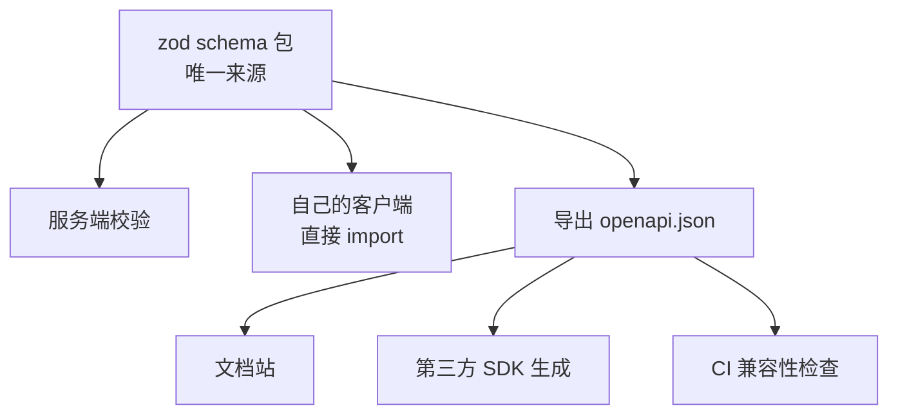

# OpenAPI 与类型生成

服务端改了一个字段名，网页端的 TS 类型没跟着改，编译照样通过，上线后页面上一块空白。这类问题的根源是：**接口的形状在两个地方各写了一份**，服务端的 DTO 一份，客户端的类型一份，靠人手同步。这一章讲怎么让接口契约只有一个来源，再从它生成客户端类型、文档和兼容性检查，以及 OpenAPI 在其中扮演的角色。

## 契约放在哪

让服务端和客户端共用一份契约，有三条路：

| 路线 | 契约的来源 | 客户端怎么拿到类型 | 适合 |
|---|---|---|---|
| 共享 schema 包 | monorepo 里一个 zod schema 包 | 直接 import | 服务端和所有客户端都是 TS，在同一个仓库 |
| 代码优先 | 服务端代码（装饰器或 schema），自动导出 OpenAPI | 从 OpenAPI 生成 | 有非 TS 客户端，或要给第三方文档 |
| 设计优先 | 手写 OpenAPI 文件 | 从 OpenAPI 生成，服务端也按它校验 | 多团队协作，先定接口再分头写 |

一人公司的典型情况是：服务端 NestJS，网页端 React，App 用 Expo，桌面端 Electron，全部是 TS，很可能在一个 monorepo 里。这时**共享 schema 包是最直接的**：同一份 zod schema，服务端用来校验请求，客户端用来校验回包、推导类型。

但只靠共享包有两个缺口：第三方看不懂你的 zod 代码，CI 也没法对一堆 TS 文件做「这次改动是否破坏兼容」的检查。所以推荐的组合是：



zod 是唯一来源，OpenAPI 是从它导出的**产物**，给文档、第三方和 CI 用。

## OpenAPI 是什么

> [!WARNING]
> 本节按 OpenAPI 3.1 规范凭记忆整理；OpenAPI 3.2 已于 2025 年发布，各工具对 3.1 / 3.2 的支持程度不一。以 OpenAPI Initiative 官方规范（spec.openapis.org）和所用工具的文档为准。

OpenAPI（前身是 Swagger）是描述 HTTP API 的标准格式，一个 YAML 或 JSON 文件，写清有哪些路径、每个路径接受什么参数和请求体、返回什么。3.1 版本起，其中的数据模型直接使用 JSON Schema（2020-12），这意味着 zod 这类能导出 JSON Schema 的库可以和它很好地对接。

一个接口的描述大致长这样：

```yaml
openapi: 3.1.0
info:
  title: hatch-counter API
  version: "1.0"
paths:
  /expenses:
    get:
      operationId: listExpenses
      summary: 列出开支
      parameters:
        - name: cursor
          in: query
          schema: { type: string }
          description: 上一页回包里的 nextCursor，不透明字符串
        - name: limit
          in: query
          schema: { type: integer, minimum: 1, maximum: 100, default: 20 }
      responses:
        "200":
          description: 一页开支
          content:
            application/json:
              schema: { $ref: "#/components/schemas/ExpensePage" }
        "401": { $ref: "#/components/responses/Problem" }
components:
  schemas:
    Expense:
      type: object
      required: [id, amount, note, paidAt]
      properties:
        id: { type: string, examples: ["exp_01JC3Z8Q"] }
        amount: { type: integer, description: 金额，单位分 }
        note: { type: [string, "null"], maxLength: 200 }
        paidAt: { type: string, format: date-time }
    ExpensePage:
      type: object
      required: [items, nextCursor]
      properties:
        items: { type: array, items: { $ref: "#/components/schemas/Expense" } }
        nextCursor: { type: [string, "null"] }
  responses:
    Problem:
      description: 错误，格式见 RFC 9457
      content:
        application/problem+json:
          schema: { $ref: "#/components/schemas/Problem" }
```

几个值得在每个接口上都写好的字段：

- `operationId`：生成 SDK 时就是方法名，`listExpenses` 比自动生成的 `getExpenses_1` 好用得多。全局唯一，发布后不改
- `description`：每个字段的单位、取值含义、边界。「金额，单位分」这几个字能省掉第三方一封邮件
- `examples`：文档和 mock 服务器都会用到
- 错误响应：至少引用统一的 Problem 响应，让读者知道错误长什么样

手写这样的文件很繁琐，而且必然和代码脱节。所以下面讲怎么从代码生成。

## 从代码导出 OpenAPI

### NestJS 的两种方式

> [!WARNING]
> 下面涉及的 `@nestjs/swagger`、zod 的 `z.toJSONSchema()` 及相关第三方库，API 按 2025–2026 年的版本凭记忆写成，版本间变化较多，以各自官方文档和 npm 上的最新说明为准。

**方式一：`@nestjs/swagger` 装饰器**。在 DTO 类和控制器上加 `@ApiProperty()`、`@ApiResponse()` 等装饰器，Nest 启动时收集它们生成文档；配合它的 CLI 插件，可以从 TS 类型自动推断大部分属性，少写很多装饰器。这条路适合用 class-validator 写 DTO 的项目。

**方式二：从 zod schema 生成**。如果 DTO 是 zod 写的（[《NestJS 后端架构》的校验一章](../nestjs-backend/04-validation-dto.md)讲了两条路线），就从 zod 出发。zod 4 自带 `z.toJSONSchema()`，可以把 schema 转成 JSON Schema；社区也有 `zod-openapi`、`nestjs-zod` 等库把它进一步组装成完整的 OpenAPI 文档。

方式二和「zod 是唯一来源」的思路一致，下面按它来。

### 一个最小的生成脚本

不依赖特定的第三方库，用 zod 4 自带的转换加上一张路由表，就能生成一份够用的 OpenAPI：

```typescript
// packages/api-contract/scripts/gen-openapi.ts
import { writeFileSync } from "node:fs";
import { z } from "zod";
import { Expense, ExpensePage, CreateExpense, Problem } from "../src/schemas";

const schemas = { Expense, ExpensePage, CreateExpense, Problem };

const ref = (name: keyof typeof schemas) => ({ $ref: `#/components/schemas/${name}` });
const json = (name: keyof typeof schemas) => ({ "application/json": { schema: ref(name) } });
const problem = { description: "错误", content: { "application/problem+json": { schema: ref("Problem") } } };

const doc = {
  openapi: "3.1.0",
  info: { title: "hatch-counter API", version: "1.0" },
  paths: {
    "/expenses": {
      get: {
        operationId: "listExpenses",
        summary: "列出开支",
        parameters: [
          { name: "cursor", in: "query", schema: { type: "string" } },
          { name: "limit", in: "query", schema: { type: "integer", minimum: 1, maximum: 100 } },
        ],
        responses: { "200": { description: "一页开支", content: json("ExpensePage") }, default: problem },
      },
      post: {
        operationId: "createExpense",
        summary: "记一笔开支",
        parameters: [{ name: "Idempotency-Key", in: "header", required: true, schema: { type: "string" } }],
        requestBody: { required: true, content: json("CreateExpense") },
        responses: { "201": { description: "新建的开支", content: json("Expense") }, default: problem },
      },
    },
  },
  components: {
    schemas: Object.fromEntries(
      Object.entries(schemas).map(([name, s]) => [name, z.toJSONSchema(s, { target: "draft-2020-12" })]),
    ),
  },
};

writeFileSync("openapi.json", JSON.stringify(doc, null, 2) + "\n");
```

路由表手写看起来有重复，但它很短，而且只有在新增接口时才改；真正容易漂移的是字段，字段全部来自 zod。项目变大后，可以换成从 Nest 的路由元数据自动收集，或者换用现成的库。

### 把 openapi.json 提交进仓库

生成的 `openapi.json` **提交进仓库**，而不是只在构建时临时生成。理由：

- 每个 PR 的 diff 里能直接看到接口变了什么，审查时一目了然
- CI 可以把当前分支生成的结果和提交的文件对比，不一致说明有人改了 schema 忘了重新生成
- CI 可以把它和主分支的版本对比，检查破坏性变更

```bash
# CI 里的两步检查
pnpm --filter api-contract gen:openapi
git diff --exit-code openapi.json || (echo "openapi.json 没有重新生成" && exit 1)

# 和主分支比较，发现破坏性变更就失败
git show origin/main:packages/api-contract/openapi.json > /tmp/base.json
oasdiff breaking /tmp/base.json packages/api-contract/openapi.json --fail-on ERR
```

> [!WARNING]
> `oasdiff` 的命令和参数按凭记忆的用法写成，以其官方仓库（github.com/oasdiff/oasdiff）的最新文档为准。

这就是[第 4 章](04-versioning-evolution.md)最后说的「用工具守住兼容性」的具体落地。

## 从 OpenAPI 生成客户端类型

对于不能直接 import zod 包的客户端（不在同一个仓库、或者是第三方的 TS 项目），从 OpenAPI 生成类型。TS 生态里一个轻量的组合是 `openapi-typescript`（生成类型）加 `openapi-fetch`（按类型约束的 fetch 封装）：

> [!WARNING]
> `openapi-typescript` 和 `openapi-fetch` 的命令和 API 按凭记忆的近期版本写成，以官方文档（openapi-ts.dev）为准。

```bash
npx openapi-typescript ./openapi.json -o ./src/api/schema.d.ts
```

```typescript
import createClient from "openapi-fetch";
import type { paths } from "./api/schema";

const api = createClient<paths>({ baseUrl: "https://api.hatch-counter.example/v1" });

const { data, error } = await api.GET("/expenses", {
  params: { query: { limit: 20 } },
});
// data 的类型是 ExpensePage，error 的类型是 Problem
// 路径写错、参数名写错、少传必填参数，都是编译错误

await api.POST("/expenses", {
  params: { header: { "Idempotency-Key": submission.key } },
  body: { amount: 3200, note: "买纸杯", paidAt: new Date().toISOString() },
});
```

它的好处是生成物只有类型，没有运行时代码，客户端包体积几乎不增加；路径和参数都有补全。

### 类型不等于校验

生成的类型只在编译期起作用。运行时服务端真回了什么，TS 并不检查。对自己的客户端，可以在关键接口上用 zod 再校验一次回包：校验失败说明服务端和客户端对契约的理解不一致，这时候报一个清楚的错误，比让 `undefined` 一路传到渲染层要好查得多。但不要在**每个**回包上都做严格校验，第 4 章讲过，客户端要做宽容的读者：校验关心的是「我需要的字段在不在、类型对不对」，而不是「有没有多余的字段」。

## 要不要做 SDK

给第三方的 SDK 有三种程度：

| 程度 | 内容 | 维护成本 |
|---|---|---|
| 只给 OpenAPI | 第三方用自己语言的生成器 | 几乎为零 |
| 生成的 SDK | 用 OpenAPI Generator 等工具为几种主流语言生成，发布到包仓库 | 中：每次接口变化都要重新生成发版 |
| 手写的 SDK | 在生成的类型之上手写一层，处理认证、重试、分页迭代、Webhook 验签 | 高 |

一人公司的建议：**先只给 OpenAPI**，加上文档里每个接口的 curl 示例。真的有多个第三方在接入、反复问同样的问题时，再为用得最多的那一种语言（大概率是 TS 或 Python）写一个**薄**的 SDK，只做生成器做不好的几件事：

- 认证：传入 API key，自动加到请求头
- 重试：只对网络错误和 429 重试，遵守 `Retry-After`，写请求自动带幂等键
- 分页：把游标分页包装成异步迭代器，调用方 `for await` 就能遍历全部
- Webhook 验签：提供一个 `verifyWebhook(payload, headers, secret)` 函数（[第 9 章](09-webhooks.md)）

分页迭代器是最能体现 SDK 价值的地方：

```typescript
export async function* listAllExpenses(api: Client, query: { limit?: number } = {}) {
  let cursor: string | undefined;
  do {
    const { data, error } = await api.GET("/expenses", { params: { query: { ...query, cursor } } });
    if (error) throw new HatchApiError(error);
    yield* data.items;
    cursor = data.nextCursor ?? undefined;
  } while (cursor);
}

for await (const e of listAllExpenses(api)) {
  console.log(e.id, e.amount);
}
```

## 契约测试

有了 schema，测试可以顺手检查「服务端回的东西是否符合契约」。在端到端测试里，对每个回包用同一份 zod schema 做严格解析：

```typescript
import { describe, expect, it } from "vitest";
import { ExpensePage } from "@hatch/api-contract";

describe("GET /expenses", () => {
  it("回包符合契约", async () => {
    const res = await app.inject({ method: "GET", url: "/v1/expenses?limit=2", headers: auth });
    expect(res.statusCode).toBe(200);
    // 服务端测试里用 strict：多出来的字段说明契约没更新
    const parsed = ExpensePage.strict().safeParse(res.json());
    expect(parsed.success, JSON.stringify(parsed.error?.issues)).toBe(true);
  });
});
```

注意这里和客户端的方向相反：**客户端宽容，服务端的测试严格**。服务端多回了一个契约里没有的字段，测试应该失败，提醒你先更新 schema（也就是更新文档），再改实现。否则文档里永远缺着那些「顺手加的」字段。

另一个有用的工具是 mock 服务器：Prism 这类工具读 OpenAPI 文件，按 `examples` 返回假数据。前端在服务端接口还没写好时就能对着它开发，只要 OpenAPI 先定好。

## 本章要点

- 接口契约只能有一个来源；全 TS 的 monorepo 用共享 zod schema 包最直接
- OpenAPI 是从 schema 导出的产物，服务于文档、第三方和 CI
- 每个接口写好 `operationId`、字段说明、示例和统一的错误响应
- `openapi.json` 提交进仓库；CI 检查是否重新生成、和主分支比较有无破坏性变更
- 仓库外的 TS 客户端用 `openapi-typescript` 加 `openapi-fetch` 生成纯类型的客户端
- 生成的类型不等于运行时校验；客户端宽容地校验关键回包，服务端测试严格地校验契约
- SDK 先不做，只给 OpenAPI 和 curl 示例；要做就做薄的：认证、重试、分页迭代、验签
