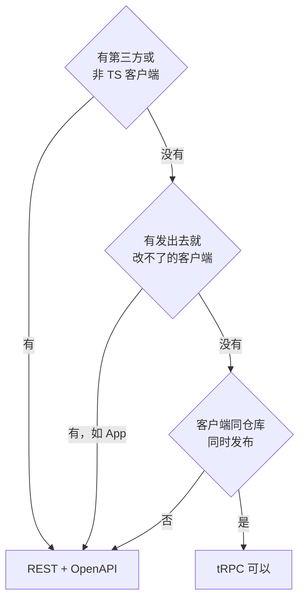

# REST、tRPC、GraphQL、gRPC 怎么选

前面几章默认接口是 REST 风格的 HTTP + JSON。但新项目起步时，总会冒出这样的念头：全栈都是 TS，用 tRPC 不是连 OpenAPI 都省了吗？前端要的字段各不相同，GraphQL 是不是更灵活？听说 gRPC 性能好。这一章把四种方案放在一起比较，重点不是它们各自怎么用，而是**它们各自在什么条件下成立**，以及对一个人维护、有 App 老版本要兼容的系统意味着什么。

## 四种方案的本质区别

| | REST | tRPC | GraphQL | gRPC |
|---|---|---|---|---|
| 抽象 | 资源 + HTTP 方法 | 远程调用 TS 函数 | 客户端写查询，服务端按 schema 解析 | 远程调用，接口用 protobuf 定义 |
| 契约 | OpenAPI（可选） | TS 类型本身 | GraphQL schema（必需） | `.proto` 文件（必需） |
| 客户端类型 | 从 OpenAPI 生成 | 直接从服务端推断，无需生成 | 从 schema 和查询生成 | 从 `.proto` 生成 |
| 语言 | 任意 | 只有 TS | 任意 | 任意 |
| 传输 | HTTP/1.1 或 2，JSON | HTTP，JSON | 通常是 HTTP POST，JSON | HTTP/2，二进制 |
| HTTP 缓存 | 天然支持 | GET 查询可以 | 难（多为 POST） | 不适用 |
| 浏览器直接调 | 能 | 能 | 能 | 要 gRPC-Web 或 Connect 协议转一层 |
| 第三方接入 | 最容易 | 基本不行 | 可以，学习成本中等 | 可以，要装工具链 |
| 演进机制 | 靠约定和工具 | 靠 TS 编译 | 只增不删 + 内置 `@deprecated` | protobuf 字段编号规则 |

## tRPC：同一次编译里的类型安全

> [!WARNING]
> 本节 tRPC 的写法按 v11 凭记忆写成，以 tRPC 官方文档（trpc.io）为准。

tRPC 的思路是：服务端定义一组「过程」（procedure），客户端像调本地函数一样调它们，参数和返回值的类型直接从服务端代码推断出来，不需要任何生成步骤。

```typescript
// server/router.ts
import { initTRPC, TRPCError } from "@trpc/server";
import { z } from "zod";

const t = initTRPC.context<{ storeId: string }>().create();

export const appRouter = t.router({
  expenses: t.router({
    list: t.procedure
      .input(z.object({ cursor: z.string().nullish(), limit: z.number().int().max(100).default(20) }))
      .query(({ ctx, input }) => listExpenses(db, ctx.storeId, input)),
    create: t.procedure
      .input(CreateExpense)
      .mutation(({ ctx, input }) => createExpense(db, ctx.storeId, input)),
  }),
});

export type AppRouter = typeof appRouter;
```

```typescript
// web/api.ts
import { createTRPCClient, httpBatchLink } from "@trpc/client";
import type { AppRouter } from "../server/router";

const api = createTRPCClient<AppRouter>({ links: [httpBatchLink({ url: "/trpc" })] });

const page = await api.expenses.list.query({ limit: 20 });
//    ^? { items: Expense[]; nextCursor: string | null }
```

在服务端改了 `listExpenses` 的返回值，前端用到的地方**立刻**标红。对于同一个仓库里、同时部署的网页端，这是最顺滑的开发体验。

### 它的前提：客户端和服务端一起编译、一起发布

tRPC 的类型安全来自 `import type { AppRouter }`，这在编译期成立。问题在于：

- **已经装在用户手机上的 App 不会重新编译**。服务端改了一个过程的输入，当前仓库里的 App 代码编译报错、你改好了，但线上 1.3 版本的 App 还在按旧的输入调用。TS 帮你检查的是「下一个版本的 App」，不是「已经发出去的 App」
- **没有一份独立的契约文件**，CI 没法像比较 OpenAPI 那样比较「这次改动对老客户端是否安全」
- **只有 TS 能用**，第三方无法接入

所以 tRPC 的适用条件很明确：**调用方全是同仓库、同发布节奏的 TS 客户端**。对 hatch-counter 来说，门店网页后台满足这个条件，App 不满足，未来的第三方集成更不满足。

> [!NOTE]
> 社区有把 tRPC 路由导出为 OpenAPI 的适配器，可以部分弥补「没有契约文件」的缺口。但如果你发现自己在给 tRPC 补 OpenAPI、补版本兼容、补 REST 风格的路径，那说明这个场景本来就更适合 REST。

## GraphQL：客户端决定要什么

GraphQL 让客户端在一次请求里声明自己要哪些字段、要哪些关联数据：

```graphql
query StoreDashboard {
  store {
    name
    expenses(first: 5) {
      edges { node { amount note paidAt } }
    }
    lowStockProducts { name stock stockAlert }
  }
}
```

它解决的是一个真实的问题：**很多种客户端、每种要的数据形状都不同**。Facebook 当年有大量不同的移动端界面，每个界面都要一个定制的 REST 接口，或者一次拉一堆用不上的字段。GraphQL 让后端只维护一个 schema，前端自己组合。

它的演进机制也比 REST 更省心：字段只增不删，要弃用的字段在 schema 里标 `@deprecated(reason: "...")`，服务端还能统计每个字段被哪些查询用到，精确知道一个字段什么时候可以安全删除。

但代价同样真实：

| 代价 | 说明 |
|---|---|
| N+1 查询 | 每个 `node` 的关联字段各查一次库；要用 DataLoader 这类批处理机制，每个关联都要写 |
| 缓存 | 查询通常是 POST，HTTP 缓存和 CDN 用不上；要做客户端规范化缓存（Apollo、urql） |
| 安全 | 客户端可以写出极深、极宽的查询把服务端拖垮；要做深度限制、复杂度计算，或者只允许预先登记的查询 |
| 权限 | 授权要做到字段级，每个解析器都要检查 |
| 工具链 | schema、代码生成、客户端缓存库，整套都要学、要维护 |

对一人公司来说，「很多种客户端、各要不同形状」这个前提通常不成立：一个网页后台、一个 App，界面就那么几十个，为它们写专门的 REST 接口反而更直接。GraphQL 的成本是为大团队、多客户端准备的。

## gRPC：服务之间的高效调用

gRPC 用 protobuf 定义接口，二进制编码，跑在 HTTP/2 上，原生支持双向流：

```protobuf
syntax = "proto3";

service ExpenseService {
  rpc ListExpenses(ListExpensesRequest) returns (ListExpensesResponse);
}

message Expense {
  string id = 1;
  int64 amount = 2;   // 分
  string note = 3;
  int64 paid_at = 4;  // Unix 毫秒
}
```

它的强项：

- **跨语言的强类型**：Go、Java、Python、TS 都能从同一个 `.proto` 生成客户端和服务端代码
- **演进规则清晰**：字段靠编号识别而不是名字，新增字段用新编号、不复用删掉的编号，老客户端自动忽略不认识的字段。这是四种方案里兼容性规则最「机械化」的
- **性能**：二进制编码比 JSON 小、解析快；HTTP/2 多路复用

它的问题在于浏览器：浏览器不能直接发原生 gRPC 请求，需要 gRPC-Web 加一个代理，或者用 Connect 这类同时兼容 gRPC 和普通 HTTP+JSON 的协议。调试也不如 JSON 直观，curl 一下看不到内容。

gRPC 适合**服务之间**的调用，尤其是多语言的内部服务。一个人的模块化单体，内部模块之间是函数调用，根本没有服务间通信，也就没有 gRPC 的位置。等哪天真的拆出一个 Python 写的模型推理服务，那时再考虑。

## 实时：不在这四种里

需要服务端主动推的场景（库存变了、新订单来了、上传进度），以上四种的「请求—响应」模型都不直接适用。常用的是 SSE（服务端单向推）和 WebSocket（双向）。tRPC 和 GraphQL 都有自己的订阅机制，底层也是这两者之一。实时推送的设计见[《软件架构与系统设计》的实时推送一章](../system-design/05-realtime-push.md)。

从接口约定的角度，推荐的做法是**推送只推「什么变了」，不推数据本身**：推一个「开支有更新，版本 1234」的通知，客户端再用普通的 REST 接口去拉。这样数据的读取只有一条路径，权限、格式、分页都只写一次。

## 怎么选



两条补充：

- GraphQL 和 gRPC 不在这张图里，不是因为它们不好，而是它们解决的问题（大量异构客户端、多语言服务间通信）在一人公司的阶段很少出现。遇到了再引入
- 同一个系统可以混用。最常见的是**对外 REST、对内 tRPC**：App 和第三方走 REST + OpenAPI，管理后台这种只有网页端、和服务端同仓库同发布的部分走 tRPC。代价是两套东西都要维护，规模小时不一定值得

### 三个项目的选择

| 项目 | 调用方 | 选择 | 理由 |
|---|---|---|---|
| hatch-counter | 网页后台、App、未来的收银系统集成 | REST | App 老版本要兼容，以后要给第三方 |
| hatch-recordwall | Expo App、Electron 桌面端，后端是 Cloudflare Worker | 少量 REST 接口 | 接口就是几个文件的读写，Worker 上越简单越好；条件写直接用 HTTP 的 `If-Match` |
| hatch-shelf 传书 | 内置网页、同仓库的命令行 | 极简的 HTTP 接口 | 服务跑在手机上，手写的 HTTP 解析，接口越少越好 |

recordwall 的例子说明了 REST 一个常被忽视的好处：**它就是 HTTP**。对象存储的条件写、CDN 缓存、Worker 的 `fetch` 处理器，全都原生理解 `ETag`、`If-Match`、`Cache-Control`。选了 REST，这些基础设施的能力是直接拿来用的；选了别的，往往要绕一层。

## 本章要点

- 四种方案的差别在抽象、契约形式、语言范围、缓存和演进机制
- tRPC 的类型安全只覆盖同一次编译；已经发出去的 App 不受它保护，也没有可比较的契约文件
- GraphQL 解决「很多种客户端、各要不同形状」，代价是 N+1、缓存、查询安全和字段级授权
- gRPC 适合多语言服务间通信，演进规则最机械化；浏览器要转一层
- 有第三方、非 TS 客户端或发出去就改不了的客户端，就用 REST + OpenAPI
- 实时推送用 SSE / WebSocket，只推「什么变了」，数据仍走普通接口拉取
- 选 REST 等于直接用上 HTTP 基础设施的能力：缓存、条件请求、CDN

## 动手练习

1. **给三个场景选方案**：① 一个人做的记账网页，Next.js 前后端同仓库同时部署，没有 App；② 健身工作室预约系统，有 iOS App，计划半年后开放给合作的小程序；③ 你在 Node 主服务旁边加了一个 Python 写的图片识别服务，只有主服务调用它。按[怎么选](#怎么选)的流程图给出选择和关键判断。

   验证：每个选择都能说出流程图里是哪一个判断把它分出来的。

   参考答案：① tRPC 可以（同仓库、同时发布、全 TS），用 REST 也不算错；② REST + OpenAPI（App 发出去就改不了，还要给第三方）；③ 内部服务间调用，跨语言，简单场景用 HTTP + JSON 即可，调用量大、接口多时再考虑 gRPC。

2. **验证「tRPC 不保护已发出去的 App」**：在一个 tRPC 示例项目里，把 `expenses.list` 的输入从 `limit` 改名为 `pageSize`，客户端同步改好、`tsc` 通过。然后用 `curl` 模拟老版本 App，按旧参数调用：`curl 'localhost:3000/trpc/expenses.list?input=%7B%22limit%22%3A5%7D'`。

   验证：`tsc` 没有任何报错，但 `curl` 的结果和改名前不同：zod 默认剥掉未知键，`limit` 被忽略、`pageSize` 取默认值，老客户端收到的条数变了而没有任何错误。

   参考答案：编译期检查只覆盖本次编译的代码；已安装的 App 是另一份旧代码，没有契约文件可比较，这类行为变化只能靠约定和监控发现。

3. **只推「什么变了」**：写一个 SSE 接口 `GET /events`，每 3 秒推一条 `data: {"type":"expenses","version":N}`，用 `curl -N localhost:3000/events` 观察。

   验证：终端里每隔约 3 秒出现一行 `data: ...`，`version` 递增，连接一直不断开。

   参考答案：

   ```javascript
   let v = 0;
   require("node:http").createServer((req, res) => {
     res.writeHead(200, { "Content-Type": "text/event-stream", "Cache-Control": "no-cache" });
     const t = setInterval(() => res.write(`data: ${JSON.stringify({ type: "expenses", version: ++v })}\n\n`), 3000);
     req.on("close", () => clearInterval(t));
   }).listen(3000);
   ```

   客户端收到通知后用普通的 `GET /expenses` 拉数据，权限和分页只写一次。
