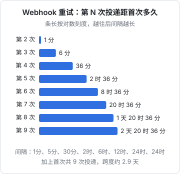

# Webhook 设计

前面的接口都是「别人来问你」。Webhook 反过来：**你的系统发生了某件事，主动去通知别人**。门店的收银系统想在每笔开支记下时同步到自己的账里，与其每分钟轮询一次 `GET /expenses`，不如由 hatch-counter 在开支创建时发一个 HTTP 请求过去。这一章讲怎么设计一个可靠的 Webhook：事件长什么样、怎么签名让对方确认是你发的、发失败了怎么重试，以及接收方要遵守哪些规矩。最后一节反过来，讲你接收别人的 Webhook（比如支付回调）时的清单。

## Webhook 本质上是一个反向的 API

| | 普通 API | Webhook |
|---|---|---|
| 谁发起 | 调用方 | 你 |
| 谁实现接收端 | 你 | 调用方 |
| 失败了谁重试 | 调用方 | 你 |
| 认证 | 调用方证明自己是谁 | 你证明自己是谁（签名） |
| 契约 | 接口文档 | 事件文档 |

最后一行很重要：Webhook 的事件格式和普通接口的回包一样是**契约**，[第 4 章](04-versioning-evolution.md)讲的兼容规则全部适用。区别是你更难知道对方怎么解析它，所以要更保守。

## 事件格式

### 信封

所有事件共用一个外层结构：

```json
{
  "id": "evt_01JC6A9X2K",
  "type": "expense.created",
  "createdAt": "2026-11-04T09:12:00.000Z",
  "apiVersion": "1",
  "storeId": "sto_01HZ8M",
  "data": {
    "object": {
      "id": "exp_01JC3Z8Q",
      "amount": 3200,
      "note": "买纸杯",
      "paidAt": "2026-11-04T17:12:00+08:00",
      "version": 1
    }
  }
}
```

| 字段 | 作用 |
|---|---|
| `id` | 事件的唯一 id，接收方用它去重。重试时**保持不变** |
| `type` | 事件类型，`资源.动作` 的形式，过去时：`expense.created`、`expense.updated`、`stock_order.received` |
| `createdAt` | 事件发生的时间，不是这次投递的时间 |
| `apiVersion` | `data` 里对象的格式版本 |
| `data.object` | 发生变化后的资源快照，格式和 `GET /expenses/{id}` 的回包一致 |

`data.object` 和普通接口回包用**同一个 schema**，这样接收方已有的解析代码可以直接复用，你也只需要维护一份格式。

### 胖事件还是瘦事件

| | 胖事件 | 瘦事件 |
|---|---|---|
| 内容 | 完整的资源快照 | 只有 id 和类型 |
| 接收方要做的 | 直接用 | 收到后调 `GET` 拉最新数据 |
| 顺序问题 | 旧快照可能晚于新快照到达 | 总是拉到最新的，没有顺序问题 |
| 数据泄露面 | 事件里有完整数据，发错地址就泄露了 | 只有 id，没有凭证拿不到数据 |
| 对方负担 | 低 | 要有 API key、要多一次请求 |

两者各有道理。推荐的折中是**发快照，但快照里带 `version`**，同时在文档里明确：「事件可能乱序、可能重复。需要严格一致的场景，以 `GET` 拉到的为准。」这样简单的集成方直接用快照，严格的集成方把事件当作「该去拉一下了」的通知。

### 事件类型要克制

不要为每个字段的变化定义一个事件（`expense.amount_changed`、`expense.note_changed`）。按资源的生命周期来：`created`、`updated`、`deleted`，加上少数有业务含义的状态迁移（`stock_order.received`、`store.expired`）。事件类型和错误码一样，一旦发布就不能改名。

订阅时让对方选择要哪些类型，不要默认推送全部。一个只关心开支的收银系统，不需要每次改商品名都被通知一次。

## 签名：证明是你发的

接收方的 URL 是公开的，任何人都能往上面 POST 一个看起来像你发的事件。签名让接收方能验证两件事：**这个请求确实来自你，内容没被改过**。

> [!WARNING]
> 本节的头名和签名格式参照 Standard Webhooks 规范（standardwebhooks.com）凭记忆整理，Stripe、GitHub 等平台各有自己的格式。以该规范和各平台官方文档的最新版本为准。

### 方案

每个订阅（接收端点）生成一个独立的密钥，创建时展示一次给用户。每次投递：

1. 取事件 id、当前时间戳、**原始请求体字节**，拼成 `{id}.{timestamp}.{body}`
2. 用密钥做 HMAC-SHA256，结果 base64 编码
3. 放进三个请求头

```http
POST /hooks/hatch HTTP/1.1
Content-Type: application/json
webhook-id: evt_01JC6A9X2K
webhook-timestamp: 1793783520
webhook-signature: v1,K5oZfzN95Z9UVu1EsfQmfVNQhnkZ2pj9o9NDN/H/pI4=

{"id":"evt_01JC6A9X2K","type":"expense.created",...}
```

为什么签名内容里要有时间戳：没有它，截获的一个合法请求可以在任何时候被原样重放。接收方检查时间戳与当前时间相差不超过 5 分钟，超过就拒绝。

为什么要有事件 id：签名把 id 和内容绑在一起，攻击者不能拿一个旧事件的内容配一个新 id 来绕过接收方的去重。

`v1,` 前缀是签名方案的版本。头里可以放多个签名，空格分隔，这在**轮换密钥**时有用：轮换期间用新旧两个密钥各签一次，接收方只要有一个能验过就接受。

### 发送方

```typescript
import { createHmac } from "node:crypto";

export function signWebhook(secret: Buffer, id: string, timestamp: number, body: string) {
  const sig = createHmac("sha256", secret).update(`${id}.${timestamp}.${body}`).digest("base64");
  return `v1,${sig}`;
}

// 密钥形如 whsec_<base64>，存储时存解码后的字节（加密存储）
export const parseSecret = (s: string) => Buffer.from(s.replace(/^whsec_/, ""), "base64");
```

### 接收方

把验签写成一个独立函数，放进 SDK 和文档，让接入方直接复制：

```typescript
import { createHmac, timingSafeEqual } from "node:crypto";

const TOLERANCE_SECONDS = 5 * 60;

export function verifyWebhook(
  rawBody: Buffer,
  headers: Record<string, string | undefined>,
  secrets: Buffer[], // 轮换期间可能有两个
  now = Math.floor(Date.now() / 1000),
): boolean {
  const id = headers["webhook-id"];
  const ts = Number(headers["webhook-timestamp"]);
  const sigHeader = headers["webhook-signature"];
  if (!id || !Number.isInteger(ts) || !sigHeader) return false;
  if (Math.abs(now - ts) > TOLERANCE_SECONDS) return false;

  const signed = Buffer.concat([Buffer.from(`${id}.${ts}.`), rawBody]);
  const presented = sigHeader
    .split(" ")
    .filter((s) => s.startsWith("v1,"))
    .map((s) => Buffer.from(s.slice(3), "base64"));

  return secrets.some((secret) => {
    const expected = createHmac("sha256", secret).update(signed).digest();
    return presented.some((p) => p.length === expected.length && timingSafeEqual(p, expected));
  });
}
```

两个容易错的地方：

- **必须用原始请求体验签**。框架解析成 JSON 对象后再 `JSON.stringify` 回来，键的顺序、空格、Unicode 转义都可能和原文不同，签名就对不上了
- **比较用 `timingSafeEqual`**，不要用 `===`。逐字节比较的耗时会泄露「前几个字节对了」，理论上能被逐字节猜出签名

> [!WARNING]
> NestJS 获取原始请求体的方式（`NestFactory.create(AppModule, { rawBody: true })` 后通过 `RawBodyRequest` 读取 `req.rawBody`）按近期版本凭记忆写成，以 NestJS 官方文档 FAQ 中 Raw body 一节为准。

在 NestJS 里接收：

```typescript
import { Controller, Headers, HttpCode, Post, Req, type RawBodyRequest } from "@nestjs/common";
import type { Request } from "express";

@Controller("hooks")
export class HooksController {
  @Post("hatch")
  @HttpCode(204)
  async receive(@Req() req: RawBodyRequest<Request>, @Headers() headers: Record<string, string>) {
    if (!req.rawBody || !verifyWebhook(req.rawBody, headers, this.secrets)) {
      throw new ApiProblem("invalid_signature", "签名不对");
    }
    // 先落库再返回，处理放到后台
    await this.inbox.save(JSON.parse(req.rawBody.toString("utf8")));
  }
}
```

## 投递与重试

### 至少一次，不保证只有一次

网络有「不知道」这第三种结果（见[《软件架构与系统设计》的幂等一章](../system-design/06-idempotency-consistency.md#网络的第三种结果)）：你发出去了，对方处理了，但 200 的回包丢了。你只能重发。所以 Webhook 的投递语义是**至少一次**：同一个事件可能到达多次，接收方必须按事件 `id` 去重。

这一条要在文档的最显眼处写清楚。

### 事件和业务写在同一个事务里

「开支记下了，但事件没发出去」和「事件发出去了，但开支回滚了」都不能接受。做法是 outbox：在业务事务里同时写一行事件，后台任务读出来投递。

```sql
CREATE TABLE webhook_events (
  id          text        PRIMARY KEY,           -- evt_...
  store_id    uuid        NOT NULL,
  type        text        NOT NULL,
  payload     jsonb       NOT NULL,
  created_at  timestamptz NOT NULL DEFAULT now()
);

CREATE TABLE webhook_deliveries (
  event_id      text        NOT NULL REFERENCES webhook_events(id),
  endpoint_id   uuid        NOT NULL,
  attempt       int         NOT NULL DEFAULT 0,
  next_at       timestamptz NOT NULL DEFAULT now(),
  status        text        NOT NULL DEFAULT 'pending', -- pending / succeeded / failed
  last_status   int,                                    -- 对方最近一次的 HTTP 状态码
  last_error    text,
  PRIMARY KEY (event_id, endpoint_id)
);
```

业务事务里写 `webhook_events`，并为每个订阅了这个类型的端点写一行 `webhook_deliveries`。Postgres 表当队列、`FOR UPDATE SKIP LOCKED` 取任务的写法，见[《软件架构与系统设计》的队列一章](../system-design/04-queues-jobs.md#postgres-当队列)。

### 一次投递的规则

```typescript
const SCHEDULE_MIN = [1, 5, 30, 120, 360, 720, 1440, 1440]; // 第 n 次失败后等多久

async function deliver(d: Delivery, ev: WebhookEvent, ep: Endpoint) {
  const body = JSON.stringify(ev.payload);
  const ts = Math.floor(Date.now() / 1000);
  let status: number | null = null;
  let error: string | null = null;

  try {
    const res = await fetch(ep.url, {
      method: "POST",
      headers: {
        "Content-Type": "application/json",
        "User-Agent": "hatch-counter-webhooks/1",
        "webhook-id": ev.id,
        "webhook-timestamp": String(ts),
        "webhook-signature": ep.secrets.map((s) => signWebhook(s, ev.id, ts, body)).join(" "),
      },
      body,
      redirect: "manual",                 // 不跟随重定向
      signal: AbortSignal.timeout(10_000), // 10 秒超时
    });
    status = res.status;
  } catch (err) {
    error = err instanceof Error ? err.message : String(err);
  }

  if (status !== null && status >= 200 && status < 300) {
    return markSucceeded(d, status);
  }
  const wait = SCHEDULE_MIN[d.attempt];
  if (wait === undefined) {
    return markFailed(d, status, error); // 用完了，进入失败，通知用户
  }
  return scheduleRetry(d, { attempt: d.attempt + 1, nextAt: addMinutes(new Date(), wait), status, error });
}
```

要点：

- **只有 2xx 算成功**。3xx 不跟随（防止被重定向到内网），4xx 和 5xx 都重试。有的平台对 4xx 不重试，理由是「对方明确拒绝了」；但实践中接收方部署出错时回 404、验签代码有 bug 时回 401 都很常见，而这些修好之后希望能收到补发。所以统一重试，交给重试次数上限兜底
- **超时要短**，10 秒左右。文档里要求接收方「先落库、立刻返回 2xx，再在后台处理」，不要在 Webhook 请求里同步做耗时的事
- **重试间隔逐渐拉长**，覆盖对方几个小时到一两天的故障



上图的时间表加上首次一共 9 次投递，跨度将近 3 天：对方周五晚上服务挂了，周一上班修好还能收到。每次的实际等待可以加一点随机抖动，避免大量积压的事件在同一时刻一起重发。

### 持续失败的端点

一个端点连续几天全部失败，大概率是对方已经不用了（换了域名、服务下线）。继续投递只会浪费资源。规则：

- 某个端点的所有事件连续失败超过一定时间（比如 5 天），自动**停用这个端点**，发邮件通知账号的所有者
- 停用后的事件不再投递，但仍然记录，用户修好之后可以在后台手动「重新启用并补发」

### 顺序

Webhook **不保证顺序**。重试会让先发生的事件晚到；多个 worker 并发投递也会打乱顺序。接收方要能处理「`expense.updated` 比 `expense.created` 先到」的情况。

保证顺序（同一个资源的事件严格按序投递，前一个没成功后一个就等着）在实现上很贵，而且一个事件卡住会堵住后面所有事件。更好的办法是让顺序变得不重要：快照里带 `version`，接收方只在 `version` 更大时才覆盖本地数据。

## 补救手段

再可靠的投递也会有漏网的情况。给接收方留几条补救的路：

| 手段 | 说明 |
|---|---|
| 投递日志 | 后台里能看到每个事件的每次投递：时间、对方回的状态码、响应体的前几百字节。接入方排查「为什么没收到」时，九成问题看一眼日志就清楚 |
| 手动重发 | 在投递日志里点「重新发送」 |
| 测试事件 | 「发一个测试事件」按钮，接入方调试时不用真去记一笔开支 |
| 事件列表接口 | `GET /events?type=expense.created&after=evt_...`，接收方可以定期对账，补上漏掉的。事件保留 30 天 |

事件列表接口是最后一道防线。有了它，接收方甚至可以完全不依赖推送，自己按游标拉取，Webhook 只是让它拉得更及时。

## 发送方的安全：SSRF

让用户填一个 URL、然后你的服务器去请求它，这是典型的 SSRF（服务端请求伪造）入口。用户可以填 `http://127.0.0.1:5432`、`http://169.254.169.254/`（云服务器的元数据地址）、`http://10.0.0.5/admin`，让你的服务器替他访问内网。

防护：

- **只允许 `https://`**，端口限制在 443（或者一个小白名单）
- **解析域名后检查 IP**：拒绝回环、私有网段、链路本地、云元数据地址。要在**实际连接时**检查解析结果，而不只是在保存 URL 时检查一次，否则对方可以先解析到公网地址通过检查，再把 DNS 改成内网地址（DNS rebinding）
- **不跟随重定向**：上面代码里的 `redirect: "manual"`
- **回包只记前几百字节**，不要把对方的响应完整展示给用户，那可能是内网服务的内容

这类检查用现成的库（按 IP 段过滤的 HTTP agent）比自己写可靠。如果 Webhook 投递跑在一个独立的、没有内网访问权限的进程或容器里，风险会小得多。

## 你作为接收方

一人公司更常见的其实是**接收**别人的 Webhook：支付平台的支付结果通知、应用商店的订阅状态通知、代码托管平台的推送通知。前面讲的每一条反过来就是接收方的清单：

- **验签**：用原始请求体，用常数时间比较，检查时间戳。不验签的支付回调等于一个任何人都能调的「把订单标为已支付」接口
- **按事件 id 去重**：同一个通知会来多次，用唯一约束挡住
- **先落库，立刻返回 2xx，再异步处理**：处理逻辑出错不应该导致对方不停重试
- **不信任通知里的关键数据**：涉及钱的，收到通知后调对方的查询接口确认状态和金额，而不是直接用通知里的数字
- **不依赖顺序**：用状态机，只做合法的状态迁移（`pending → paid` 可以，`refunded → paid` 拒绝）
- **有对账**：定期用对方的列表接口拉一遍，补上漏收的通知

各个平台的签名方式、重试策略、通知格式都不一样，接入时以对方的官方文档为准，并且一定在测试环境里把「重复通知」「乱序通知」「签名错误」三种情况都试一遍。

## 本章要点

- Webhook 是反向的 API：你发起、你重试、你签名，事件格式同样是契约
- 事件信封：`id`、`type`（`资源.动作`）、`createdAt`、`data.object`；快照和普通接口回包同一个 schema
- 快照里带 `version`，文档写明可能乱序、重复，严格场景以 `GET` 为准
- HMAC-SHA256 签 `id.timestamp.body`，每个端点独立密钥，支持多签名以便轮换；接收方用原始请求体、常数时间比较、检查时间戳
- 投递是至少一次：outbox 和业务同事务，只认 2xx，短超时，间隔拉长的重试覆盖两三天
- 持续失败的端点自动停用并通知；提供投递日志、手动重发、测试事件和事件列表接口
- 用户填 URL 就有 SSRF：只允许 https，连接时检查解析出的 IP，不跟随重定向
- 接收别人的 Webhook：验签、去重、先落库后处理、关键数据回查确认、不依赖顺序、定期对账

## 动手练习

1. **签名往返，再故意弄坏它**：把本章的 `signWebhook`、`parseSecret`、`verifyWebhook` 放进一个文件。密钥用 `"whsec_" + randomBytes(24).toString("base64")`，原始请求体用带空格的 `'{"id": "evt_1", "amount": 3200}'`。依次验证：① 原样验签；② 把请求体 `JSON.stringify(JSON.parse(body))` 后再验；③ 时间戳改成 10 分钟前；④ 签名头里放「旧密钥签名 + 新密钥签名」，`secrets` 只给新密钥。

   验证：① `true`；② `false`；③ `false`；④ `true`。

   参考答案：② 失败是因为重新序列化去掉了空格，字节变了，所以接收端必须拿原始请求体验签；③ 超过 5 分钟容差，防重放；④ 多签名让轮换期间新旧密钥都能通过。

2. **算出重试的总跨度**：不看图，按本章的 `SCHEDULE_MIN` 算出一共投递几次、最后一次距首次多久，再写一行 Node 验证：`node -e 'const s=[1,5,30,120,360,720,1440,1440];console.log(s.length+1, s.reduce((a,b)=>a+b)/60)'`。

   验证：输出 `9 68.6`，即 9 次投递，最后一次在首次之后 68.6 小时（2 天 20 小时 36 分），和本章的图一致。

   参考答案：首次投递不在表里，所以次数是表长加 1；间隔逐渐拉长，用不多的次数覆盖到两三天的故障。

3. **让乱序变得无害**：接收方本地有 `Map<id, {version, amount}>`。依次收到 `expense.updated`（version 2，amount 3500）、`expense.created`（version 1，amount 3200）、同一个 `expense.updated` 重发一次。写一个 ≤10 行的 `apply(event)`，让最终状态正确。

   验证：三次调用后 `amount` 是 `3500`、`version` 是 `2`；打印每次是否真的写入，只有第一次写入。

   参考答案：

   ```typescript
   const store = new Map<string, { version: number; amount: number }>();
   function apply(ev: { data: { object: { id: string; version: number; amount: number } } }) {
     const o = ev.data.object;
     const cur = store.get(o.id);
     if (cur && cur.version >= o.version) return false; // 旧的或重复的，忽略
     store.set(o.id, { version: o.version, amount: o.amount });
     return true;
   }
   ```
