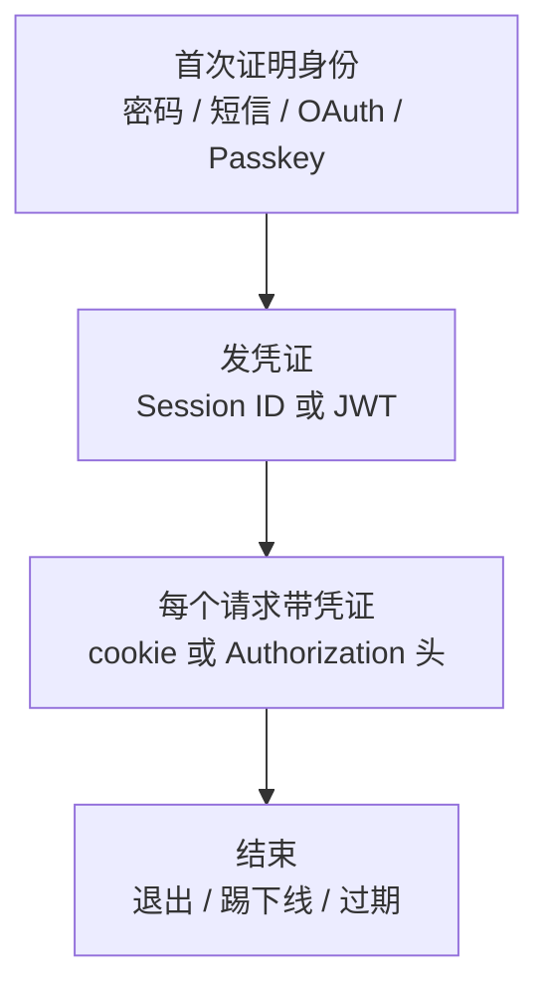
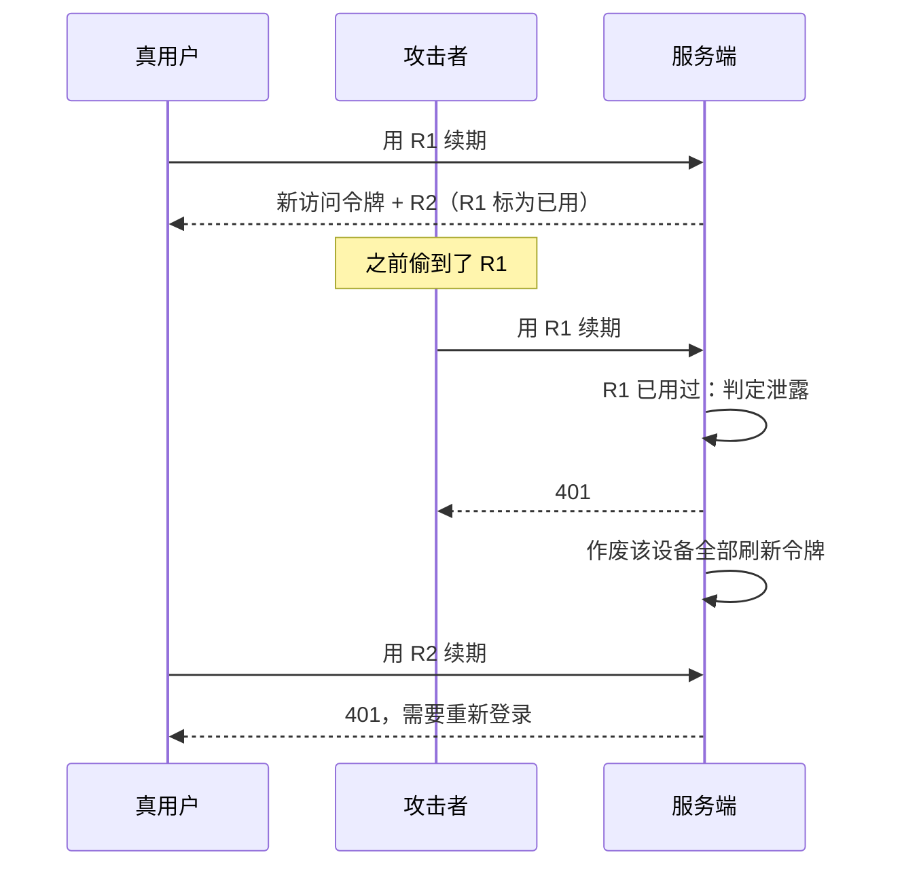
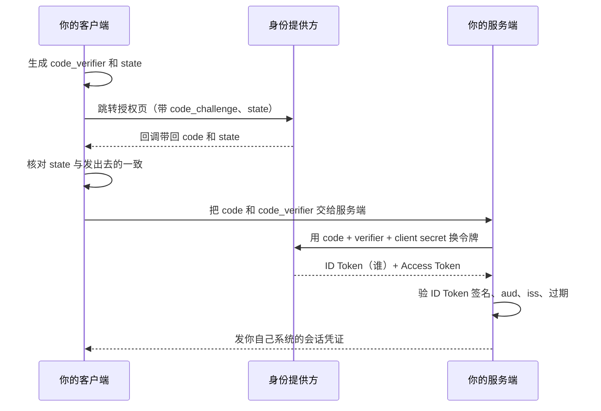
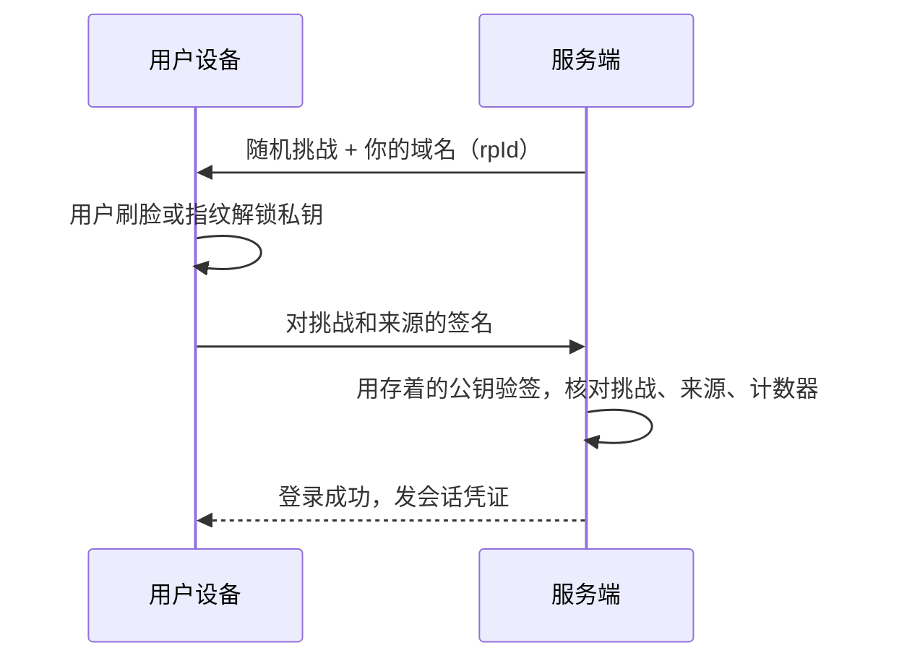

# 认证方案对比

一人公司没有安全团队，出事了也没有人替你兜底：用户数据泄露、账号被盗、服务被人刷成一张天价账单，都是你一个人的事。这本书从防御方的角度，把一个 TypeScript 全栈开发者上线产品时最常碰到的安全问题讲一遍：认证、授权、OWASP Top 10、密码与密钥、依赖供应链、移动端、日志、服务器被入侵之后怎么处置，最后收成一份能逐条对照的自查清单。

**适合谁**：已经能独立写出 NestJS / Workers 后端、React 或 Expo 客户端，准备或已经把产品交给真实用户用的人。不需要安全背景，但需要你对 HTTP、cookie、数据库有基本的了解。

**怎么读**：第 1–2 章（认证、授权）是地基，建议按顺序读；第 3 章用 OWASP Top 10 做一次全景扫描；第 4–7 章各管一块，按需跳读；第 8 章讲[服务器被入侵之后怎么处理](07-server-compromise.md)，最好在平静的时候读一遍；第 9 章的清单适合上线前和每个季度拿出来对一遍。

**不在这本书里的**：服务器本身的加固（SSH、fail2ban、端口、补丁）在[《一人运维手册》](../production-ops/)；浏览器侧的 CORS、CSP、XSS、SameSite 在[《前端工程化与 Web 平台》](../frontend-engineering/)最后一章；容器镜像和运行时的安全在[《容器技术》](../docker-containers/)；让编码 agent 安全地干活在[《Agent 安全》](../agent-safety/)。这些地方本书只引用结论，不重复展开。

贯穿全书的案例来自三个真实项目：

| 项目 | 是什么 | 本书主要拿它讲什么 |
|---|---|---|
| hatch-counter | 门店管理，NestJS + Postgres + Drizzle，网页端 + 移动端 + 管理后台 | 短信登录、JWT 双令牌、多租户 RLS、权限守卫、审计日志 |
| hatch-shelf | Expo 离线书架，WebView 阅读器 | 不可信文件的导入安全、WebView 隔离、局域网 PIN |
| hatch-recordwall | Expo + Electron 播放器，Cloudflare Worker 守着 R2 | 写死在 App 里的只读令牌、TOTP 换写令牌、代理转发 |

这一章先回答第一个问题：**你是谁**。也就是认证（authentication）。「你能做什么」是授权（authorization），放在下一章。

## 认证要解决的三件事

不管选哪种方案，认证都要回答三个问题：

1. **首次证明身份**：用户凭什么证明自己是这个账号的主人？密码、短信验证码、第三方账号、通行密钥（passkey）
2. **之后每个请求怎么认人**：证明一次之后，不能每个请求都让用户再输一次密码。服务端要发一个「凭证」，客户端每次带上
3. **怎么结束**：退出、踢下线、改密码、账号被盗时，已经发出去的凭证怎么作废

很多讨论把这三件事搅在一起，比如「JWT 和 OAuth 选哪个」——这两个根本不在同一层。下面先讲第 2、3 件（会话怎么维持），再讲第 1 件（首次怎么证明）。



## 会话怎么维持：Session 与 JWT

### 服务端 Session

最传统的做法：登录成功后，服务端生成一个随机的 session ID，把「这个 ID 对应哪个用户」存在服务端（内存、Redis 或数据库），把 ID 通过 cookie 发给浏览器。之后每个请求，服务端拿 cookie 里的 ID 去查。

- **优点**：撤销简单，删掉服务端那一行就立刻失效；凭证本身不含任何信息，泄露了也只是一串随机数
- **缺点**：每个请求都要查一次存储；多台机器要共享存储；主要靠 cookie，移动端和跨域场景要多费点事；cookie 自动携带带来了 CSRF 问题

session ID 必须来自密码学安全的随机源，长度至少 128 位：

```ts
import { randomBytes } from 'node:crypto';

// 32 字节 = 256 位，base64url 编码后 43 个字符
const sessionId = randomBytes(32).toString('base64url');
```

不要用 `Math.random()`、自增 ID、时间戳或 UUID v1 这类可预测的东西。

### JWT

JWT（JSON Web Token）把用户信息直接写进凭证里，再用密钥签名。服务端验证签名就能确认「这张票是我发的、没被改过」，不用查库。

一个 JWT 由三段 base64url 组成，用点隔开：头部（算法）、载荷（声明）、签名。载荷**只是编码不是加密**，任何人都能解开看，所以不能放秘密。

```ts
import { SignJWT, jwtVerify } from 'jose';

const secret = new TextEncoder().encode(process.env.JWT_SECRET);

// 签发：只放账号 ID 和设备 ID，15 分钟过期
export async function signAccess(accountId: string, deviceId: string) {
  return new SignJWT({ did: deviceId })
    .setProtectedHeader({ alg: 'HS256' })
    .setSubject(accountId)
    .setAudience('tenant')
    .setIssuedAt()
    .setExpirationTime('15m')
    .sign(secret);
}

// 验证：显式限定算法和受众，签名、过期一起校验
export async function verifyAccess(token: string) {
  const { payload } = await jwtVerify(token, secret, {
    algorithms: ['HS256'],
    audience: 'tenant',
  });
  return { accountId: payload.sub!, deviceId: payload.did as string };
}
```

JWT 的常见坑：

| 坑 | 后果 | 防法 |
|---|---|---|
| 不限定算法 | 历史上出现过接受 `alg: none` 或把 RS256 公钥当 HS256 密钥用的库漏洞 | 验证时写死 `algorithms` |
| 不校验 `aud` | 给 A 系统签的票能拿去 B 系统用 | 每种令牌一个 `aud`，验证时校验 |
| 往载荷里放会变的东西 | 角色、门店、权限改了，旧票还要等过期才生效 | 载荷只放身份，权限每次现查 |
| 寿命太长 | JWT 发出去就收不回来，泄露一张就是整个寿命期的窗口 | 访问令牌短命，配合刷新令牌 |
| 密钥太弱或是默认值 | 离线就能爆破出密钥，然后伪造任意用户 | 至少 32 字节随机；生产启动时拒绝开发密钥（第 4 章） |

hatch-counter 的两点做法值得照抄。第一，租户和后台员工共用一把签名密钥，**能把两种票分开的只有 `aud`**：租户票是 `tenant`，后台员工是 `admin`，两个全局守卫各认各的。文档里写得很清楚：这条得一开始就隔死，等两边都有一堆端点了再补 `aud` 校验，必定漏一个。第二，**门店不进令牌**：访问令牌里只有 `sub`（账号）和 `did`（设备），挑哪家店靠每个请求的 `x-store-id` 头现查。放进令牌的话，换绑门店、改权限、停用门店都要等旧令牌过期才生效。

### 「JWT 撤销不了」怎么办：双令牌

JWT 的无状态既是优点也是缺陷：它一旦签出去就无法撤回。业界通行的折中是**双令牌**：

- **访问令牌**（access token）：JWT，寿命几分钟到十几分钟，每个请求带着，服务端只验签
- **刷新令牌**（refresh token）：随机串，寿命几天到几十天，只用来换新的访问令牌，服务端存它的哈希，可以随时撤销

这样，撤销的生效延迟就被限制在访问令牌的寿命内。hatch-counter 更进一步：守卫每个请求还顺手查一下这台设备撤没撤，一台机器被踢下线之后，它手里那张访问令牌不会再多用十五分钟。这其实是在 JWT 上加回了一点状态，换来的是踢人立即生效——对一个要支持「店员离职立刻踢下线」的产品，值得。

### 刷新令牌轮换与重放检测

刷新令牌寿命长，是最值钱的偷窃目标。**轮换**（rotation）的意思是每次用它换访问令牌时，同时发一张新的刷新令牌，旧的标记为已使用。如果一张已使用的旧票又被拿来续期，说明它被复制过：要么攻击者在用，要么真用户在用而攻击者已经用过了。服务端分不清是谁，正确的反应是**把这台设备名下所有的票一起作废**，宁可让真用户重新登录一次。



hatch-counter 的 `TokensService.rotate()` 还处理了一个现实问题：**续期回包丢在路上**。客户端发了续期请求，服务端已经作废旧票、发了新票，但回包因为网络断了没到客户端。下次客户端只能拿旧票再来，按严格规则这就是重放，用户会被无辜踢下线。它的处理是给一个宽限：24 小时内、新票还没被任何人用过也没被撤销时，旧票照样算数，同时把没人收到的那张新票作废。24 小时是按「收银台那台正好赶上打烊关机，下一次续期就是第二天早上」定的。另外，作废旧票、发新票、记设备这三步放在一个数据库事务里，避免中间出错导致「旧票用掉了、新票没到手」。

## 首次证明身份的几种方式

### 密码

密码是最普及的方式，也是问题最多的方式：用户会复用、会被钓鱼、会被撞库。如果你要做密码登录，必须做到：

- 服务端只存**慢哈希**（scrypt、Argon2id、bcrypt），细节见第 4 章
- 登录接口限流，按账号和按 IP 各一道
- 错误提示不区分「账号不存在」和「密码错误」，避免被用来枚举注册用户
- 提供第二因素（TOTP 或 passkey），至少对管理员强制

### 短信验证码

在国内面向小商户、普通消费者的产品里，手机号 + 短信验证码几乎是默认选项：没有密码要记，用户接受度高。代价是**每条短信都是钱**，以及它的安全性取决于运营商（补卡劫持、短信嗅探都是真实存在的攻击）。

hatch-counter 的短信登录把几道闸门写得很细，可以当模板：

| 闸门 | 做法 | 防什么 |
|---|---|---|
| 码的寿命和尝试次数 | 一条码 5 分钟有效，最多试 5 次就作废 | 穷举 6 位验证码 |
| 两条之间的冷却 | 同一个号 60 秒一条 | 连点刷短信 |
| 按号的额度 | 同一个号滚动 24 小时最多 10 条 | 盯着一个号轰炸 |
| 按 IP 的额度 | 同一个 IP 滚动 24 小时 30 条，挡回去的请求也占名额 | 扫号段、批量轰炸 |
| 邀请制 | 没开通的号一条短信都不发，直接回 `not_provisioned` | 白花钱、给陌生人发短信 |

几个细节特别值得注意：

- **窗口是滚动的，不是自然日**：按自然日算的话，23:50 和 00:10 各刷满一轮，二十分钟里就走了两天的量
- **挡回去的请求也要记账**：没开通的号不发短信、不花钱，但如果不计入按 IP 的额度，这道闸门本身就成了一条免费、无限次的枚举接口，谁都能扫号段问出哪些号是你的客户
- **按 IP 限流准不准，取决于拿到的是不是真实客户端 IP**：在 nginx 后面要正确配置信任代理的跳数，少填一层，所有请求的 IP 都是 nginx 自己，限流就成了全站共享一个额度
- **后台管理员不用短信登录**：员工就那么几个人，更要紧的是后台权限太大，而短信可以被补卡劫持。后台用的是用户名 + 密码 + 动态验证码（TOTP）

每一道闸门能把攻击者的成功率压到多低，第 4 章会用一张图算给你看。

### OAuth 2.0 与 OIDC：用别人的账号登录

> [!WARNING]
> 本节的流程建议按 IETF RFC 9700《OAuth 2.0 安全最佳实践》（2025 年 1 月）整理，App Store 关于第三方登录的要求见《App Store 审核指南》4.8 节，两者都会修订，以 IETF 和 Apple 开发者网站的最新文本为准。

「用微信登录」「用 Apple 登录」「用 GitHub 登录」，背后是 OAuth 2.0 加上 OpenID Connect（OIDC）。准确地说，OAuth 2.0 本身是**授权**协议（让第三方应用代你访问某些资源），OIDC 在它之上加了一层 ID Token，才变成**认证**协议。

作为一个接入方（你的 App 是 client），只需要掌握一种流程：**授权码模式 + PKCE**。



要点：

- **`state` 防 CSRF**：回调时必须核对，否则攻击者可以把他自己的授权码塞给你，让你登进他的账号
- **PKCE 防授权码被截**：移动端的自定义 URL scheme 可能被别的 App 抢注，PKCE 保证截到 code 的人没有 verifier 也换不了令牌
- **client secret 只放服务端**：移动端、桌面端、SPA 都是公开客户端，打进包里的 secret 等于公开
- **登录完换成自己的会话**：第三方的 access token 不要直接当你系统的凭证用
- 别再用隐式模式（implicit），它在 OAuth 2.0 的安全最佳实践里已经不推荐

上架 iOS 时，如果提供第三方社交登录，App Store 审核指南对「是否需要同时提供 Sign in with Apple 或同等隐私保护的登录方式」有专门条款，条款措辞近几年调整过，以提交时的最新版本为准。

### Passkey：最值得加的那一种

> [!WARNING]
> 各平台对 passkey 的支持、同步方式，以及 SimpleWebAuthn 和 React Native 端相关库的 API，按 2025–2026 年的情况整理，变化很快，以 W3C WebAuthn 规范、Apple / Google 开发者文档和各库的最新文档为准。

Passkey 基于 WebAuthn / FIDO2：用户设备生成一对公私钥，私钥留在设备的安全硬件里（通常还会通过 iCloud 钥匙串、Google 密码管理器等在用户自己的设备间同步），服务端只存公钥。登录时服务端发一个随机挑战，设备用私钥签名，服务端用公钥验证。

它比密码和短信强在根上：

- **服务端没有可泄露的秘密**：数据库被拖走，攻击者拿到的只是公钥
- **天然防钓鱼**：凭证和域名绑定，浏览器或系统只会为注册时的那个域名签名，仿冒站点拿不到
- **没有东西可以复用、撞库或补卡劫持**



实现上不要自己解析 CBOR 和验证签名，用成熟的库（Node 生态里常用的是 SimpleWebAuthn）。对一人公司比较现实的路线是：**主登录方式不变（短信或密码），把 passkey 作为可选的快捷方式和第二因素加上去**，管理后台优先强制。React Native 端接入 passkey 需要原生能力和关联域名配置，各库对 Expo SDK 的支持情况变化快，动手前查对应版本的文档。

## 怎么选

| 方案 | 撤销 | 防钓鱼 | 服务端泄露的后果 | 运营成本 | 适合 |
|---|---|---|---|---|---|
| 密码 + Session | 立即 | 差 | 哈希被离线爆破 | 低 | 传统 Web 后台 |
| 短信验证码 + 双令牌 | 刷新令牌可撤，访问令牌短命 | 差（码可被骗走） | 无可爆破秘密 | 每条短信付费 | 国内面向商户 / 消费者的 App |
| OAuth / OIDC | 取决于你自己的会话 | 取决于身份提供方 | 你只存外部 ID | 接入和审核成本 | 用户已有大平台账号的场景 |
| Passkey | 取决于你自己的会话 | 强 | 只泄露公钥 | 实现复杂一些 | 作为附加方式，管理员必备 |

几条一人公司的经验：

- **会话机制和登录方式分开选**。登录方式按用户群定，会话机制按客户端定：纯同源网页用 Session cookie 最省心；同时有移动端的，用短命 JWT + 可撤销的刷新令牌
- **默认要登录**：hatch-counter 的全局 `AuthGuard` 默认每个端点都要登录，不需要的显式标 `@Public()`。反过来做（默认公开、要保护的加装饰器）迟早漏标一个，漏标的那个就裸奔
- **登录是你系统里被攻击最多的接口**：限流、记录失败、监控异常量，一样都不能少
- **别自己发明加密协议**。签名、哈希、WebAuthn 都用成熟库，你的工作是把参数配对

## 本章要点

- 认证回答三个问题：首次怎么证明、之后怎么认人、怎么结束；JWT 和 OAuth 不在同一层
- Session 撤销简单但要存储；JWT 不用查库但收不回来，所以访问令牌要短命
- JWT 验证时写死算法、校验 `aud`；载荷只放身份，权限和门店每次现查
- 刷新令牌要轮换并检测重放，发现重放就作废整台设备的票；为丢包留一个有边界的宽限
- 短信登录的闸门：码寿命和尝试次数、冷却、按号和按 IP 的滚动额度、挡回去的也记账
- 接第三方登录用授权码 + PKCE，核对 `state`，secret 只放服务端
- Passkey 服务端无秘密、天然防钓鱼，适合作为附加方式和管理员的第二因素

## 动手练习

以下练习都只在你自己的电脑上、用自己写的小脚本做，不要拿别人的服务或真实用户的令牌试。

1. **解开载荷，再递一张 alg=none 的票**：新建目录，`pnpm add jose`，把本章的 `signAccess` / `verifyAccess` 抄进 `jwt.mjs`（`JWT_SECRET` 用 32 个以上的随机字符）。先签一张票，用 `node -e "console.log(Buffer.from(process.argv[1].split('.')[1], 'base64url').toString())" <令牌>` 看它的载荷；再按下面的写法手工拼一张 `alg: none` 的票和一张 `aud: admin` 的票，交给验证函数。

   ```js
   const b64 = (o) => Buffer.from(JSON.stringify(o)).toString('base64url');
   const none = `${b64({ alg: 'none', typ: 'JWT' })}.${b64({ sub: 'u1', aud: 'tenant' })}.`;
   const admin = await new SignJWT({}).setProtectedHeader({ alg: 'HS256' })
     .setSubject('u1').setAudience('admin').setExpirationTime('15m').sign(secret);
   for (const t of [none, admin]) {
     try { await jwtVerify(t, secret, { algorithms: ['HS256'], audience: 'tenant' }); console.log('通过'); }
     catch (e) { console.log('拒绝', e.code); }
   }
   ```

   验证：第一条命令直接打印出含 `sub`、`did`、`aud` 的 JSON 明文；循环打印两行「拒绝」，第二行的错误码是 `ERR_JWT_CLAIM_VALIDATION_FAILED`，第一行是与算法不被允许有关的错误码（以你所装 jose 版本实际打印的为准）。

   参考答案：载荷只是 base64url 编码，谁都能读，所以不能放秘密；写死 `algorithms` 挡住了 `none`，校验 `aud` 挡住了发给别的系统的票。把 `algorithms` 和 `audience` 两个选项删掉再跑一次，观察第二张票会不会被放行。

2. **刷新令牌轮换与重放检测**：用一个 `Map` 在内存里实现 `issue(device)` 和 `rotate(token)`：每次续期作废旧票、发新票；已用过的旧票再来续期时，作废这台设备名下的所有票。然后按本章的时序图走一遍：`r1 = issue('d1')`，`r2 = rotate(r1)`，再 `rotate(r1)`，最后 `rotate(r2)`。

   验证：第三步抛出「重放」错误；第四步也失败（`r2` 已被连带作废），对应时序图里真用户被要求重新登录。

   参考答案：关键是「已用」标记和按设备连坐。真实系统里 `Map` 的键应换成令牌的 SHA-256（第 4 章），并且整个过程放进一个事务。

   ```js
   import { randomBytes } from 'node:crypto';
   const tokens = new Map(); // token -> { device, used }
   export function issue(device) {
     const t = randomBytes(32).toString('base64url');
     tokens.set(t, { device, used: false });
     return t;
   }
   export function rotate(t) {
     const rec = tokens.get(t);
     if (!rec) throw new Error('401');
     if (rec.used) {
       for (const [k, v] of tokens) if (v.device === rec.device) tokens.delete(k);
       throw new Error('401 重放：该设备全部作废');
     }
     rec.used = true;
     return issue(rec.device);
   }
   ```

3. **滚动窗口和自然日**：写一个 `allow(phone, now)`，同一个号滚动 24 小时最多 10 条；再写一个按自然日计数的版本。分别在 `23:50` 连发 10 条、`00:10` 再连发 10 条（用固定的 `Date` 时间戳模拟，不用真等）。

   验证：自然日版本 20 条全部放行；滚动窗口版本 `00:10` 那一轮一条都不放行。

   参考答案：滚动窗口保存每次发送的时间戳，判断时只数 `now - 24h` 之后的条数；自然日计数在零点清零，所以跨零点能拿到两倍额度。
