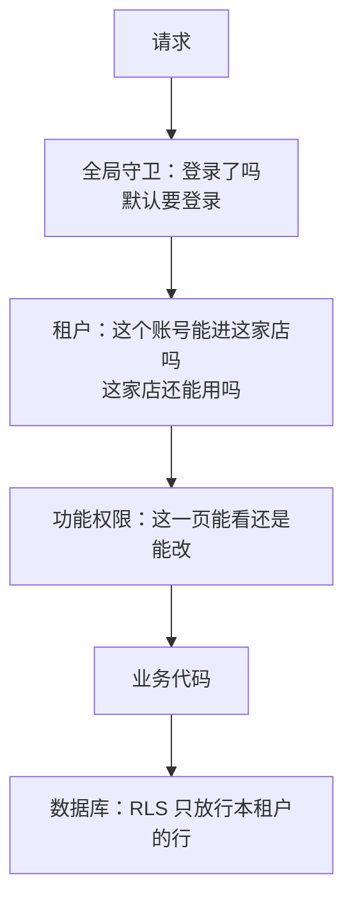

# 授权模型

上一章解决了「你是谁」，这一章解决「你能做什么」。授权出错的后果往往比认证更严重，也更隐蔽：认证坏了，用户登不进来，你马上就知道；授权坏了，一切看起来都正常，只是 A 店的店主能看到 B 店的账，或者一个普通店员能看到所有人的工资。OWASP Top 10 从 2021 版起把「失效的访问控制」排在第一位，到 2025 版仍然是第一，原因就在这里。

这一章先讲几种授权模型，再讲实现上最容易出事的几个地方，最后看 hatch-counter 怎么把多租户隔离交给数据库来兜底。

## 三种常见模型

### RBAC：按角色

基于角色的访问控制（Role-Based Access Control）：用户属于某个角色，角色拥有一组权限。「店主能改权限、店长能改库存、员工只能看排班」就是 RBAC。

- 好理解，好向用户解释
- 角色数量会膨胀：「能看开支但不能看工资的店长」要么新建一个角色，要么开始打补丁

### ABAC：按属性

基于属性的访问控制（Attribute-Based Access Control）：根据主体、资源、环境的属性做判断。「只能改自己创建的单据」「到期的门店不能写」「工作时间外不能导出」都是 ABAC。

- 表达力强，能写出细粒度规则
- 规则散落在代码各处时很难审计

### ReBAC：按关系

基于关系的访问控制（Relationship-Based Access Control）：权限来自主体和资源之间的关系。「你是这家店的成员，所以能看这家店的数据」「你是这个文档的协作者」。多租户 SaaS 的第一层隔离本质上就是 ReBAC。

实际系统几乎都是混合的。hatch-counter 就是三者叠加：

| 层 | 模型 | 规则 |
|---|---|---|
| 能不能进这家店 | ReBAC | `store_members` 里有没有这个账号和这家店的关系 |
| 这家店还能不能用 | ABAC | 门店状态是否停用、是否到期 |
| 进来之后每页能看还是能改 | RBAC + 可调 | 身份是模板（店长、员工、会计），每页三档 `none` / `view` / `edit` 可以单独改 |

最后一层的设计很务实：**权限是一组按页面的开关**，存成 `Record<PermKey, "none" | "view" | "edit">`。写死几档角色不给改，一定有店对不上；完全自由配置，店主又不会用。于是「身份是模板，改过的标出来」：在成员权限里逐页改过的人照旧叫店长，只是界面上挂一颗点，提示和预设不一样。

## 授权检查放在哪



### 原则一：服务端是唯一的裁判

界面上藏按钮、灰掉菜单只是体验，不是安全。会用浏览器开发者工具、或者拿到旧版本客户端的人，可以直接调接口。hatch-counter 的文档原话是：权限拦在服务端的 `PermGuard`，界面只是跟着变个样子；只靠界面的话，露出去的是这家店的盈亏和每个人的工资。

### 原则二：默认拒绝

漏写一个检查时，系统应该往安全的方向错。hatch-counter 有两处体现：

- 全局 `AuthGuard` 默认每个端点都要登录，公开的显式标 `@Public()`
- 业务端点标 `@Perm(钥匙, 档)`，**没标的一律只有店主进得去**。漏标的后果是「店长说他用不了」，而不是「员工看见了工资」

用 NestJS 写一个默认拒绝的权限守卫，骨架大致是这样：

```ts
import { CanActivate, ExecutionContext, ForbiddenException, Injectable, SetMetadata } from '@nestjs/common';
import { Reflector } from '@nestjs/core';

type Level = 'view' | 'edit';
const PERM_KEY = 'perm';
export const Perm = (key: string, level: Level) => SetMetadata(PERM_KEY, { key, level });

@Injectable()
export class PermGuard implements CanActivate {
  constructor(private readonly reflector: Reflector) {}

  canActivate(ctx: ExecutionContext): boolean {
    const req = ctx.switchToHttp().getRequest();
    const member = req.member; // 前一个守卫按 x-store-id 现查出来的成员关系
    if (!member) return true;  // 公开端点或非租户端点，交给别的守卫
    if (member.role === 'owner') return true;

    const need = this.reflector.getAllAndOverride<{ key: string; level: Level }>(PERM_KEY, [
      ctx.getHandler(),
      ctx.getClass(),
    ]);
    // 没标注：只有店主能用。漏标往安全那边错
    if (!need) throw new ForbiddenException('这个功能只有店主能用');

    const has = member.permissions[need.key] ?? 'none';
    const ok = need.level === 'view' ? has !== 'none' : has === 'edit';
    if (!ok) throw new ForbiddenException(`缺少「${need.key}」的${need.level === 'view' ? '查看' : '修改'}权限`);
    return true;
  }
}
```

### 原则三：权限每次现查

如果把角色、权限、可访问的门店写进 JWT，改权限就要等令牌过期才生效。店主刚把一个离职员工的权限关掉，对方还能继续看十五分钟，这在小店里是真实会发生的事。hatch-counter 的 `AuthGuard` 每个请求都现读这个人在这家店的身份和权限，改完立即生效，不用重新登录。多一次查询的成本，用索引和小表完全可以接受。

### 原则四：报错要说清楚

「403 无权限」对用户毫无帮助，只会让他去找你。hatch-counter 的拒绝信息写成「X 没有对你开放，需要的话让店主在『员工管理 → 成员权限』里放开」「你只能查看 X，改不了」。安全和体验不矛盾：说清楚缺什么、找谁开，既不泄露信息，又省掉一通客服电话。

## 停用的门店：拦在业务接口，而不是登录

这是一个很好的「授权放在哪一层」的案例。门店欠费被停用、服务到期，最直觉的做法是让登录失败。hatch-counter 刻意没有这样做：

- **停用和到期照样能登录**，登录照常发令牌，返回的门店列表带上 `status` 和 `expiresAt`
- **拦在业务接口上**：`requireStore()` 返回 `store_suspended`（「这家门店已停用，请联系客服」）或 `store_expired`（「这家门店的服务已到期，请联系客服续期」）

理由写在文档里：做成登录失败的话，店主会以为系统坏了、验证码出了问题，反复重试、打电话骂人；登进来看到一句明确的「已停用，请联系客服」，他知道下一步该干什么。而且一个账号可能是多家店的成员，一家店被停，别家的登录不该受影响。

这背后的原则是：**认证只回答「你是谁」，「这个资源现在能不能用」是授权的事**。把两者混在一起，既伤体验，又让逻辑纠缠。同理，停用、删店也不撤成员的登录：业务接口当场就拦，删掉的店也不再出现在他能进的店里。

另一个细节：客户端也要显示「快到期」「已停用」，判定逻辑只写一份，放在前后端共用的 `@counter/core` 里（`storeServiceState()`），和服务端 `requireStore()` 比的是同一个时刻。客户端说「还能用」而服务端拒绝，是最难解释的一种不一致。

## IDOR：最常见的授权漏洞

不安全的直接对象引用（Insecure Direct Object Reference）：接口按 ID 取资源，却没有检查这个资源是否属于当前用户。

```ts
// 错误：只要知道 ID 就能读到任何一张单据
@Get('receipts/:id')
async get(@Param('id') id: string) {
  return this.db.select().from(receipts).where(eq(receipts.id, id));
}

// 正确：ID 和租户一起作为条件
@Get('receipts/:id')
async get(@Param('id') id: string, @StoreId() storeId: string) {
  return this.db
    .select()
    .from(receipts)
    .where(and(eq(receipts.id, id), eq(receipts.storeId, storeId)));
}
```

用 UUID 代替自增 ID 能让猜测变难，但**不是授权**：ID 会出现在 URL、日志、分享链接、截图里。真正的防线是每次都带上归属条件。

问题在于「每次都带上」靠人记。几十条分析查询，漏写一个 `where` 是迟早的事。

## 让数据库兜底：Postgres 行级安全

hatch-counter 的多租户隔离**只靠 Postgres 的行级安全（RLS），不靠应用层的 where**。业务查询本身一条都不写 `where store_id = ?`，全部在一个设置了租户上下文的事务里执行，由数据库保证只能看到本租户的行。

每张带 `store_id` 的表在迁移里手写一条策略：

```sql
ALTER TABLE "receipts" ENABLE ROW LEVEL SECURITY;

CREATE POLICY "receipts_tenant" ON "receipts"
  USING (store_id = nullif(current_setting('app.store_id', true), '')::uuid)
  WITH CHECK (store_id = nullif(current_setting('app.store_id', true), '')::uuid);
```

应用层只有一个入口设置上下文：

```ts
// DbService.withStore：租户数据的读写一律经过这里
async withStore<T>(storeId: string, fn: (tx: Tx) => Promise<T>): Promise<T> {
  return this.db.transaction(async (tx) => {
    // 第三个参数 true = SET LOCAL，只在本事务内有效
    await tx.execute(sql`select set_config('app.store_id', ${storeId}, true)`);
    return fn(tx);
  });
}
```

这几行里藏着四个「改坏了不报错」的坑，每一个都是 hatch-counter 文档里专门写明的：

| 坑 | 后果 | 正确做法 |
|---|---|---|
| 用不带 `LOCAL` 的 `SET` | 连接是池化的，设置留在连接上，被下一个请求捡到，这就是跨租户泄露本身 | `set_config(..., true)`，只在事务内生效 |
| 策略里删掉 `nullif` | `SET LOCAL` 结束后设置变回空字符串而不是 NULL，`''::uuid` 直接报错；新连接干净、旧连接报错，成了随机行为 | 抹成 NULL，`store_id = NULL` 恒为假，没有上下文就一行都看不到 |
| 应用用表的 owner 或 superuser 连接 | 这两种角色默认绕过 RLS，隔离等于没开，测试照样全绿 | 业务连接用单独的角色，不是 owner 也不是 superuser |
| 新表忘了写策略 | 所有租户互相看得见，一个错都不报 | 测试扫描所有带 `store_id` 的表，必须开 RLS 并挂着策略 |

### 角色分离

hatch-counter 用三个数据库角色、三条连接串：

| 角色 | 谁用 | 能碰什么 |
|---|---|---|
| 迁移角色（表 owner） | 迁移、种子这些命令行 | DDL 全开 |
| 业务角色 | 业务接口 | public 下的表，受 RLS 管；后台 schema 连 USAGE 都没有 |
| 后台角色 | 管理后台接口 | 后台 schema 和门店档案，业务表一行都碰不到 |

启动时比较三条连接串里的用户名，配重了直接起不来。因为配错的后果全是静默的：业务连接指到 owner 上 RLS 被绕过，没有一行错误日志，所有测试照样绿。**能在启动时拦下的配置错误，就不要留到运行时**。

后台要统计「每家店有多少数据」又必须跨租户，这正是 RLS 拦的。它没有给后台角色 `BYPASSRLS`，而是开了一个很窄的口子：一个 `SECURITY DEFINER` 函数，只返回每家店各表的行数和最后改动时间，一行业务数据都不返回，并且对 PUBLIC 显式收回执行权限。`SECURITY DEFINER` 函数默认人人可调，不收的话业务角色也能调，等于把跨租户的口子开给了业务接口。

### RLS 不是万能的

- **不受 RLS 管的表仍要自己带条件**：账号、门店、成员关系、设备、刷新令牌这几张，鉴权要在选定门店之前读它们，所以不在策略里。业务代码里查成员表的每一条都必须带 `store_id`，漏一个就是把别人店里的人列出来
- **RLS 防的是「漏写条件」，不防「条件写错」**：如果 `storeId` 本身来自用户可以随便填的参数而没有校验成员关系，RLS 会忠实地放行。所以前面那层「能不能进这家店」的检查必不可少
- **性能**：策略里的表达式会参与每条查询，`store_id` 上要有索引

对一人公司来说，RLS 的价值在于：你不可能每次改代码都逐条审查 where 条件，但你可以写一个测试，保证每张表都挂着策略。**把「靠人记」变成「靠机器查」**，是这一章最重要的一句话。

## 本章要点

- 授权出错往往静默，所以「失效的访问控制」长期排在 OWASP Top 10 第一
- RBAC、ABAC、ReBAC 在实际系统里是叠加的：先看关系能不能进，再看状态能不能用，再看角色能做什么
- 服务端是唯一的裁判；默认拒绝，漏标往安全的方向错；权限每次现查，不写进令牌
- 停用、到期是授权问题，拦在业务接口而不是登录，给用户一句能行动的话
- IDOR：按 ID 取资源时必须带上归属条件，UUID 不是授权
- Postgres RLS 把租户隔离交给数据库兜底：`SET LOCAL`、`nullif`、非 owner 角色、测试扫描缺一不可
- 能在启动时拦下的配置错误，就不要留到运行时
