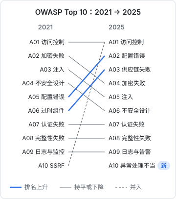

# OWASP Top 10

OWASP（开放式 Web 应用安全项目）每隔几年发布一次 Top 10，列出 Web 应用最常见、危害最大的十类风险。它不是标准也不是检查表，而是一份基于大量真实漏洞数据和社区调查的**风险排行**。对一人公司来说，它最大的用处是给你一张地图：上线前把这十类各想一遍，就不太会漏掉一整块。

本章使用的是 **OWASP Top 10:2025**。上一版是 2021 版，你在网上看到的大量文章仍按 2021 版编号，对照时注意版本年份。每一类都按「是什么 → 在 TS 全栈里长什么样 → 怎么防」来讲，已经在其他章或其他书里详细展开的只给结论和指路。

## 2021 到 2025 变了什么



几个值得注意的变化：

- **失效的访问控制仍是第一**，而且 2021 版单列的 SSRF（服务端请求伪造）并入了这一类
- **安全配置错误**从第五升到第二：现代应用的行为越来越多由配置决定（云服务、框架、容器、CDN），配错的机会也越来越多
- **2021 版的「易受攻击和过时的组件」扩展为「软件供应链失败」**，升到第三：不只是用了有漏洞的旧版本，还包括依赖被投毒、构建系统和分发渠道被攻破
- **新增「异常条件处理不当」**：错误处理、逻辑错误、出错时「失败即放行」（fail open）
- 加密失败、注入、不安全设计都往后挪了，不是因为不重要了，而是框架和库替开发者挡掉了越来越多

下面按 2025 版的顺序逐条过。

## A01 失效的访问控制

用户能做他本不该做的事：看别人的数据（IDOR）、调管理员接口、改不属于自己的资源、绕过前端直接调 API。上一章整章都在讲这一类，这里只补 2025 版并进来的 SSRF。

### SSRF：让你的服务器替别人发请求

只要你的服务端会根据用户输入去请求一个 URL（抓取链接预览、代理图片、调用 webhook、导入远程文件），就要考虑 SSRF：攻击者让你的服务器去访问它本不该访问的地方，比如云厂商的实例元数据接口、内网的数据库管理页面、只监听在本机的服务。

hatch-recordwall 的曲库 Worker 就有替客户端转发请求的接口：替手机去问第三方的接口、替它取一张封面图（`GET /v1/img?u=<地址>`）。它的 README 点出了三个关键：

- **两张域名白名单（`API_HOSTS` / `IMG_HOSTS`）是这条路唯一的安全边界**。没有它，拿到只读令牌的人（而只读令牌本来就打进了 App，还跟着测速脚本发出去过，等于公开）就有了一个架在你 Cloudflare 账号上的任意地址代理。往里加域名之前要先想清楚这一条
- **转发时一定要把 `authorization` 头摘掉**：那是进曲库的令牌，原样转发给第三方等于送出去
- **跟着摘掉 `x-forwarded-for` 和 `cf-connecting-ip`**：这两个头是 Cloudflare 加的，带过去等于把用户的真实 IP 告诉第三方，而代理本来就是为了不让用户直接露面

一个最小的防御骨架：

```ts
const ALLOWED_HOSTS = new Set(['i.ytimg.com', 'lh3.googleusercontent.com']);

export async function proxyImage(raw: string): Promise<Response> {
  let url: URL;
  try {
    url = new URL(raw);
  } catch {
    return new Response('bad url', { status: 400 });
  }
  // 1. 协议和主机都走白名单，不做黑名单
  if (url.protocol !== 'https:' || !ALLOWED_HOSTS.has(url.hostname)) {
    return new Response('host not allowed', { status: 403 });
  }
  // 2. 重新构造请求：不转发客户端的任何头，尤其是 Authorization 和 Cookie
  const upstream = await fetch(url, { redirect: 'manual', headers: { accept: 'image/*' } });
  // 3. 不跟随重定向：白名单里的主机也可能 302 到别处
  if (upstream.status >= 300 && upstream.status < 400) {
    return new Response('redirect not followed', { status: 502 });
  }
  // 4. 只放行图片
  const type = upstream.headers.get('content-type') ?? '';
  if (!type.startsWith('image/')) return new Response('not an image', { status: 415 });
  return new Response(upstream.body, { headers: { 'content-type': type } });
}
```

在 Node 服务器（而不是 Workers）上，还要额外防住解析到内网地址的域名：解析出 IP 后拒绝 `127.0.0.0/8`、`10.0.0.0/8`、`172.16.0.0/12`、`192.168.0.0/16`、`169.254.0.0/16`（云元数据接口在这里）和 IPv6 的对应网段。最省事的办法仍然是**能用主机白名单就用白名单**。

## A02 安全配置错误

默认配置、多余的功能、过于宽松的权限、详细的错误页、没关的调试接口。这一类的特点是：代码没有 bug，是部署和配置出了问题。

TS 全栈里常见的几种：

| 配置错误 | 例子 | 后果 |
|---|---|---|
| CORS 全开 | `Access-Control-Allow-Origin: *` 配合带凭证的请求 | 任意网站以用户身份读你的接口 |
| 生产开着调试 | Swagger 文档、GraphQL 内省、`NODE_ENV` 不是 production | 接口全貌公开 |
| 云存储桶公开读 | R2 / S3 / OSS 桶开了公共访问 | 所有文件谁都能下 |
| 用了开发密钥 | `JWT_SECRET=dev-secret` 被带进生产 | 任何人都能签令牌 |
| 数据库用超级用户连接 | 应用连的是 owner 或 superuser | RLS 被绕过，见第 2 章 |

hatch-recordwall 的 README 有一句很重的提醒：千万别给 R2 桶绑自定义域。R2 的自定义域是把桶直接挂上 CDN，绑上之后**桶里每个对象对全世界公开可读**，守在前面的 Worker 连同它的两把令牌就整个被绕过去了，而且一声不响，从 App 那头看什么都正常。搭建时为了测速真绑过一个，后来摘掉了。所以「桶上不绑域、不设公共读」是写进文档的硬约束，而不是一个随手的默认值。这类配置错误最可怕的地方就在于**没有任何报错**。

防御的核心是**让错误配置起不来**。hatch-counter 在启动时用 `assertProductionReady()` 拦四样：存储还是本地模式、`JWT_SECRET` 还是开发用的（`dev-` 开头）、后台初始密码还是示例文件里那个或太短、信任代理跳数没填。配错了服务直接起不来，而不是带着错误配置跑上几个月。第 4 章会给一个类似的启动自检写法。

CORS、CSP 和各种安全响应头的具体配置，见[《前端工程化与 Web 平台》](../frontend-engineering/)最后一章；nginx 层面的配置见[《Nginx 与反向代理》](../nginx-gateway/)。

## A03 软件供应链失败

你的应用里，自己写的代码可能只占很小一部分，剩下的是几百上千个 npm 包。任何一个被投毒、任何一个维护者账号被盗，恶意代码就会在你的开发机、CI 和生产环境里运行。这是本书第 5 章的主题。

## A04 加密失败

敏感数据没加密、用了弱算法、密钥管理不当。在今天的 TS 全栈里，「自己选错加密算法」已经不太常见，更常见的是：

- **密码用快哈希存**：MD5、SHA-256 加盐都不够，必须用慢哈希（第 4 章）
- **传输没加密**：内网服务之间、移动端调试时临时开的 HTTP 忘了关
- **把编码当加密**：base64、JWT 载荷都是谁都能解开的
- **用 `===` 比较令牌**：理论上存在计时侧信道（第 4 章）
- **随机数不安全**：用 `Math.random()` 生成令牌、验证码、重置链接

规则很简单：随机数用 `crypto.randomBytes` / `crypto.getRandomValues`，密码用慢哈希，传输一律 TLS，其他加密需求用成熟库的高层接口，不要自己拼。

## A05 注入

用户输入被当成代码或命令执行：SQL 注入、命令注入、模板注入，以及前端的 XSS（2025 版仍把 XSS 归在注入里）。

### SQL 注入

用 Drizzle、Prisma 这类 ORM 或查询构建器时，正常写法都是参数化的。危险出现在**手写原生 SQL** 的时候：

```ts
import { sql } from 'drizzle-orm';

// 安全：sql 模板标签会把插值变成参数（$1），不会拼进 SQL 文本
await db.execute(sql`select * from dishes where name = ${name}`);

// 危险：sql.raw 原样拼接，等于字符串拼 SQL
await db.execute(sql.raw(`select * from dishes where name = '${name}'`));
```

动态排序字段是个常见的坑：列名不能参数化，于是有人用 `sql.raw` 拼。正确做法是**白名单映射**：

```ts
const SORTABLE = { name: dishes.name, price: dishes.price, createdAt: dishes.createdAt } as const;

function orderColumn(input: string) {
  const col = SORTABLE[input as keyof typeof SORTABLE];
  if (!col) throw new BadRequestException('不支持的排序字段');
  return col;
}
```

### 命令注入

Node 里调外部命令，用 `execFile` / `spawn` 传参数数组，不要用 `exec` 拼字符串：

```ts
import { execFile } from 'node:child_process';
import { promisify } from 'node:util';
const run = promisify(execFile);

// 参数是数组，不经过 shell，文件名里有 ; 或 $() 也只是文件名
await run('pg_dump', ['--format=custom', '--file', outPath, dbName]);
```

### 输入校验

注入的根本防线是**参数化**，输入校验是第二道。在 NestJS 里，所有请求体、查询参数都过一遍 schema（zod 或 class-validator），类型、长度、格式不对的直接 400。hatch-counter 的查询参数统一过 `zQuery`，请求体有大小上限。

XSS 的细节（React 的自动转义、`dangerouslySetInnerHTML`、CSP）见《前端工程化与 Web 平台》。Markdown 渲染是 XSS 的高发区，第 6 章会讲 hatch-shelf 阅读器的做法。

## A06 不安全的设计

不是实现有 bug，而是设计本身就缺了安全考虑：没有限流的验证码接口、可以无限重试的优惠券、「忘记密码」流程能被用来接管账号。这类问题靠代码审查和扫描工具很难发现，只能在设计时想到。

一个实用的方法是给每个新功能问三个问题：

1. **谁能调它？** 未登录的人能不能调？能调多少次？
2. **最坏情况下它能被怎么滥用？** 刷钱（短信、AI 调用、存储）、刷数据（枚举用户）、刷别人（轰炸某个手机号）
3. **出错时它是放行还是拒绝？**

hatch-counter 的扫码登录就是一个想清楚了的设计：电脑建码时拿到一个 `pollKey`，二维码里只有 `ticket`。谁看得见屏幕谁就有 `ticket`（被人拍一张、被路过的人扫），但取令牌要两样都对上。而且码不认识、`pollKey` 对不上、过期、已被取走，一律回 `expired`：分开说的话，手里只有码的人就能试出「这个码还活着」。建码接口是公开的、不需要身份就能往表里插行，所以按 IP 限了一道。

## A07 认证失败

撞库、弱密码、会话管理不当、令牌泄露。第 1 章已经展开。补充两个常被忽略的点：

- **限流要按多个维度**：只按 IP 限，攻击者换 IP；只按账号限，攻击者对每个账号试一次常见密码（密码喷洒）。两个维度都要
- **找回密码、换绑手机等于登录**：它们的安全强度不能低于登录本身

## A08 软件或数据完整性失败

代码和数据在传输、更新、反序列化过程中被篡改却没有被发现：自动更新没有签名校验、CI 流水线从不可信的来源拉代码、反序列化不可信数据。

与 TS 全栈相关的几处：

- **客户端自动更新必须验签**：Electron 的自动更新依赖代码签名；不要自己实现一个下载 zip 就解压覆盖的更新器
- **CI 里引用的第三方 Action 固定到提交哈希**（第 5 章）
- **不要反序列化不可信的数据成对象图**：`JSON.parse` 本身是安全的，但随后的 `Object.assign` / 深合并可能导致原型污染。处理用户传来的 JSON，先过 schema，再用

## A09 安全日志与告警失败

出事了没有日志可查，或者有日志但没人看。2025 版把名字里的「监控」改成了「告警」，强调的是：日志不仅要记，还要在异常时**主动通知你**。一个人没法每天翻日志，所以要定好哪些事件必须告警：大量登录失败、短信发送量异常、权限拒绝激增、后台敏感操作。第 7 章讲日志里该记什么、不该记什么；告警的搭建见[《可观测性与性能》](../observability-performance/)。

## A10 异常条件处理不当

2025 版新增的一类，关注的是出错时的行为：

- **失败即放行（fail open）**：权限服务超时了，于是默认放行；限流用的 Redis 连不上，于是不限了
- **错误信息泄露内部细节**：堆栈、SQL、连接串直接回给客户端
- **异常没处理导致状态不一致**：扣了钱没发货、旧令牌作废了新令牌没发出去

hatch-counter 在这一类上有几条明确的规矩：

- **没认领的异常一律回 500「服务端出了点问题，稍后再试」**，真实原因只进日志，因为堆栈里常带着表名、SQL 片段甚至连接串
- **公开的健康检查接口只回 `ok` 和 `db` 两个布尔**，连不上库的原因只进日志：连接串常常整条躺在异常消息里，而这个端点是公开的
- **多步写操作放进一个事务**：前面提过的刷新令牌轮换、后台操作和审计日志同一个事务，都是为了不出现「做了一半」的状态

在 NestJS 里，一个全局异常过滤器可以统一做到「对外通用、对内详细」：

```ts
import { ArgumentsHost, Catch, ExceptionFilter, HttpException, Logger } from '@nestjs/common';

@Catch()
export class AppExceptionFilter implements ExceptionFilter {
  private readonly logger = new Logger('Exception');

  catch(err: unknown, host: ArgumentsHost) {
    const res = host.switchToHttp().getResponse();
    if (err instanceof HttpException) {
      // 业务主动抛的异常：信息本来就是写给用户看的
      return res.status(err.getStatus()).json(err.getResponse());
    }
    // 其余一律对外说同一句话，细节只进日志
    this.logger.error(err instanceof Error ? err.stack : String(err));
    res.status(500).json({ code: 'internal', message: '服务端出了点问题，稍后再试' });
  }
}
```

**设计上要默认失败即拒绝（fail closed）**：权限查不到就拒绝，签名验不了就拒绝，配置缺失就不启动。hatch-recordwall 的 Worker 是个干净的例子：读写令牌一把都没配的话，整个 Worker 回 503。用它 README 里的话说，宁可不干活，也别默默敞着。

## 本章要点

- 本章按 OWASP Top 10:2025 编排，网上大量资料仍按 2021 版编号，对照时注意年份
- 2025 版：访问控制仍居首并吸收了 SSRF；配置错误升到第二；过时组件扩展为供应链失败升到第三；新增异常处理不当
- SSRF 防御靠主机白名单、不转发客户端头、不跟随重定向、拒绝内网地址
- 让错误配置起不来：生产启动时检查开发密钥、存储模式、代理跳数
- 注入的根本防线是参数化：Drizzle 用 `sql` 模板别用 `sql.raw`，动态列名走白名单，外部命令传参数数组
- 新功能先问：谁能调、最坏怎么被滥用、出错时放行还是拒绝
- 对外报错通用，细节只进日志；设计上默认失败即拒绝
