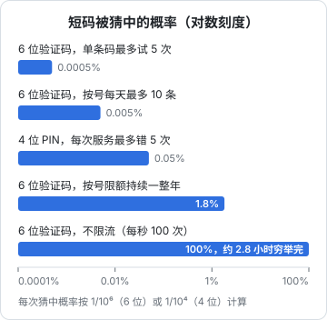

# 密码与密钥管理

这一章管两类「秘密」：一类是**用户的**，比如密码、验证码，你的职责是即使数据库被拖走也不让它们被还原；另一类是**你自己的**，比如签名密钥、数据库密码、第三方服务的 API key，你的职责是别让它们出现在不该出现的地方，并且在泄露时能快速更换。

环境变量文件怎么组织、密钥怎么放进平台的 secret 存储、CI 里怎么注入，[《部署与 CI/CD》](../deploy-release/)的「环境变量与密钥」一章已经讲过。本章讲的是那一章之前的问题：怎么存、怎么比、怎么分级、哪些东西根本不该算作秘密。

## 存密码：只存慢哈希

### 为什么不能用 SHA-256

数据库泄露时，攻击者拿到的是哈希值。他要做的是离线猜测：拿常见密码一个个算哈希，看哪个对得上。SHA-256 这类通用哈希被设计得**越快越好**，一块现代 GPU 每秒能算的次数是个天文数字，弱密码几乎瞬间就被还原。加盐只能防止「一张预先算好的表打所有用户」，挡不住针对单个哈希的暴力猜测。

**密码哈希算法被设计得故意慢、故意吃内存**，让每一次猜测都很贵：

| 算法 | 特点 | 在 Node 里 |
|---|---|---|
| Argon2id | 密码哈希竞赛的胜出者，内存困难，当前首选 | 需要第三方包（多为原生或 WASM） |
| scrypt | 内存困难，历史更久 | `node:crypto` 内置 |
| bcrypt | 老牌，不吃内存，输入超过 72 字节会被截断 | 需要第三方包 |
| PBKDF2 | 只靠迭代次数，不吃内存，主要为合规场景 | `node:crypto` 内置 |

hatch-counter 的后台员工口令用的是 scrypt，理由写得很实际：Node 内置，不引 Argon2 这类原生模块，因为原生模块得跟着 Node 的 ABI 编译，Docker 多阶段构建和 Node 升级时都多一件要操心的事。对一人公司，**内置且足够强**往往比「理论上最强」更重要。

### 用 node:crypto 的 scrypt

```ts
import { randomBytes, scrypt as scryptCb, timingSafeEqual } from 'node:crypto';
import { promisify } from 'node:util';

const scrypt = promisify(scryptCb) as (
  pw: string, salt: Buffer, len: number, opts: { N: number; r: number; p: number; maxmem: number },
) => Promise<Buffer>;

// 参数随哈希一起存，以后调高参数时旧哈希仍能验证
const N = 2 ** 17, r = 8, p = 1, KEYLEN = 32;
// scrypt 需要约 128 * N * r 字节内存，这组参数约 128 MiB，超过 Node 默认的 maxmem，要显式放宽
const MAXMEM = 256 * 1024 * 1024;

export async function hashPassword(password: string): Promise<string> {
  const salt = randomBytes(16);
  const key = await scrypt(password.normalize('NFKC'), salt, KEYLEN, { N, r, p, maxmem: MAXMEM });
  return `scrypt$${N}$${r}$${p}$${salt.toString('base64url')}$${key.toString('base64url')}`;
}

export async function verifyPassword(password: string, stored: string): Promise<boolean> {
  const [algo, n, rr, pp, saltB64, keyB64] = stored.split('$');
  if (algo !== 'scrypt') return false;
  const expected = Buffer.from(keyB64, 'base64url');
  const actual = await scrypt(password.normalize('NFKC'), Buffer.from(saltB64, 'base64url'), expected.length, {
    N: Number(n), r: Number(rr), p: Number(pp), maxmem: MAXMEM,
  });
  return timingSafeEqual(actual, expected);
}
```

几点说明：

- **参数怎么定**：OWASP 的《密码存储备忘单》给出了 Argon2id、scrypt、bcrypt、PBKDF2 各自的最低推荐参数，并且会随硬件发展更新，动手前以最新版为准。上面这组 scrypt 参数每次计算约占 128 MiB 内存，对只有几个员工的后台没问题；面向大量用户的登录接口要评估并发时的内存峰值，必要时换成文档里内存更省的等强度组合
- **参数和盐随哈希一起存**：将来调高参数，用户下次登录成功时顺手用新参数重算一次即可
- **Unicode 规范化**：同一个字符可能有不同的编码方式，不规范化的话用户在另一台设备上输入「同样的」密码会登不上
- **哈希慢是特性也是攻击面**：登录接口必须限流，否则攻击者可以用大量登录请求把你的 CPU 和内存打满

### 密码策略

近年主流指南（以美国 NIST SP 800-63B 为代表）的方向和很多人的直觉相反：

- **长度比复杂度重要**：鼓励长口令，允许空格和任意字符，不要求「必须包含大小写数字符号」
- **不强制定期改密码**：强制定期改只会让用户在末尾加个数字。只在有泄露迹象时要求修改
- **对照泄露密码库**：拒绝出现在已知泄露列表里的密码
- **允许粘贴**：禁止粘贴会逼用户放弃密码管理器

具体的长度下限等数字各版本有调整，以指南最新版为准。

## 比较秘密：别用 ===

比较令牌、签名、验证码时，`a === b` 会在第一个不同的字节处返回。理论上，攻击者可以通过测量响应时间，一个字节一个字节地猜出正确值。网络抖动让这种攻击在实践中很难，但防御成本几乎为零，没有理由不做。

`crypto.timingSafeEqual` 要求两个 Buffer 等长，长度不同时会直接抛错，而这本身又泄露了长度。hatch-recordwall 的 Worker 用了一个简洁的办法：**比较两串各自的 SHA-256 摘要**。摘要总是等长，令牌本身的长度和字符集也就不受限制了。

```ts
import { createHash, timingSafeEqual } from 'node:crypto';

const digest = (s: string) => createHash('sha256').update(s).digest();

export function safeEqual(a: string, b: string): boolean {
  return timingSafeEqual(digest(a), digest(b));
}
```

在 Cloudflare Workers 里没有 `node:crypto` 的话（取决于是否开启 Node 兼容），可以用 `crypto.subtle.digest('SHA-256', ...)` 算摘要后逐字节异或累加比较，思路一样。

## 存令牌：只存哈希，但不必慢

刷新令牌、API key、密码重置链接这些服务端生成的随机令牌，也应该**只存哈希**：数据库泄露时，攻击者拿到的哈希不能直接拿来用。hatch-counter 的刷新令牌在库里只存哈希。

和密码不同的是，这里用 SHA-256 就够了，不需要慢哈希。慢哈希防的是「从一个小空间里猜」，人类挑的密码空间很小；而 `randomBytes(32)` 生成的令牌有 256 位熵，不存在可以枚举的空间。用 SHA-256 还有一个好处：可以直接按哈希值建索引查找。

```ts
const token = randomBytes(32).toString('base64url');           // 发给客户端
const tokenHash = createHash('sha256').update(token).digest('hex'); // 存进库里
```

## 短码的安全靠限流

验证码、PIN、TOTP 都是短码，空间很小：6 位数字只有一百万种可能，4 位只有一万种。它们的安全性**完全取决于限流**，而不是码本身。下面这张图用公式算出了几种限流设置下攻击者的成功率。



算法很简单：每条码最多试 5 次，每次猜中的概率是 $1/10^6$，一条码被猜中的概率就是 $5/10^6$。hatch-counter 按号滚动 24 小时最多 10 条，所以一天最多 50 次猜测。持续一整年也只有约 1.8%，而且这一年里受害者的手机会收到三千多条验证码短信，早就发现了。反过来，没有任何限流、每秒能试 100 次的话，一百万种可能不到 3 个小时就能穷举完。

hatch-shelf 的局域网传书页面用的是 4 位 PIN，空间更小，但它的限制是「连续错误 5 次后本次服务失效」，单次服务被猜中的概率是万分之五。再加上这个服务只在用户打开传书页面时临时开启、只在局域网可达，风险可以接受。**短码可以短，前提是限流够狠、暴露面够小。**

## TOTP：自己就能实现的第二因素

TOTP（基于时间的一次性密码，RFC 6238）就是验证器 App 里每 30 秒变一次的 6 位数。原理：服务端和用户的验证器共享一个密钥，双方用「密钥 + 当前时间片」算 HMAC，截取出 6 位数字。

它值得一人公司掌握，因为**不花钱、不依赖第三方、实现只有二十行**：

```ts
import { createHmac, timingSafeEqual } from 'node:crypto';

// RFC 4648 base32 解码：验证器扫的二维码里就是 base32 编码的密钥
function base32Decode(input: string): Buffer {
  const alphabet = 'ABCDEFGHIJKLMNOPQRSTUVWXYZ234567';
  let bits = '';
  for (const c of input.replace(/=+$/, '').toUpperCase()) {
    const v = alphabet.indexOf(c);
    if (v < 0) throw new Error('invalid base32');
    bits += v.toString(2).padStart(5, '0');
  }
  const bytes = bits.match(/.{8}/g) ?? [];
  return Buffer.from(bytes.map((b) => parseInt(b, 2)));
}

function hotp(key: Buffer, counter: number): string {
  const msg = Buffer.alloc(8);
  msg.writeBigUInt64BE(BigInt(counter));
  const mac = createHmac('sha1', key).update(msg).digest();
  const offset = mac[mac.length - 1] & 0x0f;
  const bin = (mac.readUInt32BE(offset) & 0x7fffffff) % 1_000_000;
  return bin.toString().padStart(6, '0');
}

/** 验证 6 位码；前后各容忍一个 30 秒时间片，应对时钟偏差 */
export function verifyTotp(secretBase32: string, code: string, now = Date.now()): boolean {
  if (!/^\d{6}$/.test(code)) return false;
  const key = base32Decode(secretBase32);
  const step = Math.floor(now / 1000 / 30);
  return [-1, 0, 1].some((d) => timingSafeEqual(Buffer.from(hotp(key, step + d)), Buffer.from(code)));
}
```

hatch-recordwall 用 TOTP 解决了一个有意思的问题：**写令牌不进任何安装包**。App 里只有只读令牌；发布者要往曲库里传歌时，在 App 里输入验证器上那 6 位数，Worker 用 `TOTP_SECRET` 验证（前后各让一格），对上了才通过 `/v1/unlock` 把写令牌交下去。hatch-counter 的管理后台则把 TOTP 作为密码之外的第二因素。

用 TOTP 要注意：

- **同样要限流**：6 位只有一百万种，一个时间片内放行三个码，不限流的话很快就能撞上
- **防重放**：严格的实现会记住上一次成功的时间片，同一个码不允许用两次
- **密钥和密码同等重要**：TOTP 密钥要能被服务端读出来（不能哈希），所以要放在最受保护的地方。hatch-recordwall 的 README 说得直白：`TOTP_SECRET` 泄露等于把发布者身份整个送出去

## 你自己的密钥：先分级

不是所有「看起来像密钥」的东西都同样重要。先分级，再决定怎么保护：

| 级别 | 例子 | 泄露后果 | 放哪 |
|---|---|---|---|
| 公开级 | 打进客户端的只读令牌、OAuth 的 client ID、地图 SDK 的前端 key | 有限，且本来就假设会泄露 | 可以进客户端包，但服务端要限制它能做的事 |
| 服务级 | 数据库密码、JWT 签名密钥、短信和识别服务的 API key | 数据泄露、伪造身份、被盗刷账单 | 只在服务端，平台 secret 或机器上权限 600 的文件 |
| 身份级 | 云账号 root、App Store Connect API key、代码签名证书、TOTP 种子 | 整个产品被接管、以你的名义发版 | 尽量只在本机，不进 CI，不进任何服务器 |

### 客户端没有秘密

**发给每一个客户端的密钥，等于公开的密钥。** App 包可以解开，Electron 的 asar 可以解开，网页的 JS 谁都能看。hatch-counter 的规矩是：识别、短信服务商的 key 都只在服务端存一份，租户接口一个字都拿不到；客户端能问的只有「识别服务现在能不能用」。

hatch-recordwall 的做法是一个很好的反面印证：它**有意**把曲库的地址和只读令牌写死在 App 里（`apps/mobile/src/vault/keys.ts`），设置里连输入框都没有。这不是疏忽，而是想清楚之后的取舍：

- 只读令牌只能读、不能写，而且 Worker 限定了它能走的路径
- 它本来就会泄露：锁屏封面的地址是交给操作系统去取的，挂不上自定义头，只能把令牌放进 URL，于是它会进访问日志
- 丢了换一把就完事，代价是要发一版新 App（它是打包时内联进 bundle 的）
- 真正不能露的写令牌和 TOTP 密钥，一个都不进任何安装包

所以判断标准不是「这串字符像不像密钥」，而是**假设它明天出现在公网上，后果能不能接受、能不能快速换掉**。能接受的，可以放进客户端，但要在服务端把它的权限收到最小；不能接受的，就绝不能离开服务端。

### 身份级密钥留在本机

hatch-recordwall 的发版脚本 `ship` 刻意留在本机、不上 CI。那把 App Store Connect 的 API key 能以你的名义往 App Store Connect 传包、改元数据；放进仓库 secret 之后，任何一次 workflow 改动都够得着它。一个季度只发几次版的产品，在本机跑发版脚本多花的那点时间，远比这把钥匙的风险便宜。

### 让错误的密钥起不来

开发密钥混进生产，是最常见也最低级的密钥事故。在启动时检查一遍，比靠人记靠谱得多：

```ts
import { z } from 'zod';

const Env = z.object({
  NODE_ENV: z.enum(['development', 'test', 'production']),
  JWT_SECRET: z.string().min(32, 'JWT_SECRET 至少 32 个字符'),
  DATABASE_URL: z.string().url(),
  APP_DATABASE_URL: z.string().url(),
  TRUST_PROXY: z.coerce.number().int().min(0).optional(),
});

export function loadConfig(raw = process.env) {
  const env = Env.parse(raw);
  if (env.NODE_ENV === 'production') {
    const problems: string[] = [];
    if (env.JWT_SECRET.startsWith('dev-')) problems.push('JWT_SECRET 还是开发用的');
    if (env.TRUST_PROXY === undefined) problems.push('TRUST_PROXY 必须照实填写代理层数');
    const user = (u: string) => new URL(u).username;
    if (user(env.DATABASE_URL) === user(env.APP_DATABASE_URL)) problems.push('业务连接不能和迁移用同一个数据库角色');
    if (problems.length) throw new Error(`生产配置不合格：\n- ${problems.join('\n- ')}`);
  }
  return env;
}
```

注意 `TRUST_PROXY` 那一行：hatch-counter 踩过的坑是空字符串。`Number("")` 是 0，留空会被静默读成「直连」，必填检查一个字都不会说。所以它对可选项做了「留空等于没填」的处理。配置校验里的每一个隐式转换都值得多看一眼。

### 泄露了怎么办

一人公司没有安全响应团队，事先写好一页「换钥匙」手册比事后手忙脚乱强得多。每一把服务级以上的密钥都应该能回答：

1. **它在哪些地方**：平台 secret、服务器文件、客户端包、CI，一处都不能漏
2. **怎么换**：生成新值 → 更新所有使用方 → 重启或重新部署 → 作废旧值
3. **换的时候会断什么**：换 JWT 密钥，所有在线用户的访问令牌立即失效（刷新令牌不受影响的话，用户无感）；换客户端里的令牌，要发版
4. **怎么确认旧值没被滥用**：看服务商后台的调用量和账单、看自己的审计日志

**一个消费方一把钥匙**（详见《部署与 CI/CD》）让第 1 步变得简单：泄露的范围就是那一个消费方，换它不影响别人。

## 本章要点

- 密码只存慢哈希：Argon2id 或 scrypt，参数以 OWASP 备忘单最新版为准；Node 内置的 scrypt 省掉原生模块的麻烦
- 参数和盐随哈希一起存；登录接口必须限流，慢哈希本身也是攻击面
- 密码策略重长度、轻复杂度，不强制定期改，对照泄露库
- 比较秘密用 `timingSafeEqual`，比两串的 SHA-256 摘要可以绕开等长要求
- 服务端生成的高熵令牌只存 SHA-256 哈希，不需要慢哈希
- 短码的安全完全靠限流：6 位码限 5 次、按号每天 10 条，一年也只有约 1.8% 的成功率
- TOTP 二十行就能实现，同样要限流和防重放，种子要按最高级别保护
- 密钥先分级：客户端里的都是公开的，服务端限定其权限；身份级密钥留在本机；启动时拒绝开发密钥
