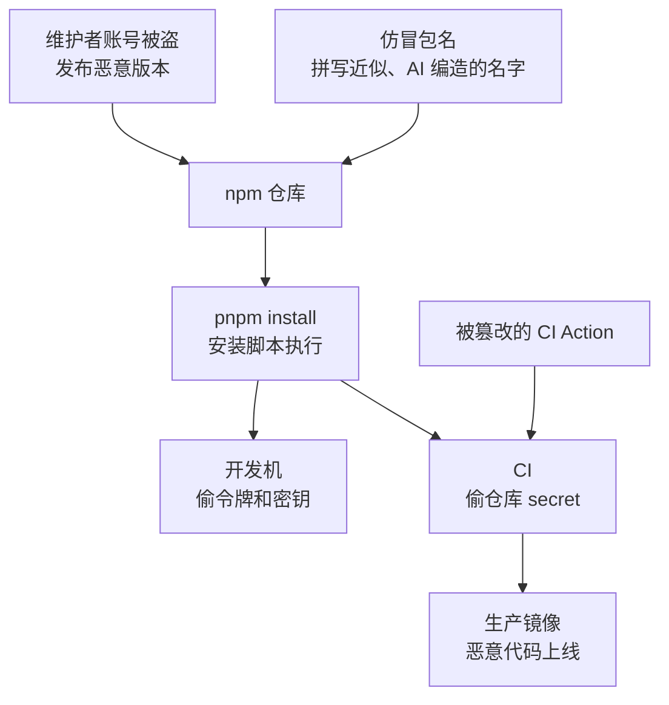

# 依赖与供应链

打开任何一个 pnpm monorepo 的 `pnpm-lock.yaml`，数一数里面有多少个包：几百到上千个是常态。你亲手写的代码只是冰山一角，其余都是陌生人写的，而它们在 `pnpm install` 的那一刻就能在你的电脑上执行代码，能读你的 `~/.ssh`、`~/.npmrc`、环境变量里的云账号密钥。

OWASP Top 10:2025 把 2021 版的「易受攻击和过时的组件」扩展为「软件供应链失败」并升到第三，反映的正是这种变化：风险已经不只是「用了一个有已知漏洞的旧版本」，而是**依赖本身被投毒、维护者账号被盗、构建和分发环节被攻破**。这一章讲一人公司能负担得起的几层防御。

## 攻击是怎么进来的



| 攻击方式 | 怎么发生 | 典型特征 |
|---|---|---|
| 维护者账号被盗 | 钓鱼邮件骗走 npm 凭据或令牌，攻击者以维护者身份发布新版本 | 一个你一直在用的正经包突然出了一个补丁版本 |
| 仿冒包名（typosquatting） | 注册和热门包拼写近似的名字，等人手滑 | `lodahs`、`reacct-dom` 这类名字 |
| AI 编造的包名（slopsquatting） | 大模型在生成代码时会编出不存在但听起来合理的包名，攻击者抢先注册 | 编码 agent 建议安装一个你从没听说过的包 |
| 安装脚本 | `preinstall` / `postinstall` 在安装时执行任意代码 | 装依赖时有网络请求、读了家目录 |
| 依赖混淆 | 私有包名在公共仓库被抢注，包管理器优先拉了公共的 | 公司内部包名出现在 npm 公共仓库 |
| CI 组件被篡改 | 被引用的第三方 GitHub Action 的标签被改指到恶意提交 | 流水线日志里打印出了 secret |

### 近几年的几起真实事件

> [!WARNING]
> 本节事件按 2026 年 11 月能查到的一手材料整理：xz-utils 和 tj-actions 按 NVD 的 CVE-2024-3094、CVE-2025-30066 条目；Nx 按 nrwl/nx 仓库的安全公告 GHSA-cxm3-wv7p-598c；chalk / debug 按维护者在 debug-js/debug 第 1005 号 issue 里的说明；Shai-Hulud 按 GitHub 官方博客（2025-09-22）和美国 CISA 2025-09-23 的通告。Shai-Hulud 第二波和 2026 年 keyv 蠕虫只有安全厂商的分析报告，各家给出的日期和受影响包数出入较大，下面只写各家一致的部分。

这些攻击方式都不是假想，下面按时间列几起，每一起都对应本章后面的一层防御：

- **2024 年 3 月，xz-utils 后门（CVE-2024-3094）**。一个化名维护者花了几年时间参与 xz 项目、取得信任，然后在 5.6.0、5.6.1 的发布包里藏了后门：恶意代码藏在伪装成测试数据的文件里，构建时才被取出来改写 liblzma，而通过 liblzma 影响 SSH 服务。它在进入各大发行版的稳定版之前，被一位工程师因为 SSH 登录莫名变慢追查发现。教训：**维护者本人可能就是攻击者；发布出来的包不一定等于仓库里看得到的源码**
- **2025 年 3 月 14–15 日，tj-actions/changed-files（CVE-2025-30066）**。这个被大量仓库引用的 GitHub Action，`v1` 到 `v45.0.7` 的标签全被改指到一个恶意提交，它把运行器内存里的 secret 打印进 CI 日志，公开仓库的日志谁都能看。按标签引用的仓库什么都没改就中招了，固定到提交哈希的不受影响（见[第六层](#第六层ci-本身的安全)）
- **2025 年 8 月 26 日，Nx 被投毒（s1ngularity）**。Nx 仓库新加的一个 PR 检查工作流用了 `pull_request_target`，又把 PR 标题直接拼进了 shell 命令。攻击者借这个口子触发了发布工作流、拿到了里面的 npm 发布令牌，发布了带 `postinstall` 脚本的恶意版本（Nx 的编辑器插件会在后台安装最新版的 `nx`，有人只是打开了编辑器就中招）。这个脚本扫描文件系统里的凭证，编码后**以受害者自己的 GitHub 账号**建一个名字含 `s1ngularity-repository` 的公开仓库传上去。教训：`pull_request_target` 和放在 CI 里的长期发布令牌
- **2025 年 9 月 8 日，chalk / debug 等 18 个包被投毒**。维护者收到一封仿冒 npm 的「重置双因素认证」邮件（发件域名是 `npmjs.help`），在钓鱼页面上交出了密码和一次性验证码。攻击者随即发布了 `chalk@5.6.1`、`debug@4.4.2` 等 18 个恶意版本，这些都是周下载量以亿计的基础包。恶意代码只在浏览器里生效，篡改加密货币钱包的转账地址。当天就被社区发现、陆续下架。教训：**动态验证码挡不住实时钓鱼**，需要和域名绑定的硬件密钥或 passkey
- **2025 年 9 月中旬，Shai-Hulud 蠕虫**。GitHub 9 月 14 日收到报告。被感染的包在 `postinstall` 里搜刮 npm 令牌、GitHub 令牌和云厂商密钥，把它们传到受害者账号下一个名叫 Shai-Hulud 的公开仓库；然后用偷到的 npm 令牌，把受害者自己维护的其他包也发布成带毒版本，自我传播。GitHub 下架了 500 多个包，CISA 9 月 23 日发了通告。教训：**一个人的令牌泄露，会变成他所有包的用户的问题**
- **2025 年 11 月下旬，Shai-Hulud 第二波**。安全厂商报告的变种把执行入口从 `postinstall` 提前到 `preinstall`，波及的包和 GitHub 仓库比第一波多得多
- **2026 年 8 月，keyv 蠕虫**。多家安全厂商报告：攻击者控制了 keyv 维护者的 GitHub 账号，把恶意代码直接推进仓库，再用**项目自己的 GitHub Actions 发布工作流**发版，于是这些恶意版本带着完全有效的来源证明（provenance）；之后照 Shai-Hulud 的路子，用偷到的令牌感染了数百个包。教训：**来源证明只能说明包是在哪个仓库的哪条流水线里构建的，说明不了触发这次构建的人有没有被授权**

共同点是：**受害者什么都没做错，只是照常装了依赖、跑了流水线**。而 npm 官方在这一年里的应对（下架、收紧令牌、推 trusted publishing），在本章[最后一节](#如果你也发布包trusted-publishing)会讲到。

## 第一层：少装依赖

最有效的防御是减少攻击面。每加一个依赖，都是在信任它的作者、它的所有依赖的作者，以及所有这些人的账号安全。

加依赖之前过一遍：

- **这件事 Node 内置能不能做？** Node 22 自带 `fetch`、`crypto`（含 scrypt）、`node:test`、`util.parseArgs`。hatch-counter 后台口令选 scrypt 而不是 Argon2 包，就是少一个原生依赖
- **能不能自己写二三十行？** 第 4 章的 TOTP 就是例子。判断标准：逻辑稳定、有标准可依、容易测试
- **这个包是否可信？** 看周下载量、维护者数量、最近一次发版的时间、仓库是否活跃、依赖树有多深
- **名字拼对了吗？** 从官方文档复制包名，而不是凭记忆或 AI 的建议

编码 agent 是新的风险来源：它会顺手 `pnpm add` 一个包来解决问题，名字甚至可能是它编出来的。把「新增依赖」设为必须人工确认的操作，在 PR 里专门看 `package.json` 的变化。agent 的权限边界怎么设，见[《Agent 安全》](../agent-safety/)。

## 第二层：锁定版本

`pnpm-lock.yaml` 记录了整棵依赖树每个包的确切版本和完整性哈希。它必须入库，而且 CI 和 Docker 构建里**只能按锁文件装**：

```bash
# 锁文件和 package.json 对不上时直接失败，而不是悄悄解析出新版本
pnpm install --frozen-lockfile
```

pnpm 在检测到 CI 环境变量时默认就是这个行为，但在 Dockerfile 里显式写上更稳妥。

`package.json` 里的 `^1.2.3` 意味着「下次解析时可以升到 1.x 的任何新版本」。有锁文件时它只在你主动更新时生效，所以锁文件就是你的版本闸门：**锁文件的每一处变化都值得看一眼**，尤其是你没有主动升级的包出现了新版本。

## 第三层：管住安装脚本

> [!WARNING]
> 本节的 pnpm 默认行为和配置名按 2026 年 11 月 pnpm 官方文档（Settings / Build）和 v11.0.0、v12.0.0 的发布说明整理：pnpm 11（2026 年 4 月）用 `allowBuilds` 取代了 `onlyBuiltDependencies` 等旧设置，并且不再读 `package.json` 里的 `pnpm` 字段；当前最新是 pnpm 12。后续版本可能再改名或改默认值，以你所用版本的 pnpm 官方文档为准；作者的仓库仍在 pnpm 9.15。

依赖的 `postinstall` 等生命周期脚本是投毒最常用的执行入口。它们有正当用途（编译原生模块、下载平台相关的二进制），但大多数包根本不需要。

**pnpm 10 起默认不再执行依赖的生命周期脚本**，需要执行的包要显式放行。放行名单写在 `pnpm-workspace.yaml` 里，也可以运行 `pnpm approve-builds` 交互式地选。pnpm 11 起配置名换成了 `allowBuilds`，写成「包名: 是否放行」的映射：

```yaml
# pnpm-workspace.yaml（pnpm 11 及以上）
packages:
  - "apps/*"
  - "packages/*"

allowBuilds:
  esbuild: true
  better-sqlite3: true
  electron: true
  core-js: false        # 明确拒绝，不再提示
```

pnpm 11 还把 `strictDepBuilds` 的默认值改成了 `true`：有依赖带着没审过的构建脚本，安装直接失败，而不只是打一行提示。新加一个需要编译的依赖时，`pnpm install` 会红，这时用 `pnpm approve-builds` 看一眼再放行。

pnpm 10 用的是旧的名单写法：

```yaml
# pnpm-workspace.yaml（pnpm 10）
packages:
  - "apps/*"
  - "packages/*"

# 只有这些包允许在安装时运行脚本
onlyBuiltDependencies:
  - esbuild
  - better-sqlite3
  - electron
```

本书写作时，仓库所有者的三个项目都还停在 pnpm 9.15。pnpm 9 默认会执行依赖的安装脚本，但同样支持放行名单，写在根目录 `package.json` 的 `pnpm` 字段里：

```json
{
  "pnpm": {
    "onlyBuiltDependencies": ["esbuild", "better-sqlite3", "electron"]
  }
}
```

配置之后，名单外的包的安装脚本都不会执行，pnpm 会提示哪些包的脚本被跳过了。遇到功能异常时再按需加入名单，比默认全放行安全得多。

从 9 直接升到 11 或 12 时，上面这个 `package.json` 里的 `pnpm` 字段会被**整个忽略**，要挪进 `pnpm-workspace.yaml` 并改成 `allowBuilds`。pnpm 12 起，`pnpm-workspace.yaml` 里写了不认识的设置会直接报错，拼错一个设置名、整条防护悄悄失效的情况不会再发生；pnpm 11 及更早仍会静默忽略，升级后跑一次 `pnpm config list` 确认设置真的生效了。

## 第四层：让新版本先冷却一下

> [!WARNING]
> `minimumReleaseAge` 的起始版本（10.16）、单位和默认值，以及 `trustPolicy` 的取值，按 2026 年 11 月 pnpm 官方文档（Settings / Dependency resolution）和 v11.0.0 发布说明整理：pnpm 11 起 `minimumReleaseAge` 默认就是 1440（1 天）。启用前以你所用版本的 pnpm 官方文档和发布说明为准。

被投毒的版本通常在发布后几小时到几天内被发现并下架。如果你的安装策略是「新版本发布满一天才允许装」，就能躲过大部分这类攻击。

pnpm 从 10.16 起提供 `minimumReleaseAge`（单位是分钟）：

```yaml
# pnpm-workspace.yaml（pnpm 10.16 及以上）
minimumReleaseAge: 1440        # 发布不满 24 小时的版本不装
minimumReleaseAgeExclude:
  - "@your-scope/*"            # 自己发布的包不受限制
```

**pnpm 11 起这是默认行为**：不写也有 1 天的冷却。默认情况下，如果范围内没有满 1 天的版本，pnpm 会退回去装那个新版本；显式写了 `minimumReleaseAge` 之后则严格执行，装不到就失败（由 `minimumReleaseAgeStrict` 控制）。所以想要真正的闸门，仍然建议显式写上。

代价是紧急安全补丁也要等一天才能装上，遇到这种情况可以临时把那个包加入排除名单。仍在 pnpm 9 的项目要先升级到 pnpm 10.16 以上才能用。

冷却挡的是「新版本」，另一个设置 `trustPolicy` 挡的是「来路变差」：

```yaml
# pnpm-workspace.yaml
trustPolicy: no-downgrade
```

打开后，如果一个包以前的版本是通过 trusted publishing 发布、带来源证明的，新版本却是用普通令牌发的，安装就会失败。chalk、Shai-Hulud 这类事件里，攻击者拿到的是令牌，走不了原项目的 CI，恶意版本的「来路」就比之前的版本差，这道检查正好能拦住。它拦不住 keyv 那种直接用原项目流水线发版的攻击，所以只是多一层，不是全部。升级时注意 pnpm 10 本身有破坏性变更（例如上面说的默认不执行安装脚本），在一个分支上完整跑一遍构建和测试再合并。

## 第五层：已知漏洞扫描与更新

供应链的另一半是老问题：你用的版本有已公开的漏洞。

```bash
# 只看会进生产的依赖；开发依赖的漏洞优先级低一些
pnpm audit --prod

# 查某个包是被谁引进来的
pnpm why <包名>
```

不要试图把 `audit` 清零。大量告警是开发依赖里的、或者是你根本没用到的代码路径里的。按这个顺序判断：

1. 是否进生产（`dependencies` 还是 `devDependencies`，是否打进了客户端 bundle）
2. 漏洞的触发条件你的代码是否满足（比如只在解析不可信的输入时触发）
3. 有没有修复版本，升级是否有破坏性

自动化更新可以用 GitHub 的 Dependabot（它的 `npm` 生态也支持 pnpm 锁文件）或 Renovate。对一人公司，关键是**别让更新 PR 淹没你**：

```yaml
# .github/dependabot.yml
version: 2
updates:
  - package-ecosystem: npm
    directory: /
    schedule:
      interval: weekly
    open-pull-requests-limit: 5
    groups:
      minor-and-patch:
        update-types: [minor, patch]
  - package-ecosystem: github-actions
    directory: /
    schedule:
      interval: monthly
```

小版本和补丁合成一个 PR，CI 绿了就合；大版本单独看 changelog。注意 Dependabot 的冷却期和 pnpm 的 `minimumReleaseAge` 是两回事，前者控制什么时候开 PR，后者控制安装时允许什么版本。

## 第六层：CI 本身的安全

CI 是供应链里权限最集中的环节：它能读仓库 secret、能推镜像、能部署。

```yaml
# .github/workflows/ci.yml（节选）
permissions:
  contents: read            # 默认只读；需要写的 job 单独申请

jobs:
  check:
    runs-on: ubuntu-latest
    steps:
      # 第三方 Action 固定到完整的提交哈希，注释里写版本号方便升级
      - uses: actions/checkout@<40 位提交哈希> # v4.x
      - uses: pnpm/action-setup@<40 位提交哈希> # v4.x
      - run: pnpm install --frozen-lockfile
      - run: pnpm typecheck && pnpm test
```

要点：

- **固定到提交哈希而不是标签**：标签可以被改指向别的提交，提交哈希不能。Dependabot 的 `github-actions` 生态能帮你更新哈希
- **工作流默认最小权限**：在顶层写 `permissions: contents: read`，需要写权限的 job 单独声明
- **慎用 `pull_request_target`**：它以目标仓库的权限运行，却可能检出来自 fork 的代码，是 CI 被攻破的经典入口
- **secret 只给需要的 job**：检查类 job 不需要部署密钥
- **最高权限的凭证不进 CI**：第 4 章提到的 hatch-recordwall 把 App Store Connect 的 API key 留在本机、发版脚本不上 CI，就是这个道理

容器基础镜像的固定（按 digest 引用）和扫描，见[《容器技术》](../docker-containers/)的「容器安全」一章。

## 如果你也发布包：trusted publishing

> [!WARNING]
> 本节按 2026 年 11 月的 npm 官方文档 Trusted publishing for npm packages（2026-10 更新）和 GitHub Changelog（2025-07-31 trusted publishing 正式可用、2025-12-09 经典令牌全部吊销）整理。支持的 CI 平台、npm CLI 和 Node 的最低版本、令牌的有效期都还在变，以 docs.npmjs.com 的最新文档为准。

monorepo 里的内部包（`@counter/core`、`@shelf/spec`）通常不发布到 npm，用 `workspace:*` 引用即可。如果你确实要发布公开包，先了解 npm 这两年的变化：

- **经典令牌（classic token）已经没有了**。2025 年 12 月 9 日 npm 吊销了所有经典令牌；现在只剩细粒度令牌（granular token），有写权限的最长 90 天
- **本地发布要过双因素认证**。`npm login` 拿到的会话两小时过期，发布时要求 2FA；新建的包默认开启「发布需要 2FA」
- **CI 里推荐 trusted publishing**，2025 年 7 月 31 日正式可用

trusted publishing 的思路是：不再在 CI 里存任何 npm 令牌。你在 npmjs.com 上声明「这个包只接受某个仓库、某个工作流文件发布」；CI 运行时向平台要一张短期的 OIDC 身份令牌，npm 核对它确实来自你声明的那条流水线，才允许这一次发布。没有长期令牌，Nx 事件里那种「从 CI 里偷走发布令牌」就无从谈起。

截至 2026 年 11 月的要求：

| 项目 | 要求 |
|---|---|
| CI 平台 | GitHub Actions（GitHub 托管的运行器）、GitLab.com 共享运行器、CircleCI 云端；**不支持自托管运行器** |
| 版本 | npm CLI 11.5.1 及以上，Node 22.14.0 及以上 |
| 工作流权限 | GitHub Actions 要声明 `id-token: write` |
| 来源证明 | GitHub Actions 和 GitLab 上、仓库和包都公开时自动生成，不用再加 `--provenance` |

GitHub Actions 上的发布工作流大致是这样：

```yaml
# .github/workflows/publish.yml
on:
  push:
    tags: ["v*"]

permissions:
  contents: read
  id-token: write            # 让 npm CLI 拿到 OIDC 身份令牌

jobs:
  publish:
    runs-on: ubuntu-latest   # 必须是 GitHub 托管的运行器
    environment: npm         # 在仓库设置里给这个环境加上「需要人工批准」
    steps:
      - uses: actions/checkout@<40 位提交哈希>
      - uses: actions/setup-node@<40 位提交哈希>
        with:
          node-version: 24
          registry-url: https://registry.npmjs.org
      - run: npm install -g npm@11   # 确保 npm CLI 不低于 11.5.1
      - run: npm ci && npm test
      - run: npm publish       # 没有 NODE_AUTH_TOKEN，走 OIDC
```

在 npmjs.com 的包设置里添加 trusted publisher 时，填的是 GitHub 用户名或组织、仓库名、工作流文件名（`publish.yml`）和环境名（`npm`）。第一次发布成功之后，再到同一页的「Publishing access」里选「Require two-factor authentication and disallow tokens」：从此任何令牌都发不了这个包，trusted publishing 不受影响。

但 keyv 事件说明，trusted publishing 把信任从「令牌」挪到了「流水线」，流水线本身就成了要守的东西：

- **给发布工作流单独一个 environment，并设成需要你手动批准**。攻击者就算能推代码、打标签，也要过你这一关
- **保护默认分支和发布标签**：开启分支保护，限制谁能创建 `v*` 标签
- **发布工作流不要被别的工作流触发**，更不要用 `pull_request_target`（Nx 就是这样被打穿的）
- **GitHub 账号本身用 passkey 或硬件密钥**：GitHub 账号被盗，等于流水线被盗

其他几条仍然适用：

- npm 账号的 2FA 用 passkey 或硬件密钥，而不是动态验证码（chalk 事件里，验证码被钓鱼页面实时转发了）
- 不得不用令牌时，用细粒度令牌，只授权需要的包，有效期尽量短
- 内部包名如果有被抢注的风险，用自己的 scope（`@你的名字/`）并在 npm 上占住

## 出事时怎么排查

某天你看到新闻说某个常用包被投毒了：

```bash
# 1. 你的锁文件里有没有这个包、是哪个版本
grep -n "被投毒的包名@" pnpm-lock.yaml
pnpm why 被投毒的包名

# 2. 本机和 CI 最近有没有装过受影响的版本：看锁文件的提交历史
#    以及 CI 最近几次运行的安装日志

# 3. 如果装过：假设开发机和 CI 上的所有凭证都已泄露
```

第 3 步是最容易被低估的。被投毒的包常见的行为是搜刮环境变量、`~/.npmrc` 里的 npm 令牌、`~/.config/gh` 里的 GitHub 令牌、云厂商的凭证文件，然后外传。如果确认装过受影响版本，就要按第 4 章「泄露了怎么办」的手册，把这台机器和这条流水线能接触到的凭证全部换掉，并检查 GitHub、npm、云账号最近的操作记录。**凭证分级、一个消费方一把钥匙**的价值，在这时候才真正体现出来。

## 本章要点

- 供应链风险已经从「用了旧版本」变成「依赖被投毒、账号被盗、CI 被攻破」，OWASP Top 10:2025 把它排到第三
- 第一层是少装依赖：Node 内置能做的不装，二三十行能写的自己写，agent 新增依赖必须人工确认
- 锁文件入库，CI 和 Docker 里用 `--frozen-lockfile`，锁文件的每处变化都值得看
- 用放行名单管住安装脚本（pnpm 10 叫 `onlyBuiltDependencies`，pnpm 11 起叫 `allowBuilds`）；pnpm 10 起默认不执行依赖的安装脚本
- pnpm 10.16 起可用 `minimumReleaseAge` 让新版本冷却一段时间再装，pnpm 11 起默认冷却 1 天；`trustPolicy: no-downgrade` 拦住来路变差的新版本
- `pnpm audit --prod` 按是否进生产、能否触发来排优先级；Dependabot 分组更新，避免被 PR 淹没
- CI 里第三方 Action 固定到提交哈希，默认只读权限，最高权限的凭证留在本机
- 发布 npm 包用 trusted publishing，不在 CI 里存令牌；发布工作流单独设 environment 并手动批准，来源证明只说明在哪构建、不说明有没有被授权
- 确认装过被投毒的版本时，假设那台机器和那条流水线上的所有凭证都已泄露

## 动手练习

以下练习在一个新建的空目录里做，装的都是普通公开包或你自己打的本地包，不要往 npm 上发布任何东西。

1. **装一个旧版本，看 audit 怎么说**：`pnpm init`，`pnpm add lodash@4.17.20`，运行 `pnpm audit`；再 `pnpm remove lodash && pnpm add -D lodash@4.17.20`，分别运行 `pnpm audit` 和 `pnpm audit --prod`。

   验证：前两次都能看到 lodash 的漏洞条目（修复版本写的是 4.17.21 或更高）；`--prod` 那次不再列出 lodash。用 `pnpm why lodash` 能看到它是被谁引进来的。

   参考答案：同一个漏洞，在 `dependencies` 里要尽快处理，在 `devDependencies` 里优先级低得多，这就是本章「先看是否进生产」的判断顺序。

2. **安装脚本到底跑没跑**：在 `evil/` 目录写一个包，`package.json` 里 `"name": "evil-demo"`、`"version": "1.0.0"`，`"scripts": { "postinstall": "node -e \"require('fs').writeFileSync('RAN', '')\"" }`，运行 `npm pack` 得到 `evil-demo-1.0.0.tgz`。再到另一个目录 `pnpm init && pnpm add ../evil/evil-demo-1.0.0.tgz`，看 `ls node_modules/evil-demo/RAN` 是否存在。然后按你所用 pnpm 版本把它加进放行名单（pnpm 11 起 `allowBuilds`，pnpm 10 是 `onlyBuiltDependencies`，都写在 `pnpm-workspace.yaml`），删掉 `node_modules` 重装。

   验证：pnpm 9 下 `RAN` 直接出现；pnpm 10 下没有 `RAN`，安装输出提示有构建脚本被忽略；pnpm 11 及以上安装直接失败。加入放行名单后重装，`RAN` 出现。具体提示文字随版本不同，以实际输出为准。

   参考答案：这个脚本只是写了一个空文件，真实的投毒脚本在同样的位置读 `~/.npmrc` 和环境变量。默认不跑、按名单放行，是把「信任」从隐式变成了显式。

3. **锁文件闸门**：`pnpm add is-number@7.0.0` 后，把 `package.json` 里的版本手工改成 `^6.0.0`，运行 `pnpm install --frozen-lockfile`。

   验证：安装失败，报错码是 `ERR_PNPM_OUTDATED_LOCKFILE`。不带 `--frozen-lockfile` 再装一次，锁文件被改写，`git diff`（如果你 `git init` 过）能看到 is-number 的版本变了。

   参考答案：CI 和 Dockerfile 里加 `--frozen-lockfile`，锁文件以外的版本一个都进不来；锁文件的变化只能由你本地主动产生，并在提交里被看见。
