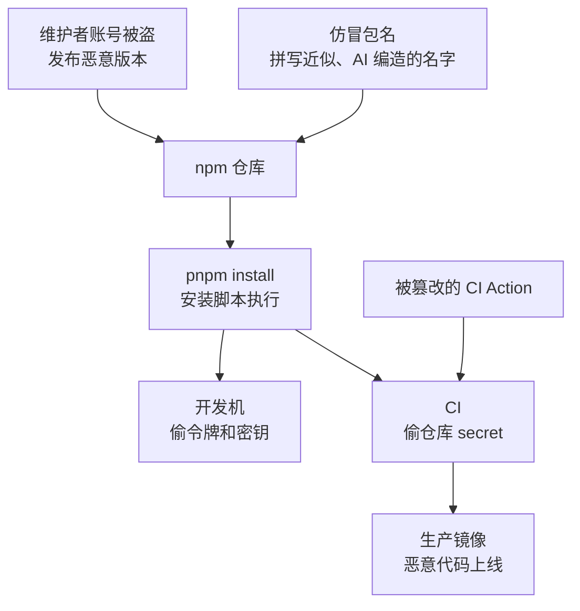

# 依赖与供应链

打开任何一个 pnpm monorepo 的 `pnpm-lock.yaml`，数一数里面有多少个包：几百到上千个是常态。你亲手写的代码只是冰山一角，其余都是陌生人写的，而它们在 `pnpm install` 的那一刻就能在你的电脑上执行代码，能读你的 `~/.ssh`、`~/.npmrc`、环境变量里的云账号密钥。

OWASP Top 10:2025 把 2021 版的「易受攻击和过时的组件」扩展为「软件供应链失败」并升到第三，反映的正是这种变化：风险已经不只是「用了一个有已知漏洞的旧版本」，而是**依赖本身被投毒、维护者账号被盗、构建和分发环节被攻破**。这一章讲一人公司能负担得起的几层防御。

## 攻击是怎么进来的



| 攻击方式 | 怎么发生 | 典型特征 |
|---|---|---|
| 维护者账号被盗 | 钓鱼邮件骗走 npm 凭据或令牌，攻击者以维护者身份发布新版本 | 一个你一直在用的正经包突然出了一个补丁版本 |
| 仿冒包名（typosquatting） | 注册和热门包拼写近似的名字，等人手滑 | `lodahs`、`reacct-dom` 这类名字 |
| AI 编造的包名（slopsquatting） | 大模型在生成代码时会编出不存在但听起来合理的包名，攻击者抢先注册 | 编码 agent 建议安装一个你从没听说过的包 |
| 安装脚本 | `preinstall` / `postinstall` 在安装时执行任意代码 | 装依赖时有网络请求、读了家目录 |
| 依赖混淆 | 私有包名在公共仓库被抢注，包管理器优先拉了公共的 | 公司内部包名出现在 npm 公共仓库 |
| CI 组件被篡改 | 被引用的第三方 GitHub Action 的标签被改指到恶意提交 | 流水线日志里打印出了 secret |

这些都不是假想。近两年 npm 生态里接连出现过热门包维护者被钓鱼后发布恶意版本、能自我传播的蠕虫通过窃取的发布令牌感染更多包、被大量仓库引用的 GitHub Action 被篡改后在 CI 日志里泄露 secret 等事件。共同点是：**受害者什么都没做错，只是照常装了依赖、跑了流水线**。

## 第一层：少装依赖

最有效的防御是减少攻击面。每加一个依赖，都是在信任它的作者、它的所有依赖的作者，以及所有这些人的账号安全。

加依赖之前过一遍：

- **这件事 Node 内置能不能做？** Node 22 自带 `fetch`、`crypto`（含 scrypt）、`node:test`、`util.parseArgs`。hatch-counter 后台口令选 scrypt 而不是 Argon2 包，就是少一个原生依赖
- **能不能自己写二三十行？** 第 4 章的 TOTP 就是例子。判断标准：逻辑稳定、有标准可依、容易测试
- **这个包是否可信？** 看周下载量、维护者数量、最近一次发版的时间、仓库是否活跃、依赖树有多深
- **名字拼对了吗？** 从官方文档复制包名，而不是凭记忆或 AI 的建议

编码 agent 是新的风险来源：它会顺手 `pnpm add` 一个包来解决问题，名字甚至可能是它编出来的。把「新增依赖」设为必须人工确认的操作，在 PR 里专门看 `package.json` 的变化。agent 的权限边界怎么设，见[《Agent 安全》](../agent-safety/)。

## 第二层：锁定版本

`pnpm-lock.yaml` 记录了整棵依赖树每个包的确切版本和完整性哈希。它必须入库，而且 CI 和 Docker 构建里**只能按锁文件装**：

```bash
# 锁文件和 package.json 对不上时直接失败，而不是悄悄解析出新版本
pnpm install --frozen-lockfile
```

pnpm 在检测到 CI 环境变量时默认就是这个行为，但在 Dockerfile 里显式写上更稳妥。

`package.json` 里的 `^1.2.3` 意味着「下次解析时可以升到 1.x 的任何新版本」。有锁文件时它只在你主动更新时生效，所以锁文件就是你的版本闸门：**锁文件的每一处变化都值得看一眼**，尤其是你没有主动升级的包出现了新版本。

## 第三层：管住安装脚本

> [!WARNING]
> 本节的 pnpm 默认行为和配置名（`onlyBuiltDependencies`、`pnpm approve-builds`、配置写在 `pnpm-workspace.yaml` 还是 `package.json`）按截至 2026 年的 pnpm 9 / 10 整理，后续版本可能改名或改默认值，以 pnpm 官方文档和 pnpm 发布说明为准；作者的仓库仍在 pnpm 9.15。

依赖的 `postinstall` 等生命周期脚本是投毒最常用的执行入口。它们有正当用途（编译原生模块、下载平台相关的二进制），但大多数包根本不需要。

**pnpm 10 起默认不再执行依赖的生命周期脚本**，需要执行的包要显式放行。放行名单写在 `pnpm-workspace.yaml` 里，也可以运行 `pnpm approve-builds` 交互式地选：

```yaml
# pnpm-workspace.yaml（pnpm 10）
packages:
  - "apps/*"
  - "packages/*"

# 只有这些包允许在安装时运行脚本
onlyBuiltDependencies:
  - esbuild
  - better-sqlite3
  - electron
```

本书写作时，仓库所有者的三个项目都还停在 pnpm 9.15。pnpm 9 默认会执行依赖的安装脚本，但同样支持放行名单，写在根目录 `package.json` 的 `pnpm` 字段里：

```json
{
  "pnpm": {
    "onlyBuiltDependencies": ["esbuild", "better-sqlite3", "electron"]
  }
}
```

配置之后，名单外的包的安装脚本都不会执行，pnpm 会提示哪些包的脚本被跳过了。遇到功能异常时再按需加入名单，比默认全放行安全得多。

## 第四层：让新版本先冷却一下

> [!WARNING]
> `minimumReleaseAge` 的起始版本（10.16）、单位和默认值按截至 2026 年的 pnpm 文档整理，这个设置的默认值和相关选项在 pnpm 后续版本中有调整，启用前以你所用版本的 pnpm 官方文档和发布说明为准。

被投毒的版本通常在发布后几小时到几天内被发现并下架。如果你的安装策略是「新版本发布满一天才允许装」，就能躲过大部分这类攻击。

pnpm 从 10.16 起提供 `minimumReleaseAge`（单位是分钟）：

```yaml
# pnpm-workspace.yaml（pnpm 10.16 及以上）
minimumReleaseAge: 1440        # 发布不满 24 小时的版本不装
minimumReleaseAgeExclude:
  - "@your-scope/*"            # 自己发布的包不受限制
```

代价是紧急安全补丁也要等一天才能装上，遇到这种情况可以临时把那个包加入排除名单。仍在 pnpm 9 的项目要先升级到 pnpm 10 才能用。升级时注意 pnpm 10 本身有破坏性变更（例如上面说的默认不执行安装脚本），在一个分支上完整跑一遍构建和测试再合并。

## 第五层：已知漏洞扫描与更新

供应链的另一半是老问题：你用的版本有已公开的漏洞。

```bash
# 只看会进生产的依赖；开发依赖的漏洞优先级低一些
pnpm audit --prod

# 查某个包是被谁引进来的
pnpm why <包名>
```

不要试图把 `audit` 清零。大量告警是开发依赖里的、或者是你根本没用到的代码路径里的。按这个顺序判断：

1. 是否进生产（`dependencies` 还是 `devDependencies`，是否打进了客户端 bundle）
2. 漏洞的触发条件你的代码是否满足（比如只在解析不可信的输入时触发）
3. 有没有修复版本，升级是否有破坏性

自动化更新可以用 GitHub 的 Dependabot（它的 `npm` 生态也支持 pnpm 锁文件）或 Renovate。对一人公司，关键是**别让更新 PR 淹没你**：

```yaml
# .github/dependabot.yml
version: 2
updates:
  - package-ecosystem: npm
    directory: /
    schedule:
      interval: weekly
    open-pull-requests-limit: 5
    groups:
      minor-and-patch:
        update-types: [minor, patch]
  - package-ecosystem: github-actions
    directory: /
    schedule:
      interval: monthly
```

小版本和补丁合成一个 PR，CI 绿了就合；大版本单独看 changelog。注意 Dependabot 的冷却期和 pnpm 的 `minimumReleaseAge` 是两回事，前者控制什么时候开 PR，后者控制安装时允许什么版本。

## 第六层：CI 本身的安全

CI 是供应链里权限最集中的环节：它能读仓库 secret、能推镜像、能部署。

```yaml
# .github/workflows/ci.yml（节选）
permissions:
  contents: read            # 默认只读；需要写的 job 单独申请

jobs:
  check:
    runs-on: ubuntu-latest
    steps:
      # 第三方 Action 固定到完整的提交哈希，注释里写版本号方便升级
      - uses: actions/checkout@<40 位提交哈希> # v4.x
      - uses: pnpm/action-setup@<40 位提交哈希> # v4.x
      - run: pnpm install --frozen-lockfile
      - run: pnpm typecheck && pnpm test
```

要点：

- **固定到提交哈希而不是标签**：标签可以被改指向别的提交，提交哈希不能。Dependabot 的 `github-actions` 生态能帮你更新哈希
- **工作流默认最小权限**：在顶层写 `permissions: contents: read`，需要写权限的 job 单独声明
- **慎用 `pull_request_target`**：它以目标仓库的权限运行，却可能检出来自 fork 的代码，是 CI 被攻破的经典入口
- **secret 只给需要的 job**：检查类 job 不需要部署密钥
- **最高权限的凭证不进 CI**：第 4 章提到的 hatch-recordwall 把 App Store Connect 的 API key 留在本机、发版脚本不上 CI，就是这个道理

容器基础镜像的固定（按 digest 引用）和扫描，见[《容器技术》](../docker-containers/)的「容器安全」一章。

## 如果你也发布包

monorepo 里的内部包（`@counter/core`、`@shelf/spec`）通常不发布到 npm，用 `workspace:*` 引用即可。如果你确实要发布公开包：

- npm 账号开启双因素认证，发布令牌按包限定范围、设置过期时间
- 优先使用从 CI 通过 OIDC 发布的方式（npm 称之为 trusted publishing），不在任何地方长期保存发布令牌，并附带来源证明（provenance），让使用者能验证包是从哪个仓库的哪次构建产生的
- 内部包名如果有被抢注的风险，用自己的 scope（`@你的名字/`）并在 npm 上占住

## 出事时怎么排查

某天你看到新闻说某个常用包被投毒了：

```bash
# 1. 你的锁文件里有没有这个包、是哪个版本
grep -n "被投毒的包名@" pnpm-lock.yaml
pnpm why 被投毒的包名

# 2. 本机和 CI 最近有没有装过受影响的版本：看锁文件的提交历史
#    以及 CI 最近几次运行的安装日志

# 3. 如果装过：假设开发机和 CI 上的所有凭证都已泄露
```

第 3 步是最容易被低估的。被投毒的包常见的行为是搜刮环境变量、`~/.npmrc` 里的 npm 令牌、`~/.config/gh` 里的 GitHub 令牌、云厂商的凭证文件，然后外传。如果确认装过受影响版本，就要按第 4 章「泄露了怎么办」的手册，把这台机器和这条流水线能接触到的凭证全部换掉，并检查 GitHub、npm、云账号最近的操作记录。**凭证分级、一个消费方一把钥匙**的价值，在这时候才真正体现出来。

## 本章要点

- 供应链风险已经从「用了旧版本」变成「依赖被投毒、账号被盗、CI 被攻破」，OWASP Top 10:2025 把它排到第三
- 第一层是少装依赖：Node 内置能做的不装，二三十行能写的自己写，agent 新增依赖必须人工确认
- 锁文件入库，CI 和 Docker 里用 `--frozen-lockfile`，锁文件的每处变化都值得看
- 用 `onlyBuiltDependencies` 管住安装脚本；pnpm 10 起默认不执行依赖的安装脚本
- pnpm 10.16 起可用 `minimumReleaseAge` 让新版本冷却一段时间再装
- `pnpm audit --prod` 按是否进生产、能否触发来排优先级；Dependabot 分组更新，避免被 PR 淹没
- CI 里第三方 Action 固定到提交哈希，默认只读权限，最高权限的凭证留在本机
- 确认装过被投毒的版本时，假设那台机器和那条流水线上的所有凭证都已泄露
