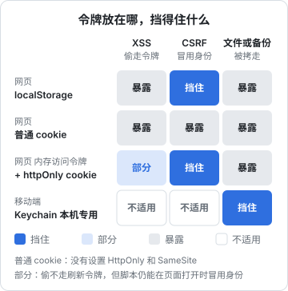

# 移动端安全

移动端和服务端最大的区别是：**你的代码运行在别人的设备上**。安装包可以被解开、被修改、被放进越狱的手机里调试；设备可能丢、可能借给别人；网络可能是咖啡馆里的公共 Wi-Fi；数据还会从其他 App 流进来（分享面板、文件、深度链接）。

这一章不讲越狱检测、代码混淆这类重型手段，对一人公司来说它们的投入产出比很低。我们聚焦在几件真正会出事、而且花点心思就能做好的事上：客户端里放什么、令牌存哪、网络怎么走、怎么处理外部来的输入、WebView 怎么关进笼子。案例主要来自 hatch-shelf（Expo 离线书架）和 hatch-recordwall（Expo 播放器）。

## OWASP Mobile Top 10

> [!WARNING]
> 本节按 2024 年发布的 OWASP Mobile Top 10:2024 整理，中文名称是本书自译；榜单可能已更新，以 OWASP Mobile Top 10 项目官网的最新版本为准。

OWASP 有一份单独的移动端榜单，当前版本是 **OWASP Mobile Top 10:2024**（上一版是 2016 年的）：

| 编号 | 风险 | 一人公司最该注意的点 |
|---|---|---|
| M1 | 凭证使用不当 | 硬编码在包里的 API key、明文存的密码 |
| M2 | 供应链安全不足 | 第三方 SDK、npm 依赖（第 5 章） |
| M3 | 不安全的认证 / 授权 | 只在客户端判断权限；服务端信任客户端传来的身份 |
| M4 | 输入 / 输出校验不足 | 深度链接参数、导入的文件、WebView 里的内容 |
| M5 | 不安全的通信 | 明文 HTTP、关闭证书校验 |
| M6 | 隐私控制不足 | 多收数据、日志里有个人信息、权限申请过多 |
| M7 | 二进制保护不足 | 逆向、篡改；对多数小产品优先级低 |
| M8 | 安全配置错误 | 调试开关进了生产包、导出的组件、过宽的文件权限 |
| M9 | 不安全的数据存储 | 令牌存在明文存储里、敏感数据进了备份 |
| M10 | 加密不足 | 弱算法、硬编码的加密密钥 |

可以看到，大部分条目和 Web 榜单是同一类问题在移动端的投影。下面按「客户端里放什么 → 存储 → 通信 → 外部输入 → WebView」的顺序讲。

## 客户端里没有秘密

第 4 章已经讲过原则：**发给每一个客户端的密钥，等于公开的密钥**。在 Expo 里这一点尤其容易被忽略：`EXPO_PUBLIC_*` 环境变量是 Metro 在打包时**内联进 JS bundle** 的，不是运行时读取的。任何拿到安装包的人，解开就能用字符串搜索找到它们。

所以判断一个值能不能用 `EXPO_PUBLIC_` 前缀，标准只有一个：**它明天出现在公网上，你能不能接受**。

- 能接受：你自己服务端的地址、只读且可轮换的令牌（hatch-recordwall 的做法）、分析 SDK 的公开 key
- 不能接受：数据库连接串、第三方 AI 服务的 key、短信服务的 key、任何能写数据或花钱的凭证

需要调用付费第三方服务的，一律让客户端调你自己的服务端，由服务端带着 key 去调，并且在服务端做限流和计费。hatch-counter 的进货单识别就是这样：识别服务的 key 只在服务端存一份，客户端只能问「现在能不能识别」。

hatch-recordwall 的发版脚本还加了两道闸门：缺只读令牌时拒绝出包，`EXPO_PUBLIC_VAULT_URL` 被设置过时也拒绝出包（地址只该写死在代码里）。这两道闸门必须按 Expo 读取 env 文件的同一份名单去读文件，而不能只看 `process.env`，否则一正一反地都会失效：令牌明明配好了却判成没配，文件里那行地址反倒看不见、照样放行。这是踩过的坑。

## 本地存储：令牌放进钥匙串

> [!WARNING]
> 本节 `expo-secure-store` 的 API 和常量按 Expo SDK 58 的官方文档和源码核对过（`AFTER_FIRST_UNLOCK_THIS_DEVICE_ONLY` 在源码里没有标为废弃；废弃的是 `ALWAYS` 和 `ALWAYS_THIS_DEVICE_ONLY`）。各 SDK 版本可能调整，以 docs.expo.dev 对应版本的 SecureStore 文档为准。

移动端常见的几种存储，安全性差别很大：

| 存储 | 底层 | 加密 | 适合放 |
|---|---|---|---|
| AsyncStorage | iOS 上是沙盒里的文件，Android 上是 SQLite | 只靠系统的整盘加密 | 偏好设置、缓存 |
| SQLite（expo-sqlite） | 沙盒里的数据库文件 | 同上 | 业务数据、离线数据 |
| expo-secure-store | iOS Keychain、Android Keystore 加密 | 系统级的密钥保护 | 刷新令牌、会话凭证 |

刷新令牌是一张长寿命的门票，应该放进 `expo-secure-store`：

```ts
import * as SecureStore from 'expo-secure-store';

const KEY = 'refresh_token';

export async function saveRefreshToken(token: string) {
  await SecureStore.setItemAsync(KEY, token, {
    // 设备首次解锁后才可读；不随 iCloud 钥匙串同步到别的设备
    keychainAccessible: SecureStore.AFTER_FIRST_UNLOCK_THIS_DEVICE_ONLY,
  });
}

export const loadRefreshToken = () => SecureStore.getItemAsync(KEY);
export const clearRefreshToken = () => SecureStore.deleteItemAsync(KEY);
```

几点说明：

- **访问令牌放内存就行**：它只活十几分钟，App 重启后用刷新令牌换一张新的
- **`THIS_DEVICE_ONLY`**：防止令牌随备份或钥匙串同步跑到别的设备上。换手机后重新登录一次，对大多数产品是合理的代价
- **iOS 卸载 App 后 Keychain 里的条目可能保留**：如果你要求「卸载重装等于退出登录」，可以在首次启动时（用一个普通存储里的标记判断）主动清掉旧条目
- **SecureStore 只适合放小的凭证**：Expo 自己不限制大小，但部分 iOS 版本曾拒绝超过约 2048 字节的值，写入时要处理原生报错，不要往里塞大块数据
- **Android 卸载即清空**，而且系统的自动备份要排除 SecureStore 的数据：Keystore 里的密钥卸载时就删了，恢复回来的密文也解不开

下面这张图把网页端和移动端各种存放位置面对的威胁放在一起比较。



网页端那几种的细节见[《前端工程化与 Web 平台》](../frontend-engineering/)；hatch-counter 的网页端把访问令牌放内存、刷新令牌放路径受限的 httpOnly cookie，移动端则是回包体里给票、请求体里递票，令牌存进系统的安全存储。轮换、重放检测、按设备作废这些服务端机制（第 1 章）不分端，它们管的是票，不管票装在哪。

## 通信：只走 HTTPS

> [!WARNING]
> ATS 和 Android 明文流量限制的默认行为按 iOS 26–27、Android 15–16 前后整理，平台规则会随系统版本调整，以 developer.apple.com 和 developer.android.com 的最新文档为准。

iOS 的 App Transport Security（ATS）默认禁止明文 HTTP，Android 9 起也默认禁止。**不要在 `app.json` 里全局关掉它们**，哪怕只是为了开发方便：这类开关很容易被带进生产包。开发时需要访问局域网里的 HTTP 服务，按域名单独放行，并确认生产构建里不包含这条配置。

证书固定（certificate pinning）能防住中间人攻击里「用户设备上被装了恶意根证书」的情况，但代价不小：证书更换时如果没提前发版更新固定值，所有老版本 App 会立刻全部连不上。对一人公司，一般建议**不做证书固定**，把精力放在服务端的 TLS 配置和令牌的短寿命上。确实要做的话，固定的是公钥而不是证书，并且同时固定一个备用公钥。

## 外部来的输入都是不可信的

移动 App 的输入不只来自用户的手指，还来自：

- 分享面板、AirDrop、「文件」App 打开的文件
- 深度链接和通用链接（universal links）的 URL 参数
- 剪贴板
- 内嵌的局域网服务收到的请求
- WebView 里页面发来的消息

### 案例：hatch-shelf 的导入管线

hatch-shelf 允许用户通过 AirDrop、「文件」App 和局域网把书传到手机上。一本书是一个 zip 包，里面有 Markdown、YAML 和图片。**zip 包是典型的不可信输入**：它可能是任何人做的，里面的路径、大小、文件类型都不可信。

它的做法有三个值得学习的地方。

**第一，单一导入管线。** 所有导入通道只负责把文件交给管线，不得各自写 `books/` 目录。这样安全检查只有一处，不会出现「AirDrop 那条路检查了、局域网那条路忘了」。

**第二，判断逻辑只写在一个纯函数包里。** 路径检查、扩展名白名单、大小限制都在 `@shelf/spec` 里，App 和电脑上的 CLI 共用，并且可以在 Node 里写单元测试：

```ts
/** 导入管线放行的扩展名 */
export const ALLOWED_EXTENSIONS = ['.md', '.yaml', '.yml', '.png', '.jpg', '.jpeg', '.gif', '.webp', '.svg'] as const;

/** 单个导入包的大小上限 */
export const MAX_PACKAGE_BYTES = 50 * 1024 * 1024;

/** zip slip 防护：拒绝绝对路径、反斜杠路径和包含 .. 的条目 */
export function isSafeEntryPath(path: string): boolean {
  if (path.length === 0 || path.startsWith('/') || path.includes('\\')) return false;
  if (/^[a-zA-Z]:/.test(path)) return false;
  return !path.split('/').some((seg) => seg === '..');
}
```

**第三，每一道检查都对应一种具体的攻击：**

| 检查 | 防什么 |
|---|---|
| 拒绝绝对路径和含 `..` 的条目 | **zip slip**：条目名写成 `../../Library/xxx`，解压时写到目标目录之外，覆盖 App 的其他文件 |
| 拒绝反斜杠和盘符 | 在 Windows 风格路径下绕过上一条检查 |
| 扩展名白名单 | 只放行书需要的文件类型，其余直接丢弃；白名单而不是黑名单，新的危险类型不会漏进来 |
| 压缩包 50 MB 上限 | 超大文件耗尽内存和存储 |
| 解压后总量不超过压缩包上限的 4 倍 | **zip 炸弹**：几十 KB 的压缩包解压出几 GB 数据。解压前就按条目声明的原始大小累加检查 |
| 先写临时目录，再整体替换 | 导入到一半失败时，不会留下一本残缺的书 |

选用纯 JS 的 fflate 解压，而不是原生的解压库，一个重要原因就是**解压前就能逐条检查路径与大小**，不必先解开再检查。

### 案例：局域网传书服务

hatch-shelf 的传书页面会在手机上开一个 HTTP 服务，让电脑通过浏览器或 CLI 上传。在手机上开一个监听端口，听起来就有风险，它是这样收窄暴露面的：

- **只在进入传书页面时启动**，离开页面、App 进入后台立即关闭
- **每次随机生成一个 4 位 PIN**，上传和列书都要带；**连续错误 5 次，本次服务直接失效**（第 4 章算过，单次被猜中的概率是万分之五）
- **只支持最小的接口集合**：自己实现了只认几条路径的 HTTP 解析，只接受带 `Content-Length` 的请求，每个连接处理一个请求就关闭
- **上传的文件不直接落进书库**，而是交给同一条导入管线

它仍有一个明确接受的风险：服务是明文 HTTP，同一局域网里能嗅探流量的人可以看到 PIN 和书的内容。对一个「在自己家 Wi-Fi 里给自己传书」的个人工具，这个取舍合理；如果是要在公共网络里使用的商业产品，就需要重新评估。**安全决策的关键不是消灭所有风险，而是知道自己接受了哪些风险。**

### 深度链接

深度链接的参数和网页的 URL 参数一样不可信：

- 不要让深度链接直接触发有副作用的操作（支付、删除、改设置），最多跳到确认页
- 不要把深度链接里的 URL 直接塞进 WebView 打开
- OAuth 回调优先用通用链接（iOS universal links / Android App Links），它们绑定了你验证过的域名；自定义 scheme（`myapp://`）可以被别的 App 抢注，这也是第 1 章强调 PKCE 的原因

## WebView：把网页关进笼子

WebView 是移动端最大的攻击面之一：一段网页内容运行在你的 App 里，如果它能执行任意脚本、访问网络、调用原生桥接，后果和 XSS 一样严重，甚至更糟。

hatch-shelf 的阅读器就是一个 WebView：Markdown 在里面用 markdown-it 渲染，书的内容来自用户导入的文件，属于不可信输入。它用了好几层防护：

**1. 渲染层不产生原始 HTML。** markdown-it 用 `html: false` 初始化，书里写的 `<script>`、`` 只会被当成文字显示。远程图片在渲染时就被替换成一行提示，不生成 `` 标签。

**2. CSP 禁止一切网络请求。** 阅读器 HTML 里带着这样的 CSP：

```text
default-src 'none'; img-src file: data: blob:; style-src 'unsafe-inline'; font-src data:; script-src 'unsafe-inline'
```

`default-src 'none'` 且没有声明 `connect-src`，意味着 `fetch`、`XMLHttpRequest`、WebSocket 统统被拦；图片只能来自本地文件和内联数据。即使某天渲染层出了漏洞、混进了一段脚本，它也没法把数据发出去。这里的 `script-src 'unsafe-inline'` 是因为阅读器的 JS 被打包内联进了单个 HTML，在「完全不联网」这个前提下是可以接受的折中。

**3. WebView 只允许加载阅读器本身。** RN 侧限定了 `originWhitelist={['file://*']}`，并且用 `onShouldStartLoadWithRequest` 只放行阅读器页面那一个地址，任何导航到别处的尝试都被拒绝。用户点了书里的外部链接，WebView 不会自己跳转，而是发一条消息给 RN，由 RN 决定是跳到书内的章节还是交给系统浏览器。

**4. 桥接消息有明确的类型。** RN 和 WebView 之间的消息类型只在 `bridge.ts` 里定义，每种消息的字段都是确定的。RN 端收到消息时应当把它当作外部输入：按 `type` 分发，校验字段。hatch-shelf 处理 `link` 消息就是这样做的：`href` 先按 `xx-xx.md#锚点` 的格式匹配本书章节，匹配上就在 App 内跳转；否则只有 `http:` / `https:` 交给系统浏览器打开，其他 scheme（`tel:`、`sms:`、自定义 URL scheme）一律忽略。

**5. SVG 只作为图片加载。** 书里允许 SVG 图片。SVG 可以内嵌脚本，但通过 `` 标签加载的 SVG 不会执行其中的脚本，这是浏览器的规定。所以 SVG 只能以 `` 的方式出现，而不是内联进页面。

这五层合起来体现的是**纵深防御**：任何一层失效，后面还有一层挡着。

### Electron 也是同一个问题

> [!WARNING]
> Electron 各安全选项的默认值随大版本调整过（如 `contextIsolation`、`sandbox`），以 electronjs.org 的 Security 文档和你所用版本的发布说明为准。

Electron 的渲染进程本质上也是一个 WebView，只是权限更大。基本的三个开关：`contextIsolation: true`、`nodeIntegration: false`、`sandbox: true`（新版本 Electron 默认值已经是安全的，不要为了图省事改回去），渲染进程和主进程之间只通过 `contextBridge` 暴露最小的接口，并校验每个 IPC 消息的参数。具体见[《Electron 桌面应用》](../electron-desktop/)。

## 本章要点

- 移动端的代码运行在别人的设备上：包可以解开，设备会丢，网络不可信，外部输入很多；本章引用的是 OWASP Mobile Top 10:2024
- `EXPO_PUBLIC_*` 在打包时内联进 bundle，只能放公开后果可接受的值；付费服务一律经由自己的服务端
- 刷新令牌放 `expo-secure-store`，访问令牌放内存；`THIS_DEVICE_ONLY` 防止随备份迁移
- 不要全局关闭 ATS；一人公司一般不做证书固定
- 不可信输入的处理：单一管线、判断逻辑集中在可测试的纯函数里、每道检查对应一种攻击（zip slip、zip 炸弹、类型白名单）
- 设备上开监听端口要收窄暴露面：只在需要时开、随机 PIN、错误次数上限、最小接口集，并清楚自己接受了哪些风险
- WebView 纵深防御：不渲染原始 HTML、CSP 禁网络、只允许加载自身、桥接消息按类型校验、SVG 只作为图片加载

## 动手练习

1. **`EXPO_PUBLIC_*` 进了 bundle**：在一个练习用的 Expo 项目里（`npx create-expo-app@latest` 新建即可），根目录 `.env` 写一行 `EXPO_PUBLIC_FAKE_KEY=sk-fake-should-not-ship-123`，在任一页面里显示 `process.env.EXPO_PUBLIC_FAKE_KEY`。运行 `npx expo export --platform web`，然后 `grep -r "sk-fake-should-not-ship-123" dist/`。

   验证：grep 在导出的 JS 文件里找到了这串字符。把页面里引用它的那行删掉再导出，grep 就找不到了。

   参考答案：Metro 在打包时把引用到的 `EXPO_PUBLIC_*` 替换成字面量，iOS 和 Android 的 bundle 也一样。会放进这个前缀的值，都要按「明天出现在公网上」来评估。

2. **造一个 zip slip 包，让检查函数拦下**：用 Python 造一个恶意 zip：`python3 -c "import zipfile; z = zipfile.ZipFile('evil.zip', 'w'); z.writestr('../escape.txt', 'x'); z.writestr('book/01.md', '# ok'); z.close()"`，用 `unzip -l evil.zip` 看条目名。再把本章的 `isSafeEntryPath` 抄进一个文件，用 `node:test` 写测试，至少覆盖 `../escape.txt`、`a/../../b`、`/etc/passwd`、`a\..\b`（JS 字符串里写成 `'a\\..\\b'`）、`C:/x`、`book/01.md`、`a/..b/c`。最后用 fflate 的 `unzipSync` 读出 `evil.zip` 的条目名，逐个过一遍检查函数。

   验证：`unzip -l` 列出的条目名就是 `../escape.txt`；测试里前五个返回 `false`，后两个返回 `true`；读 `evil.zip` 时只有 `book/01.md` 通过。

   参考答案：zip 的条目名是做包的人随便写的字符串；`a/..b/c` 是用来确认你按路径段比较，而不是简单地搜 `..` 子串而误伤正常文件名。

3. **CSP 拦住网络请求**：在本机新建 `reader.html`，`<head>` 里放 `<meta http-equiv="Content-Security-Policy" content="default-src 'none'; img-src file: data: blob:; style-src 'unsafe-inline'; script-src 'unsafe-inline'">`，`<body>` 里放一张 `https://example.com/x.png` 的图片和一段内联脚本 `fetch('https://example.com').then(() => document.title = 'fetched', (e) => document.title = 'blocked')`。用桌面浏览器直接打开这个文件，打开开发者工具的 Console 和 Network。

   验证：标签页标题变成 `blocked`；Console 里有两条 CSP 违规提示（一条是图片，一条是 connect），Network 面板里这两个请求没有真正发出（Chrome 会标成 `blocked:csp`）。把 meta 标签删掉再刷新，对比两者的差别。

   参考答案：`default-src 'none'` 且没有 `connect-src`，`fetch` 和远程图片都被浏览器在发出前拦下；这是渲染层之后的又一层，即使有脚本混进来也送不出数据。
