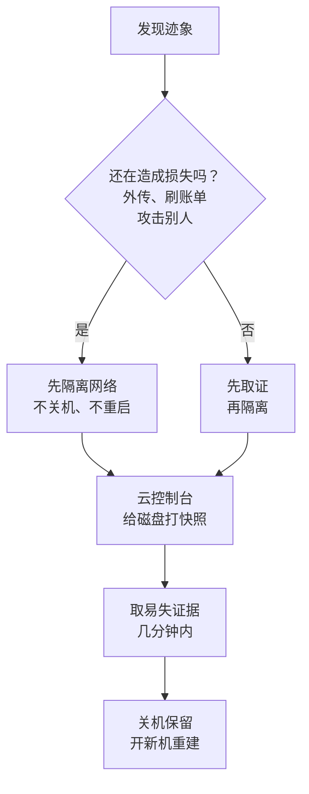

# 服务器被入侵了怎么办

前面七章讲的都是「怎么不被攻破」。这一章讲攻破之后：某天早上你发现一台 VPS 的 CPU 一夜都是 100%，或者收到云厂商「您的实例存在对外攻击行为」的邮件。这时最容易犯的错，是登上去 `kill` 掉陌生进程、删掉可疑文件、重启，然后告诉自己「处理完了」。

[《一人运维手册》的事故响应一章](../production-ops/03-incident-response.md#安全事件的特殊处理)给了五步的简版。本章把它展开：怎么判断是不是被入侵、先隔离还是先取证、取证要存什么、钥匙按什么顺序换、为什么要重建而不是修补，以及事后怎么找到入口、要不要报告。

## 发现迹象

入侵很少自己报到。一人公司能看到的迹象大多来自账单、监控和服务商的通知：

| 迹象 | 常见原因 | 先看哪里 |
|---|---|---|
| CPU 长时间满载、云账单暴涨 | 挖矿程序 | `top` 里的进程名和启动路径；云控制台的监控曲线从什么时候开始 |
| 云厂商的安全告警、「对外攻击」通知 | 机器被当成肉鸡扫描或发包 | 告警里写的时间、目标和进程 |
| 陌生的 ssh 登录记录 | 私钥泄露、弱口令、新加的公钥 | `last`、`journalctl -u ssh`、`~/.ssh/authorized_keys` 的修改时间 |
| 陌生的用户、定时任务、systemd 单元 | 攻击者留的持久化后门 | `/etc/passwd`、所有用户的 crontab、`systemctl list-timers` |
| 出站流量异常、连向陌生地址 | 外传数据、回连控制端 | `ss -tunap`、云控制台的出网流量 |
| 数据库里出现陌生的管理员账号、被改过的配置 | 应用层漏洞或数据库直接暴露在公网 | 审计日志（[第 7 章](07-sensitive-logs.md)）、按创建时间排序的用户表 |
| 第三方服务账单异常（短信、大模型、支付） | 服务端密钥泄露 | 服务商后台的调用来源 IP 和时间 |
| GitHub 发来密钥泄露通知 | 密钥被提交进仓库 | 通知里的提交和文件 |

有一条要先记住：**被入侵的机器上的工具不可信**。攻击者如果拿到了 root，`ps`、`ls`、`netstat` 都可能被替换成隐藏自己的版本。机器上看到的「一切正常」不能作为结论；云控制台的监控曲线、流量统计、账单是攻击者改不了的，比机器上的输出更可靠。

## 先隔离还是先取证

两件事有冲突：隔离和止损要快，但重启、关机、删文件会抹掉证据；取证要时间，但攻击者可能还在线，每多一分钟就多外传一些数据、多烧一些钱。

一个人的判断规则：



**隔离要用不会丢现场的办法。** 在云控制台改安全组：入站只放行你自己当前的 IP，**出站也全部拒绝**（挖矿和外传都靠出站）。不要关机、不要重启：内存里的进程、网络连接、已删除但仍在运行的程序都只存在于运行中的机器上。也不要先在机器上「到处看看」，攻击者可能正看着你。

**快照在任何操作之前。** 在云控制台给系统盘和数据盘各打一个快照。它记录的是磁盘此刻的状态，之后你在机器上做的任何事都不会污染它。事后分析时，从快照创建一块新盘，以只读方式挂到一台干净的分析机上看，而不是在原机器上看。

## 取证清单

通用的现场清单（时间窗、版本、请求样本、进程现场、指标截图、数据库状态、自己的操作）在[《调试方法》的线上取证清单](../debugging-methods/09-production-only.md#线上取证清单出事时先保存什么)里，照着做，这里不重复。安全事件要在那张表之外再加几项。

**输出不要写到这台机器的磁盘上**，从你自己的电脑上远程执行，把结果存在本地：

```bash
H=deploy@203.0.113.10
D=incidents/$(date +%F)-compromise && mkdir -p "$D"
run() { ssh "$H" "sudo $1" > "$D/$2.txt" 2>&1; }

run "date -u; uptime"                         time
run "who; last -F -n 50"                      logins
run "lastb -F -n 50"                          failed-logins
run "ps auxfww"                               processes
run "ss -tunap"                               sockets
run "ls -la /proc/*/exe 2>/dev/null | grep deleted"  deleted-binaries
run "cat /etc/passwd; ls -la /home/*/.ssh /root/.ssh; cat /home/*/.ssh/authorized_keys /root/.ssh/authorized_keys"  accounts-keys
run "for u in \$(cut -d: -f1 /etc/passwd); do crontab -l -u \$u 2>/dev/null | sed \"s/^/\$u: /\"; done; ls -la /etc/cron.*"  cron
run "systemctl list-units --type=service --state=running; systemctl list-timers --all"  systemd
run "find /etc/systemd /usr/lib/systemd /etc/cron* /tmp /var/tmp /dev/shm -newermt '-14 days' -type f -ls"  recent-files
run "docker ps -a; docker images"             docker
run "journalctl -u ssh --since '-14 days' --no-pager"  ssh-log
sha256sum "$D"/*.txt > "$D/SHA256SUMS"
```

- 输出里有被删除但仍在运行的程序（`(deleted)`）、`/tmp` `/dev/shm` 里的可执行文件、名字伪装成 `kworker` 却有用户态命令行的进程，这些都是典型的恶意程序痕迹
- 每个容器都跑一次 `docker diff <容器>`：它列出容器启动后被新增和修改的文件。镜像本应是只读的，正常服务的 diff 里只有日志和缓存
- 云账号这一层也要取证：阿里云的操作审计（ActionTrail）、AWS 的 CloudTrail 记录了每一次 API 调用。按泄露的 AccessKey 筛选，能看到攻击者用它建了什么实例、读了哪个桶
- 文件上算一次哈希，说明这份证据在你拿到之后没有被改过。可能报案或涉及用户赔偿时，这一点有用

清单本身写好放在仓库里，出事时照着执行，不要临场想。

## 轮换密钥：从影响面最大的开始

假设这台机器上能读到的一切都已经泄露：环境变量、`.env`、`/etc` 下的配置、shell 历史、部署用户的私钥。换钥匙的步骤按[第 4 章「泄露了怎么办」](04-passwords-secrets.md#泄露了怎么办)的四问逐把处理，顺序按「落到别人手里能造成多大损失」排：

| 顺序 | 钥匙 | 为什么排在这里 |
|---|---|---|
| 1 | 云账号的登录密码和 MFA、云 AccessKey | 拿到它可以删掉所有机器、所有备份，再开一百台机器挖矿 |
| 2 | 代码托管和 CI 的令牌、镜像仓库的推送凭据 | 能在你的代码或镜像里埋后门，重建出来的新机器照样中招 |
| 3 | 备份仓库的凭据（restic 密码、对象存储密钥） | 能删掉你恢复所需的最后一份数据 |
| 4 | 数据库密码 | 能直接读写全部业务数据 |
| 5 | 会花钱的第三方密钥：短信、支付、大模型 API | 损失按分钟增长；顺带看服务商后台有没有异常调用 |
| 6 | 应用自己的签名密钥：JWT、会话、Webhook 签名 | 换掉后所有已签发的令牌失效，这正是想要的 |
| 7 | ssh 密钥 | 新机器用新钥匙；旧公钥从所有地方移除 |

几条原则：

- **在另一台干净的机器上操作**：你的电脑，或者至少不是这台服务器。从被入侵的机器上登录云控制台，等于把新密码也交出去
- **先换再删旧值的顺序不能反**：新值部署好、服务恢复后，再到服务商那里作废旧值。但如果旧值正在被滥用（第三方账单在涨），先作废，接受一段停机
- **用户的凭据**：数据库里如果存的是慢哈希（第 4 章），密码哈希泄露不等于密码泄露，但仍然应当提示用户修改；如果会话令牌、API 密钥是明文存的，全部作废，让用户重新登录、重新生成

## 重建，而不是修补

找到了那个挖矿进程、删掉了、重启后也没再出现，看起来已经修好了。但你无法证明攻击者只留下了这一个东西：替换过的系统命令、藏在别处的定时任务、内核模块、某个容器镜像里的后门，任何一个漏掉都意味着它还能回来。**对一台被拿到过 root 的机器，唯一可信的处理方式是不再信任它**。

重建的顺序：

1. **先找到入口**（下一节）。不堵住入口就上线的新机器，会被同一个方法再次攻破，可能就在几小时之内
2. **开一台全新的机器**，从官方镜像开始，不从旧机器的快照或自定义镜像开始。如果机器的配置已经写成了代码（[《基础设施即代码》的重建手册](../iac-gitops/06-solo-iac.md#重建手册)），这一步就是跑一遍 playbook
3. **只搬数据，不搬程序**。代码从仓库重新构建，镜像重新拉取（并核对仓库和 CI 没有被动过手脚），配置文件按清单重写；从旧机器上拷过来的只有数据
4. **数据从入侵之前的备份恢复**。根据取证得到的最早入侵时间，选那之前的一份备份；之后产生的业务数据，对照审计日志确认没有被篡改后再补回来。数据库里重点看：新增的管理员账号、被改过的回调地址和收款信息、被加进去的 API 密钥
5. **新机器用新密钥**，旧机器保持关机状态直到分析完，再连同快照一起删除

这就是《一人运维手册》强调[整机重建演练](../production-ops/02-backup-dr.md#整机重建演练)的原因：演练过，出事时重建就是照着做一遍；没演练过，重建本身就会变成第二个事故。

## 找到入口

一个人维护的服务，入口通常就是下面几种之一。对照取证结果逐个排除：

| 入口 | 迹象 | 对应的防线 |
|---|---|---|
| 密钥泄露：进了 Git 仓库、打进了客户端包 | 攻击者直接用有效凭据登录或调用 API，没有漏洞利用的痕迹 | 第 4 章；第 9 章季度复查里的 gitleaks |
| 数据库、Redis、管理面板直接暴露在公网 | 数据库日志里有陌生来源的登录；Redis 被写入了 ssh 公钥或定时任务 | 《一人运维手册》的[端口审计](../production-ops/01-hardening.md#端口审计你以为开了什么和实际开了什么) |
| 弱口令或默认口令 | `lastb` 里大量失败后出现一次成功；Grafana、Portainer 这类面板还是初始密码 | 关掉密码登录；面板不对公网 |
| 依赖或基础软件的已知漏洞 | 访问日志里有针对特定路径的攻击请求，之后出现异常进程 | 第 5 章；自动安全更新 |
| 应用自己的漏洞：命令注入、SSRF、文件上传 | 访问日志里的异常参数，和进程启动时间对得上 | 第 3 章 |
| 供应链：被投毒的依赖包、CI 被篡改 | 构建时或安装依赖时出现的外连；问题在新部署后出现 | 第 5 章 |

把访问日志、ssh 日志和取证里的进程启动时间放在同一条时间线上，入口通常会自己浮现：最早一个异常进程启动之前的几分钟里，发生了什么请求或登录。

## 通知与报告

> [!WARNING]
> 本节按 2026 年 11 月对照的法规原文整理：《个人信息保护法》第五十七条（个人信息泄露时的补救和通知义务）；《国家网络安全事件报告管理办法》（国家网信办 2025 年 9 月发布、2025 年 11 月 1 日起施行，按中国网信网刊载的全文），其中一般网络运营者对「较大以上」网络安全事件最迟 4 小时内向属地省级网信部门报告，事件分级按《网络安全事件分级指南》。适用情形和要求以法规原文和主管部门的最新规定为准；面向海外用户的还要看 GDPR 等当地规定（见[《出海实务》](../going-global/05-gdpr-privacy.md#数据泄露)）。

两类义务要分开想：

- **对用户**：发生或者可能发生个人信息泄露、篡改、丢失的，个保法要求立即采取补救措施，并通知履行个人信息保护职责的部门和个人。取证的结论决定了范围：攻击者能读到数据库，就要按「全部用户数据可能泄露」处理，而不是按「没发现他读了」处理
- **对主管部门**：大多数一人公司的事故达不到「较大」的分级，但涉及大量个人信息时，以分级指南和主管部门的口径判断，拿不准就咨询。网信部门开通了 12387 热线等报告渠道

给用户的通知写清楚四件事：发生了什么、什么时候、涉及哪些数据、用户需要做什么（比如改密码、留意以你名义发出的短信）。不要写「没有证据表明数据被滥用」这种既无法证明也帮不上用户的话。合规框架见[《国内合规实务》](../opc-compliance-cn/06-pipl.md#处理者的义务)。

## 事后复盘

复盘的写法按[《一人运维手册》的复盘一章](../production-ops/04-postmortem.md)，安全事件要额外回答三个问题：

1. **入侵发生到发现隔了多久**，这段时间里本来可以由哪个信号发现。答案通常是一条该有却没有的告警：ssh 登录通知、出站流量阈值、云账单日预算、数据库新增管理员的审计告警
2. **入口为什么存在**：是不知道（端口不知道开着），还是知道但排在后面（「回头再改默认密码」）。后者要在清单里升级优先级
3. **恢复时卡在哪**：找不到备份、不知道有哪些密钥、重建步骤缺了一段。每一处卡顿都对应一份要补的文档

产出照例落到[第 9 章的清单](08-security-checklist.md)和测试里：每一次事故都让清单多一条，或者让一条人工检查变成自动检查。

## 本章要点

- 迹象多来自账单、监控和服务商通知；被入侵机器上的工具不可信，以云控制台的数据为准
- 还在造成损失就先隔离：改安全组、出站也拒绝，**不关机、不重启**；任何操作之前先打磁盘快照
- 取证从自己的电脑远程执行，输出存在本地并算哈希；通用清单见《调试方法》，安全事件再加账号、定时任务、systemd、已删除仍运行的程序、`docker diff` 和云审计日志
- 换钥匙按影响面排序：云账号、代码托管和 CI、备份、数据库、会花钱的第三方、签名密钥、ssh；在干净的机器上操作
- 被拿到过 root 的机器不修补，先找到入口，再从官方镜像重建、只搬数据、从入侵之前的备份恢复
- 个人信息可能泄露时有通知义务；复盘要回答「多久才发现」「入口为什么存在」「恢复卡在哪」

## 动手练习

下面的练习在一次性容器里进行，模拟攻击者留下的痕迹，再用本章的清单找出来。

1. **用 `docker diff` 找出被动过的文件**：启动一个容器模拟「被入侵的服务」，在里面留几处后门。

   ```bash
   docker run -d --name victim ubuntu:24.04 sleep infinity
   docker exec victim bash -c '
     mkdir -p /root/.ssh && echo "ssh-ed25519 AAAAFAKE attacker" >> /root/.ssh/authorized_keys
     cp /bin/sleep /var/tmp/.kworker
     echo "*/5 * * * * root /var/tmp/.kworker 999" > /etc/cron.d/update-check'
   docker diff victim
   ```

   验证：输出里有 `A /root/.ssh/authorized_keys`、`A /etc/cron.d/update-check` 和 `A /var/tmp/.kworker`（前面还会有它们所在目录的 `C` 行）。

   参考答案：镜像应当是只读的，正常服务的 diff 里只该有日志、缓存这类预期内的写入；新增的公钥、定时任务和藏在 `/var/tmp` 里的隐藏文件就是持久化后门。要注意 `/dev/shm` 这类挂载进来的内存文件系统不在 diff 的范围里，所以取证清单还要单独查 `/tmp`、`/var/tmp`、`/dev/shm`。

2. **找出「已删除但仍在运行」的程序**：接着上一题，在容器里启动伪装的进程，再删掉它的文件。

   ```bash
   docker exec -d victim /var/tmp/.kworker 999
   docker exec victim rm /var/tmp/.kworker
   docker exec victim bash -c 'ls -la /proc/*/exe 2>/dev/null | grep deleted'
   ```

   验证：输出一行，指向 `/var/tmp/.kworker (deleted)`。

   参考答案：恶意程序常在启动后删掉自己的文件，磁盘上找不到，进程却还在跑。`/proc/<pid>/exe` 仍然指向它，此时可以用 `cp /proc/<pid>/exe /某处` 把程序本体取出来留作证据。这也说明了为什么先取证再关机：一关机，这个程序就彻底消失了。做完清理：`docker rm -f victim`。

3. **给一次入侵排换钥匙的顺序**：一台 VPS 被入侵，攻击者拿到了 root。机器上有：`.env`（数据库密码、JWT 密钥、短信服务密钥、R2 访问密钥）、`/etc/restic/env`（备份仓库密码和对象存储密钥）、部署用户的 `~/.ssh/id_ed25519`（能推送到 GitHub 仓库）、`~/.config/gh`（GitHub CLI 令牌）。列出你换钥匙的顺序，并说明前两项为什么排在最前面。

   验证：顺序和本章的表大体一致；前两项是 GitHub 相关凭据和备份凭据（这台机器上没有云账号凭据）。

   参考答案：先换 GitHub 令牌和部署私钥（能改代码，重建出来的机器会再次带上后门），再换备份凭据（能删掉恢复所需的数据），然后是数据库密码、R2 密钥、短信密钥（同时看短信后台的调用量），最后是 JWT 密钥（所有用户需要重新登录）。全部在自己的电脑上操作，新机器用新的 ssh 密钥。
