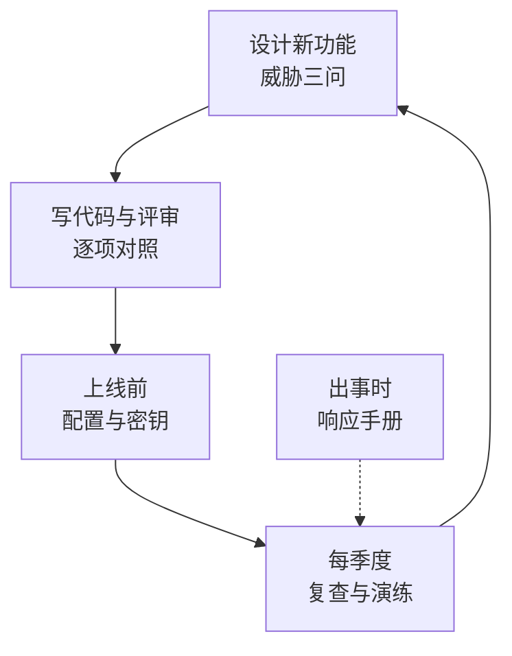
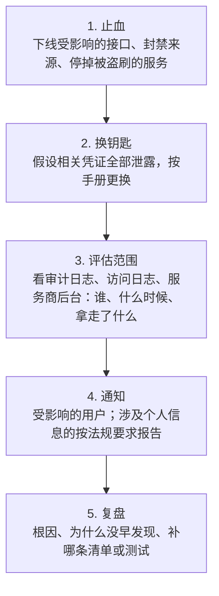

# 安全自查清单

前面七章讲了原理和案例，这一章把它们收成一份可以逐条对照的清单。它按**什么时候用**来组织：设计一个新功能时、写代码和评审时、上线前、每个季度、出事时。每一条后面标了对应的章节，拿不准的时候回去看。

清单不求全，求的是「一个人真的会去对」。每一条都应该能在几分钟内回答「是」或「否」，回答不了的那一条，就是你下一个要补的地方。

## 怎么用这份清单

几个使用建议：

- **复制到项目里**：把适用的条目复制进项目的 `docs/` 或 `CLAUDE.md`，变成这个项目的约定。编码 agent 读到它，写代码时也会遵守
- **能自动化的就自动化**：清单里很多条可以变成测试或启动检查（RLS 扫描、生产配置自检、日志不含令牌），变成测试的条目就可以从人工清单里划掉
- **记下你接受的风险**：有些条目你会有意不做，比如 hatch-shelf 的局域网服务用明文 HTTP。把「不做」和「为什么」写下来，它就从疏忽变成了决策

## 设计新功能时：威胁三问

每个新功能、新接口，动手前回答三个问题（第 3 章）：

| 问题 | 要想到的 |
|---|---|
| 谁能调它？ | 未登录能不能调；登录后哪些角色能调；能调多少次 |
| 最坏情况下它能被怎么滥用？ | 刷钱（短信、AI、存储、流量）；刷数据（枚举用户、遍历 ID）；刷别人（轰炸某个手机号）；当跳板（SSRF、开放代理） |
| 出错时它是放行还是拒绝？ | 依赖的服务超时、配置缺失、数据库连不上时，默认拒绝 |

再加一问：**这个功能会不会接收外部文件或 URL？** 会的话，按第 6 章的不可信输入处理，或按第 3 章的 SSRF 处理。

## 认证（第 1 章）

| 检查项 | 怎么验证 |
|---|---|
| 全局默认要登录，公开端点显式标注 | 搜索所有 `@Public()`，逐个确认 |
| JWT 验证时写死算法、校验 `aud` | 看验证函数的参数 |
| 不同用途的令牌用不同的 `aud`（用户、后台、内部服务） | 用用户令牌调后台接口，应当 401 |
| 访问令牌寿命在十几分钟量级；载荷只含身份，不含权限 | 解开一张令牌看 |
| 刷新令牌只存哈希、每次续期轮换、检测到重放就作废整台设备 | 拿一张用过的刷新令牌去续期，应当失败且该设备的其他令牌一起失效 |
| 网页端刷新令牌在 `HttpOnly`、`Secure`、`SameSite`、路径受限的 cookie 里 | 浏览器开发者工具看 cookie 属性 |
| 登录、验证码接口按账号和 IP 两个维度限流，滚动窗口 | 写测试打满限额 |
| 按 IP 限流时，正确配置了信任代理的跳数 | 日志里看到的 IP 是真实客户端，而不是 nginx |
| 被拒绝的请求也计入限流 | 用没开通的号连续请求，应当被按 IP 限住 |
| 错误提示不区分「账号不存在」和「密码错误」 | 手动试一次 |
| 管理后台有第二因素（TOTP 或 passkey），不只靠短信 | 登录后台走一遍 |
| 接入第三方登录时用授权码 + PKCE，核对 `state` | 看回调处理代码 |

## 授权（第 2 章）

| 检查项 | 怎么验证 |
|---|---|
| 所有权限判断都在服务端，界面只是跟着变 | 用低权限账号直接调高权限接口，应当 403 |
| 没标注权限的端点默认只有最高角色能用 | 新加一个端点不标注，用普通账号调 |
| 权限、门店、角色每次请求现查，改完立即生效 | 改一个人的权限，不重新登录直接试 |
| 按 ID 取资源时带上归属条件 | 用 A 租户的令牌请求 B 租户的资源 ID |
| 多租户隔离有数据库兜底（RLS），并有测试扫描所有租户表 | 新建一张带租户字段的表不写策略，测试应当变红 |
| 设置租户上下文用事务级的 `SET LOCAL` | 搜索 `set_config` 和 `SET` |
| 业务连接用的数据库角色不是表的 owner，也不是 superuser | 启动时比较连接串里的用户名 |
| 资源状态（停用、到期）在业务接口拦，给出能行动的提示 | 停用一个测试租户，登录后访问业务接口 |
| 拒绝信息说清缺什么权限、找谁开，但不泄露资源是否存在 | 看 403 的返回内容 |

## 输入与输出（第 3、6 章）

| 检查项 | 怎么验证 |
|---|---|
| 所有请求体、查询参数过 schema 校验，有大小上限 | 发一个超大请求体、一个字段类型错误的请求 |
| 没有字符串拼接的 SQL；`sql.raw` 的每一处都有理由 | 搜索 `sql.raw`、模板字符串里的 `select` |
| 动态排序、动态列名走白名单 | 传一个不存在的列名 |
| 外部命令用 `execFile` / `spawn` 传参数数组 | 搜索 `exec(` |
| 服务端请求用户给的 URL 时：主机白名单、不转发客户端头、不跟随重定向、拒绝内网地址 | 让它请求 `http://127.0.0.1` 和云元数据地址 |
| 解压用户上传的压缩包时：拒绝 `..` 和绝对路径、扩展名白名单、限制压缩前后的大小 | 用构造好的恶意 zip 写单元测试 |
| 不可信文件只有一条导入管线，判断逻辑集中在可测试的模块里 | 搜索所有写目标目录的地方 |
| Markdown / 富文本渲染不输出原始 HTML，或经过严格的消毒 | 在内容里写一段 `` |
| 未处理的异常对外只回通用信息，细节只进日志 | 制造一个数据库错误，看返回内容 |
| 公开的健康检查接口只回布尔值 | 断开数据库，请求健康检查 |

## 密码与密钥（第 4 章）

| 检查项 | 怎么验证 |
|---|---|
| 密码用 Argon2id 或 scrypt 存，参数对照 OWASP 备忘单最新版 | 看哈希字符串的前缀和参数 |
| 比较令牌、签名、验证码用 `timingSafeEqual` | 搜索令牌比较处的 `===` |
| 服务端生成的令牌用 `crypto.randomBytes`，只存哈希 | 搜索 `Math.random` |
| 短码（验证码、PIN、TOTP）都有尝试次数上限 | 连续输错，看是否作废 |
| 客户端包里没有服务级以上的密钥 | 解开安装包或 bundle，搜索 `key`、`secret`、`token` |
| 生产启动时拒绝开发密钥、缺失的必填配置 | 用开发配置以生产模式启动，应当起不来 |
| 每把服务级以上的密钥都知道在哪、怎么换、换了会断什么 | 拿出你的「换钥匙」手册看一遍 |
| 身份级凭证（云账号、App Store Connect、签名证书）不在 CI 和服务器上 | 检查 CI 的 secret 列表 |
| 云账号和代码托管账号开了双因素认证 | 登录各平台的安全设置页 |

## 依赖与供应链（第 5 章）

| 检查项 | 怎么验证 |
|---|---|
| 锁文件入库，CI 和 Dockerfile 用 `--frozen-lockfile` | 看 CI 配置和 Dockerfile |
| 依赖的安装脚本有放行名单（`onlyBuiltDependencies`） | 看 `pnpm-workspace.yaml` 或 `package.json` |
| （pnpm 10.16+）配置了 `minimumReleaseAge` | 看 `pnpm-workspace.yaml` |
| 新增依赖必须人工确认，编码 agent 不能自行添加 | 看 agent 的权限配置；PR 里检查 `package.json` |
| `pnpm audit --prod` 没有未评估的高危漏洞 | 跑一次 |
| 有自动依赖更新，且分组、限量 | 看 `dependabot.yml` 或 Renovate 配置 |
| CI 里第三方 Action 固定到提交哈希，默认只读权限 | 看 workflow 文件 |
| 没有使用 `pull_request_target` 检出 fork 的代码 | 搜索 workflow 文件 |

## 移动端（第 6 章）

| 检查项 | 怎么验证 |
|---|---|
| `EXPO_PUBLIC_*` 里只有公开后果可接受的值 | 列出所有 `EXPO_PUBLIC_` 变量逐个过 |
| 刷新令牌在 `expo-secure-store` 里，不在 AsyncStorage | 搜索令牌的存取代码 |
| 没有全局关闭 ATS 或允许明文流量 | 看 `app.json` 和生成的 `Info.plist` |
| 深度链接不直接触发有副作用的操作 | 构造一个深度链接试 |
| WebView 限制了可加载的来源，并拦截导航 | 看 `originWhitelist` 和 `onShouldStartLoadWithRequest` |
| WebView 内容有 CSP；不需要联网的就禁止网络 | 看 HTML 的 meta 标签 |
| 桥接消息按类型分发并校验字段；外部链接只放行 `http(s)` | 看消息处理代码 |
| 设备上开的监听服务只在需要时启动，有凭证和错误次数上限 | 离开页面后访问端口；连续输错 PIN |

## 日志（第 7 章）

| 检查项 | 怎么验证 |
|---|---|
| 请求日志不记请求体和 `Authorization`、`Cookie` 头 | 登录一次，翻日志 |
| 有测试断言关键流程的日志里不出现令牌和验证码 | 跑测试 |
| 令牌不出现在 URL 里；例外有明确的理由和范围 | 搜索 `?token=`、`&t=` |
| 日志里关联用户用 ID，个人信息打码 | 翻日志 |
| 后台敏感操作有审计日志，和操作在同一个事务里 | 让审计写入失败，操作应当回滚 |
| 审计里不出现密钥和验证码，只记「改没改」 | 改一次配置，看审计内容 |
| 登录失败、验证码量、令牌重放、权限拒绝有告警 | 制造一次，看是否收到告警 |
| 第三方错误追踪服务关掉了请求体和个人信息的采集 | 看 SDK 配置 |

## 上线前：最后十分钟

把上面的内容压缩成上线前必过的十项：

1. 生产配置自检能通过，开发密钥起不来
2. 数据库业务连接不是 owner，RLS 测试是绿的
3. 用普通用户的令牌调一次后台接口，被拒绝
4. 用 A 租户调一次 B 租户的资源，被拒绝
5. 登录和验证码接口的限流打得满
6. 客户端 bundle 里搜不到服务级密钥
7. 对象存储桶不是公开读，也没有绑定会让它公开的域名
8. 未处理异常只回通用信息
9. 日志里搜不到令牌
10. 服务器加固清单（见[《一人运维手册》](../production-ops/)）已过一遍

## 每个季度：复查与演练

安全不是一次性的工作，配置会漂移，依赖会变，你会忘。每个季度花半天：

- **复查权限**：云账号、代码托管、服务商后台、服务器上，都有谁、有什么权限、哪些 SSH 公钥和 API key 已经不用了
- **复查依赖**：跑 `pnpm audit --prod`，处理积压的依赖更新
- **演练换钥匙**：挑一把服务级密钥真的换一次，验证手册写得对、换完服务正常
- **演练恢复**：从备份恢复一次数据库（《一人运维手册》的备份演练）
- **看一眼审计和告警**：过去三个月有没有异常的登录、异常的后台操作、被忽略的告警
- **回顾这份清单**：有没有新加的功能没对照过，有没有新踩的坑要补进来

## 出事时：响应手册

> [!WARNING]
> 个人信息泄露后通知用户、向主管部门报告的要求和时限，以《个人信息保护法》等法规和国家网信办等主管部门的最新规定为准。

真出事时人是慌的，所以步骤要事先写好。一个人的安全事件响应可以简化为五步：

- **先止血，再查原因**：被盗刷的短信、AI 服务先停掉，损失每分钟都在增长
- **保留证据**：止血时别顺手把日志删了，复盘和可能的报案都需要
- **个人信息泄露有法定义务**：通知用户、向主管部门报告，[《国内合规实务》](../opc-compliance-cn/)讲了框架
- **复盘的产出是清单和测试**：每一次事故都应该让这份清单多一条，或者让某一条从人工检查变成自动测试。复盘怎么写见《一人运维手册》

## 本章要点

- 清单按使用时机组织：设计时的威胁三问、写代码时逐项对照、上线前十项、每季度复查、出事时五步
- 每一条都应该能在几分钟内回答；回答不了的就是下一个要补的
- 能自动化的条目变成测试或启动检查，从人工清单里划掉
- 有意不做的条目写下理由，把疏忽变成决策
- 每次事故都让清单多一条，或让一条人工检查变成自动测试

---

到这里，这本书就结束了。安全没有终点，但你已经有了一张地图和一份清单。

按书架导读里「准备上线第一个付费产品」那条路线，接下来建议读《国内合规实务》：本书多次提到个人信息保护的法律义务、泄露后的通知和报告，那本书把备案、隐私政策、个人信息处理规则这些框架和流程讲清楚。如果还没读过《一人运维手册》，它和本书是一对：本书管应用层，那本管服务器和事故响应。之后可以读[《定价与商业模式》](../pricing-monetization/)，把产品真正变成生意。想更系统地理解多租户、模块边界这些本书反复用到的架构概念，可以读[《软件架构与系统设计》](../system-design/)。
