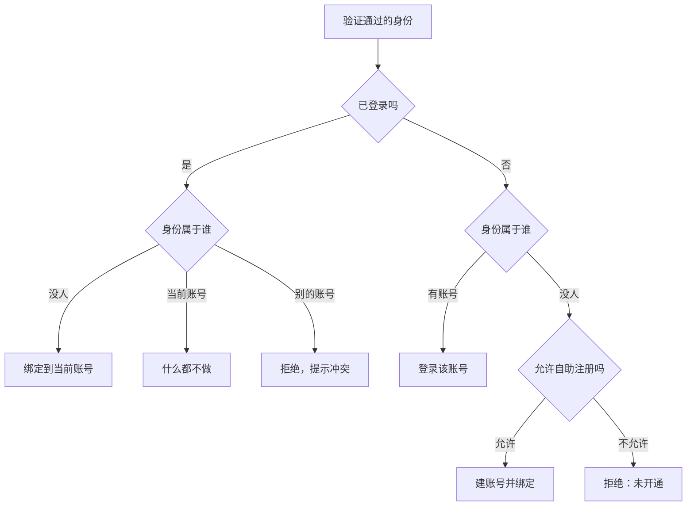
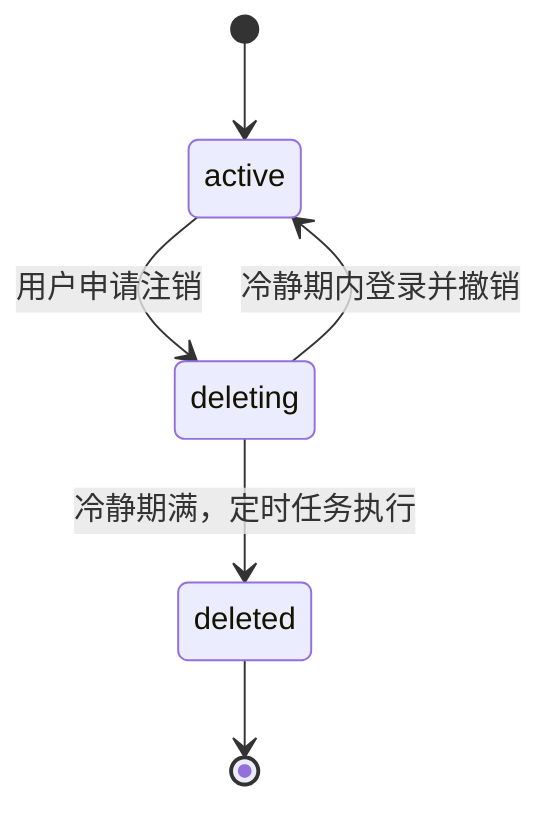

# 账号体系的数据模型

这本书讲两件一人公司迟早要自己写的东西：**让人登录**和**让人付钱**。它们看起来是两块，其实共享同一套难点：外部系统（短信服务商、微信、苹果、支付平台）会超时、会重复通知、会乱序；用户会换手机号、换设备、退款、忘了续费；而你的数据库必须在这一切发生之后仍然说得清「这个人是谁、他付过什么、现在能用什么」。

**和其他几本书的分工**：

| 问题 | 去哪本书 |
|---|---|
| Session 和 JWT 怎么选、短信登录有哪些闸门、Passkey 为什么值得加 | [《应用安全》](../app-security/) |
| 收不收费、收多少、选哪种支付产品、退款政策怎么定 | [《定价与商业模式》](../pricing-monetization/) |
| 海外主体、Stripe 和 MoR 怎么选 | [《出海实务》](../going-global/) |
| NestJS 里守卫、JWT 模块怎么接 | [《NestJS 后端架构》](../nestjs-backend/) |
| 幂等键、outbox、重试的一般原理 | [《软件架构与系统设计》](../system-design/) |

那些书回答「选什么」，本书回答「选完之后表怎么建、代码怎么写、边界情况怎么处理」。凡是那边讲透了的，这里只给链接和结论。

**适合谁**：写过 NestJS + Postgres 服务、准备把账号和收费做成正式功能的人。代码用 TypeScript、Drizzle 或裸 SQL，换成别的栈思路一样。

**贯穿全书的案例**：

| 项目 | 现状 | 本书拿它讲什么 |
|---|---|---|
| hatch-counter | 门店 SaaS，NestJS + Postgres，按门店订阅；手机号验证码登录，线下转账、后台确认收款 | 账号与身份分离、设备与刷新票、短信防刷、到期日台账，以及「接上微信支付之后会怎样」 |
| hatch-shelf | Expo App，本身不联网、没有账号 | 假设要卖「云同步」订阅时，App Store 内购和账号怎么接 |

第 1–5 章是账号，第 6–10 章是支付。第 1 章的数据模型是后面所有章节的地基，建议先读。

## 人、身份、凭据、会话

「用户表」是很多项目第一张表，也是最容易一开始就建歪的那张。典型的歪法是这样：

```sql
CREATE TABLE users (
  id            uuid PRIMARY KEY,
  phone         text UNIQUE,
  email         text UNIQUE,
  password_hash text,
  wechat_openid text UNIQUE,
  apple_sub     text UNIQUE,
  nickname      text
);
```

每加一种登录方式就加一列，看起来直接，问题会一个个冒出来：用户想同时绑定两个手机号怎么办？微信登录拿到的是 `openid` 还是 `unionid`？换手机号时旧号要不要留着防止被别人注册？只有微信、没有手机号的账号，`phone` 是空，那唯一约束要允许多个空值吗？

根子上的问题是把四种性质完全不同的东西塞进了一行：

| 概念 | 是什么 | 例子 | 会怎么变 |
|---|---|---|---|
| **账号**（account） | 你系统里的「一个人」，有一个永不变的内部 ID | `accounts.id` | 几乎不变，只会被注销 |
| **身份**（identity） | 外部世界可以验证的、指向这个人的标识 | 手机号、邮箱、微信 unionid、Apple 的 `sub` | 会换、会增加、会解绑 |
| **凭据**（credential） | 证明「我拥有这个账号」的秘密或公钥 | 密码哈希、Passkey 公钥、TOTP 密钥 | 会改、会轮换、会吊销 |
| **会话**（session） | 证明一次之后发出去的票 | 刷新令牌、session ID | 天天在变 |

把它们拆成四类表，后面每一章都会轻松很多。hatch-counter 的 schema 里有一句注释说得很直白：

> 一个「人」。手机号不存这儿——它是一条凭证，在 auth_identities 里。

（严格说手机号是身份，验证码才是凭据，但意思一样：手机号不是人的属性，是人用来登录的一种东西。）

## 表结构

下面是一套够用的起点，后面几章会在它上面加表。

```sql
-- 人
CREATE TABLE accounts (
  id          uuid PRIMARY KEY DEFAULT gen_random_uuid(),
  nickname    text,
  status      text NOT NULL DEFAULT 'active',   -- active / disabled / deleting / deleted
  created_at  timestamptz NOT NULL DEFAULT now(),
  deleted_at  timestamptz
);

-- 身份：一个人可以有多条，一条只能属于一个人
CREATE TABLE auth_identities (
  id           uuid PRIMARY KEY DEFAULT gen_random_uuid(),
  account_id   uuid NOT NULL REFERENCES accounts(id) ON DELETE CASCADE,
  kind         text NOT NULL,          -- phone / email / wechat_unionid / apple / oidc:<issuer>
  identifier   text NOT NULL,          -- 规范化之后的值
  verified_at  timestamptz,            -- 什么时候证明过它属于这个人
  profile      jsonb,                  -- 第三方给的昵称头像等，只做展示
  created_at   timestamptz NOT NULL DEFAULT now(),
  UNIQUE (kind, identifier)
);
CREATE INDEX ON auth_identities (account_id);

-- 凭据：密码、TOTP 这类「一个账号最多一份」的放这里；Passkey 一人多把，单独建表（第 5 章）
CREATE TABLE credentials (
  account_id   uuid NOT NULL REFERENCES accounts(id) ON DELETE CASCADE,
  kind         text NOT NULL,          -- password / totp
  secret       text NOT NULL,          -- 密码是慢哈希；TOTP 密钥要加密存（见下文）
  updated_at   timestamptz NOT NULL DEFAULT now(),
  PRIMARY KEY (account_id, kind)
);

-- 设备与会话：第 2 章展开
CREATE TABLE devices (
  id            uuid PRIMARY KEY,      -- 客户端生成并长期保存
  account_id    uuid NOT NULL REFERENCES accounts(id) ON DELETE CASCADE,
  platform      text NOT NULL,         -- ios / android / web
  name          text,
  last_seen_at  timestamptz,
  revoked_at    timestamptz,
  created_at    timestamptz NOT NULL DEFAULT now()
);
```

几个设计点：

- **唯一约束是 `(kind, identifier)`**，不是单独的 `identifier`。同一串字符在不同 kind 下是不同的东西
- **`kind` 用 text 而不是 Postgres 枚举**。hatch-counter 用了枚举，结果文档里留了一句「`wechat_unionid` 没有代码在用，删它要动一次枚举」。登录方式是会增减的东西，用 text 加应用层校验（或一个 `CHECK` 约束）更好改
- **`verified_at` 必须有**。邮箱注册后没点验证链接、第三方返回的邮箱未经验证，这类身份能展示，不能拿来登录或找回账号
- **`profile` 只做展示**。微信昵称、Apple 给的名字随时可能变或拿不到，别把业务逻辑挂在上面

### 规范化：存之前先洗干净

身份的唯一约束只有在值被规范化之后才可靠。`13800138000`、`+86 138 0013 8000`、`86-13800138000` 是同一个号，存成三条就等于一个人有三个账号。

```typescript
// 只做国内手机号时，统一存 11 位；将来要支持国际号码再改成 E.164（+8613800138000）
const CN_MOBILE = /^1[3-9]\d{9}$/;

export function normalizePhone(input: string): string | null {
  const digits = input.replace(/[\s-]/g, "").replace(/^(\+?86)/, "");
  return CN_MOBILE.test(digits) ? digits : null;
}

export function normalizeEmail(input: string): string {
  // 只做小写和去空白。不要擅自去掉 Gmail 的点和加号后缀：别的邮箱服务商不是这个规则
  return input.trim().toLowerCase();
}
```

> [!NOTE]
> 号段规则会变，正则只用来挡明显的输错，真正的「这个号能不能收短信」由短信发送结果说了算。如果一开始就可能有海外用户，直接存 E.164 格式，后补迁移比一开始多写几行麻烦得多。

第三方身份的规范化在第 4 章：微信要存 `unionid` 而不是 `openid`，Apple 要存 `sub` 而不是邮箱，通用 OIDC 要把 `iss` 一起存进 kind 里，因为 `sub` 只在同一个签发方内唯一。

### 凭据里的秘密要分级存

| 凭据 | 怎么存 | 理由 |
|---|---|---|
| 密码 | 慢哈希（scrypt / Argon2id） | 人挑的密码空间小，要让离线爆破变贵 |
| 短信验证码、刷新令牌、扫码登录的 ticket | SHA-256 哈希 | 随机生成、熵够高，快哈希就够，还能直接按哈希查 |
| TOTP 密钥 | **对称加密**（AES-GCM），密钥放在环境变量 | 服务端每次验证都要用到原文，没法只存哈希 |
| Passkey | 公钥原样存 | 公钥本来就不是秘密 |

前两行的原理和代码见[《应用安全》第 4 章](../app-security/04-passwords-secrets.md)。TOTP 那一行最容易被忽略：很多实现把 TOTP 密钥明文存在库里，数据库备份一旦泄露，第二因素就形同虚设。

```typescript
import { createCipheriv, createDecipheriv, randomBytes } from "node:crypto";

// FIELD_KEY 是 32 字节随机数的 base64，只在服务端环境变量里
const key = Buffer.from(process.env.FIELD_KEY!, "base64");

export function seal(plain: string): string {
  const iv = randomBytes(12);
  const cipher = createCipheriv("aes-256-gcm", key, iv);
  const body = Buffer.concat([cipher.update(plain, "utf8"), cipher.final()]);
  // 版本前缀留给将来换密钥：v1 解不开就说明该轮换了
  return ["v1", iv.toString("base64"), cipher.getAuthTag().toString("base64"), body.toString("base64")].join(".");
}

export function open(sealed: string): string {
  const [ver, iv, tag, body] = sealed.split(".");
  if (ver !== "v1") throw new Error(`未知的密钥版本：${ver}`);
  const decipher = createDecipheriv("aes-256-gcm", key, Buffer.from(iv, "base64"));
  decipher.setAuthTag(Buffer.from(tag, "base64"));
  return Buffer.concat([decipher.update(Buffer.from(body, "base64")), decipher.final()]).toString("utf8");
}
```

## 注册、登录、绑定是三个动作

拆表之后，「用手机号 + 验证码登录」这一个按钮背后其实可能是三件不同的事：



把这张图写成一个函数，所有登录方式（短信、微信、Apple、Passkey 之外的那几种）都走它，规则只写一处：

```typescript
type VerifiedIdentity = { kind: string; identifier: string; profile?: unknown };

type Outcome =
  | { type: "login"; accountId: string; created: boolean }
  | { type: "bound"; accountId: string }
  | { type: "conflict"; ownerId: string }
  | { type: "not_provisioned" };

export async function resolveIdentity(
  tx: Tx,
  id: VerifiedIdentity,
  opts: { currentAccountId?: string; allowSignup: boolean },
): Promise<Outcome> {
  const [row] = await tx.execute<{ account_id: string }>(sql`
    SELECT account_id FROM auth_identities
    WHERE kind = ${id.kind} AND identifier = ${id.identifier}
    FOR UPDATE`);

  if (opts.currentAccountId) {
    if (!row) {
      await insertIdentity(tx, opts.currentAccountId, id);
      return { type: "bound", accountId: opts.currentAccountId };
    }
    return row.account_id === opts.currentAccountId
      ? { type: "bound", accountId: row.account_id }
      : { type: "conflict", ownerId: row.account_id };
  }

  if (row) return { type: "login", accountId: row.account_id, created: false };
  if (!opts.allowSignup) return { type: "not_provisioned" };

  const [acc] = await tx.execute<{ id: string }>(sql`INSERT INTO accounts DEFAULT VALUES RETURNING id`);
  // 两个请求同时用同一个新号注册：后到的那个撞唯一约束，整个事务重来一次就会走到「有账号」分支
  await insertIdentity(tx, acc.id, id);
  return { type: "login", accountId: acc.id, created: true };
}
```

`allowSignup` 这个开关值得单独说。hatch-counter 是**邀请制**：门店只能由后台开，客户端没有自助注册，凭证对不上直接回 `not_provisioned`，提示「这个手机号还没有开通，请联系客服开户」。它在发码前和验码后**各拦一道**：前一道省下一条短信钱，后一道保证账号不会因为有人从别的路拿到一条码就凭空长出来。面向 C 端的产品通常允许自助注册，但同一个函数里留着这个开关，做内测、做白名单时只改一个参数。

`conflict` 分支不要自作主张地合并。下一节说为什么。

## 账号合并：能不做就不做

典型场景：用户先用手机号注册了一个账号，后来在另一台设备上点了「微信登录」，因为没登录，系统给他新建了第二个账号。过两天他发现数据「丢了」。

合并听起来是答案，但它是整个账号系统里最危险的操作：

- 两个账号可能都有订阅、订单、业务数据，合并规则（保留哪个昵称、两份订阅怎么算）没有标准答案
- 合并是不可逆的，合错了没法拆回去
- 它是一条现成的攻击路径：如果攻击者能让你把受害者的身份「合并」进他的账号，就等于接管

更稳的做法是**从源头少产生重复账号**：

1. **登录页先问手机号**。第三方登录拿到身份后，如果是新身份，不直接建账号，而是让用户「绑定已有手机号或继续创建」。这一步多一次输入，换来的是绝大多数重复账号不会产生
2. **允许在已登录状态下绑定**。设置页里「绑定微信」「绑定 Apple」走上面的 `bound` 分支
3. **冲突时告诉用户真相**：「这个微信已经绑定了另一个账号（尾号 8000），请先用它登录并解绑」，让用户自己选

真要做合并时，把它当成后台的人工操作：只合并「空的那个」进「有数据的那个」，即被合并的一方没有订单、没有业务数据，只是转移身份，这就退化成了「解绑再绑定」。两边都有数据的，请用户自己选保留哪个。

## 换手机号

身份和账号分开之后，换手机号就是在身份表里改一行，账号 ID 和所有业务数据都不动。流程上要守住三点：

1. **证明拥有新号**：给新号发验证码
2. **证明是本人在操作**：旧号还能收短信就验旧号；收不到了（这是换号最常见的原因），就要用别的方式：另一个已绑定的身份、Passkey，或者人工审核
3. **新号没被占用**：被占用就是 `conflict`

```typescript
export async function changePhone(db: Db, accountId: string, newPhone: string, actor: AuditActor) {
  await db.transaction(async (tx) => {
    const taken = await tx.execute(sql`
      SELECT account_id FROM auth_identities WHERE kind = 'phone' AND identifier = ${newPhone}`);
    if (taken.length) throw new AppError("这个手机号已经被别的账号使用", 409);

    const [old] = await tx.execute<{ identifier: string }>(sql`
      SELECT identifier FROM auth_identities
      WHERE account_id = ${accountId} AND kind = 'phone'
      FOR UPDATE`);
    await tx.execute(sql`
      UPDATE auth_identities SET identifier = ${newPhone}, verified_at = now()
      WHERE account_id = ${accountId} AND kind = 'phone'`);

    await audit(tx, actor, "phone.changed", { accountId, from: mask(old.identifier), to: mask(newPhone) });
    // 换号是高风险动作：除当前设备外，其余设备全部下线
    await tx.execute(sql`
      UPDATE devices SET revoked_at = now()
      WHERE account_id = ${accountId} AND id <> ${actor.deviceId} AND revoked_at IS NULL`);
  });
}
```

「除当前设备外全部下线」这条规矩同样适用于改密码、解绑身份、重置 TOTP。理由很简单：如果做这些动作的正是攻击者，你不能让真用户手里的会话继续活着、被攻击者利用；如果是真用户，他在当前设备上不受影响，其他设备重新登录一次而已。

旧号被释放以后，别人用它注册是合法的（运营商会回收号码再放号）。所以**任何业务逻辑都不要把手机号当作长期的人的标识**，统计、关联、外部对接一律用账号 ID。

## 账号和租户分开

hatch-counter 还有一层：账号是「人」，门店是「租户」，中间是成员表。

| 表 | 一行是什么 |
|---|---|
| `accounts` | 一个人 |
| `stores` | 一家店，也是计费单位，有 `expires_at` |
| `store_members` | 某人在某家店里的身份（店主、店长、会计、员工）和按页权限 |

这样一个人可以在几家店里，换绑门店、员工离职都只动成员表。**订阅和到期日挂在门店上，不挂在账号上**：付钱的是店，不是人。到期的门店仍然允许登录，接口明确告诉客户端「到期」而不是「验证码不对」，否则店主会以为系统坏了。

面向个人用户的 App 没有租户这一层，订阅直接挂账号；但如果有一天要做「家庭共享」或「团队版」，你会希望一开始就有一个独立的「谁付钱」实体。第 9 章的订阅表会用 `subject_type + subject_id` 留出这个口子。

## 注销

> [!WARNING]
> 本节涉及的平台规则按 2025 年前后的情况整理，可能已调整：App Store 要求支持创建账号的 App 在应用内提供删除账号入口（《App 审核指南》5.1.1 节），国内应用商店和监管部门对 App 注销功能、个人信息删除也有要求（《个人信息保护法》及工信部关于 App 个人信息保护的相关规定）。以苹果开发者网站和工信部、网信办的最新文件为准。

注销在数据层面不是 `DELETE FROM accounts`，它要同时满足三方面：

- **用户**：个人信息要删掉或匿名化，身份要释放（他的手机号以后能被重新注册）
- **你自己**：订单、发票、退款这些财务记录有法定保存期限，不能跟着删
- **第三方**：用了 Sign in with Apple 的，要调苹果的接口撤销令牌（第 4 章）；有进行中的自动续费的，要先提醒用户去取消，否则人没了还在扣钱

一个常见的实现是「冷静期 + 匿名化」：



```typescript
// 冷静期满后由定时任务执行，一个账号一个事务
export async function finalizeDeletion(tx: Tx, accountId: string) {
  await tx.execute(sql`DELETE FROM auth_identities WHERE account_id = ${accountId}`); // 释放手机号、微信
  await tx.execute(sql`DELETE FROM credentials WHERE account_id = ${accountId}`);
  await tx.execute(sql`UPDATE devices SET revoked_at = now() WHERE account_id = ${accountId}`);
  await tx.execute(sql`
    UPDATE accounts SET status = 'deleted', nickname = NULL, deleted_at = now()
    WHERE id = ${accountId}`);
  // 订单、发票申请里的快照字段（金额、套餐名）保留；姓名、手机号这类个人信息按保存要求另行处理
}
```

账号这一行本身保留（只留 ID 和状态），因为订单、审计日志都外键指向它。这也是为什么前面坚持「业务数据只关联账号 ID」：注销时只需要清理身份和凭据，不用在几十张表里找手机号。

## 留下登录记录

最后一张表很多项目不建，出事了才后悔：

```sql
CREATE TABLE auth_events (
  id          bigserial PRIMARY KEY,
  account_id  uuid,                    -- 失败的登录可能对应不到账号
  kind        text NOT NULL,           -- login / login_failed / bind / unbind / phone_changed / logout_all ...
  method      text,                    -- sms / wechat / apple / passkey / password
  device_id   uuid,
  ip          inet,
  detail      jsonb,
  created_at  timestamptz NOT NULL DEFAULT now()
);
CREATE INDEX ON auth_events (account_id, created_at DESC);
```

它回答这几类问题：用户说「我没登录过，为什么有台陌生设备」；客服要确认「这个号上次是什么时候、用什么方式登录的」；你要看「昨晚的登录失败是不是集中在几个 IP」。写入时注意别把验证码、令牌、完整手机号写进 `detail`，日志里的敏感信息怎么处理见[《应用安全》第 7 章](../app-security/07-sensitive-logs.md)。

## 本章要点

- 账号、身份、凭据、会话是四种东西，分成四类表；手机号是身份，不是人的属性
- 身份表按 `(kind, identifier)` 唯一，存之前先规范化；`kind` 用 text 比枚举好改
- 秘密分级存：密码慢哈希，随机令牌快哈希，TOTP 密钥对称加密，公钥原样存
- 注册、登录、绑定写成一个 `resolveIdentity`，所有登录方式共用；邀请制只是一个开关
- 尽量不做账号合并，从源头避免重复账号；冲突时把真相告诉用户
- 换号、改密码、解绑这类动作，除当前设备外全部下线；业务逻辑只认账号 ID
- 订阅挂在「谁付钱」的实体上，有租户的挂租户
- 注销是冷静期加匿名化：释放身份、清凭据，保留财务记录；留一张登录事件表
