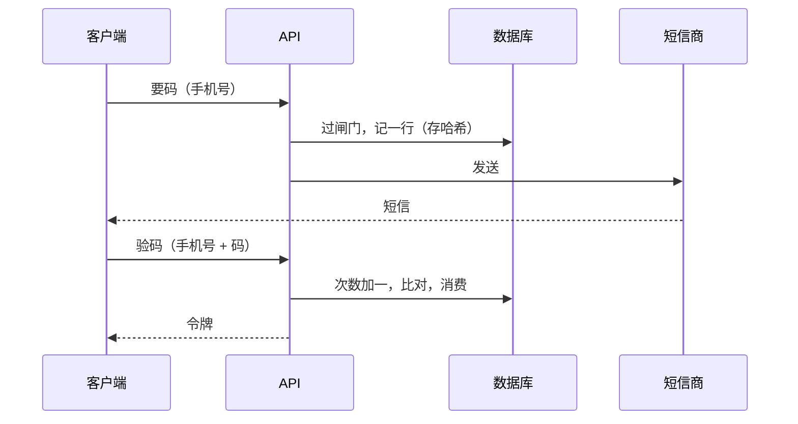

# 手机号验证码登录

国内面向商户和普通消费者的产品，手机号加验证码几乎是默认的登录方式。它对用户最省事，对你却是整个系统里最贵、最容易被刷的接口：每一次「获取验证码」都是真金白银，而这个接口天生不需要登录就能调。

[《应用安全》第 1 章](../app-security/01-authentication.md)列过 hatch-counter 的五道闸门（码的寿命和次数、冷却、按号额度、按 IP 额度、邀请制），[第 4 章](../app-security/04-passwords-secrets.md)算过限流把猜中概率压到多低。这一章讲怎么把这些闸门写成正确的代码：两张表、发码和验码的并发处理、短信服务商的接入，以及被刷的时候账单会长成什么样。

## 一条验证码的一生



看起来平平无奇，每一步都有坑：两个「要码」请求同时到达会不会都通过冷却检查？短信发送失败了这一行算不算额度？验码时「次数加一」和「比对」之间被并发插队怎么办？下面一步步来。

## 两张表

hatch-counter 用了两张表，分工很清楚：

```sql
-- 每一行都是一条真发出去的短信
CREATE TABLE sms_codes (
  id           uuid PRIMARY KEY DEFAULT gen_random_uuid(),
  phone        text NOT NULL,
  code_hash    text NOT NULL,
  expires_at   timestamptz NOT NULL,
  consumed_at  timestamptz,
  attempts     int  NOT NULL DEFAULT 0,
  request_ip   inet,
  reset_at     timestamptz,             -- 后台放行过：限流不再数这一行，但行留着
  created_at   timestamptz NOT NULL DEFAULT now()
);
CREATE INDEX ON sms_codes (phone, created_at);
CREATE INDEX ON sms_codes (request_ip, created_at);

-- 被挡回去、一条都没发的请求
CREATE TABLE sms_probes (
  id          uuid PRIMARY KEY DEFAULT gen_random_uuid(),
  phone       text NOT NULL,
  request_ip  inet,
  created_at  timestamptz NOT NULL DEFAULT now()
);
CREATE INDEX ON sms_probes (request_ip, created_at);
```

为什么分两张？源码注释给了理由：**「这个号今天到底发了多少条」是排查被刷时唯一能看的数**，混进没发出去的就不是钱数了。而被挡回去的请求（拿没开通的号来要码）又必须计入按 IP 的额度，否则「没开通就不发」这道闸门本身就是一个免费、无限次的枚举接口，谁都能扫一遍号段，问出哪些号是你的客户。所以按 IP 计数时两张表加起来数。

`reset_at` 也值得一提：客服在后台给某个号「重置验证码」（比如店主连点了十次重发，被按号额度挡住了），不删行，只标记。删了行，审计里只剩一句「重置过」，再也查不出那天到底发了几条。

## 发码

### 检查顺序

```typescript
import { createHash, randomInt } from "node:crypto";

export async function requestCode(db: Db, rawPhone: string, ip: string): Promise<void> {
  const phone = normalizePhone(rawPhone);
  if (!phone) throw new AppError("手机号格式不对", 400);

  const code = await db.transaction(async (tx) => {
    // 同一个号的发码请求串行化：没有这把锁，两个并发请求会同时通过冷却检查，各发一条
    await tx.execute(sql`SELECT pg_advisory_xact_lock(hashtext(${"sms:" + phone}))`);

    await assertIpBudget(tx, ip); // 1. 按 IP：两张表加起来数

    if (!(await isProvisioned(tx, phone))) {
      await tx.execute(sql`INSERT INTO sms_probes (phone, request_ip) VALUES (${phone}, ${ip})`);
      return null; // 2. 没开通：记一笔，不发
    }

    await assertCooldown(tx, phone);  // 3. 距上一条不到 60 秒
    await assertPhoneBudget(tx, phone); // 4. 按号滚动 24 小时 10 条
    await assertGlobalBudget(tx);     // 5. 全站今天的总预算

    const code = randomInt(0, 1_000_000).toString().padStart(6, "0");
    await tx.execute(sql`
      INSERT INTO sms_codes (phone, code_hash, expires_at, request_ip)
      VALUES (${phone}, ${sha256(code)}, now() + interval '5 minutes', ${ip})`);
    return code;
  });

  if (code === null) throw new NotProvisionedError();
  await deliver(phone, code); // 在事务外发送，见下文
}
```

几个要点：

- **验证码用 `crypto.randomInt`**，不用 `Math.random()`。后者不是密码学安全的随机数
- **按 IP 的检查放在最前面**，在「是否开通」之前。这样扫号段的请求无论号是否开通，都被同一个额度管着
- **advisory lock 按号加**。冷却和额度都是「先数再插」，两步之间不加锁就会被并发穿过去。锁随事务结束自动释放，不会忘了解
- **按 IP 的额度不在锁里也有并发穿透**，但穿透的量是「同一时刻的并发数」，可以接受；要严格的话按 IP 再加一把锁

每个检查都是一条计数查询：

```typescript
async function assertPhoneBudget(tx: Tx, phone: string) {
  const [r] = await tx.execute<{ n: number }>(sql`
    SELECT count(*)::int AS n FROM sms_codes
    WHERE phone = ${phone} AND reset_at IS NULL
      AND created_at > now() - interval '24 hours'`);
  if (r.n >= PER_PHONE_DAILY) throw new RateLimitError("这个号今天的验证码次数用完了，请明天再试或联系客服");
}

async function assertIpBudget(tx: Tx, ip: string) {
  const [r] = await tx.execute<{ n: number }>(sql`
    SELECT
      (SELECT count(*) FROM sms_codes  WHERE request_ip = ${ip} AND created_at > now() - interval '24 hours') +
      (SELECT count(*) FROM sms_probes WHERE request_ip = ${ip} AND created_at > now() - interval '24 hours')
      AS n`);
  if (Number(r.n) >= PER_IP_DAILY) throw new RateLimitError("请求太频繁，请稍后再试");
}
```

窗口是**滚动的 24 小时**，不是自然日。按自然日算，23:50 和 00:10 各刷满一轮，二十分钟里就能走两天的量。

### 按 IP 计数的前提：拿到真的 IP

在 nginx 或负载均衡后面，`req.ip` 默认是代理自己的地址。NestJS（Express 适配器）要显式设置信任几层代理：

```typescript
const app = await NestFactory.create<NestExpressApplication>(AppModule);
// 只有一层 nginx，就填 1。填 true 会信任任意 X-Forwarded-For，客户端自己伪造一个头就能换 IP
app.set("trust proxy", Number(process.env.TRUST_PROXY ?? 0));
```

hatch-counter 的 `sms-limits.ts` 在按 IP 额度的注释里专门写了这一条：不填的话，这道闸门数的是代理机那一个地址，30 条是全站共用的。上线第一天全站的人都会被它挡住，比不限流还糟。

### 短信在事务外发

发送是一次网络调用，可能耗时几秒。放在事务里，会让这把 advisory lock 和一条数据库连接干等着。所以顺序是：**事务里记账，事务提交后发送**。

那发送失败怎么办？这一行已经记了，占了额度，用户却没收到。两种处理都说得通：

- **失败就把这一行删掉**（或标记失败，额度不数它）。用户体验好，但如果失败是因为号码被服务商判为空号、黑名单，攻击者可以用这类号无限刷你的发送接口（虽然不花短信钱，仍然消耗服务商的调用频率）
- **失败也占额度**。hatch-counter 采用这种：额度宽到正常用户碰不到（一天 10 条，正常一天用不到 2 条），失败了用户再点一次就是

不管哪种，**发送失败要把服务商的原始错误记进日志，给用户看的是另一句话**。服务商的错误原文里可能带着 AccessKeyId 之类的东西，那不是给用户看的。

## 验码

验码最容易写错的地方是「次数」。常见的错误写法：

```typescript
// 错误示范：先读、再比、再加次数，三步之间可以被并发插队
const row = await findLatestCode(phone);
if (row.attempts >= 5) throw ...;
if (sha256(input) !== row.code_hash) {
  await incrementAttempts(row.id);
  throw ...;
}
```

攻击者同时发 100 个验码请求，它们会同时读到 `attempts = 0`，全部通过检查，「最多试 5 次」形同虚设。正确的写法是**先原子地占一次机会，再比对**：

```typescript
export async function verifyCode(db: Db, phone: string, input: string): Promise<void> {
  // 一条语句同时完成：找到最新一条未消费、未过期的码，且次数未满，次数加一
  const [row] = await db.execute<{ id: string; code_hash: string }>(sql`
    UPDATE sms_codes SET attempts = attempts + 1
    WHERE id = (
      SELECT id FROM sms_codes
      WHERE phone = ${phone} AND consumed_at IS NULL AND expires_at > now()
      ORDER BY created_at DESC LIMIT 1
    )
    AND attempts < ${MAX_ATTEMPTS}
    RETURNING id, code_hash`);
  if (!row) throw new AuthError("验证码不对或已过期，请重新获取", "code_invalid");

  if (!safeEqualHex(sha256(input), row.code_hash)) {
    throw new AuthError("验证码不对或已过期，请重新获取", "code_invalid");
  }

  // 消费也用条件更新：同一条码被两个请求同时验对，只有一个能消费成功
  const consumed = await db.execute(sql`
    UPDATE sms_codes SET consumed_at = now() WHERE id = ${row.id} AND consumed_at IS NULL RETURNING id`);
  if (!consumed.length) throw new AuthError("验证码已被使用", "code_invalid");
}
```

几个决定：

- **只有最新一条码有效**。用户连点三次「重发」，收到三条短信，只认最后一条。允许任意一条有效的话，攻击者的有效猜测空间会成倍放大
- **错误提示不区分「码错了」「码过期了」「次数用完了」**，统一成一句。区分它们对正常用户帮助不大，对攻击者是信息
- **比较哈希用 `timingSafeEqual`**。这里比的是哈希，计时攻击的实际威胁很小，但养成习惯没有坏处

验码成功之后才走第 1 章的 `resolveIdentity`：已有账号就登录，没有就看是否允许注册。hatch-counter 在这里还有一道检查：凭证对上了但号没开通，照样拒绝。发码前已经拦过一次，为什么还要拦？因为码可能是从别的路（比如测试通道、后台试发）来的，账号不能因为谁拿到一条码就凭空长出来。

## 接入短信服务商

> [!WARNING]
> 本节关于短信签名、模板报备、资质要求的描述按 2025 年前后的情况整理，各服务商和监管要求会调整。以阿里云、腾讯云等服务商控制台的最新说明和工信部关于短信的管理规定为准。

国内发验证码短信，要先过两道审核：

| 审核项 | 是什么 | 要注意的 |
|---|---|---|
| 短信签名 | 短信开头【】里的名字 | 通常要和已备案的网站、App 名称或企业名称对应，需要主体资质证明 |
| 短信模板 | 正文，变量用占位符 | 验证码模板和通知模板是两类，不能混用；变量里一般不允许放链接 |

两项都审下来之前，验证码这条路是跑不通的。所以开发阶段需要一个替代通道。hatch-counter 有三条：阿里云（正式）、企业微信群机器人（开发时把验证码发进自己的群）、日志（本机开发）。它对替代通道有两条硬规矩，值得照抄：

- **没有自动降级**。正式通道挂了不会退到开发通道，那等于把真实用户的验证码发进你自己的群里，群里任何人都能拿它登进别人的账号。要切换只能由人在后台改
- **生产环境下开发通道只发给白名单号码**，名单外的当场失败。这是「上线时忘了切回正式通道」唯一会自己撞出来的地方：第一个真用户打电话说收不到码，而不是他的码悄悄进了群

```typescript
export function smsBlockReason(s: SmsSettings, phone: string): string | null {
  if (!smsReady(s)) return `短信通道「${s.channel}」还没配齐`;
  if (s.channel === "aliyun") return null;
  if (process.env.NODE_ENV !== "production") return null;
  if (s.devPhones.includes(phone)) return null;
  return `短信还在开发通道（${s.channel}），这个号不在测试名单里，没发`;
}
```

调用服务商的 API 时，是引官方 SDK 还是自己签名，要看依赖代价。hatch-counter 选了自己算阿里云的签名，理由是官方 SDK 会拖进来一整套依赖，而这里只需要发一个 POST。自己签名的代价是第一次接时要对着返回码排查，源码注释里也老实写了「这段代码没有拿真凭据验过」。两种选择都可以，关键是**把服务商的调用收在一个模块里**，换服务商只改这一处。

### 用户说收不到

验证码收不到是客服最常接到的问题之一，原因大致几类：

| 原因 | 怎么查 |
|---|---|
| 被手机上的拦截软件或运营商拦了 | 服务商控制台的发送记录显示「成功」，但回执是失败或一直没有回执 |
| 号码停机、空号、携号转网后的延迟 | 回执里有明确的错误码 |
| 触发了服务商自己的频率限制 | 发送接口直接返回限流错误 |
| 签名或模板被驳回、过期 | 所有号码都发不出去 |
| 你的闸门挡住了 | 你自己的 `sms_codes` 和日志里能看到 |

所以除了「发出去」，最好还接一下服务商的**发送回执**（异步回调或主动拉取），把每一条的最终状态记到 `sms_codes` 上。客服就能在后台直接看到「这条在 14:03 发出，运营商回执：用户拦截」，不用去服务商控制台里翻。

## 被刷一天要花多少钱

短信接口被刷，最直接的后果是账单。下面这张图按每条 0.045 元的假设单价，算了几种防护组合下，攻击者持续 24 小时能让你发出多少条短信：


> [!WARNING]
> 图中单价是为了演示计算而取的假设值，实际短信单价随服务商、套餐包大小、短信类型和时间变化，以你所用服务商的最新报价为准。

这张图想说明的是三件事：

- **按号额度防不住刷钱**。它防的是「盯着一个号轰炸」（短信轰炸，伤害的是号主），攻击者换号就绕过了
- **按 IP 额度是刷钱的主要防线**，但它的效果取决于攻击者有多少 IP。代理 IP 池很便宜，所以它只能把量级压下来，压不到零
- **最后一道是全站预算**：每天最多发多少条，超了就停发、报警。它会误伤正常用户，但它给了账单一个确定的上限

全站预算的实现和按号额度一样是计数，区别在于触发后的动作：

```typescript
async function assertGlobalBudget(tx: Tx) {
  const [r] = await tx.execute<{ n: number }>(sql`
    SELECT count(*)::int AS n FROM sms_codes WHERE created_at > now() - interval '24 hours'`);
  if (r.n >= GLOBAL_DAILY) {
    await alertOnce("sms-global-budget", `24 小时内已发 ${r.n} 条验证码，触发全站上限`);
    throw new AppError("验证码服务繁忙，请稍后再试", 503);
  }
  if (r.n >= GLOBAL_DAILY * 0.5) {
    await alertOnce("sms-global-half", `24 小时内已发 ${r.n} 条验证码，过半`);
  }
}
```

`GLOBAL_DAILY` 怎么定：取最近一段时间的日峰值，乘以 3 到 5 倍。过半就报警，让你在被卡死之前有时间看一眼。服务商控制台通常也能设置每日发送上限和余额告警，两边都设上：你的代码有 bug 时，服务商那一道还在。

## 人机验证什么时候加

> [!WARNING]
> 各云厂商的验证码 / 人机验证产品形态、计费和接入方式变化较快，以所选服务商的最新文档为准。

滑块、点选这类人机验证能把攻击成本从「换 IP」提高到「破解验证码」，代价是每个正常用户都要多做一步，而且人机验证服务本身也按次收费。比较合理的顺序：

1. 先上齐限流和全站预算，它们不影响正常用户
2. 监控 `sms_probes` 和按 IP 被挡的量。一晚上冒出几千行，就是有人在扫
3. 真被刷了，再加人机验证，并且**只在可疑时触发**：同一个 IP 短时间内第二次要码、IP 在已知的数据中心网段、设备首次出现等

人机验证的结果必须**在服务端校验**（把前端拿到的票据交给服务商的校验接口），只在前端弹个滑块等于没加。

## 给审核员的固定验证码

上架应用商店时，审核员需要登录。他没有一个能收短信的国内手机号，所以需要一个**演示账号 + 固定验证码**。hatch-counter 的做法是后台给一个演示号配一条固定码：这个号要码时一条都不发，验码时跟固定码比。

固定码拆掉了两道闸门：它不过期，也没有「一条码试 5 次就作废」。所以 hatch-counter 给这条路单独加了一道按 IP 的验错限额（验错就往 `sms_probes` 里记一行），并且演示号只能进一家专门的演示门店，数据是假的。审核结束后把固定码关掉。

## 一键登录

> [!WARNING]
> 运营商本机号码认证（「一键登录」）的接入方式、计费和可用范围以三大运营商及所选服务商的最新文档为准。

除了验证码，国内还有一种基于运营商网关的「本机号码一键登录」：App 通过 SDK 向运营商取得一个令牌，服务端拿令牌去换取手机号。它的体验更好（不用等短信、不用输码），单次价格通常也和短信在一个量级。限制是只能在 App 里用、需要走蜂窝数据网络、要接各家服务商的 SDK。

从数据模型的角度看，它和验证码登录没有区别：服务端最终拿到一个**经过验证的手机号**，交给同一个 `resolveIdentity`。所以先把验证码登录做好，一键登录只是多一个拿到手机号的入口，验证码仍然作为兜底。

## 本章要点

- 两张表：`sms_codes` 只记真发出去的，`sms_probes` 记被挡回去的；按 IP 计数时两张一起数；放行用标记不用删除
- 发码时按 IP 的检查放最前，先于「是否开通」；按号用 advisory lock 串行化，避免并发穿过冷却和额度
- 窗口是滚动 24 小时；按 IP 计数前先把 `trust proxy` 配对
- 事务里记账，事务外发送；服务商原始错误进日志，不给用户看
- 验码先原子地占一次机会再比对；只认最新一条；消费用条件更新
- 开发通道没有自动降级，生产环境只发白名单号码
- 按号额度防轰炸，按 IP 额度压量级，全站预算给账单封顶；过半报警
- 人机验证在可疑时才触发，结果在服务端校验；审核员的固定码要自带按 IP 限额
- 一键登录只是拿到手机号的另一个入口，进的是同一个 `resolveIdentity`

## 动手练习

1. **验码次数上限**：在 Docker 里的 Postgres 建本章的 `sms_codes` 表，插入一条 5 分钟后过期的码。把 `verifyCode` 里那条 `UPDATE ... attempts < 5 ... RETURNING` 的 SQL 改成直接写死手机号，用 `for i in $(seq 6); do psql ... -c "<那条 SQL>"; done` 连跑 6 次，`RETURNING` 里加上 `attempts`。

   验证：前 5 次各返回一行，`attempts` 依次是 1 到 5；第 6 次输出 `UPDATE 0`。

   参考答案：「占一次机会」和「判断是否还有机会」在同一条语句里完成，所以无论并发多少请求，最多只有 5 次能拿到 `code_hash` 去比对。可以再开两个窗口同时跑，结果相同。

2. **`trust proxy` 填错的后果**：`npm i express` 后写一个只返回 `req.ip` 的服务，分别把 `trust proxy` 设成 `0`、`1`、`true`，用 `curl -H "X-Forwarded-For: 6.6.6.6, 5.5.5.5" localhost:3000` 访问。

   验证：设成 `0` 时返回本机回环地址；设成 `1` 时返回 `5.5.5.5`；设成 `true` 时返回 `6.6.6.6`。

   参考答案：`1` 表示只信任最近一跳（你的 nginx），取它追加的那个地址，也就是最右边的；`true` 信任整条链，取最左边那个客户端自己填的值，攻击者每次换个头就换了一个 IP，按 IP 额度失效。

   ```javascript
   import express from "express";
   const app = express();
   app.set("trust proxy", JSON.parse(process.env.TP ?? "0"));
   app.get("/", (req, res) => res.send(req.ip));
   app.listen(3000);
   ```

3. **算一笔被刷的账**：假设单价 0.045 元，按号每天 10 条、按 IP 每天 30 条、全站每天 1000 条。攻击者有 200 个代理 IP 和无限个号码，持续刷 24 小时。分别算出只有按号额度、加上按 IP 额度、再加全站预算三种情况下最多发出多少条、花多少钱。

   验证：和本章配图的数字对得上。

   参考答案：只按号时攻击者每个号刷 10 条就换号，上限取决于请求速率，额度不起作用；加按 IP 后是 200 × 30 = 6000 条，约 270 元；再加全站预算，封顶 1000 条，约 45 元。全站预算触发时正常用户也收不到码，所以要在过半时报警。
