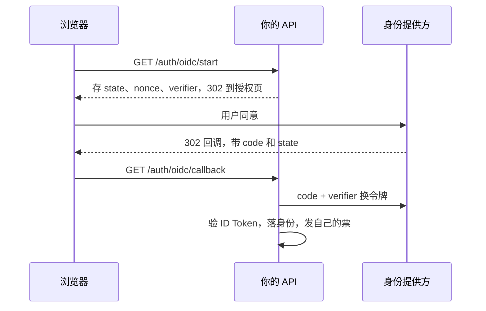

# 第三方登录

「用微信登录」「通过 Apple 登录」在用户看来是同一类按钮，在服务端是三种不太一样的东西：标准的 OIDC（Apple、Google 以及大多数企业身份提供方）、类 OAuth 但不是 OIDC 的微信，以及各平台 App 里的原生 SDK 登录。授权码模式、PKCE、`state` 为什么必须核对，[《应用安全》第 1 章](../app-security/01-authentication.md)讲过原理。这一章讲实现：先写一层通用的 OIDC，再分别处理微信和 Apple 的特殊之处，最后回到第 1 章的数据模型，把外部身份落进自己的账号体系。

hatch-counter 目前只有手机号登录，但它的身份表里一开始就留了 `wechat_unionid` 这个 kind。这一章可以看成「真要把它接上时要做的事」。

## 落库之前先想清楚存什么

第三方登录的终点永远是同一件事：拿到一个**经过验证的外部身份**，交给第 1 章的 `resolveIdentity`。所以第一个问题是：外部身份的哪个字段能当 `identifier`？

| 提供方 | 存哪个字段 | kind 怎么写 | 不能用什么 |
|---|---|---|---|
| 标准 OIDC | ID Token 的 `sub` | `oidc:<iss>` | 邮箱（会变、可能未验证） |
| Apple | ID Token 的 `sub` | `apple` | 邮箱（可能是中转邮箱，用户可随时停用） |
| 微信 | `unionid` | `wechat_unionid` | `openid`（每个 AppID 不同） |

规则只有一条：**用提供方承诺「对同一个人永远不变」的那个 ID**。OIDC 规范只保证 `sub` 在同一个签发方（`iss`）内唯一，所以 kind 里要带上 `iss`。邮箱、昵称、头像统统放进 `profile`，只做展示。

## 通用的 OIDC 流程

用 `jose` 就能写一个不依赖任何提供方 SDK 的 OIDC 客户端。网页端的完整流程是两个接口：



### 起点：生成并暂存三样东西

```typescript
import { createHash, randomBytes } from "node:crypto";

const b64url = (b: Buffer) => b.toString("base64url");

export async function startOidc(db: Db, p: OidcProvider, returnTo: string) {
  const state = b64url(randomBytes(32));
  const nonce = b64url(randomBytes(32));
  const verifier = b64url(randomBytes(32));
  const challenge = b64url(createHash("sha256").update(verifier).digest());

  // 暂存 10 分钟，回调时按 state 取出并删掉；也可以放进签名加密的短期 cookie
  await db.execute(sql`
    INSERT INTO oauth_flows (state_hash, provider, nonce, verifier, return_to, expires_at)
    VALUES (${sha256(state)}, ${p.id}, ${nonce}, ${verifier}, ${returnTo}, now() + interval '10 minutes')`);

  const meta = await discover(p.issuer); // 读 /.well-known/openid-configuration，进程内缓存
  const url = new URL(meta.authorization_endpoint);
  url.search = new URLSearchParams({
    response_type: "code",
    client_id: p.clientId,
    redirect_uri: p.redirectUri,
    scope: "openid email profile",
    state,
    nonce,
    code_challenge: challenge,
    code_challenge_method: "S256",
  }).toString();
  return url.toString();
}
```

`returnTo` 是登录完要回到的页面，**必须校验它是你自己站内的相对路径**，否则就是一个开放重定向漏洞。

### 回调：换令牌、验 ID Token

```typescript
import { createRemoteJWKSet, jwtVerify } from "jose";

const jwksCache = new Map<string, ReturnType<typeof createRemoteJWKSet>>();

export async function finishOidc(db: Db, p: OidcProvider, code: string, state: string) {
  // 取出并删除：同一个 state 只能用一次
  const [flow] = await db.execute<OauthFlow>(sql`
    DELETE FROM oauth_flows
    WHERE state_hash = ${sha256(state)} AND provider = ${p.id} AND expires_at > now()
    RETURNING nonce, verifier, return_to`);
  if (!flow) throw new AuthError("登录已过期，请重新开始", "oauth_state_invalid");

  const meta = await discover(p.issuer);
  const res = await fetch(meta.token_endpoint, {
    method: "POST",
    headers: { "Content-Type": "application/x-www-form-urlencoded" },
    body: new URLSearchParams({
      grant_type: "authorization_code",
      code,
      redirect_uri: p.redirectUri,
      client_id: p.clientId,
      client_secret: p.clientSecret,
      code_verifier: flow.verifier,
    }),
  });
  if (!res.ok) throw new AuthError("第三方登录失败，请重试", "oauth_exchange_failed");
  const { id_token } = (await res.json()) as { id_token: string };

  let jwks = jwksCache.get(meta.jwks_uri);
  if (!jwks) jwksCache.set(meta.jwks_uri, (jwks = createRemoteJWKSet(new URL(meta.jwks_uri))));

  const { payload } = await jwtVerify(id_token, jwks, {
    issuer: meta.issuer,
    audience: p.clientId,
    clockTolerance: 60,
  });
  if (payload.nonce !== flow.nonce) throw new AuthError("登录校验失败", "oauth_nonce_mismatch");

  return {
    identity: {
      kind: `oidc:${meta.issuer}`,
      identifier: payload.sub!,
      profile: { email: payload.email, emailVerified: payload.email_verified, name: payload.name },
    },
    returnTo: flow.return_to,
  };
}
```

要校验的东西都在 `jwtVerify` 的参数里：签名（用提供方公布的公钥集）、`iss`、`aud`、过期时间，再加上手动比对的 `nonce`。`createRemoteJWKSet` 会缓存公钥，遇到不认识的 `kid` 时自动重新拉取，提供方轮换密钥时不用你操心。

**不要因为 ID Token 里有 `email` 就自动把它关联到已有的同邮箱账号**。这是一个经典漏洞：如果某个提供方允许用户填未经验证的邮箱，攻击者就能用受害者的邮箱登进受害者的账号。即使 `email_verified` 为真，也要走第 1 章「先问用户要不要绑定已有账号」的流程。

## 微信登录

微信登录看起来像 OAuth 2.0，但它不是 OIDC：没有 ID Token、没有签名可验，身份信息是你的服务端拿 `code` 去换来的，可信度来自「这次 HTTPS 请求是你自己发给微信的」。

> [!WARNING]
> 本节的接口地址、参数、`unionid` 的下发条件和用户信息的返回规则按 2025 年前后的微信官方文档整理，微信多次调整过昵称头像等信息的获取方式。以微信开放平台、微信公众平台的最新文档为准。

### 四种场景，四个 AppID

| 场景 | 在哪申请 | 前端怎么拿 code | 换令牌接口 |
|---|---|---|---|
| 电脑网页扫码登录 | 开放平台「网站应用」 | 跳转到 `open.weixin.qq.com/connect/qrconnect`，`scope=snsapi_login` | `sns/oauth2/access_token` |
| 微信里打开的网页 | 公众号（服务号）网页授权 | 跳转到 `open.weixin.qq.com/connect/oauth2/authorize` | `sns/oauth2/access_token` |
| 原生 App | 开放平台「移动应用」 | 微信 SDK 发起授权，回调里拿 code | `sns/oauth2/access_token` |
| 小程序 | 小程序后台 | `wx.login()` | `sns/jscode2session` |

每种场景是一个独立的 AppID，同一个微信用户在每个 AppID 下的 `openid` 都不同。能把它们串起来的是 **`unionid`**：同一个用户在同一个**微信开放平台账号**下绑定的所有应用里，`unionid` 相同。

所以如果你将来可能同时有网页、App、小程序，**一开始就把它们绑定到同一个开放平台账号，身份表里存 `unionid`**。开放平台账号通常需要完成开发者资质认证才能绑定应用，这一步有费用和审核周期，以官方说明为准。

`openid` 也不能扔：用 JSAPI 支付、发订阅消息时，微信要的是**该 AppID 下的 openid**。另建一张表存：

```sql
CREATE TABLE wechat_openids (
  account_id  uuid NOT NULL REFERENCES accounts(id) ON DELETE CASCADE,
  appid       text NOT NULL,
  openid      text NOT NULL,
  created_at  timestamptz NOT NULL DEFAULT now(),
  PRIMARY KEY (appid, openid)
);
CREATE INDEX ON wechat_openids (account_id);
```

### 网页扫码登录的实现

```typescript
export function wechatQrUrl(cfg: WechatWebApp, state: string): string {
  const q = new URLSearchParams({
    appid: cfg.appid,
    redirect_uri: cfg.redirectUri, // 域名要和开放平台里登记的授权回调域一致
    response_type: "code",
    scope: "snsapi_login",
    state,
  });
  return `https://open.weixin.qq.com/connect/qrconnect?${q}#wechat_redirect`;
}

interface WechatTokenResp {
  access_token?: string;
  openid?: string;
  unionid?: string;
  errcode?: number;
  errmsg?: string;
}

export async function wechatExchange(cfg: WechatWebApp, code: string) {
  const q = new URLSearchParams({
    appid: cfg.appid,
    secret: cfg.secret, // 只在服务端
    code,
    grant_type: "authorization_code",
  });
  const res = await fetch(`https://api.weixin.qq.com/sns/oauth2/access_token?${q}`);
  const data = (await res.json()) as WechatTokenResp;

  // 微信出错时 HTTP 状态码仍是 200，错误在 errcode 里
  if (data.errcode) throw new AuthError("微信登录失败，请重试", "wechat_exchange_failed", { cause: data });
  if (!data.unionid) {
    // 应用没绑定到开放平台账号时拿不到 unionid。这是配置错误，不该让用户背锅，但也不能退回用 openid 落身份
    throw new Error(`未返回 unionid，检查 ${cfg.appid} 是否绑定到开放平台账号`);
  }
  return {
    identity: { kind: "wechat_unionid", identifier: data.unionid },
    openid: { appid: cfg.appid, openid: data.openid! },
  };
}
```

`state` 的生成和校验与 OIDC 那一节完全相同，可以复用 `oauth_flows` 表。微信不支持 PKCE，所以 `code` 的保护完全靠 `state` 和「secret 只在服务端」。

**昵称和头像不要指望**。微信近几年收紧了用户信息的获取：很多场景下拿到的是统一的默认昵称和头像，需要用户在你的界面里主动填写或通过平台提供的组件选择。产品上的做法是：登录只依赖 `unionid`，昵称让用户自己设，或者默认显示「用户 + 尾号」。

### 原生 App 里的微信登录

App 里要集成微信 SDK，React Native / Expo 项目需要一个封装了原生 SDK 的社区库，并通过 config plugin 配置 Universal Link 和 URL Scheme，所以只能用 dev client 构建。SDK 在 App 里拿到 `code` 之后，交给你的服务端，服务端调的是同一个 `sns/oauth2/access_token`，只是 `appid` 和 `secret` 换成移动应用的那一对。

服务端要根据 code 来自哪个端，选对应的 AppID。最简单的办法是**每个端一个回调接口**（`/auth/wechat/web`、`/auth/wechat/app`），而不是让客户端在参数里说自己是谁。

## 通过 Apple 登录

Apple 是标准的 OIDC，但有四个特殊之处要单独处理：原生登录不走浏览器跳转、名字和邮箱只给一次、邮箱可能是中转地址、注销时要撤销令牌。

> [!WARNING]
> 本节涉及的接口和审核要求按 2025 年前后的苹果文档整理：《App 审核指南》4.8 节（登录服务）的措辞近几年调整过，提供第三方登录时是否必须同时提供「通过 Apple 登录」或同等隐私保护的登录方式，以提交时的最新版本为准；令牌撤销接口和服务器通知以 Apple Developer 文档「Sign in with Apple REST API」最新版为准。

### iOS 原生：客户端拿令牌，服务端验

Expo 项目用 `expo-apple-authentication`。客户端调起系统面板，拿到 `identityToken`（一个 JWT）和 `authorizationCode`，一起交给服务端：

```typescript
import * as AppleAuthentication from "expo-apple-authentication";

export async function signInWithApple() {
  const { nonce } = await api.post("/auth/apple/nonce"); // 服务端生成、暂存，5 分钟有效
  const cred = await AppleAuthentication.signInAsync({
    requestedScopes: [
      AppleAuthentication.AppleAuthenticationScope.FULL_NAME,
      AppleAuthentication.AppleAuthenticationScope.EMAIL,
    ],
    nonce,
  });
  return api.post("/auth/apple", {
    identityToken: cred.identityToken,
    authorizationCode: cred.authorizationCode,
    nonce,
    // 名字只在用户第一次授权时给，之后永远是 null。错过这一次就再也拿不到了
    fullName: cred.fullName,
  });
}
```

服务端验 `identityToken`，和通用 OIDC 一样，只是参数固定：

```typescript
const appleJwks = createRemoteJWKSet(new URL("https://appleid.apple.com/auth/keys"));

export async function verifyAppleToken(identityToken: string, expectedNonce: string) {
  const { payload } = await jwtVerify(identityToken, appleJwks, {
    issuer: "https://appleid.apple.com",
    audience: process.env.APPLE_BUNDLE_ID!, // 原生登录是 Bundle ID；网页登录是 Services ID
  });
  if (payload.nonce !== expectedNonce) throw new AuthError("登录校验失败", "apple_nonce_mismatch");
  return {
    kind: "apple",
    identifier: payload.sub!,
    profile: { email: payload.email, isPrivateEmail: payload.is_private_email },
  };
}
```

> [!NOTE]
> 不同的库对 `nonce` 的处理不完全一样：有的原样传给苹果，有的会先做一次 SHA-256。联调时把 token 里的 `nonce` 打印出来对一次，确认服务端比对的是同一个值。

### 名字和邮箱的「只给一次」

苹果只在用户**第一次**授权你的 App 时返回名字和邮箱。如果你的服务端那一次正好出错了，用户第二次登录时这两样就是空的。所以：

- 客户端把 `fullName` 和令牌一起提交，服务端在**首次创建身份时**写进 `profile`
- 服务端失败时客户端不要丢掉 `fullName`，重试时一起带上
- 邮箱可能是 `xxx@privaterelay.appleid.com` 这种中转地址，发邮件要通过苹果的中转服务（需要在开发者后台登记发件域名），用户也可以随时停用中转

### 注销时撤销令牌

App Store 要求提供账号删除，用了「通过 Apple 登录」的账号在删除时还要调用苹果的接口撤销令牌。撤销需要一个 `refresh_token`，而它只能在登录时用 `authorizationCode` 换来。所以**首次登录时就要换一次，并把 `refresh_token` 加密存下来**：

```typescript
import { importPKCS8, SignJWT } from "jose";

// client_secret 是一个用你在开发者后台下载的 .p8 私钥签的 JWT，有效期最长 6 个月，可以每次现签
async function appleClientSecret(): Promise<string> {
  const key = await importPKCS8(process.env.APPLE_PRIVATE_KEY!, "ES256");
  return new SignJWT({})
    .setProtectedHeader({ alg: "ES256", kid: process.env.APPLE_KEY_ID! })
    .setIssuer(process.env.APPLE_TEAM_ID!)
    .setSubject(process.env.APPLE_BUNDLE_ID!)
    .setAudience("https://appleid.apple.com")
    .setIssuedAt()
    .setExpirationTime("5m")
    .sign(key);
}

export async function appleExchangeCode(authorizationCode: string): Promise<string | null> {
  const res = await fetch("https://appleid.apple.com/auth/token", {
    method: "POST",
    headers: { "Content-Type": "application/x-www-form-urlencoded" },
    body: new URLSearchParams({
      client_id: process.env.APPLE_BUNDLE_ID!,
      client_secret: await appleClientSecret(),
      code: authorizationCode,
      grant_type: "authorization_code",
    }),
  });
  if (!res.ok) return null; // 换失败不影响登录，记日志，下次登录再换
  const { refresh_token } = (await res.json()) as { refresh_token?: string };
  return refresh_token ?? null;
}

export async function appleRevoke(refreshToken: string) {
  await fetch("https://appleid.apple.com/auth/revoke", {
    method: "POST",
    headers: { "Content-Type": "application/x-www-form-urlencoded" },
    body: new URLSearchParams({
      client_id: process.env.APPLE_BUNDLE_ID!,
      client_secret: await appleClientSecret(),
      token: refreshToken,
      token_type_hint: "refresh_token",
    }),
  });
}
```

`authorizationCode` 有效期只有几分钟且只能用一次，所以换令牌要在登录接口里同步做（或者立刻丢进队列），不能拖到以后。存 `refresh_token` 用第 1 章的 `seal()` 加密。

苹果还会向你登记的地址推送服务器通知：用户停用了中转邮箱、撤销了对你 App 的授权、删除了 Apple ID。收到「撤销授权」时，应该作废这个身份关联的所有设备会话；收到「删除账号」时，按你的注销流程处理。通知本身是苹果签名的 JWT，用同一套 `jwtVerify` 验证。

## 安卓和其他提供方

国内安卓没有统一的系统级账号登录。Google 登录在中国大陆不可用，各手机厂商（华为、小米、OPPO、vivo 等）有自己的账号服务，多数提供 OAuth 2.0 或 OIDC 接口。对一人公司，国内安卓的第三方登录通常只接微信就够了；面向海外的安卓用户再接 Google，它是标准 OIDC，上面的通用流程直接能用。

## 回到自己的会话

验证完外部身份、走完 `resolveIdentity`，就要给客户端发**你自己的**票（第 2 章）。第三方的 access token 用完即弃，不要当成你系统的凭证。

发票的方式按端不同：

| 端 | 怎么把票交给客户端 |
|---|---|
| 网页 | 回调接口直接写刷新票 cookie，然后 302 到 `returnTo`；访问令牌由页面加载后续期拿 |
| 原生 App（SDK 登录） | 登录接口是普通的 POST，直接在响应体里返回 |
| 原生 App（浏览器跳转登录） | 回调页生成一个一次性的短码，通过深链交回 App，App 再用短码换票 |

最后一种是为了**不把令牌放进 URL**。URL 会进浏览器历史、进日志、可能被别的 App 截获。短码只能用一次、30 秒过期，App 用它换令牌的那次 POST 走的是正常的 HTTPS 请求体。hatch-counter 的扫码登录也是同样的思路：二维码里只有一个 `ticket`，电脑来取令牌时还要出示只存在于它内存里的 `pollKey`，库里两样都只存哈希，令牌在取的那一刻才现签，库被人读走也捡不到一张能用的票。

## 绑定与解绑

已登录用户在设置页绑定微信或 Apple，走的是 `resolveIdentity` 的 `currentAccountId` 分支，流程和登录完全一样，只是起点要求已登录、并且最近再验证过一次（第 2 章的 `RequireRecentAuth`）。

解绑要守住一条：**账号至少保留一种能登录的方式**。

```typescript
export async function unbindIdentity(tx: Tx, accountId: string, identityId: string) {
  const rows = await tx.execute<{ id: string }>(sql`
    SELECT id FROM auth_identities WHERE account_id = ${accountId} FOR UPDATE`);
  const passkeys = await tx.execute(sql`SELECT 1 FROM passkeys WHERE account_id = ${accountId} LIMIT 1`);
  if (rows.length <= 1 && passkeys.length === 0) {
    throw new AppError("这是你唯一的登录方式，先绑定手机号或其他方式再解绑", 409);
  }
  await tx.execute(sql`DELETE FROM auth_identities WHERE id = ${identityId} AND account_id = ${accountId}`);
  await revokeAllDevices(tx, accountId, /* except */ currentDeviceId());
}
```

`FOR UPDATE` 锁住这个账号的所有身份行，防止两个并发的解绑请求各自看到「还剩两种」，结果一起解掉、一种不剩。解绑 Apple 身份时顺便调一次 `appleRevoke`。

## 本章要点

- 外部身份只用提供方承诺不变的 ID：OIDC 的 `iss + sub`、Apple 的 `sub`、微信的 `unionid`；邮箱昵称只进 `profile`
- 通用 OIDC：`state`、`nonce`、PKCE verifier 暂存并一次性取出；`jwtVerify` 校验签名、`iss`、`aud`、过期，再比对 `nonce`
- 不要按邮箱自动关联已有账号
- 微信每个场景一个 AppID，`openid` 各不相同；身份存 `unionid`，`openid` 按 AppID 另存，供支付和消息使用
- 微信出错时 HTTP 仍是 200，看 `errcode`；拿不到 `unionid` 是配置问题，不要退回 `openid`
- Apple 的名字只给一次，客户端失败重试时要带上；首次登录就用 `authorizationCode` 换 `refresh_token` 加密存好，注销时撤销
- 不把令牌放进 URL，跳转式登录用一次性短码交回客户端
- 解绑要保证至少留一种登录方式，并锁住身份行防并发

## 动手练习

1. **算一次 PKCE challenge**：用本章 `startOidc` 里的写法，对 RFC 7636 附录里的示例 verifier `dBjftJeZ4CVP-mB92K27uhbUJU1p1r_wW1gFWFOEjXk` 计算 `code_challenge`。

   验证：`node -e 'console.log(require("crypto").createHash("sha256").update("dBjftJeZ4CVP-mB92K27uhbUJU1p1r_wW1gFWFOEjXk").digest("base64url"))'` 输出 `E9Melhoa2OwvFrEMTJguCHaoeK1t8URWbuGJSstw-cM`，和 RFC 里的值一致。

   参考答案：challenge 是 verifier 的 SHA-256 再做 base64url（不带 `=` 填充）。授权码被截获的人拿不到 verifier，换不了令牌。

2. **ID Token 的哪些校验会失败**：`npm i jose`，在本地生成一对 ES256 密钥，签一个 `iss=https://idp.test`、`aud=client-a`、`nonce=n1`、两分钟后过期的 JWT，然后用 `jwtVerify` 分别以 `audience: "client-b"`、`issuer: "https://other.test"` 验证，最后用正确参数验证并比对 `nonce`。

   验证：前两次抛出异常，`err.code` 是 `ERR_JWT_CLAIM_VALIDATION_FAILED`，`err.claim` 分别是 `aud` 和 `iss`；第三次通过，`payload.nonce === "n1"`。

   参考答案：签名对、但发给别的应用的令牌，靠 `aud` 挡掉；`nonce` 不在 `jwtVerify` 的选项里，要自己比。

   ```javascript
   import { generateKeyPair, SignJWT, jwtVerify } from "jose";
   const { publicKey, privateKey } = await generateKeyPair("ES256");
   const jwt = await new SignJWT({ nonce: "n1" }).setProtectedHeader({ alg: "ES256" })
     .setIssuer("https://idp.test").setAudience("client-a").setSubject("u1")
     .setExpirationTime("2m").sign(privateKey);
   for (const opts of [{ audience: "client-b" }, { issuer: "https://other.test" }]) {
     try { await jwtVerify(jwt, publicKey, opts); } catch (e) { console.log(e.code, e.claim); }
   }
   const { payload } = await jwtVerify(jwt, publicKey, { issuer: "https://idp.test", audience: "client-a" });
   console.log(payload.nonce);
   ```

3. **堵住开放重定向**：写一个 `isSafeReturnTo(s)`，用 `/orders?id=1`、`//evil.com`、`https://evil.com`、`/\evil.com`、`javascript:alert(1)` 测试它。

   验证：只有 `/orders?id=1` 返回 `true`。

   参考答案：只接受以单个 `/` 开头、第二个字符不是 `/` 或 `\` 的相对路径。浏览器会把 `//evil.com` 当成协议相对地址，部分浏览器还会把 `\` 当成 `/`。更稳的写法是 `new URL(s, "https://app.test")` 之后检查 `origin` 仍是 `https://app.test`。
