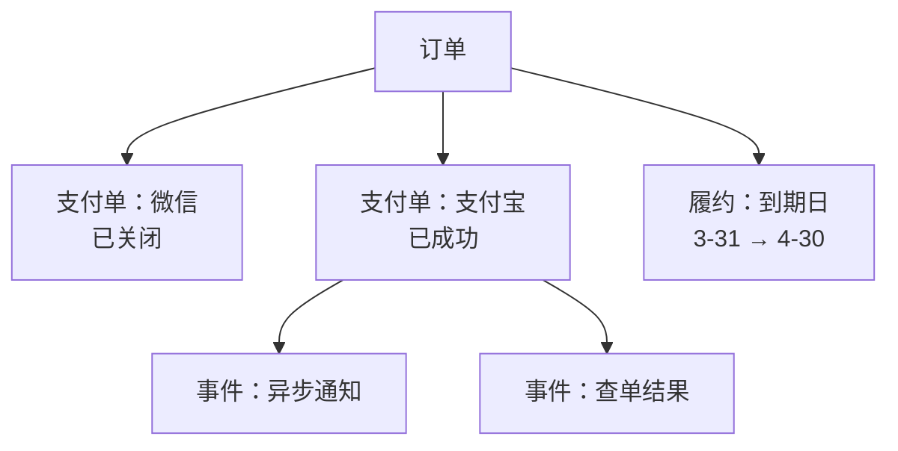
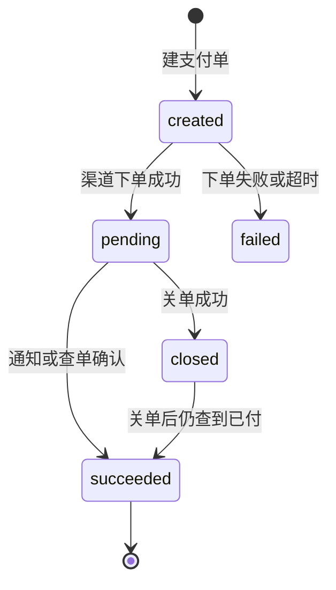
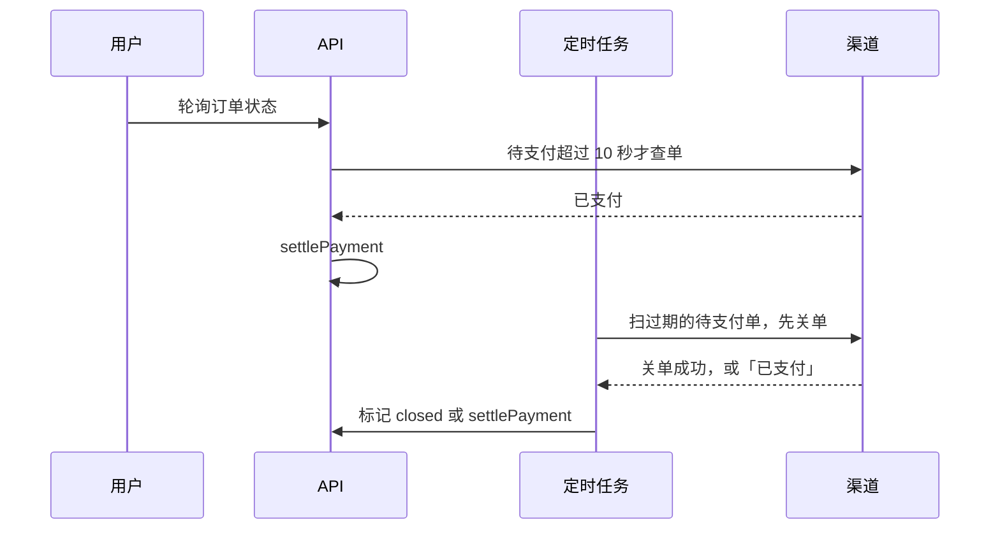

# 支付接入的总体架构

从这一章开始讲支付。[《定价与商业模式》第 5 章](../pricing-monetization/05-payments-china.md)已经给出了单渠道接入的骨架：订单状态机、用 `WHERE status = 'pending'` 保证只入账一次、主动查单兜底、每天对账。那是对的，但只够一个渠道、一种商品。真实的一人公司很快会遇到这些情况：

- 同一张订单，用户先点了微信，二维码过期了又换支付宝
- 用户在两个渠道都付了钱
- 回调到了，但你的服务正在发布，处理到一半进程退出了
- 回调说付了 88 元，你的订单是 98 元
- 网页端用微信支付，iOS 端用内购，安卓用支付宝，后台还有人工确认的对公转账

这一章搭一个能承住这些情况的结构。它不依赖任何具体渠道，第 7、8 章再把微信、支付宝、Stripe、内购分别接进来。

## 四个概念

| 概念 | 回答什么 | 一行是什么 |
|---|---|---|
| **订单**（order） | 买了什么、该付多少 | 一次购买意图，金额和商品是快照 |
| **支付单**（payment） | 在哪个渠道、用哪个单号付 | 一次支付尝试，对应渠道侧的一个交易 |
| **渠道事件**（payment event） | 渠道告诉了我们什么 | 一条原始通知或查询结果，原样留存 |
| **履约**（fulfillment） | 钱到了之后改了什么 | 顺延到期日、开通权益，挂在订单上 |

最常见的简化是把前两个合成一个：订单表里直接放 `out_trade_no` 和 `transaction_id`。单渠道时没问题，一旦出现「换个渠道再付」就要么复用单号（多数渠道不允许同一单号换金额或换产品重新下单），要么新建订单（用户的购买记录里出现一张「已关闭」和一张「已支付」，财务对不上）。

拆开之后，关系是这样的：



一张订单可以有多张支付单，**至多一张成功**；每张支付单可以收到多条事件，**同一个结论只生效一次**；履约只看订单。

## 表结构

```sql
CREATE TABLE orders (
  id              uuid PRIMARY KEY DEFAULT gen_random_uuid(),
  no              text NOT NULL UNIQUE,          -- 给人看的单号，如 O20261104-001
  subject_type    text NOT NULL,                 -- store / account：谁付钱（第 1 章）
  subject_id      uuid NOT NULL,
  kind            text NOT NULL,                 -- open / renew / upgrade ...
  plan_id         uuid,
  plan_name       text NOT NULL,                 -- 快照：套餐改名后旧单照样看得懂
  months          int  NOT NULL,
  amount_cents    bigint NOT NULL CHECK (amount_cents >= 0),
  currency        text NOT NULL DEFAULT 'CNY',
  status          text NOT NULL DEFAULT 'pending', -- pending / paid / closed / refunded / partially_refunded
  paid_payment_id uuid,                          -- 成功的那一张支付单
  expires_at      timestamptz NOT NULL,          -- 超过这个时间不再允许发起新的支付
  paid_at         timestamptz,
  extended_from   timestamptz,                   -- 履约：到期日从哪天
  extended_to     timestamptz,                   -- 顺延到哪天；退款按这一段减回去
  created_at      timestamptz NOT NULL DEFAULT now()
);

CREATE TABLE payments (
  id              uuid PRIMARY KEY DEFAULT gen_random_uuid(),
  order_id        uuid NOT NULL REFERENCES orders(id),
  channel         text NOT NULL,                 -- wechat_native / alipay_page / stripe / apple / offline ...
  out_trade_no    text NOT NULL,                 -- 我方发给渠道的单号
  amount_cents    bigint NOT NULL,
  status          text NOT NULL DEFAULT 'created', -- created / pending / succeeded / duplicate / closed / failed
  channel_txn_id  text,                          -- 渠道侧交易号
  prepay          jsonb,                         -- code_url、跳转地址等，给前端用
  succeeded_at    timestamptz,
  created_at      timestamptz NOT NULL DEFAULT now(),
  UNIQUE (channel, out_trade_no)
);
CREATE INDEX ON payments (order_id);
CREATE INDEX ON payments (status, created_at);
-- 同一张订单至多一张成功的支付单：数据库替你守住
CREATE UNIQUE INDEX payments_one_success ON payments (order_id) WHERE status = 'succeeded';

CREATE TABLE payment_events (
  id              bigserial PRIMARY KEY,
  channel         text NOT NULL,
  dedupe_key      text NOT NULL,                 -- 渠道的通知 ID，或「单号 + 状态」
  out_trade_no    text,
  payload         jsonb NOT NULL,                -- 验签解密之后的原文
  received_at     timestamptz NOT NULL DEFAULT now(),
  processed_at    timestamptz,
  error           text,
  UNIQUE (channel, dedupe_key)
);
```

几个设计点：

- **金额一律用整数「分」**，`bigint`。浮点数在 `0.1 + 0.2` 这一步就已经错了。渠道接口里用「元」的（支付宝的 `total_amount` 是 `"88.00"` 这样的字符串），在边界上转换，转换函数见本章最后
- **订单上存快照**。hatch-counter 的订单表存了套餐名和门店名，注释写得很清楚：套餐改了名、门店彻底删了，这张单当时卖的是什么照样看得懂。改价只影响以后开的单，也是因为金额存在订单上
- **部分唯一索引 `payments_one_success`** 是整张图里最重要的一行。应用代码再怎么出 bug，数据库都不会允许同一张订单有两张成功的支付单。第二张要成功时会撞索引，你就知道遇到了「重复支付」
- **履约的起止存在订单上**。hatch-counter 的 `extendedFrom` / `extendedTo` 就是这么用的：退款时按这一段减回去，查账时说得出到期日的每一天从哪来

## 下单

```typescript
export async function createPayment(db: Db, input: { orderId: string; channel: Channel; subject: Subject }) {
  const { payment, order } = await db.transaction(async (tx) => {
    const [order] = await tx.execute<OrderRow>(sql`
      SELECT * FROM orders WHERE id = ${input.orderId} FOR UPDATE`);
    if (!order || order.subject_id !== input.subject.id) throw new AppError("订单不存在", 404);
    if (order.status !== "pending") throw new AppError("订单已支付或已关闭", 409);
    if (order.expires_at < new Date()) throw new AppError("订单已过期，请重新下单", 410);

    // 同一渠道已有一张还在等付款的，直接复用，不重复下单（用户刷新了支付页）
    const [reuse] = await tx.execute<PaymentRow>(sql`
      SELECT * FROM payments
      WHERE order_id = ${order.id} AND channel = ${input.channel} AND status = 'pending'
        AND created_at > now() - interval '10 minutes'`);
    if (reuse) return { payment: reuse, order };

    const [payment] = await tx.execute<PaymentRow>(sql`
      INSERT INTO payments (order_id, channel, out_trade_no, amount_cents)
      VALUES (${order.id}, ${input.channel}, ${newOutTradeNo()}, ${order.amount_cents})
      RETURNING *`);
    return { payment, order };
  });

  if (payment.status === "pending") return payment.prepay;

  // 调渠道放在事务外：网络调用不占数据库连接
  const prepay = await channels[input.channel].create({
    outTradeNo: payment.out_trade_no,
    amountCents: payment.amount_cents,
    description: order.plan_name,
    expiresAt: order.expires_at,
  });
  await db.execute(sql`
    UPDATE payments SET status = 'pending', prepay = ${prepay} WHERE id = ${payment.id} AND status = 'created'`);
  return prepay;
}
```

要点：

- **金额来自订单，订单金额来自服务端的价目表**，前端只传订单 ID 和渠道。前端传金额是最古老的支付漏洞之一
- **调渠道下单在事务外**。下单失败时支付单停在 `created`，不影响什么；定时任务会把超时的 `created` 清成 `failed`
- **把订单的过期时间传给渠道**（微信的 `time_expire`、支付宝的 `time_expire` 或 `timeout_express`）。渠道侧到点自动不让付，比你自己关单可靠

单号的格式要同时满足所有渠道的限制。各渠道对 `out_trade_no` 的长度、字符集要求不同，取交集最省事：

```typescript
import { randomBytes } from "node:crypto";

// 只用字母数字，32 位以内：日期 8 位 + 随机 16 位 = 24 位
export function newOutTradeNo(now = new Date()): string {
  const d = now.toISOString().slice(0, 10).replaceAll("-", "");
  return `${d}${randomBytes(8).toString("hex")}`;
}
```

不要用订单的自增 ID 当单号：别人能猜出你一天卖了多少单。也不要把单号设计成可以从中解析出业务信息的格式，单号就是一个不透明的字符串，关联关系在你的表里。

## 支付单的状态机



`closed → succeeded` 这条边看起来不该存在，但它真的会发生：你调了关单接口，几乎同一时刻用户完成了付款，渠道的通知比你的关单结果晚到。**渠道说钱到了，就是钱到了**，你的状态必须服从。这也是为什么关单之后支付单不能被删除或复用。

各渠道的状态名不同，统一映射到这几个状态：

| 我方状态 | 微信支付 `trade_state` | 支付宝 `trade_status` | Stripe |
|---|---|---|---|
| pending | `NOTPAY`、`USERPAYING` | `WAIT_BUYER_PAY` | `checkout.session` 未完成 |
| succeeded | `SUCCESS` | `TRADE_SUCCESS`、`TRADE_FINISHED` | `checkout.session.completed` 且已付款 |
| closed | `CLOSED`、`REVOKED` | `TRADE_CLOSED`（未付款时） | session 过期 |
| failed | `PAYERROR` | | |

微信的 `REFUND`（转入退款）和支付宝付款后又全额退款时的 `TRADE_CLOSED` 都意味着「曾经成功过」，不能映射成 `closed`，要先确认它成功过，再走退款流程。映射函数在第 7 章。

## 确认支付只有一个入口

支付成功的消息可能从四个方向来：异步通知、用户在支付页轮询触发的查单、定时任务的查单、每日对账发现的漏单。hatch-counter 还有第五个：财务在后台点「确认已收款」。

不管从哪来，**都调用同一个函数**：

```typescript
export interface ChannelResult {
  channel: Channel;
  outTradeNo: string;
  channelTxnId: string;
  amountCents: number;
  paidAt: Date;
}

export async function settlePayment(db: Db, r: ChannelResult, source: string): Promise<void> {
  await db.transaction(async (tx) => {
    const [p] = await tx.execute<PaymentRow>(sql`
      SELECT * FROM payments WHERE channel = ${r.channel} AND out_trade_no = ${r.outTradeNo} FOR UPDATE`);
    if (!p) throw new Error(`未知支付单 ${r.channel}/${r.outTradeNo}`); // 记下来人工看，不吞掉
    if (p.status === "succeeded") return;                               // 重复的消息，什么都不做

    if (r.amountCents !== p.amount_cents) {
      // 金额对不上：不入账，报警。可能是 bug，也可能是有人在篡改
      await alert(`支付金额不一致：${p.out_trade_no} 应付 ${p.amount_cents}，实付 ${r.amountCents}`);
      throw new Error("amount mismatch");
    }

    // 订单行锁住：两个渠道同时到账、或者财务同时确认两张单时，串行处理
    const [o] = await tx.execute<OrderRow>(sql`SELECT * FROM orders WHERE id = ${p.order_id} FOR UPDATE`);

    if (o.status === "paid" || o.paid_payment_id) {
      // 订单已经被另一张支付单付过了：这是重复支付。记下钱确实到了，然后退回去
      await tx.execute(sql`
        UPDATE payments SET status = 'duplicate', channel_txn_id = ${r.channelTxnId}, succeeded_at = ${r.paidAt}
        WHERE id = ${p.id}`);
      await enqueueRefund(tx, { paymentId: p.id, reason: "duplicate_payment" });
      return;
    }

    await tx.execute(sql`
      UPDATE payments SET status = 'succeeded', channel_txn_id = ${r.channelTxnId}, succeeded_at = ${r.paidAt}
      WHERE id = ${p.id}`);
    // ↑ 前面的检查漏了什么，这里也会撞 payments_one_success 索引，整个事务回滚

    const { from, to } = await fulfill(tx, o); // 顺延到期日、开通权益
    await tx.execute(sql`
      UPDATE orders SET status = 'paid', paid_payment_id = ${p.id}, paid_at = ${r.paidAt},
        extended_from = ${from}, extended_to = ${to}
      WHERE id = ${o.id}`);
    await audit(tx, "order.paid", { orderId: o.id, paymentId: p.id, source });
  });
}
```

细看「重复支付」那个分支：重复的那张不标为 `succeeded`，而是单独的 `duplicate`，既记下「钱确实到了」（对账时要对得上），又不违反「一张订单至多一张成功」。订单若是已关闭（`closed`）时钱才到，同样按这个思路处理：要么重新打开订单并履约，要么记为待退款，按你的退款政策二选一，但不能装作没看见。

**履约和改订单状态在同一个事务里**，这是整章最重要的一句话。钱收了、日子没加，或者日子加了、订单还是待支付，这两种半截状态都是客诉。hatch-counter 的到期日计算全部收在 `expiry.ts` 一个文件里，确认收款、赠送天数、退款都调它，后台界面上的预览「确认收款后到 2027-03-31」也调它，预览和真执行走同一个函数，界面才不会说 3 月 31 日、续完却是 3 月 3 日。

它的订单台账还解释了为什么要 `FOR UPDATE` 锁住门店那一行：两个财务同时确认同一家店的两张单，各自读到同一个原到期日、各自往后接，就有一张白收了钱。

## 主动查单与关单

回调不可全信，它可能晚到、可能被你的防火墙挡掉、可能在你发布时丢失。查单是兜底：



两个时机：

- **用户在支付页时**，前端每两三秒轮询你自己的订单状态接口。服务端发现支付单仍是 `pending` 且已经超过十几秒，就顺手查一次渠道。用户付完钱、回调还没到，页面也能及时跳转
- **定时任务**每分钟扫一次：`pending` 超过订单过期时间的，**先调渠道的关单接口，再改状态**。关单失败、渠道返回「订单已支付」的，转去 `settlePayment`

顺序很重要：先在渠道侧关掉，才能保证之后不会再有钱进来。只在自己库里标 `closed` 而不关渠道侧，用户手机上那个支付页面还能付成功，钱到了你的订单却已经关了。即使这样，「关单后仍查到已付」那条边也要保留，因为关单请求本身也可能和付款撞车。

查单的频率、并发和失败重试，正是后台任务系统要管的事，具体落地在同批的另一本书里讲。这一章只需要记住：**查单结果和回调走同一个 `settlePayment`**。

## 线下转账也是一个渠道

hatch-counter 现在没有接任何支付 API：店主转账，财务在后台上传凭证截图、填收款日期，点「确认已收款」，同一个事务里把订单标为已收、把到期日顺延。

把它看成 `channel = 'offline'` 的一种支付，就能无缝过渡：

| | 线下转账 | 接入微信支付之后 |
|---|---|---|
| 谁触发 `settlePayment` | 财务点按钮 | 回调或查单 |
| `channel_txn_id` | 银行流水号或凭证编号 | 微信交易号 |
| 金额校验 | 财务输入的到账金额 | 渠道返回的金额 |
| 履约 | 同一个 `fulfill` | 同一个 `fulfill` |

[《定价与商业模式》第 8 章](../pricing-monetization/08-case-hatch-counter.md)说过，接入支付后「和现在财务点确认已收款的逻辑完全一致，只是触发者从人换成了回调」。上面这套结构就是让这句话在代码层面成立：加一个渠道，只是给 `settlePayment` 多一个调用方。

## 金额在边界上转换

```typescript
/** "88.00" → 8800。只接受最多两位小数的十进制字符串，其余一律报错，不猜 */
export function yuanToCents(s: string): number {
  const m = /^(\d+)(?:\.(\d{1,2}))?$/.exec(s.trim());
  if (!m) throw new Error(`金额格式不对：${s}`);
  return Number(m[1]) * 100 + Number((m[2] ?? "").padEnd(2, "0"));
}

/** 8800 → "88.00" */
export function centsToYuan(cents: number): string {
  if (!Number.isSafeInteger(cents) || cents < 0) throw new Error(`金额不对：${cents}`);
  return `${Math.floor(cents / 100)}.${String(cents % 100).padStart(2, "0")}`;
}
```

不要写 `Math.round(parseFloat(s) * 100)`：它在绝大多数时候是对的，所以出错的那一次会很难查。字符串解析一步到位，格式不对就报错。

## 本章要点

- 订单、支付单、渠道事件、履约是四个东西：订单说该付多少，支付单说在哪付，事件原样留存，履约挂在订单上
- 一张订单可以有多张支付单，用部分唯一索引保证至多一张成功；第二张成功就是重复支付，走退款
- 金额用整数分，订单存快照；金额来自服务端价目表，前端只传订单 ID
- 调渠道下单在事务外；把订单过期时间传给渠道；单号取各渠道限制的交集，不透明、不可猜
- 支付单状态机要允许「关单后仍成功」：渠道说钱到了就是到了
- 所有「钱到了」的消息都走同一个 `settlePayment`：锁支付单、校验金额、锁订单、履约，全在一个事务里
- 查单兜底：用户在支付页时顺手查，定时任务先关单再改状态
- 线下转账是 `offline` 渠道，接入支付 API 只是给同一个函数多一个调用方
- 元和分只在边界转换，用字符串解析，不用浮点

## 动手练习

1. **浮点换算在哪里出错**：对 `"88.00"`、`"4.35"`、`"0.57"` 分别计算 `Math.floor(parseFloat(s) * 100)` 和本章的 `yuanToCents(s)`，再试 `yuanToCents("1.005")`。

   验证：`Math.floor` 那组得到 `8800`、`434`、`56`；`yuanToCents` 得到 `8800`、`435`、`57`；`"1.005"` 抛出「金额格式不对」。

   参考答案：`4.35 * 100` 在双精度下是 `434.99999999999994`，取整方向一偏就少一分。`Math.round` 能掩盖大多数情况，但不能保证；按字符串拆整数和小数部分，不经过浮点。

2. **数据库守住「至多一张成功」**：在 Docker 里的 Postgres 建本章的 `payments` 表（`order_id` 去掉外键）和 `payments_one_success` 部分唯一索引。给同一个 `order_id` 插入两张 `pending` 支付单，依次把它们 `UPDATE ... SET status = 'succeeded'`。

   验证：第一条更新成功；第二条报 `duplicate key value violates unique constraint "payments_one_success"`。把第二张改成 `status = 'duplicate'` 则能成功。

   参考答案：部分唯一索引只约束 `status = 'succeeded'` 的行，所以同一订单下可以有任意多张 `closed`、`duplicate`，成功的只能有一张。应用层的检查漏了，数据库仍会让事务回滚。

3. **关单和付款撞车**：订单 10:00:00 过期。定时任务 10:00:01 调渠道关单，渠道返回「关单成功」，支付单标为 `closed`；10:00:03 收到异步通知，说用户在 10:00:00.8 付款成功。按本章的状态机和 `settlePayment`，写出支付单和订单最终应处于的状态，以及你要做的处理。

   验证：对照本章「支付单的状态机」和「确认支付只有一个入口」两节检查你的答案。

   参考答案：渠道说钱到了就是到了，支付单走 `closed → succeeded`（或订单已被别的支付单付过时记为 `duplicate`）。订单若已关闭，按退款政策二选一：重新打开订单并在同一事务里履约，或记为待退款，不能忽略这笔钱。关单前后都可能撞车，所以关单后的支付单不能删除或复用。
