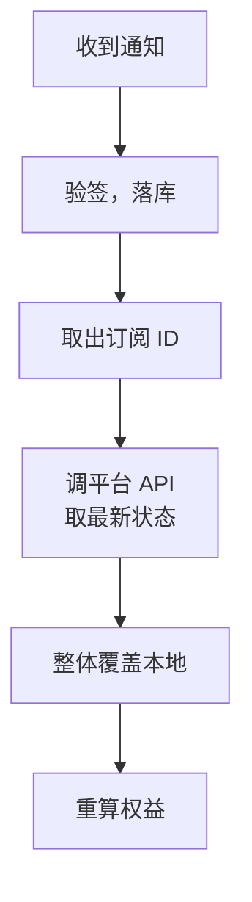

# Stripe 与内购的服务端校验

微信支付和支付宝卖的是「一笔钱」：用户付一次，你收一次，订阅的周期、续费、到期全由你自己算。Stripe 的订阅、App Store 和 Google Play 的自动续期订阅不一样：**订阅本身活在平台那边**，续费、扣款失败、宽限期、退款都由平台驱动，你的服务端只是它的一面镜子。

镜子要照得准，有两个难点：平台的通知会乱序、会重复、会丢；同一个人可能在三个平台各有一份订阅。这一章先确立一个对三家都适用的原则，再分别看三家的实现细节。

已经讲过的部分：Stripe 的 Checkout、webhook 验签、客户门户和本地联调见[《出海实务》第 3 章](../going-global/03-stripe-payments.md)；什么时候必须用内购、StoreKit 2 的整体流程、App Store 服务器通知的基本处理、沙盒测试见[《定价与商业模式》第 6 章](../pricing-monetization/06-app-store-iap.md)。

> [!WARNING]
> 本章涉及的 Stripe API（含 API 版本之间的字段变化）、App Store Server API 与服务器通知 V2、Google Play Developer API 与实时开发者通知，均按 2025 年前后的官方文档整理，三家都在持续调整接口、字段和规则，Google Play 在中国大陆不可用。以 Stripe 文档（docs.stripe.com）、Apple Developer 文档（App Store Server API、App Store Server Notifications）和 Google Play 开发者文档的最新版本为准。

## 原则：收到通知，回头去问

最直观的写法是「收到什么事件就做什么」：收到续费就把到期日加一个月，收到过期就关掉权益。这在三家都会出问题：

- **乱序**：Stripe 明确说不保证事件的投递顺序；你可能先收到 `customer.subscription.updated`（已取消），再收到更早的那条（已激活）
- **丢失**：你的服务在发布，平台重试几次后放弃了
- **语义细**：苹果的 `DID_FAIL_TO_RENEW` 带不带 `GRACE_PERIOD` 子类型，处理完全不同；按事件类型写 `switch`，分支会越写越多

更稳的做法是：**把通知只当作「这个订阅有变化」的信号，收到后调平台的 API 拿到这个订阅的当前完整状态，整体覆盖到本地**。



这样乱序无所谓（每次都是最新状态），重复无所谓（覆盖两次结果一样），丢了也能补（定时任务对快到期的订阅主动拉一遍）。代价是每条通知多一次 API 调用，对一人公司的量级不值一提。

## 一张镜像表

三家的订阅都落进同一张表：

```sql
CREATE TABLE external_subscriptions (
  id                  uuid PRIMARY KEY DEFAULT gen_random_uuid(),
  provider            text NOT NULL,        -- stripe / apple / google
  external_id         text NOT NULL,        -- Stripe 订阅 ID / Apple originalTransactionId / Google 首个 purchaseToken
  subject_type        text NOT NULL,        -- account / store
  subject_id          uuid NOT NULL,
  product_id          text NOT NULL,        -- 平台侧的商品或价格 ID
  status              text NOT NULL,        -- active / trialing / grace / on_hold / paused / canceled / expired / revoked
  current_period_end  timestamptz,
  auto_renew          boolean,
  environment         text NOT NULL DEFAULT 'production', -- Apple 的 Sandbox 订单要能和正式的分开
  raw                 jsonb NOT NULL,       -- 平台返回的原文，排查用
  synced_at           timestamptz NOT NULL DEFAULT now(),
  UNIQUE (provider, external_id)
);
CREATE INDEX ON external_subscriptions (subject_type, subject_id);
```

`status` 是三家状态归一之后的值，第 9 章的权益计算只看这一列和 `current_period_end`，不关心来自哪家。`raw` 一定要存：用户说「我明明付了钱」的时候，你要能看到平台当时告诉你的原话。

同步函数的骨架三家一样：

```typescript
export async function upsertMirror(db: Db, m: MirrorRow) {
  await db.execute(sql`
    INSERT INTO external_subscriptions
      (provider, external_id, subject_type, subject_id, product_id, status, current_period_end, auto_renew, environment, raw)
    VALUES (${m.provider}, ${m.externalId}, ${m.subjectType}, ${m.subjectId}, ${m.productId}, ${m.status},
            ${m.currentPeriodEnd}, ${m.autoRenew}, ${m.environment}, ${m.raw})
    ON CONFLICT (provider, external_id) DO UPDATE SET
      status = EXCLUDED.status,
      product_id = EXCLUDED.product_id,
      current_period_end = EXCLUDED.current_period_end,
      auto_renew = EXCLUDED.auto_renew,
      raw = EXCLUDED.raw,
      synced_at = now()`);
  await recomputeEntitlements(db, m.subjectType, m.subjectId); // 第 9 章
}
```

注意 `ON CONFLICT` 里**不更新 `subject_id`**。订阅归属谁，只在第一次建立关联时决定，之后平台的数据不能改掉它。归属变更（比如用户在另一个账号上恢复购买）是一个需要显式处理的业务决定，下文 App Store 一节会讲。

## Stripe

### 客户和你的账号一一对应

Stripe 的订阅挂在 Customer 上。第一次结账前就为「谁付钱」创建一个 Customer，存下映射，之后所有结账都用它：

```sql
CREATE TABLE billing_customers (
  subject_type  text NOT NULL,
  subject_id    uuid NOT NULL,
  provider      text NOT NULL,              -- stripe
  customer_id   text NOT NULL UNIQUE,
  PRIMARY KEY (subject_type, subject_id, provider)
);
```

[《出海实务》](../going-global/03-stripe-payments.md)的最小示例用的是 `customer_email` 加 `client_reference_id`，让 Stripe 在结账时自动建 Customer。它够用，但同一个用户结账两次会得到两个 Customer，客户门户里就看不到另一份订阅。正式做法是先建好再传 `customer`，并且**在创建 Checkout 之前检查是否已有生效的订阅**，避免用户重复订阅：

```typescript
export async function startStripeCheckout(db: Db, subject: Subject, priceId: string) {
  const active = await db.execute(sql`
    SELECT 1 FROM external_subscriptions
    WHERE provider = 'stripe' AND subject_type = ${subject.type} AND subject_id = ${subject.id}
      AND status IN ('active', 'trialing', 'grace')`);
  if (active.length) throw new AppError("已有生效的订阅，请在账单页管理", 409);

  const customer = await ensureStripeCustomer(db, subject); // 没有就建，metadata 里写上 subject
  const session = await stripe.checkout.sessions.create(
    {
      mode: "subscription",
      customer,
      line_items: [{ price: priceId, quantity: 1 }],
      subscription_data: { metadata: { subjectType: subject.type, subjectId: subject.id } },
      success_url: `${APP_URL}/billing/done?session_id={CHECKOUT_SESSION_ID}`,
      cancel_url: `${APP_URL}/billing`,
    },
    { idempotencyKey: `checkout:${subject.id}:${priceId}:${dayKey()}` },
  );
  return session.url!;
}
```

`subscription_data.metadata` 会写到订阅对象上，之后任何一条订阅事件都能直接读到它属于谁，不用再经过 Customer 反查。

### 处理事件：只认订阅 ID，回头去取

```typescript
const SUB_EVENTS = new Set([
  "customer.subscription.created",
  "customer.subscription.updated",
  "customer.subscription.deleted",
  "customer.subscription.paused",
  "customer.subscription.resumed",
  "invoice.paid",
  "invoice.payment_failed",
]);

export async function handleStripeEvent(db: Db, event: Stripe.Event) {
  if (!SUB_EVENTS.has(event.type)) return;
  const obj = event.data.object as { id: string; object: string; subscription?: string | null };
  const subId = obj.object === "subscription" ? obj.id : subscriptionIdOfInvoice(obj);
  if (!subId) return;

  const sub = await stripe.subscriptions.retrieve(subId); // 最新状态
  await upsertMirror(db, {
    provider: "stripe",
    externalId: sub.id,
    subjectType: sub.metadata.subjectType,
    subjectId: sub.metadata.subjectId,
    productId: sub.items.data[0].price.id,
    status: mapStripeStatus(sub.status),
    currentPeriodEnd: periodEndOf(sub),
    autoRenew: !sub.cancel_at_period_end,
    environment: sub.livemode ? "production" : "test",
    raw: sub,
  });
}

function mapStripeStatus(s: Stripe.Subscription.Status): string {
  switch (s) {
    case "trialing": return "trialing";
    case "active": return "active";
    case "past_due": return "grace";      // 扣款失败，Stripe 正在按你的设置重试
    case "paused": return "paused";
    case "unpaid":                        // 重试用尽，按设置保留但不再开发票
    case "incomplete":                    // 首次付款未完成
      return "on_hold";
    case "canceled":
    case "incomplete_expired":
      return "expired";
    default: return "expired";
  }
}
```

两个版本相关的坑：

- **订阅周期字段的位置变过**。较新的 Stripe API 版本把 `current_period_end` 从订阅对象移到了订阅项（`items.data[].current_period_end`）上，`invoice.subscription` 也换了位置。`periodEndOf` 和 `subscriptionIdOfInvoice` 两个函数就是为了把这类差异关在一处
- **在代码里固定 API 版本**。创建 Stripe 客户端时显式传 `apiVersion`，webhook 端点在 Stripe 后台也绑定同一个版本。升级版本是一次有计划的改动，而不是某天 Stripe 后台默认版本变了、你的字段突然读成 `undefined`

## App Store

### 购买时就绑定账号

StoreKit 2 购买时可以传一个 `appAccountToken`（UUID），它会写进交易里。直接用账号 ID（或者「谁付钱」实体的 ID）：

```typescript
// 客户端：具体调用方式取决于所用的 IAP 库，关键是把 appAccountToken 传进去
await purchase({ sku: "sync_monthly", appAccountToken: me.accountId });
// 购买成功后，把交易 ID 交给服务端
await api.post("/billing/apple/transactions", { transactionId: tx.id });
```

服务端拿交易 ID 去苹果那里取签名的交易信息，验签，再拉这个订阅的全部状态：

```typescript
import {
  AppStoreServerAPIClient,
  Environment,
  SignedDataVerifier,
  type JWSTransactionDecodedPayload,
} from "@apple/app-store-server-library";

const clients = {
  production: new AppStoreServerAPIClient(P8_KEY, KEY_ID, ISSUER_ID, BUNDLE_ID, Environment.PRODUCTION),
  sandbox: new AppStoreServerAPIClient(P8_KEY, KEY_ID, ISSUER_ID, BUNDLE_ID, Environment.SANDBOX),
};

export async function syncAppleByTransaction(db: Db, accountId: string, transactionId: string) {
  // 先问正式环境，查不到再问沙盒：App 审核员用的是正式包 + 沙盒账号
  const { env, tx } = await getTransactionAnyEnv(transactionId);

  if (tx.appAccountToken && tx.appAccountToken !== accountId) {
    // 这笔订阅当初是另一个账号买的，现在被别的账号「恢复」
    return handleOwnershipConflict(db, accountId, tx);
  }
  await syncAppleSubscription(db, env, tx.originalTransactionId!, { type: "account", id: accountId });
}

async function syncAppleSubscription(db: Db, env: "production" | "sandbox", originalTxId: string, subject: Subject) {
  const res = await clients[env].getAllSubscriptionStatuses(originalTxId);
  const last = res.data?.[0]?.lastTransactions?.find((t) => t.originalTransactionId === originalTxId);
  if (!last) return;

  const tx = await verifiers[env].verifyAndDecodeTransaction(last.signedTransactionInfo!);
  const renewal = await verifiers[env].verifyAndDecodeRenewalInfo(last.signedRenewalInfo!);

  await upsertMirror(db, {
    provider: "apple",
    externalId: originalTxId,
    subjectType: subject.type,
    subjectId: subject.id,
    productId: tx.productId!,
    status: mapAppleStatus(last.status!, tx),
    currentPeriodEnd: new Date(renewal.gracePeriodExpiresDate ?? tx.expiresDate!),
    autoRenew: renewal.autoRenewStatus === 1,
    environment: env,
    raw: { status: last.status, tx, renewal },
  });
}

function mapAppleStatus(status: number, tx: JWSTransactionDecodedPayload): string {
  if (tx.revocationDate) return "revoked";   // 退款或被撤销
  switch (status) {
    case 1: return "active";
    case 4: return "grace";                  // 计费宽限期：扣款失败但仍应提供服务
    case 3: return "on_hold";                // 计费重试中，宽限期已过
    case 5: return "revoked";
    default: return "expired";               // 2
  }
}
```

几个要点：

- **用 `originalTransactionId` 作为订阅的 ID**。每次续费产生新的 `transactionId`，`originalTransactionId` 不变
- **宽限期内到期日要用 `gracePeriodExpiresDate`**。在 App Store Connect 里开启计费宽限期后，扣款失败的用户在宽限期内仍然应该能用
- **正式环境的服务器也要能处理沙盒交易**。App 审核时，审核员用的是你提交的正式版本，但付款走沙盒。服务端只认正式环境，审核员就会看到「购买成功但功能没开通」，然后拒审。沙盒订单的 `environment` 记为 `sandbox`，权益可以照常开通，但统计收入时排除

### 归属冲突：订阅属于 Apple ID，不属于你的账号

用户 A 用 Apple ID 买了订阅，退出登录，又用你系统里的账号 B 登录，点了「恢复购买」。这笔交易的 `appAccountToken` 是 A，现在 B 要用。

苹果的立场是：订阅属于 Apple ID。你需要为这种情况定一条规则，常见的三种：

| 规则 | 做法 | 适合 |
|---|---|---|
| 转移 | 订阅改挂到 B，A 失去权益 | 大多数个人用户场景，同一个人换了账号 |
| 拒绝 | 提示「这份订阅属于另一个账号」，显示那个账号的脱敏标识 | 防止一份订阅给多个账号共享 |
| 共享 | A、B 都有权益 | 一般不建议 |

选「转移」时，要在 `upsertMirror` 之外显式改 `subject_id`，记审计日志，并作废 A 的权益缓存。这正是镜像表的 `ON CONFLICT` 不更新归属的原因：归属变化必须是一个有意识的决定，不能被某次同步悄悄改掉。

### 服务器通知

服务器通知 V2 的处理按本章开头的原则写：验签、落库、取 `originalTransactionId`、调 `syncAppleSubscription`。通知里的 `appAccountToken` 告诉你它属于谁；如果为空（比如购买时没传），用 `originalTransactionId` 在镜像表里找到已有的归属。找不到归属的通知（用户买了但从没把交易交给你的服务端），先存着，等用户下次打开 App 上传交易时再关联。

## Google Play

> [!NOTE]
> Google Play 在中国大陆不可用，国内安卓用户的付费通常走微信支付、支付宝或各应用商店自己的支付。下面的内容只在你面向海外安卓用户时需要。

Google Play 的订阅用 **purchaseToken** 标识。客户端购买成功后把它交给服务端，服务端用 Google Play Developer API 查询，再**确认**（acknowledge）这笔购买：

```typescript
import { google } from "googleapis";

const publisher = google.androidpublisher({
  version: "v3",
  auth: new google.auth.GoogleAuth({ scopes: ["https://www.googleapis.com/auth/androidpublisher"] }),
});

export async function syncGooglePurchase(db: Db, subject: Subject, purchaseToken: string) {
  const { data } = await publisher.purchases.subscriptionsv2.get({ packageName: PACKAGE, token: purchaseToken });

  if (data.externalAccountIdentifiers?.obfuscatedExternalAccountId &&
      data.externalAccountIdentifiers.obfuscatedExternalAccountId !== subject.id) {
    return handleOwnershipConflict(/* 同 App Store 一节 */);
  }

  // 升级、降级、过期后重新订阅会产生新的 token，linkedPurchaseToken 指向旧的那个
  if (data.linkedPurchaseToken) await markSuperseded(db, data.linkedPurchaseToken);

  const item = data.lineItems?.[0];
  await upsertMirror(db, {
    provider: "google",
    externalId: purchaseToken,
    subjectType: subject.type,
    subjectId: subject.id,
    productId: item?.productId ?? "",
    status: mapGoogleState(data.subscriptionState),
    currentPeriodEnd: item?.expiryTime ? new Date(item.expiryTime) : null,
    autoRenew: item?.autoRenewingPlan?.autoRenewEnabled ?? false,
    environment: data.testPurchase ? "sandbox" : "production",
    raw: data,
  });

  // 新购买必须在规定时间内确认，否则 Google 会自动退款
  if (data.acknowledgementState === "ACKNOWLEDGEMENT_STATE_PENDING" && item?.productId) {
    await publisher.purchases.subscriptions.acknowledge({
      packageName: PACKAGE, subscriptionId: item.productId, token: purchaseToken,
    });
  }
}

function mapGoogleState(s?: string | null): string {
  switch (s) {
    case "SUBSCRIPTION_STATE_ACTIVE": return "active";
    case "SUBSCRIPTION_STATE_IN_GRACE_PERIOD": return "grace";
    case "SUBSCRIPTION_STATE_ON_HOLD": return "on_hold";
    case "SUBSCRIPTION_STATE_PAUSED": return "paused";
    case "SUBSCRIPTION_STATE_CANCELED": return "canceled"; // 已取消续订，但当前周期内仍有效
    default: return "expired";
  }
}
```

**确认是服务端的责任**。如果只在客户端确认，用户买完立刻杀掉 App，确认没发出去，几天后 Google 自动退款，你的服务端却已经开通了权益。确认的时限以 Google 文档为准（目前是几天），放在服务端校验成功之后立即做。

`purchaseToken` 链是 Google 独有的复杂之处：升级套餐时会生成新 token，`linkedPurchaseToken` 指向旧的。旧 token 对应的镜像行要标记为已被取代，否则同一个人会同时有两份「生效」的订阅。

### 实时开发者通知

Google 的通知不是直接发给你，而是发到 Google Cloud Pub/Sub 的一个主题，再由 Pub/Sub 推送到你的 HTTPS 接口。推送时可以附带一个 Google 签名的 OIDC 令牌，用第 4 章的 `jwtVerify` 验证它的签发方和你在订阅里配置的 `aud`：

```typescript
const googleJwks = createRemoteJWKSet(new URL("https://www.googleapis.com/oauth2/v3/certs"));

@Post("google/rtdn")
@Public()
@HttpCode(204)
async rtdn(@Headers("authorization") auth: string, @Body() body: PubSubPush) {
  await jwtVerify(auth.replace(/^Bearer /, ""), googleJwks, {
    issuer: ["https://accounts.google.com", "accounts.google.com"],
    audience: RTDN_AUDIENCE,
  });
  const msg = JSON.parse(Buffer.from(body.message.data, "base64").toString("utf8"));
  if (!msg.subscriptionNotification) return; // 测试通知、一次性商品通知另行处理
  await events.record({
    channel: "google",
    dedupeKey: body.message.messageId,
    payload: msg,
  });
}
```

处理时取出 `purchaseToken`，在镜像表里找到归属，调 `syncGooglePurchase` 拉最新状态。和苹果一样，通知本身的类型只用来记日志，状态以 API 返回为准。

## 退款和撤销

| 平台 | 你怎么知道 | 镜像状态 |
|---|---|---|
| Stripe | `charge.refunded`、`charge.dispute.created` 事件 | 退款不一定取消订阅，看你在退款时是否同时取消；拒付要单独处理 |
| App Store | `REFUND`、`REVOKE` 通知；交易里出现 `revocationDate` | `revoked` |
| Google Play | 订阅状态变化通知；另有「已作废的购买」API 可定期拉取 | 按 API 返回 |

退款权在苹果和 Google 手里（[《定价与商业模式》第 7 章](../pricing-monetization/07-refunds-disputes.md)讲过「苹果说了算」），你的服务端只需要正确地同步。苹果还会在用户申请退款时发 `CONSUMPTION_REQUEST`，询问这个用户的使用情况，你可以选择回应，回应内容要符合苹果的数据规范和你的隐私政策。

## 本章要点

- 订阅活在平台那边，你的服务端是镜子；通知只当作「有变化」的信号，收到后调 API 取最新完整状态整体覆盖
- 三家落进同一张镜像表，状态归一，保留原文；同步时不改归属
- Stripe：先建 Customer 并存映射，结账前检查已有订阅，订阅上写 metadata；固定 API 版本，把字段位置的差异关在一处
- App Store：`appAccountToken` 用账号 ID，`originalTransactionId` 标识订阅；宽限期用 `gracePeriodExpiresDate`；正式服务器也要处理沙盒交易
- 订阅属于 Apple ID 或 Google 账号，不属于你的账号；归属冲突要定规则并显式处理
- Google Play：服务端确认购买，处理 `linkedPurchaseToken` 链；通知经 Pub/Sub 推送，验证推送令牌
- 退款和撤销以平台为准，同步即可
