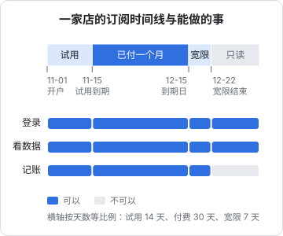

# 订阅状态机

上一章的 Stripe 和内购，订阅的状态机跑在平台那边，你照着同步就行。国内用微信支付、支付宝或对公转账收费时，没有平台替你维护订阅：用户付的是「一笔钱」，买的是「一段时间」，试用、续费、到期、升级、退款全部要你自己算。hatch-counter 就是这种情况。

这一章讲自己维护的订阅怎么建模：存什么、状态怎么推出来、到期日怎么算才不出错，以及最后怎么把自管订阅和平台订阅合成一个「这个人现在能用什么」的答案。商业上的规则（试用多久、升级怎么折算、退款按什么比例）在[《定价与商业模式》第 8 章](../pricing-monetization/08-case-hatch-counter.md)，这里讲实现。

## 存日期，算状态

最常见的建模是在门店或用户表上加一个 `status` 列：`trialing`、`active`、`expired`。然后写一个定时任务，每天零点把到期的改成 `expired`。

这个设计有一个结构性问题：**状态是时间的函数，而你把它存成了一个快照**。定时任务晚跑了一个小时，这一个小时里状态就是错的；定时任务挂了一天，所有该过期的都没过期；有人手动改了到期日，忘了同步改状态，两列就对不上了。

hatch-counter 的门店表注释里写着它的选择：

> 到期不占一个状态值——那是 `expiresAt` 跟当前时间比出来的，存下来就会跟时间对不上。

所以它的门店只有两个**存下来的**状态：`active` 和 `suspended`（人手停的：欠费、违规、客户自己要求），再加一个 `expires_at`。「试用中」「已到期」都是读的时候现算的。

原则是：**只存事实，状态推出来**。事实是「到期日是哪天」「有没有被人手停用」「有没有付过一张收费订单」，这些不会因为时间流逝而变错。

## 状态怎么推

先定义要推出的状态和它们对应的能力：

| 状态 | 条件 | 能登录 | 能看数据 | 能写入 |
|---|---|---|---|---|
| 不限期 | 内部门店，`expires_at` 为空 | 能 | 能 | 能 |
| 试用中 | 未到期，且没有确认过收费订单 | 能 | 能 | 能 |
| 生效中 | 未到期，且确认过收费订单 | 能 | 能 | 能 |
| 宽限期 | 已过到期日，但未超过宽限天数 | 能 | 能 | 能（但处处提示续费） |
| 已到期 | 超过宽限期 | 能 | 能 | 不能 |
| 已停用 | 人手停用 | 能 | 看策略 | 不能 |



推导函数是纯函数，输入事实和当前时间，输出状态：

```typescript
export type SubState = "unlimited" | "trialing" | "active" | "grace" | "expired" | "suspended";

export interface Term {
  suspended: boolean;
  expiresAt: Date | null;  // 空 = 不限期
  hasPaid: boolean;        // 确认过至少一张收费订单
}

export const GRACE_DAYS = 7;

export function subState(t: Term, now: Date): SubState {
  if (t.suspended) return "suspended";
  if (t.expiresAt === null) return "unlimited";
  if (now <= t.expiresAt) return t.hasPaid ? "active" : "trialing";
  if (now.getTime() - t.expiresAt.getTime() <= GRACE_DAYS * DAY_MS) return "grace";
  return "expired";
}

export function canWrite(s: SubState): boolean {
  return s !== "expired" && s !== "suspended";
}
```

`hasPaid` 也可以不存，每次从订单表里查「有没有一张已收款的非试用订单」，hatch-counter 的 `storeTerm()` 就是这么做的。但它在每个请求的守卫里都要用，存一个冗余列（在确认收款的同一个事务里写）更省。

宽限期要不要设，是产品决定。hatch-counter 没有宽限期：过了到期日就不能记账，但仍能登录、能看数据。它的理由是到期日本身就留了余量（落在那天的 23:59:59），提前 7 天、1 天、当天各发一次提醒，而且续期是店主找客服办的，客服可以随时送几天。面向个人用户、自动续费的产品，宽限期更有用：扣款失败往往只是卡过期了，给用户几天时间更新支付方式。

## 拦在写入，不拦在登录

到期之后能做什么，决定了守卫怎么写。hatch-counter 的做法值得照抄：**到期的门店允许登录，接口明确告诉客户端是「到期」**。源码注释里的理由是：做成登录失败的话，店主会以为系统坏了，客服要排查半天才发现是欠费。

守卫只拦写入类的接口：

```typescript
@Injectable()
export class SubscriptionGuard implements CanActivate {
  constructor(private reflector: Reflector, private terms: TermService) {}

  async canActivate(ctx: ExecutionContext): Promise<boolean> {
    const req = ctx.switchToHttp().getRequest();
    if (req.method === "GET") return true;                  // 读一律放行
    if (this.reflector.get(ALLOW_WHEN_EXPIRED, ctx.getHandler())) return true; // 如：导出数据、续费下单

    const term = await this.terms.of(req.storeId);
    const state = subState(term, new Date());
    if (!canWrite(state)) {
      throw new ForbiddenError(
        state === "suspended" ? "这家门店已停用，请联系客服" : "这家门店的服务已到期，请续期后继续使用",
        state === "suspended" ? "store_suspended" : "store_expired",
      );
    }
    req.subState = state; // 宽限期里的请求，响应拦截器可以加一个提示头
    return true;
  }
}
```

两类接口要显式放行：**续费下单**（不然到期的人没法付钱）和**导出数据**（不然到期就等于把用户的数据扣下了）。错误码 `store_expired` 和登录失败的错误码分开，客户端据此弹出「去续期」而不是「重新登录」。

## 到期日怎么算

状态推导简单，难的是到期日本身。hatch-counter 把到期日的所有计算收在一个文件里，确认收款、赠送天数、退款、后台界面上的预览全部调它。它踩过的坑可以列成一张表：

| 问题 | 错误做法的后果 | 规矩 |
|---|---|---|
| 续期从哪天接 | 从今天起算：提前一周续的人白丢七天；从原到期日起算：断了三个月才回来的人续完还是过期的 | 从「原到期日」和「现在」里晚的那个接 |
| 落在哪个时刻 | 落在 00:00，说「续到 3 月 31 日」的人 31 日一早就用不了了 | 落在那天的 23:59:59（业务时区） |
| 加一个月 | JS 的 `setMonth` 会溢出：1 月 31 日加一个月是 3 月 3 日，账期从此每次往后漂 | 撞上月底就退到当月最后一天 |
| 时区 | 服务器是 UTC，「那一天」差了 8 小时 | 用业务时区算「那一天」 |

```typescript
const DAY_MS = 86_400_000;

/** 加几个月，撞上月底就退到当月最后一天 */
export function addMonths(base: Date, months: number): Date {
  const d = new Date(base);
  const day = d.getDate();
  d.setDate(1);
  d.setMonth(d.getMonth() + months);
  d.setDate(Math.min(day, new Date(d.getFullYear(), d.getMonth() + 1, 0).getDate()));
  return d;
}

/** 那一天的 23:59:59（北京时间）。说「到 3 月 31 日」的人是想用满那一天的 */
export function endOfBusinessDay(at: Date): Date {
  return new Date(`${businessDate(at)}T23:59:59+08:00`);
}

/** 顺延从哪天接：原到期日和现在里晚的那个 */
export function extendBase(current: Date | null, now: Date): Date {
  return current && current > now ? current : now;
}

export function renewTo(current: Date | null, months: number, now: Date): Date {
  return endOfBusinessDay(addMonths(extendBase(current, now), months));
}

export function grantTo(current: Date | null, days: number, now: Date): Date {
  return endOfBusinessDay(new Date(extendBase(current, now).getTime() + days * DAY_MS));
}
```

`businessDate(at)` 返回业务时区下的 `YYYY-MM-DD`，可以用 `Intl.DateTimeFormat("sv-SE", { timeZone: "Asia/Shanghai" })` 实现。`addMonths` 里的 `getDate`、`setMonth` 用的是进程的本地时区，所以服务进程的 `TZ` 环境变量也要设成业务时区，或者把这几个函数改成全部在业务时区的日期上操作。时区是这类代码最容易「本地测试全过、上线差一天」的地方。

**预览和真执行走同一个函数**。后台开单时显示「确认收款后到 2027-03-31」，用的是 `renewTo`；财务点确认时，事务里调用的也是 `renewTo`。两处各写一份，迟早一处说 3 月 31 日、另一处续到了 3 月 3 日。

## 试用

试用在 hatch-counter 里是一张 0 元、14 天的「订单」，开户时自动生成。把试用也记成订单有两个好处：到期日的每一天都能在订单台账里找到出处；「这家店有没有付过钱」可以用「有没有非试用的已收款订单」来判断。

试用之后第一次付费，到期日从哪天算？两种做法：

| 做法 | 结果 | 适合 |
|---|---|---|
| 接在试用结束之后 | 试用期间付费的人，试用剩下的天数照样用 | 鼓励早付费 |
| 从开户那天算，顶替试用 | 第一期从开户日起算一整期，试用那 14 天被这一期覆盖 | 账期与开户日对齐 |

hatch-counter 用的是第二种：开户订单确认收款后，到期日从开户那天往后接，送过的天数照样接在后面。这样每家店的账期都从开户日开始，客服说「您是 3 月 1 日开的户，每年 3 月 1 日续」很好理解。无论选哪种，都写进那个唯一的计算函数里。

**防止反复试用**。自助注册的产品要考虑同一个人注册多个账号反复试用。限制试用的维度要选一个获取成本高的东西：手机号（第 1 章的身份）比账号好，营业执照、设备指纹更难绕过。实现上就是在发放试用前查一张「已试用过的标识」表。hatch-counter 是后台开户的，没有这个问题。

## 续费提醒

不做自动扣款的订阅，续费全靠提醒。hatch-counter 的到期提醒服务每天上午跑一次，给到期前 7 天、1 天、当天的店主发通知短信，有几条规矩：

- **同一家店、同一个到期日、同一个提醒点只发一次**，靠一张表的主键保证，而且**先落行再发**：进程重启、一天跑两遍、两台机器一起跑都不会重复发。没发成的也占着那个点，过了那天再补发一条「7 天后到期」就是错的
- **同一个人同一天有几家店要提醒，合成一条**：一个人一天收到三条「你的店要到期了」，只会觉得被催了三遍
- 停用的、内部的不发；每家店发了没发、为什么没发，写进那家店的操作时间线

```sql
CREATE TABLE expiry_notices (
  subject_id   uuid NOT NULL,
  expires_on   date NOT NULL,    -- 提醒针对的是哪个到期日：续费之后到期日变了，就是新的一组提醒点
  days_before  int  NOT NULL,    -- 7 / 1 / 0
  sent_at      timestamptz,
  skip_reason  text,
  created_at   timestamptz NOT NULL DEFAULT now(),
  PRIMARY KEY (subject_id, expires_on, days_before)
);
```

```typescript
// 先抢占这个提醒点，抢到了才发
const claimed = await db.execute(sql`
  INSERT INTO expiry_notices (subject_id, expires_on, days_before)
  VALUES (${storeId}, ${expiresOn}, ${daysBefore})
  ON CONFLICT DO NOTHING
  RETURNING subject_id`);
if (!claimed.length) return; // 别的进程或之前的一轮已经处理过
```

定时任务的调度、多实例下谁来跑、失败了怎么记录，属于后台任务的范畴，同批的另一本书会展开。

## 自动续费

> [!WARNING]
> 国内的自动续费（微信支付、支付宝的周期扣款 / 代扣类产品）通常需要单独申请开通，并受到较严格的监管：扣费前提醒、取消方式要便捷、不得默认勾选等。相关要求见国家市场监管总局等部门的规定和两家平台的接入规范，按 2025 年前后的情况整理，以最新官方文件和平台文档为准。

对一人公司，国内的自动续费是一个要慎重的选择：开通门槛高、监管要求多，而且[《定价与商业模式》第 7 章](../pricing-monetization/07-refunds-disputes.md)讲过，自动续费是客诉重灾区。面向商户的 SaaS 用「预付一段时间 + 到期提醒 + 一键续费」通常就够了：用户扫码付一年，你不需要处理扣款失败、签约解约这些状态。

如果真要做，模型上它介于「自管」和「平台托管」之间：签约关系是平台维护的，每期扣款是你发起的（或平台按约定发起），每次扣款成功仍然是一张订单、一张支付单，走第 6 章的 `settlePayment` 顺延到期日。扣款失败就是「到期日没有被顺延」，状态推导函数会自然地把它推进宽限期和到期。

## 升级与降级

**升级立即生效**。hatch-counter 的规则：新套餐从确认收款那天起算一整期，旧套餐剩下的天数按两边的日价折成新套餐的天数接上，不补差价。

```typescript
/** 升级：旧套餐剩余天数按日价折算成新套餐的天数 */
export function upgradeTo(
  current: Date | null,
  now: Date,
  months: number,
  oldMonthlyCents: number | null,
  newMonthlyCents: number,
): { to: Date; carriedDays: number } {
  const left = current && current > now ? Math.floor((current.getTime() - now.getTime()) / DAY_MS) : 0;
  const carried =
    oldMonthlyCents == null || newMonthlyCents <= 0 ? left : Math.floor((left * oldMonthlyCents) / newMonthlyCents);
  return { to: endOfBusinessDay(new Date(addMonths(now, months).getTime() + carried * DAY_MS)), carriedDays: carried };
}
```

`Math.floor` 向下取整，零头的几个小时归你，规则简单、用户也不会在意。开单时把「折算 23 天，确认后到 2027-04-23」显示给用户看，这句预览和真执行也是同一个函数。

**降级在周期末生效**。立即降级要退差价，规则复杂、容易出错；大多数产品的做法是「当前周期结束后切换到新套餐」。实现上是在订阅上记一个「下一期的套餐」，下一次续费时按它开单：

```sql
ALTER TABLE stores ADD COLUMN next_plan_id uuid; -- 空 = 续费时沿用当前套餐
```

## 退款

退款要把到期日减回去，按退款比例减「这张订单当初加上去的那一段」。所以第 6 章要求订单上存 `extended_from` 和 `extended_to`：

```typescript
/** 按比例减回：退一半的钱，减掉这张单加上去的那一段的一半 */
export function refundPullBack(order: { extendedFrom: Date; extendedTo: Date; amountCents: number },
                               refundCents: number, current: Date): Date {
  const added = order.extendedTo.getTime() - order.extendedFrom.getTime();
  const days = Math.ceil(((added / DAY_MS) * refundCents) / order.amountCents);
  return endOfBusinessDay(new Date(current.getTime() - days * DAY_MS));
}
```

减回去的天数向上取整，退了钱的那部分时间一天都不多给。减到今天以前就是当场到期，不要替它兜到今天：hatch-counter 的注释说得清楚，到期日得是「起点 + 还算数的那几笔」，兜一下就多出一段说不清从哪来的日子。

退款、改到期日、记退款金额和「从哪天减到哪天」，同样在一个事务里，并锁住门店那一行。

## 合成一个答案：权益

到这里，「这个人现在能用什么」可能有好几个来源：

- 自管订阅：门店或账号上的 `expires_at`
- 平台订阅：第 8 章镜像表里的 Stripe、Apple、Google 订阅
- 赠送、内部账号、兑换码

业务代码不应该关心这些来源。把它们合成一个**权益**（entitlement），业务只问权益：

```typescript
export interface Entitlement {
  plan: string;            // 取最高的那一档
  state: SubState;         // 取最好的那个状态
  until: Date | null;      // 取最晚的那个到期日
  sources: string[];       // 来自哪些订阅，排查用
}

export async function entitlementOf(db: Db, subject: Subject, now: Date): Promise<Entitlement> {
  const own = await ownTerm(db, subject);                    // 自管
  const mirrors = await activeMirrors(db, subject);          // 平台订阅，第 8 章
  const candidates = [
    { plan: own.plan, state: subState(own, now), until: own.expiresAt, source: "own" },
    ...mirrors.map((m) => ({ plan: planOfProduct(m.product_id), state: mirrorState(m, now), until: m.current_period_end, source: `${m.provider}:${m.external_id}` })),
  ];
  return pickBest(candidates);
}
```

`pickBest` 的规则要写清楚并测试：状态按 `unlimited > active > trialing > grace > expired > suspended` 排；同为生效时取档位高的；`suspended` 是人手停用，它应该压过一切。最后一条容易漏：一家店被停用了，不能因为它恰好还有一份 App Store 订阅就继续能用。

权益每个请求都要读，可以在 `upsertMirror`、确认收款、退款、停用之后重算并写进一张 `entitlements` 表或缓存，读的时候直接取。但**状态部分仍然要按当前时间现算**，存下来的只是 `until` 和 `plan`，否则就回到了本章开头那个「状态快照和时间对不上」的问题。

## 测试：把时间注入进来

这一章的每个函数都接收 `now` 参数，而不是在函数里调 `new Date()`。这让边界情况可以直接写成测试：

```typescript
import { describe, expect, it } from "vitest";

describe("renewTo", () => {
  const at = (s: string) => new Date(s);

  it("提前续费从原到期日接", () => {
    expect(renewTo(at("2027-03-31T23:59:59+08:00"), 1, at("2027-03-20T10:00:00+08:00")))
      .toEqual(at("2027-04-30T23:59:59+08:00"));
  });

  it("过期后续费从现在接", () => {
    expect(renewTo(at("2027-01-31T23:59:59+08:00"), 1, at("2027-03-10T10:00:00+08:00")))
      .toEqual(at("2027-04-10T23:59:59+08:00"));
  });

  it("1 月 31 日加一个月落在 2 月最后一天", () => {
    expect(renewTo(at("2027-01-31T23:59:59+08:00"), 1, at("2027-01-20T10:00:00+08:00")))
      .toEqual(at("2027-02-28T23:59:59+08:00"));
  });
});
```

值得覆盖的边界：月底、闰年 2 月、跨年、到期日当天的 23:59:59 与次日 00:00:00、宽限期的最后一秒、升级时剩余天数为 0、退款后到期日早于今天。这些测试跑得快、不需要数据库，是这一章性价比最高的投入。

## 本章要点

- 只存事实（到期日、是否停用、是否付过钱），状态按当前时间推出来；不要靠定时任务改状态列
- 到期拦写入、不拦登录，错误码和登录失败分开；续费下单和导出数据显式放行
- 到期日的计算收在一个文件里：从原到期日和现在里晚的那个接，落在业务时区那天的 23:59:59，加月份撞月底退到月末；预览和执行走同一个函数
- 试用记成 0 元订单；第一期从哪天起算是产品决定，写进同一个函数；防反复试用要选获取成本高的标识
- 续费提醒先落行再发，按到期日和提醒点去重，同一人合并
- 国内自动续费门槛和监管要求高，预付加提醒通常够用；扣款成功仍走 `settlePayment`
- 升级立即生效、按日价折算剩余天数；降级在周期末生效；退款按比例减回这张单加上的那一段，向上取整
- 多个来源合成一个权益，停用压过一切；存 `until` 和 `plan`，状态现算
- 时间作为参数注入，边界情况写成纯函数测试
