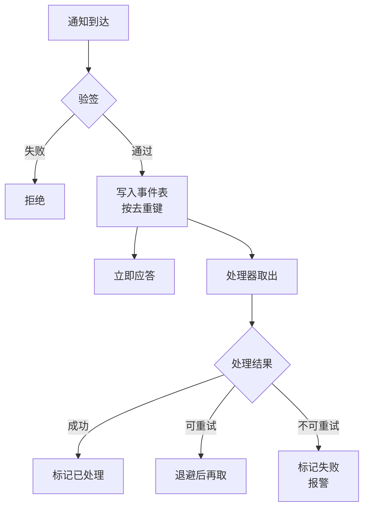
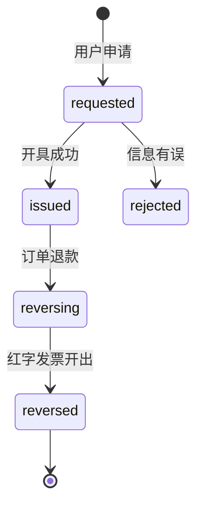

# Webhook、对账与发票

前面几章反复说了同一句话：回调接口只做验签、落库、快速应答，处理放到后面。这一章把「后面」写出来：一条通用的事件处理管线，能重试、能重放、能把失败的事件交给人看。然后是两件收钱之后每天都要做的事：**对账**，确认你库里的每一分钱和渠道账单对得上；**发票**，把用户要的票开出来，并且在退款时不出错。

## 收事件的管线

微信支付、支付宝、Stripe、Apple、Google 的通知形式各不相同，但进来之后的路径可以完全一样：



为什么不在回调接口里直接处理？

- **渠道对应答时间有限制**。处理里要调平台 API（第 8 章的「回头去问」）、要锁订单行、要发通知，任何一步慢了，渠道都会判你超时、过一会儿重发
- **处理失败时，你要的是自己重试，而不是等渠道重试**。渠道的重试间隔你控制不了，而且一天之后它就不再发了
- **原始事件要留着**。用户投诉、对账出差异、代码有 bug 需要重跑时，你需要知道渠道当时到底说了什么

第 6 章的 `payment_events` 表加几列就能承担这条管线：

```sql
ALTER TABLE payment_events
  ADD COLUMN attempts        int NOT NULL DEFAULT 0,
  ADD COLUMN next_attempt_at timestamptz NOT NULL DEFAULT now(),
  ADD COLUMN status          text NOT NULL DEFAULT 'pending'; -- pending / done / failed

CREATE INDEX payment_events_todo ON payment_events (next_attempt_at) WHERE status = 'pending';
```

### 落库：去重键是关键

```typescript
export class PaymentEvents {
  constructor(private db: Db) {}

  /** 回调接口里调用。重复的通知撞唯一约束，什么都不做，照样应答成功 */
  async record(e: { channel: string; dedupeKey: string; outTradeNo?: string; payload: unknown }) {
    await this.db.execute(sql`
      INSERT INTO payment_events (channel, dedupe_key, out_trade_no, payload)
      VALUES (${e.channel}, ${e.dedupeKey}, ${e.outTradeNo ?? null}, ${JSON.stringify(e.payload)})
      ON CONFLICT (channel, dedupe_key) DO NOTHING`);
  }
}
```

去重键选渠道提供的通知 ID：微信支付的通知 `id`、支付宝的 `notify_id`、Stripe 的 `event.id`、Apple 的 `notificationUUID`、Pub/Sub 的 `messageId`。这一层去重挡住的是「同一条通知重复投递」；而「不同的通知说了同一件事」（支付宝先发 `TRADE_SUCCESS` 再发 `TRADE_FINISHED`），靠第 6 章 `settlePayment` 里的状态判断挡住。两层缺一不可。

### 处理器：用 SKIP LOCKED 取活

处理器是一个循环：取一批到期的事件，逐条处理，记录结果。多个进程同时跑也不会重复处理同一条，靠的是 `FOR UPDATE SKIP LOCKED`：

```typescript
const BACKOFF_SEC = [10, 60, 300, 1800, 7200, 21600]; // 10 秒到 6 小时，之后放弃

export async function drainEvents(db: Db, handlers: Record<string, EventHandler>, batch = 20) {
  await db.transaction(async (tx) => {
    const rows = await tx.execute<EventRow>(sql`
      SELECT * FROM payment_events
      WHERE status = 'pending' AND next_attempt_at <= now()
      ORDER BY id
      LIMIT ${batch}
      FOR UPDATE SKIP LOCKED`);

    for (const ev of rows) {
      try {
        await tx.execute(sql`SAVEPOINT ev`);
        await handlers[ev.channel](tx, ev);
        await tx.execute(sql`UPDATE payment_events SET status = 'done', processed_at = now() WHERE id = ${ev.id}`);
      } catch (err) {
        await tx.execute(sql`ROLLBACK TO SAVEPOINT ev`); // 只撤销这一条的处理，不影响同批其他事件
        const retryable = isRetryable(err) && ev.attempts < BACKOFF_SEC.length;
        await tx.execute(sql`
          UPDATE payment_events SET
            attempts = attempts + 1,
            error = ${String(err)},
            status = ${retryable ? "pending" : "failed"},
            next_attempt_at = now() + make_interval(secs => ${BACKOFF_SEC[Math.min(ev.attempts, BACKOFF_SEC.length - 1)]})
          WHERE id = ${ev.id}`);
        if (!retryable) await alert(`支付事件处理失败：${ev.channel} #${ev.id} ${String(err)}`);
      }
    }
  });
}
```

这段代码把一批事件放在一个事务里，每条用一个 savepoint 隔开。好处是写法简单；代价是一批里如果有一条要调慢的外部 API，整批的锁都会被拖住。事件多了以后，可以改成「先短事务领取（把 `next_attempt_at` 推后几分钟作为租约）、再逐条在各自的事务里处理」。这两种写法的取舍、Postgres 当队列的完整做法、以及换成 BullMQ 的时机，是后台任务的专门话题，同批的另一本书会讲。

处理器什么时候跑？最简单的是回调接口落库之后顺手触发一次（不等待结果），再加一个每几十秒跑一次的定时器兜底。

### 什么错误该重试

| 错误 | 例子 | 处理 |
|---|---|---|
| 暂时性 | 数据库连接断开、平台 API 5xx 或超时 | 退避重试 |
| 时序 | 通知里的单号在库里找不到（下单事务还没提交、或者回调比下单的响应还快） | 重试几次；一直找不到再标失败 |
| 数据不对 | 金额不一致、商户号不是你的 | **不重试**，标失败并报警，等人看 |
| 代码 bug | 映射函数遇到没见过的状态 | 不重试；修好代码后批量重放 |

「金额不一致」不重试是因为重试一百次结果都一样，而且它可能意味着有人在篡改，必须有人看一眼。

### 重放和人工补单

管理后台要有一个事件列表：按渠道、单号、状态筛选，能看原文、看错误，能点「重新处理」。重新处理就是把 `status` 改回 `pending`、`next_attempt_at` 改成现在。因为整条处理链是幂等的，重放永远是安全的，这是前面几章坚持幂等的回报。

人工补单（客服确认用户确实付了钱，但系统没入账）也不要直接改订单表。走查单：后台点「向渠道查询」，查到已支付就调 `settlePayment`，`source` 记为 `manual:<操作人>`。和 hatch-counter 财务点「确认已收款」是同一个函数、同一套校验、同一条审计记录。

## 对账

对账回答一个问题：**你认为收到的钱，和渠道认为付给你的钱，是不是同一笔钱**。前面所有的幂等、查单、重放都是为了让它们一致，对账是最后检查一致性的那一步，也是发现 bug 最可靠的办法。

### 三本账

| 账 | 来源 | 回答什么 |
|---|---|---|
| 你的库 | `payments`、退款表 | 你以为收了多少 |
| 渠道账单 | 每天从商户平台下载的交易账单 | 渠道认为发生了哪些交易 |
| 银行流水 | 结算账户的到账记录 | 钱真的到了多少 |

日常对的是前两本：每天下载前一天的账单，和库逐笔比对。第三本按结算周期核一次总数：渠道账单里的「应结算金额」（交易额减手续费减退款）应该等于银行到账。hatch-counter 现在走对公转账，只有第一和第三本账：财务确认收款时上传凭证截图，定期拿银行流水核一遍。

### 下载账单

> [!WARNING]
> 账单接口、账单格式（字段、编码、压缩方式）和可下载时间按 2025 年前后的文档整理，以微信支付「申请交易账单」和支付宝「查询对账单下载地址」接口的最新文档为准。

两家都是「先调接口拿下载地址，再下载文件」的两步：

- **微信支付**：调申请交易账单接口，传账单日期和类型，返回一个下载地址和文件的哈希值。下载同样要带签名，下载后**校验哈希**再解析。文件是逗号分隔的文本，字段值前面带一个反引号（防止表格软件把长数字转成科学计数法），解析时去掉
- **支付宝**：调查询对账单下载地址接口，返回一个有时效的地址，下载下来是压缩包，里面是 CSV 文件，注意文件编码不一定是 UTF-8

账单通常在次日上午之后才能下载，定时任务排在上午十点左右，失败了每小时重试，到中午还拿不到就报警。下载下来的原始文件存进对象存储，保留下来，将来查账时要用。

解析之后统一成一种结构：

```typescript
interface BillRow {
  channel: string;
  outTradeNo: string;
  channelTxnId: string;
  kind: "payment" | "refund";
  amountCents: number;
  feeCents: number;     // 手续费
  occurredAt: Date;
}
```

### 比对

```typescript
type Diff =
  | { type: "missing_local"; bill: BillRow }               // 渠道有、你没有：漏单
  | { type: "missing_channel"; local: LocalRow }           // 你有、渠道没有：错单
  | { type: "amount_mismatch"; bill: BillRow; local: LocalRow };

export function reconcile(bill: BillRow[], local: LocalRow[]): Diff[] {
  const key = (r: { channel: string; outTradeNo: string; kind: string }) => `${r.channel}|${r.kind}|${r.outTradeNo}`;
  const localMap = new Map(local.map((r) => [key(r), r]));
  const diffs: Diff[] = [];

  for (const b of bill) {
    const l = localMap.get(key(b));
    if (!l) diffs.push({ type: "missing_local", bill: b });
    else if (l.amountCents !== b.amountCents) diffs.push({ type: "amount_mismatch", bill: b, local: l });
    localMap.delete(key(b));
  }
  for (const l of localMap.values()) diffs.push({ type: "missing_channel", local: l });
  return diffs;
}
```

`local` 是你库里「成功时间落在账单日期那一天」的支付和退款。日期边界是比对里最常见的误报来源：渠道按它的时区和它的「交易完成时间」切天，你的 `succeeded_at` 可能是回调到达的时间，晚了几秒就落到了第二天。所以 `missing_channel` 的那些，先去前后一天的账单里找一遍再报。

三种差异的处理：

| 差异 | 常见原因 | 处理 |
|---|---|---|
| 漏单（渠道有、你没有） | 回调丢了、查单任务没跑、处理失败没人看 | 自动调查单，走 `settlePayment`；查单结果和账单不一致就报警 |
| 错单（你有、渠道没有） | 日期边界；或者某段代码在没有渠道确认的情况下把支付单标成了成功 | 先排除日期边界；剩下的每一条都是严重问题，人工查 |
| 金额不一致 | 部分退款记错、单位换算错 | 人工查，修数据并找到 bug |

漏单可以自动补，**错单绝不自动处理**。一张「你以为收了钱、渠道说没有」的单，意味着有一条入账路径绕过了校验，必须找到它。

### 对账结果要留下来

```sql
CREATE TABLE reconciliation_runs (
  id            bigserial PRIMARY KEY,
  channel       text NOT NULL,
  bill_date     date NOT NULL,
  bill_file_key text,                    -- 原始账单在对象存储里的位置
  bill_count    int,
  bill_amount   bigint,
  local_count   int,
  local_amount  bigint,
  fee_amount    bigint,
  diffs         jsonb NOT NULL DEFAULT '[]',
  status        text NOT NULL,           -- matched / diffs / failed
  created_at    timestamptz NOT NULL DEFAULT now(),
  UNIQUE (channel, bill_date)
);
```

每天一行。`fee_amount` 顺手把手续费汇总了，记账时要用：收入按交易总额记，手续费单独记为费用（[《财务与税务》第 3 章](../opc-finance/03-invoices.md)讲了为什么不能按到账净额记收入）。后台首页放一个小卡片：最近 7 天的对账状态，有差异的标红。没有差异的日子，这张卡片一眼扫过；有差异的日子，它是你当天第一件要处理的事。

## 发票

开票的税务规则（能开什么票、个人用户要不要开、App Store 收入怎么处理、手续费的票怎么取）在[《财务与税务》第 3 章](../opc-finance/03-invoices.md)，那一章也给了一个最小的开票申请结构。这里讲落到系统里要多考虑的几件事：合并开票、退款红冲、以及怎么防止多开。

> [!WARNING]
> 数电发票（全面数字化的电子发票）的开具方式、红字发票流程、开票接口的接入条件，按 2025 年前后的情况整理，以国家税务总局和当地电子税务局的最新规定为准；第三方开票服务的接入要求以服务商文档为准。

### 一张发票，多张订单

B2B 客户常见的要求是「这个季度的几张单合开一张」。所以发票和订单是多对多：

```sql
CREATE TABLE invoices (
  id            uuid PRIMARY KEY DEFAULT gen_random_uuid(),
  subject_type  text NOT NULL,
  subject_id    uuid NOT NULL,
  buyer_type    text NOT NULL,           -- personal / company
  title         text NOT NULL,           -- 抬头快照：客户改了名称，已开的票不跟着变
  tax_id        text,
  email         text NOT NULL,
  amount_cents  bigint NOT NULL,
  status        text NOT NULL DEFAULT 'requested', -- requested / issued / reversing / reversed / rejected
  invoice_no    text,                    -- 开出后回填
  file_key      text,                    -- PDF / OFD 文件
  reverses_id   uuid REFERENCES invoices(id), -- 红字发票指向它冲掉的那张
  created_at    timestamptz NOT NULL DEFAULT now(),
  issued_at     timestamptz
);

CREATE TABLE invoice_items (
  invoice_id    uuid NOT NULL REFERENCES invoices(id),
  order_id      uuid NOT NULL REFERENCES orders(id),
  amount_cents  bigint NOT NULL,
  PRIMARY KEY (invoice_id, order_id)
);
```

hatch-counter 的客户表上已经存了开票需要的信息（名称、税号、地址电话、开户行账号），因为它的「客户」就是「谁付钱、发票开给谁」。开票申请时从客户表带出默认值，存进发票上的是**快照**，理由和订单上存套餐名快照一样。

### 防止多开：在锁里算可开金额

一张订单可开票的金额 = 实付 − 已退款 − 已开票（未被红冲的）。两个并发的开票申请如果各自算一遍，都会觉得还能开，结果开出两倍。所以要锁住订单再算：

```typescript
export async function requestInvoice(db: Db, subject: Subject, orderIds: string[], buyer: BuyerInfo) {
  return db.transaction(async (tx) => {
    const orders = await tx.execute<OrderRow>(sql`
      SELECT * FROM orders
      WHERE id = ANY(${orderIds}) AND subject_id = ${subject.id} AND status IN ('paid', 'partially_refunded')
      ORDER BY id
      FOR UPDATE`); // 按 id 排序加锁，避免两个申请以不同顺序锁同一批订单而死锁
    if (orders.length !== orderIds.length) throw new AppError("有订单不存在或不能开票", 400);

    let total = 0;
    for (const o of orders) {
      const [r] = await tx.execute<{ refunded: number; invoiced: number }>(sql`
        SELECT
          (SELECT coalesce(sum(amount_cents), 0) FROM refunds WHERE order_id = ${o.id} AND status = 'succeeded')::bigint AS refunded,
          (SELECT coalesce(sum(ii.amount_cents), 0) FROM invoice_items ii JOIN invoices i ON i.id = ii.invoice_id
            WHERE ii.order_id = ${o.id} AND i.status IN ('requested', 'issued', 'reversing'))::bigint AS invoiced`);
      const available = o.amount_cents - Number(r.refunded) - Number(r.invoiced);
      if (available <= 0) throw new AppError(`订单 ${o.no} 已经开过票`, 409);
      total += available;
    }

    const [inv] = await tx.execute<{ id: string }>(sql`
      INSERT INTO invoices (subject_type, subject_id, buyer_type, title, tax_id, email, amount_cents)
      VALUES (${subject.type}, ${subject.id}, ${buyer.type}, ${buyer.title}, ${buyer.taxId ?? null}, ${buyer.email}, ${total})
      RETURNING id`);
    // 每张订单按各自的可开金额写明细（略）
    return inv.id;
  });
}
```

### 退款遇上已开的票

已经开了票的订单发生退款，票面金额就不对了。处理顺序是：



1. 退款流程里检查这张订单有没有 `issued` 状态的发票；有，就把发票标为 `reversing`，并通知你（或自动调用开票服务）开红字发票
2. 红字发票开出后，原票标为 `reversed`，红字票作为一张新的 `invoices` 行，`reverses_id` 指向原票
3. 如果是部分退款，用户还需要剩余金额的票，就按上面的 `requestInvoice` 重新申请，可开金额会自动算对

把「退款时有已开发票」做成退款流程里的一个必经检查，而不是事后想起来。否则季度末对账时，开出的发票总额比实际收入多，就要一张张往回翻。

### 开票这一步谁来做

| 阶段 | 做法 |
|---|---|
| 量很小 | 后台列出待开的申请，你在电子税务局手动开，开完把发票号码和文件上传回来，状态改为 `issued` |
| 量变大 | 接第三方开票服务的 API：提交申请，异步拿结果（又是一个回调或轮询，走本章的事件管线） |

无论哪种，系统里的状态流转是一样的，区别只是 `requested → issued` 这一步由人还是由服务完成。一开始先做手动的那一种，等你开始觉得每周开票是负担了，再接 API。这和 hatch-counter 「先线下转账、后接支付 API」是同一个思路：先把数据结构做对，自动化可以晚一点。

## 全书回顾

这本书讲了两件事的实现，回头看，它们靠的是同一组原则：

- **身份、凭据、会话分开存**；**订单、支付单、事件、履约分开存**。拆开之后每一张表只管一件事，变化不会互相牵连
- **外部系统的消息先落库，再处理**。处理是幂等的，所以重放永远安全
- **检查和占用用一条条件更新完成**：验证码的次数、刷新票的轮换、找回密码的令牌、支付单的入账，都是 `UPDATE ... WHERE ... RETURNING`
- **只存事实，状态现算**：到期日存下来，「是否过期」现算；平台订阅的状态以平台为准，收到通知回头去问
- **合不上的缝交给人**：金额不一致、错单、归属冲突，不自动处理，报警，等人看

## 本章要点

- 所有渠道的通知走同一条管线：验签、按渠道通知 ID 落库、立即应答、处理器异步处理
- 处理器用 `FOR UPDATE SKIP LOCKED` 取活，每条用 savepoint 隔开；暂时性错误退避重试，数据错误不重试并报警
- 后台能看原文、能重放；人工补单走查单和 `settlePayment`，不直接改订单
- 对账对三本账：日常比对库和渠道账单，按结算周期核银行到账；原始账单文件留存
- 漏单自动查单补入，错单绝不自动处理；日期边界是误报的主要来源
- 每天的对账结果和手续费汇总落表，后台首页显示最近几天的状态
- 发票和订单多对多，抬头存快照；可开金额在锁住订单后计算，防止并发多开
- 退款时检查已开发票并走红冲；开票先手动、量大再接 API，状态流转不变
