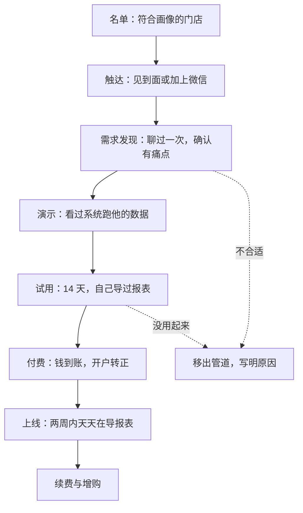
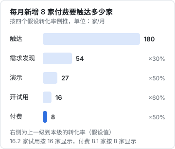

# 一个人的销售漏斗

这本书写给一类人：会写代码、产品已经能用，但一想到「去卖」就发怵的开发者。场景很具体——一个人、下班时间、把门店管理软件卖给国内的中小餐馆老板。全书的例子都来自 hatch-counter（品牌名「掌柜眼」）：导入收银报表算销量、拍进货单管库存、记开支算盈亏，开户由后台办，店主用手机号登录。

先把边界说清楚。定价怎么定见《定价与商业模式》，增长渠道怎么挑见《获客与增长》，公众号、小红书、企业微信这些私域打法见《国内私域与内容平台》，合同条款怎么写见《合同与法律文书》，发票怎么开见《财务与税务》第 3 章。本书只讲**销售动作本身**：找谁、怎么开口、聊什么、演示什么、怎么报价、怎么把钱收回来、怎么让他第二年还续。

## 销售不是「推」，是一串可管理的步骤

很多开发者对销售的想象是：口才好、脸皮厚、能把梳子卖给和尚。对中小门店来说正好相反。小馆子老板一天被推销好几回——团购代运营、收银机、外卖代运营、装修、贷款——他对「会说的人」天然警惕。能成交的往往是那个**说得最少、问得最准、演示时用他自己的数据、事后真把事办了**的人。这恰好是开发者擅长的。

把销售看成一个漏斗，每一步都有明确的进入条件和退出条件，你就能像调试程序一样调试它：哪一步漏得最多，就修哪一步。

和网上教程里的「营销漏斗」不同，门店软件的漏斗**付费之后还有两步**：上线和续费。一家店付了一个月就不用了，你花在它身上的时间基本白费。《定价与商业模式》第 8 章的推演里，一个人要养活自己需要两百多家付费门店；按月流失 3%，每月要新签八家才能维持规模。所以对你来说，「卖出去」和「留下来」是同一件事的两半。

## 每一步的定义要能判对错

漏斗里每一步必须有一个**谁来看都会得出同样结论**的判定标准，否则你永远在自我安慰（「这家挺有兴趣的」）。下面是 hatch-counter 用的定义：

| 阶段 | 进入条件（可验证） | 典型耗时 | 主要产出 |
|---|---|---|---|
| 名单 | 店名、地址、业态已知，按第 2 章的打分 ≥ 6 | — | 一行名单记录 |
| 触达 | 和老板本人说上了话，或加上了老板本人的微信 | 当天 | 约到下一次沟通的时间 |
| 需求发现 | 问完第 4 章的问题清单，确认至少一个能量化的痛点 | 15–30 分钟 | 一份发现记录 |
| 演示 | 老板看过系统里跑出来的数，最好是他自己的报表 | 15–20 分钟 | 试用的约定 |
| 试用 | 后台开了试用店，老板或店员**自己**导过一份报表 | 14 天 | 试用成功标准是否达成 |
| 付费 | 款项到账，后台确认收款 | 1–3 天 | 订单、发票信息 |
| 上线 | 付费后连续两周，每个营业日都有报表导入 | 2 周 | 上线验收记录 |
| 续费 | 到期前续了下一期 | 按套餐周期 | 续费订单 |

几个容易出错的地方：

- **「加了微信」不等于触达成功**。加的是店长、收银员或者老板娘的妹妹，决策人没见到，就还停在「触达」之前。小馆子的决策人通常是老板本人，有时是管钱的老板娘，第 4 章会讲怎么分辨
- **「演示过」要以老板看过为准**，不是给店员看过。店员觉得好用、老板没看过，最后一句「我再想想」就没了下文
- **试用要求「自己导过」**，不是你替他导。你替他导好了，试用期里他看到的只是你的劳动成果，不是他自己能不能用起来

## 用数字倒推你要做多少事

漏斗的价值在于能倒推工作量。下面的转化率是**为了推演设的假设值**，开始时你没有自己的数据，可以先用它，跑一两个月后换成真实的：

| 环节 | 假设转化率 |
|---|---|
| 触达 → 需求发现 | 30% |
| 需求发现 → 演示 | 50% |
| 演示 → 开试用 | 60% |
| 试用 → 付费 | 50% |

目标是每月新增 8 家付费门店。倒推：

$$
\text{需要触达} = \frac{8}{0.3 \times 0.5 \times 0.6 \times 0.5} = \frac{8}{0.045} \approx 178
$$

也就是每月要触达约 180 家店，聊 54 家，演示 27 家，开 16 家试用，最后 8 家付费。

再把时间算进去。地推一家店（含走路、等老板空下来）平均算 10 分钟，聊需求 20 分钟，演示 20 分钟，试用期跟进每家合计 60 分钟：

$$
180 \times 10 + 54 \times 20 + 27 \times 20 + 16 \times 60 = 1800 + 1080 + 540 + 960 = 4380 \text{ 分钟} \approx 73 \text{ 小时}
$$

每月 73 小时，相当于每个周末两天都扑在上面，还不算上线交付和客服。对一个在职、下班做副业的人来说**这个数做不到**。这就是这本书要反复面对的现实，结论有三条：

1. **先别追 8 家/月**。第一阶段的目标是前 10 家付费客户，速度慢没关系，要的是把每一步的真实转化率测出来。分阶段的目标和止损线见《一人公司行动手册》
2. **最该优化的是最上面两步**：触达 180 家、聊 54 家占了总时间的三分之二。转介绍和渠道（第 3 章）能让一次触达的成功率从 30% 提到 60% 以上，相当于触达量直接减半
3. **试用 → 付费是杠杆最大的一步**。从 50% 提到 70%，同样 8 家付费只需要开 12 家试用，往上每一级都跟着少。第 5 章和第 8 章的大部分内容都在为这一步服务

## 在职的人怎么排销售时间

门店老板的作息和上班族是错开的。一般餐馆午市、晚市是最忙的时候，这两段去谈软件，老板只会挥手让你走；下午两三点到四点多是空档，打烊后老板也可能有空但已经很累。

而你工作日下午在上班。可行的排法：

| 时间段 | 适合做什么 |
|---|---|
| 工作日午休 | 回微信、约时间、发试用期的提醒 |
| 工作日晚上 21 点后 | 整理名单和管道、准备演示数据、远程帮试用店排查导入问题 |
| 周六、周日下午 | 地推和上门演示，一个下午集中跑一个商圈 |
| 年假、调休 | 留给需要连续几个小时驻店的上线交付 |

两个原则：

- **同步的事（见面、演示）集中在周末，异步的事（微信跟进）分散在工作日**。微信是门店老板的主战场，老板晚上打烊后回消息很常见，你第二天午休回就行，不用秒回
- **不要用公司的时间和设备做副业销售**。上班时间接客户电话、用公司电脑存客户名单，既可能违反劳动合同和公司制度，也可能在离职时引来职务成果、竞业的纠纷。这些风险见《一人公司方法论》第 4 章

## 一个人做销售，要避开的几种失败

| 失败模式 | 表现 | 对策 |
|---|---|---|
| 一直在准备 | 官网改了三版、宣传册印了两盒，一家店都没去 | 定一个日期，那天之前必须见到 10 个老板 |
| 只跟喜欢你的人聊 | 天天找那两家熟人店，管道里永远是同一批人 | 每周新增名单有硬指标（第 10 章） |
| 不问钱 | 聊得很好、演示很好，从来没说过多少钱 | 演示结束前必须报价或约好报价时间（第 6 章） |
| 免费送 | 「先免费用着，用好了再说」 | 试用有期限、有成功标准，到期就谈钱（第 5 章） |
| 承诺功能换签单 | 「这个下个月就加上」 | 只承诺已经有的；没有的记下来，不给日期（第 6 章） |
| 卖完就跑 | 付了钱就去找下一家，上线没人管 | 付费不是终点，上线验收才是（第 8 章） |

## 把漏斗记下来

从第一家店开始，就要有一份记录：每家店现在在哪一步、下一步做什么、什么时候做。一开始一张表格就够，具体结构在第 10 章。现在只需要记住：**没写下来的跟进等于没有**。你会以为自己记得「周六去老王那家看一下」，然后加班一周，就忘了。

## 本章要点

- 门店软件的漏斗是：名单 → 触达 → 需求发现 → 演示 → 试用 → 付费 → 上线 → 续费；付费之后的两步和前面一样重要
- 每一步要有可验证的进入条件：见到决策人、他自己导过报表、钱到账、连续两周在用
- 按假设转化率倒推，每月新增 8 家付费要触达约 180 家店、花约 73 小时，在职状态下做不到；第一阶段先拿 10 家、测出真实转化率
- 最费时间的是触达和首次沟通，转介绍和渠道能大幅降低它；杠杆最大的是试用转付费
- 同步的事（见面、演示）放周末，异步的事（微信跟进）放工作日碎片时间；不占用公司时间和设备
