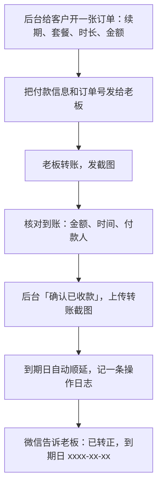

# 签单、收款与开票

试用期快结束了，老板用得不错。很多开发者在这里卡住：不好意思开口要钱，等着老板主动说「我要买」。小馆子老板很少主动说，他忙，到期那天系统拦住他记账，他才想起来，这时候他的感受是「被停了」，而不是「我决定买了」。

成交要你**主动提出**，并且把后面的每一步（确认、付款、开户、开票）都准备好，让老板只需要点头和转账。

## 成交信号

下面这些信号出现时，就该提成交了，不用等到试用最后一天：

| 信号 | 例子 |
|---|---|
| 他开始问「以后」的事 | 「以后能不能让收银员也看？」「过年那几天不营业怎么算？」 |
| 他在跟别人分享 | 「我给老板娘看了，她说挺好」「隔壁老李也问我这是啥」 |
| 他在用系统做决定 | 「看了一下，毛血旺我准备涨两块」 |
| 他问付款的细节 | 「年付能开发票吗？」「转账转到哪？」 |
| 后台上手漏斗六步都走到了 | 天天在导、记了开支、看过经营分析 |

反过来，如果到第 12 天还卡在前两步，这时候提成交只会得到「再说吧」。先回到第 5 章处理卡点，或者坦诚地延后试用。

## 怎么开口

开口的关键是**问一个容易回答的选择题**，而不是「您要不要买」这种是非题。

```text
「王哥，试用后天到期了。这两周您每天都在导，水煮鱼和毛血旺的账也算出来了。
咱们转正的话，您看是按月 99，还是一年 990 划算一点？」
```

如果他犹豫，回到第 6 章的异议处理：「您还在考虑哪一块？」。如果他说行，**当场把下一步说清楚**：

```text
「好嘞。我现在把付款信息发您，转好了截个图给我，
我这边确认了就给您转正，到期日从今天往后排一年，账都接着用，不用重新录。
要开发票的话，把开票信息发我一下，我给您发个格式。」
```

## 签什么

小馆子老板通常不愿意签一份几页的合同，也看不下去。但你需要一份双方都认可的书面记录，至少包含：谁、买什么、多少钱、多长时间、到期怎么办。

可行的做法，从轻到重：

| 方式 | 适合 | 注意 |
|---|---|---|
| 微信里发一段订单确认，老板回复「确认」 | 单店、月付或年付 | 确认的内容要完整；截图存档 |
| 在线用户协议 + 服务协议，登录或付款时勾选同意 | 所有客户都应该有 | 协议文本要先写好、放在官网，见[《合同与法律文书》](../contracts-legal/) |
| 纸质或电子签的服务合同 | 多店、渠道、金额较大、要报销的 | 用电子签平台，或打印两份签字盖章 |

关于微信确认的效力：《民法典》第四百六十九条规定，能有形地表现所载内容、并可以随时调取查用的数据电文，视为书面形式。律所科普文章普遍据此认为，微信里的文字、语音满足条件时可以视为书面形式（[示例](https://www.huichenglawyer.com/pufaku/209742.html)），但条款要明确，还要能证明对方是本人；具体一份聊天记录算不算数，要结合个案判断。所以微信确认要做到两点：内容写全，对象是老板本人的微信（不是店员的）。具体的证据和电子签问题见《合同与法律文书》。

订单确认的模板：

```text
王哥，跟您确认一下这次的订单：
· 门店：老街川菜馆 中山路店
· 服务：掌柜眼标准版，1 年，990 元（含税）
· 服务期：从我确认收到款的那天起算 1 年，试用期的数据接着用
· 包含：全部功能；进货单识别不限次；最多 8 个成员账号；
  工作日微信答复，一般 24 小时内
· 到期后：数据保留，能登录查看，续费后接着记账
· 发票：增值税普通发票，开票信息您发我
· 付款：转到下面的账户（附账户信息），转好截图给我
使用时以官网上的《用户协议》《服务协议》为准。没问题的话您回个「确认」。
```

## 收款

### 收到哪里

收款方式的选择和你的主体有关。主体怎么选见[《国内合规实务》第 1 章](../opc-compliance-cn/01-entity-choice.md)，个人和公司的钱为什么要分开见[《财务与税务》第 5 章](../opc-finance/05-separate-money.md)。

- **对公转账到公司账户**
  - 适合：有一人公司或个体户对公账户
  - 优点：账目清楚，开票顺
  - 注意：老板要用手机银行转，有些老板嫌麻烦
- **商户收款码（微信、支付宝）**
  - 适合：已开通商户的
  - 优点：老板扫码就付，最省事
  - 注意：有手续费；要有经营主体
- **个人收款码**
  - 适合：还没注册主体的副业初期
  - 优点：零门槛
  - 注意：收入进个人账户，和生活的钱混在一起；对明显有经营特征的个人，支付机构可能会引导改用经营收款码
- **在线支付（扫码续费页面）**
  - 适合：客户多了以后
  - 优点：自动确认、自动顺延
  - 注意：要开发，要商户资质，见[《定价与商业模式》第 5 章](../pricing-monetization/05-payments-china.md)

关于个人收款码：人民银行《关于加强支付受理终端及相关业务管理的通知》（银发〔2021〕259 号）自 2022 年 3 月 1 日起施行，要求对具有明显经营活动特征的个人，按特约商户的规则提供收款条码；随后中国支付清算协会明确个人收款码不关闭、不停用，另设「个人经营收款码」供自愿升级（[中国新闻网，2022-03-01](https://www.chinanews.com.cn/cj/2022/03-01/9688590.shtml)）。所以副业初期用个人码收款不是不行，但每一笔都要能和订单对上，并且尽早换成主体账户。

不管用哪种方式，**一律不让渠道或中间人代收**（第 3 章）。

### hatch-counter 的收款流程

hatch-counter 现在的收款是线下转账，在管理后台确认。流程：



几个细节：

- **订单号放进付款备注**。请老板转账时备注订单短号（比如 `1030-001`），对账时一眼对得上。老板忘了备注也没关系，但你要在后台订单上记下付款人姓名
- **先到账、后确认**。看到截图不等于到账，以银行或支付平台的到账记录为准再点确认。截图可以伪造，也可能转错账户
- **转账截图存进订单**。hatch-counter 后台在确认收款时可以传一张凭证截图，存在订单上。以后对账、退款、开票都能找到
- **试用期的数据接着用**。转正不需要重新录任何东西，确认收款后到期日顺延，这一点要告诉老板，很多人担心「转正要重新弄一遍」

### 没按时付怎么办

到期前后的提醒，hatch-counter 后台在到期前 7 天、1 天、当天各发一条短信（通知类短信，发给老板本人的号码）。除此之外，你自己的跟进：

| 情况 | 做法 |
|---|---|
| 说了要付，三天没付 | 微信提醒一句，附上付款信息：「王哥，付款信息我再发您一下，方便的时候转一下哈」 |
| 一周没付 | 打个电话，问是不是有什么顾虑；有些老板是在等月初的钱 |
| 到期了还没付 | 系统会拦记账，数据还在。不用追得太紧，问一句「需不需要先开一个月的」 |
| 付了一部分 | 按实收确认对应时长，或者跟他确认补齐的时间，在订单上备注 |

门店软件的金额小，绝大多数「没付」是忘了或者在犹豫，不是赖账。真遇到使用了服务又拒不付款的，催款和违约处理见《合同与法律文书》。

## 开票

开票本身（发票类型、怎么开、开错了怎么红冲）见[《财务与税务》第 3 章](../opc-finance/03-invoices.md)。这里只讲销售环节要做的事。

### 收集开票信息

开票信息在付款前就收齐，避免付了款再来回问。发给老板一个格式：

```text
开票信息（请照着填好发我）：
· 发票类型：普通发票 / 专用发票（不确定的话问一下您的会计）
· 抬头（单位名称）：
· 纳税人识别号（统一社会信用代码）：
· 接收发票的邮箱或手机号：
（开专用发票的另需：地址电话、开户行及账号）
```

几个常见情况：

- **个体工商户的老板**：抬头写个体户营业执照上的名称，纳税人识别号是执照上的统一社会信用代码。有的老板会说「开我个人名字」，提醒他如果要入店里的账，抬头要和执照一致
- **专票还是普票**：老板自己往往不知道，让他问会计。你自己能开什么票、税率是多少，取决于你的主体和纳税人身份，报价时就要说清楚（第 6 章）
- **还没有主体**：副业初期没注册主体就开不了发票。如果客户需要发票，要在报价时就说明，或者先注册主体。这也是什么时候该注册主体的一个实际信号

### 在后台登记

hatch-counter 后台的客户资料里存开票信息，发票在外面开、后台只登记状态（待开 / 已开 / 已作废，标已开要填发票号）。每开一张票，回后台登记，这样年底对账时，订单、收款、发票三者能一一对上。

## 签单之后的第一件事

钱到账、转正以后，马上做这几件事，不要拖到「有空」：

```text
成交后清单
[ ] 后台确认收款，到期日已顺延
[ ] 微信告诉老板：已转正、到期日、有问题怎么找你
[ ] 开票信息已收，发票已开、已发、已在后台登记
[ ] 管道里这家店的阶段改成「付费」，下一步改成「上线验收」，日期写两周后
[ ] 记下这家店的来源（扫街 / 谁介绍的 / 哪个渠道），推荐奖励按规则兑现
[ ] 如果是转介绍来的，告诉推荐人「您介绍的店签了，谢谢」
[ ] 在你的成交日志里写三行：成交用了多少天、卡过哪一步、老板最终为什么买
```

最后一条最容易被跳过，也最有价值。十家店之后回头看，「老板最终为什么买」那一栏会告诉你，你的产品真正卖的是什么。

## 本章要点

- 成交要主动提，用选择题（月付还是年付）而不是是非题；在成交信号出现时就提，不等到期
- 签什么：至少有一份老板本人确认的完整订单记录；在线协议所有客户都要有；多店、渠道、大金额用正式合同
- 《民法典》第四百六十九条：数据电文可视为书面形式；微信确认要内容完整、对象是老板本人
- 收款优先进主体账户；个人收款码在副业初期可以用但要尽早换；绝不让渠道代收
- 先确认到账再在后台确认收款，凭证截图存进订单；转正后试用期的数据接着用
- 开票信息在付款前收齐，开完在后台登记，订单、收款、发票三者对得上
- 成交后马上更新管道、兑现推荐奖励、写成交日志
