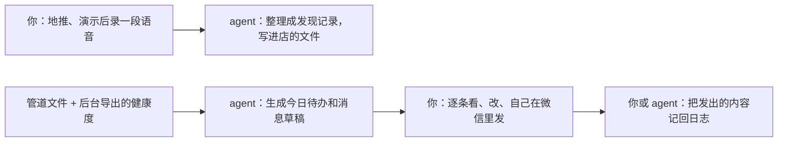

# 销售管道与 agent

前九章的每一个动作都依赖同一样东西：**一份记录了每家店在哪一步、下一步做什么、什么时候做的管道**。没有它，你会忘记周六约了谁、不知道哪家试用快到期、说不清这个月的转化率是多少。

这一章先定义一个人用得动的管道数据结构，再讲每周怎么复盘，最后讲怎么让 agent 帮你做跟进里最耗时间的那部分：整理记录、生成今日待办、起草消息。原则先说在前面：**agent 起草，你来发**。

## 为什么不用现成的 CRM

市面上的 CRM 当然可以用。但对一个在职、管几十家店的开发者，它们往往太重：字段几十个、要付费、数据在别人那里，最关键的是**不好让 agent 读写**。你是开发者，一个放在私有 Git 仓库里的纯文本管道，有几个好处：

- 结构自己定，和第 1 章的阶段定义完全对应
- 用任何编辑器都能改，手机上也能看
- 每次修改都有历史，能回看一家店是怎么走过来的
- agent 可以直接读写文件，不需要接 API

客户超过一两百家、或者有了第二个人一起做销售时，再考虑换成数据库或正式的 CRM。

## 数据结构

### 一家店一个文件

```text
sales/
├── README.md              # 阶段定义、打分卡、话术（第 1–6 章的内容，按你的实际改）
├── stores/
│   ├── S-0042.md          # 一家店一个文件
│   ├── S-0043.md
│   └── ...
├── weekly/
│   └── 2026-W45.md        # 每周复盘
└── lost/                  # 移出管道的店（流失、放手），不删
```

每个文件头上是结构化的字段，下面是按时间倒序的跟进日志：

```markdown
---
id: S-0042
name: 老街川菜馆
area: 中山路美食街东段
cuisine: 川菜
source: 扫街
score: 8
pos: 美团收银
contact: 王老板（决策人）；老板娘管钱
stage: trial
stage_since: 2026-11-15
next_action: 第 5 天发他自己的数：水煮鱼、毛血旺单份料钱
next_date: 2026-11-20
trial_ends: 2026-11-29
plan: null
expires: null
---

## 2026-11-15 演示
用他上周的美团报表演示，老板娘在场。报价 99/月、990/年，约定 14 天试用。
试用目标：每天看到利润；水煮鱼单份料钱算出来。

## 2026-11-08 需求发现
（第 4 章的发现记录）
```

### 字段与取值

| 字段 | 取值 | 规则 |
|---|---|---|
| `stage` | `list` / `contacted` / `discovered` / `demoed` / `trial` / `paid` / `live` / `renewing` / `lost` | 和第 1 章的阶段一一对应；只能往前走或进 `lost` |
| `stage_since` | 日期 | 进入当前阶段的日期，用来算「卡了多久」 |
| `next_action` | 一句话 | **必填**，除非 `stage: lost` |
| `next_date` | 日期 | **必填**，除非 `stage: lost` |
| `score` | 0–10 | 第 2 章的打分卡 |
| `source` | 扫街 / 介绍:S-0031 / 渠道:供应商李哥 / … | 用来算各来源的转化率 |
| `trial_ends` / `expires` | 日期 | 从后台抄过来，或者用脚本同步 |
| `lost_reason` | 第 9 章的六类之一 + 一句话 | 进 `lost` 时必填 |

几条纪律：

- **每家店必须有 `next_date`**。没有下一步的店，要么定一个日期，要么移进 `lost` 写清原因
- **当天的事当天记**。地推回来、演示结束、收到老板微信，当天晚上写进日志；拖到周末，细节就没了
- **不记不必要的个人信息**。老板的手机号、微信号在微信里就有，管道里只写称呼；需要关联后台时用门店名或后台的门店 id。原因在本章后面「把客户信息交给 agent 之前」

### 用脚本做检查

管道是纯文本，就可以写一个很短的脚本检查它。比如列出过期没跟进、卡太久的店：

```ts
// scripts/check.ts —— 用法：npx tsx scripts/check.ts
import { readdirSync, readFileSync } from "node:fs";
import { parse } from "yaml";

const STUCK_DAYS: Record<string, number> = {
  contacted: 14, discovered: 7, demoed: 7, trial: 14, paid: 14,
};
const today = new Date().toISOString().slice(0, 10);
const days = (a: string, b: string) =>
  Math.round((Date.parse(b) - Date.parse(a)) / 86_400_000);

for (const file of readdirSync("stores")) {
  const text = readFileSync(`stores/${file}`, "utf8");
  const s = parse(text.split("---")[1]) as Record<string, string>;
  if (s.stage === "lost") continue;
  if (!s.next_action || !s.next_date) {
    console.log(`${s.id} ${s.name}：没有下一步`);
  } else if (s.next_date < today) {
    console.log(`${s.id} ${s.name}：下一步过期 ${days(s.next_date, today)} 天（${s.next_action}）`);
  }
  const limit = STUCK_DAYS[s.stage];
  if (limit && days(s.stage_since, today) > limit) {
    console.log(`${s.id} ${s.name}：在 ${s.stage} 停了 ${days(s.stage_since, today)} 天`);
  }
}
```

注意 YAML 会把 `2026-11-20` 这样的值解析成什么类型，取决于你用的库和配置；上面的写法假设解析出来是字符串，用之前先打印一次确认。

## 每周复盘

每周固定一个时间（比如周日晚上），花半小时做三件事：

1. **跑一遍检查脚本**，把每家店的 `next_date` 排进下一周
2. **数一遍漏斗**：本周各阶段新进入了几家、各阶段现在有几家，和上周比
3. **写复盘**：放在 `weekly/` 下

```markdown
# 2026-W45 复盘

## 数字
| 阶段 | 本周新进入 | 当前在这一阶段 |
|---|---|---|
| contacted | 9 | 14 |
| discovered | 3 | 4 |
| demoed | 2 | 2 |
| trial | 1 | 3 |
| paid / live | 1 | 6 |
| lost | 2 | — |

## 这周学到的
- 扫街 9 家，约到 3 家；两家说「月底会计对账」，是好切入点
- S-0039 试用卡在配方，厨师不配合。下次培训时让厨师在场

## 下周
- 周六下午：中山路西段 10 家
- 跟进 S-0042 试用第 7 天检查；S-0037 转正谈话
```

每个月把四周的数字合起来，算一次第 1 章的各级转化率，替换掉当初的假设值。三个月以后，你就有了一份真实的、属于你自己的漏斗。这个数据也是[《一人公司行动手册》](../opc-action-plan/)里判断「获客是否可重复」的依据。

## 让 agent 帮你跟进

一个人做销售，时间主要花在三类事上：**见面**（只能你自己）、**记录和整理**、**写跟进消息**。后两类可以交给 agent。



### 工作流一：语音变记录

地推或演示结束，在回家路上对着手机说两三分钟：见到谁、聊了什么、老板的原话、下一步。转成文字后交给 agent：

```text
下面是我刚拜访完一家店后的口述（语音转文字，可能有错别字）。
请按 sales/README.md 里「发现记录模板」的格式整理，追加到 stores/S-0042.md 的日志最前面，
并更新文件头的 stage、stage_since、next_action、next_date。

要求：
- 老板说的原话保留原样，放在引号里；你的推断单独标「判断：」
- 数字只写我口述里出现的，不要补、不要估
- 口述里没提到下一步的，next_action 写「待定」，并在回复里提醒我
- 不要写入手机号、微信号、身份证号这类信息，即使口述里出现了

口述：
……
```

最后两条要求是关键。agent 最容易犯的错是**替你补全**：口述里说「扔得挺多」，它写成「每月损耗约 1500 元」。这种编出来的数字进了记录，到报价时你会拿它去跟老板说，后果很尴尬。

### 工作流二：今日待办与消息草稿

每天中午（工作日午休时）让 agent 读一遍管道，生成今天要做的事：

```text
读 sales/stores/ 下所有文件，以及 sales/health/latest.csv（后台导出的各店最后活跃和导入情况）。
今天是 2026-11-20。输出：

1. 今日待办：next_date 是今天或已经过期的店，按「试用中 > 快到期 > 其他」排序，
   每条一行：店名、阶段、要做的事
2. 健康度预警：已付费的店里，最后活跃超过 7 天的，列出来
3. 消息草稿：对每一条需要发微信的待办，按这家店日志里的上下文起草一条消息。
   - 用我平时的口吻（参考 sales/README.md 里的话术示例），短，不超过 80 字
   - 能用这家店自己的数据就用，数据必须来自日志或 health 文件，没有就不写数字
   - 不承诺功能和日期，不给折扣
4. 不要修改任何文件
```

输出是一份清单，你在午休的十分钟里逐条看：数字对不对、语气对不对、这时候发合不合适。改好了，**自己复制到微信里发**。

### 为什么不让 agent 自动发微信

技术上可以找到各种让程序操作个人微信的办法，但不要这么做：

- **平台规则**：用外挂、模拟操作控制个人微信，违反微信的使用规则，账号可能被限制或封禁。你的客户关系全在这个微信上，被封的代价远大于省下的时间。个人微信与企业微信的平台规则和封号风险见[《国内私域与内容平台》](../private-domain-cn/)
- **出错的代价**：agent 把 A 店的数据发给 B 店老板，或者在老板关店的第二天发「续费提醒」，一次就能毁掉一段关系
- **销售本身**：门店老板回消息时常常会顺带说些重要的事（「最近生意不好」「准备开分店」）。你自己发、自己看回复，才接得住

业务通知（到期提醒短信这类）由你的系统按固定模板发，这是另一回事，hatch-counter 后台已经在做。agent 负责的是**一对一的、需要判断的跟进**，这部分保留人在回路里。整个「采集 → 调度 → 审批 → 执行」的自动化流水线怎么搭，见[《用 AI 撑起一人公司》第 7 章](../ai-native-opc/07-automation-pipeline.md)。

### 工作流三：从后台拿健康度

第 9 章的健康度来自后台的信号。让 agent 直接连生产数据库不是好主意：权限太大，一个错误的查询就能影响线上。更稳妥的做法：

- 用一个**只读**的查询或后台的导出功能，每天生成一份 `health/latest.csv`：门店 id、店名、最后活跃日期、最近 7 天导入天数、到期日
- 只导出健康度需要的字段，不导出老板手机号、账目明细
- agent 只读这份文件

这样 agent 能做出「S-0042 已经 8 天没导报表了」这样的判断，又碰不到线上数据库。

### 工作流四：周复盘的初稿

周日晚上让 agent 先数一遍漏斗、起草复盘的「数字」部分，你只写「这周学到的」和「下周」。数数是机器擅长的，判断要你自己来。

## 把客户信息交给 agent 之前

管道文件里有客户的经营信息，跟进日志里难免有老板的称呼、店里员工的名字。把这些交给云端的模型服务处理，涉及把个人信息提供给第三方或委托处理，《个人信息保护法》对此有要求（见[《国内合规实务》第 6 章](../opc-compliance-cn/06-pipl.md)）。几条实用的做法：

| 做法 | 说明 |
|---|---|
| 最小化 | 管道里不存手机号、微信号、身份证号；员工只写角色（「收银员」）不写全名 |
| 用编号 | 用 `S-0042` 关联，不用老板全名 |
| 看服务条款 | 了解你用的模型服务是否会用输入数据训练、保留多久；选不用于训练的选项 |
| 隐私政策写清楚 | 你的隐私政策里说明会使用哪类第三方服务处理客户数据，见[《合同与法律文书》](../contracts-legal/) |
| 不交账目明细 | 健康度只需要活跃和导入天数，不需要营收和利润；用老板的数据起草消息时，只交那一两个数字 |

## 全书回顾

一个人把门店软件卖出去，回头看是这样一串动作：

| 章 | 动作 | 一句话 |
|---|---|---|
| 1 | 漏斗 | 每一步有可验证的定义，用数字倒推工作量 |
| 2 | 画像与名单 | 先挑店，打分卡 6 分以上才去，不买名单 |
| 3 | 触达 | 地推练手，转介绍降本，渠道放量；不碰商业贿赂 |
| 4 | 需求发现 | 问过去的具体事，用老板自己的数字算痛点，认出决策人 |
| 5 | 演示与试用 | 用他自己的报表演示，试用有成功标准、有跟进节奏 |
| 6 | 报价与谈判 | 演示结束就报价，折扣只换东西，不承诺没有的功能 |
| 7 | 签单收款开票 | 主动提成交，内容写全的确认，钱进主体账户 |
| 8 | 交付上线 | 定边界、按角色培训、两周验收 |
| 9 | 续费与流失 | 看健康度、年度小结、体面送走、写复盘 |
| 10 | 管道与 agent | 纯文本管道 + 每周复盘；agent 整理和起草，你来发 |

最后一句：销售对开发者来说不是天赋，是一套可以记录、度量、调试的流程。你写代码时怎么对待一个线上问题——记日志、找卡点、改一处、看效果——就怎么对待你的漏斗。

## 本章要点

- 管道用私有 Git 仓库里的纯文本：一家店一个文件，文件头是结构化字段，下面是跟进日志
- 每家店必须有 `stage`、`next_action`、`next_date`；进 `lost` 要写原因；不存手机号等个人信息
- 用一个小脚本找出过期没跟进、在某阶段卡太久的店；每周复盘数漏斗，每月用真实转化率替换假设值
- agent 适合做：语音转发现记录、今日待办与消息草稿、周复盘初稿；要求它不补数字、不改文件、不承诺
- 不让 agent 自动发个人微信：有封号风险、出错代价大、你会错过老板顺口说的关键信息
- 健康度用只读导出的精简文件交给 agent，不让它连生产库；交给模型的客户信息做最小化
