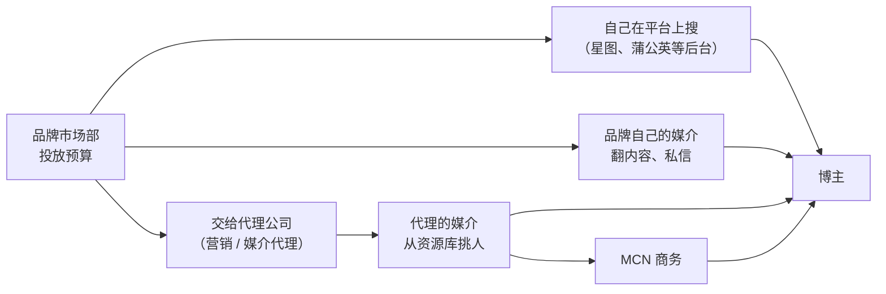

# 商单的类型与品牌方怎么选博主

很多下班做内容的开发者，第一次收到品牌私信时的反应是两种：要么兴奋地马上答应，要么怀疑是骗子直接不回。两种都不对。商单（品牌付钱请你做内容）是中小博主最常见、也最稳定的一种变现方式，但它是一门生意：有固定的品类、固定的买家逻辑、固定的流程和坑。

这本书讲的就是这门生意的全流程：

| 章 | 讲什么 |
|---|---|
| 本章 | 商单有哪几种、品牌方花钱买的到底是什么、他们用什么标准挑博主 |
| 官方平台 | 星图、蒲公英、花火、互选、磁力聚星：入驻、接单、服务费、结算 |
| 第一单 | 小博主的门槛、怎么主动出击、媒介 / MCN / 代理是什么角色 |
| 报价 | 用 CPM / CPE 倒推价格、刊例价、议价、打包，附报价单模板 |
| brief 与提案 | 把一份 brief 拆成可执行的要点，写脚本提案 |
| 制作与交付 | 修改轮次、审核节点、交付清单、数据回传 |
| 合同与结算 | 关键条款、违约、授权期限、开票和个税 |
| 长期合作 | 怎么让一次合作变成年框，怎么积累口碑 |
| MCN | 签不签、合同里常见的坑 |

不在本书范围内的：带货佣金（见《带货与选品》）、直播间的玩法（见《直播实战》）、内容本身怎么做（见《选题与爆款结构》《短视频脚本与分镜》）、广告法和财税的完整讲解（见《自媒体与短剧合规财税》）。

## 品牌方买的是什么

先换位思考。品牌方的市场部每年有一笔「达人营销」（也叫 KOL / KOC 投放）预算，这笔钱要换回下面几样东西中的一样或几样：

| 品牌想要的 | 用什么衡量 | 对你意味着什么 |
|---|---|---|
| **曝光**：让更多人看到 | 播放量、阅读量、CPM（每千次曝光成本） | 你的稳定播放量是定价基础 |
| **互动与种草**：让人记住、产生兴趣 | 点赞评论收藏、CPE（每次互动成本）、评论区提及率 | 粉丝是否真的信任你 |
| **搜索与口碑沉淀**：别人搜品牌时能看到好评 | 笔记被搜索到的次数、长尾播放 | 小红书、B 站的内容寿命长，有优势 |
| **转化**：直接卖货、拉新 | 点击、下单、ROI、CPA（每次转化成本） | 风险转移给你，常见于「保底 + 佣金」 |
| **素材**：拿你的视频去投广告 | 素材在信息流里的点击率和转化 | 涉及授权，单独谈钱（第 7 章） |

**同一个博主，面对不同目标的品牌，价值完全不同**。一个 3 万粉、每条稳定 2 万播放、评论区很活跃的程序员博主：对想要大曝光的快消品牌来说几乎没有价值；对一家卖机械键盘、开发者工具或者编程课的品牌来说，他的评论区就是最精准的目标人群。

所以接商单的第一个认知是：**你不是在卖粉丝数，是在卖「某一类人的注意力和信任」**。粉丝少不可怕，人群模糊才可怕。人群怎么定、怎么做垂直，见《账号定位与对标拆解》。

## 商单的六种类型

行业里叫法很多，归纳起来是下面六类。它们的区别在于：内容由谁主导、品牌占多大比重、对你要求多高、价格怎么算。

| 类型 | 是什么 | 品牌占比 | 制作成本 | 价格参照 |
|---|---|---|---|---|
| **植入** | 正常内容里插入一段口播或画面，常见 15–60 秒 | 低 | 低 | 刊例价的下档，一般按「植入」单独报价 |
| **定制** | 整条内容围绕品牌或产品策划 | 高 | 高 | 刊例价的标准档（多数平台的「1–20 秒 / 21–60 秒 / 60 秒以上」按时长分档就是定制） |
| **测评** | 以使用体验为主线，讲优缺点 | 中到高 | 中，要真实使用 | 定制档；涉及多款对比时更高 |
| **种草** | 小红书式的体验分享、好物推荐，常为图文 | 中 | 低到中 | 图文、视频分别报价 |
| **直播** | 进直播间讲产品、挂链接，按场或按小时 | 高 | 中，占用时间多 | 坑位费 + 佣金，见《直播实战》《带货与选品》 |
| **全案** | 一段时间内多条内容 + 直播 + 素材授权的组合 | 高 | 高 | 打包价，第 4 章 |

几个容易混淆的点：

- **植入和定制不是看时长，是看主次**。一条 5 分钟的教程里插 40 秒键盘口播，是植入；一条 40 秒的视频专门演示这把键盘，是定制。品牌会想用植入的价格买定制的内容，报价时要先确认是哪种
- **测评有底线**：广告法要求代言人对没有使用过的商品不得推荐、证明（《广告法》第三十八条）。收了钱的测评首先是广告，需要标注；「客观测评」的人设和「收了钱」不冲突，冲突的是隐瞒（第 6 章讲标注）
- **「置换」也是一种商单**：品牌只送产品不给钱。早期可以接，但要算清楚：一条内容你要花的时间，按你的时薪值多少钱？产品你本来会买吗？置换同样需要做广告标注
- **「纯佣」不是商单**：只给佣金、不给固定费用的，本质是带货分销，风险全在你身上。可以做，但别把它当商单算收入

## 品牌方怎么找到你

品牌方找博主有三条路，你需要知道每条路上的「筛选器」是什么。

1. **品牌自己在平台后台搜**：星图、蒲公英这类平台对品牌开放了达人库，可以按类目、粉丝量、粉丝画像、报价、历史数据筛选。这条路上，你在后台的**标签、报价、历史合作数据**决定能不能被搜到
2. **代理公司 / 媒介**：大品牌的达人投放多数外包给营销代理，代理里的「媒介」岗位负责找博主、谈价、跟进执行。媒介手上有一份 Excel 资源库，你要做的是进入这份表
3. **品牌自己的媒介直接私信**：中小品牌、新消费品牌常见。他们翻内容找人，看到合适的直接私信或发邮件

第 3 章会讲怎么让这三条路上的人找到你。

## 品牌方用什么标准挑人

不管哪条路，挑人的逻辑大同小异。下面这张表是一个典型的媒介筛选表的列，按重要性排：

| 维度 | 他们看什么 | 你能做什么 |
|---|---|---|
| **人群匹配** | 粉丝画像（性别、年龄、地域、兴趣）、评论区是不是目标用户 | 保持垂直；评论区多和目标人群互动 |
| **近期数据** | 最近 10–20 条的播放 / 阅读中位数（不是平均数，也不是最高那条）、互动率 | 稳定比爆款重要；别让近期数据断崖 |
| **商单数据** | 历史商单的播放和互动，相对自然内容掉了多少 | 商单也要用心做，第 8 章 |
| **性价比** | 报价 ÷ 预期播放 = CPM；报价 ÷ 预期互动 = CPE | 报价要能用这两个数解释，第 4 章 |
| **内容调性** | 画面质感、表达风格、有没有负面争议 | 账号主页像「作品集」 |
| **配合度** | 回复速度、改稿态度、是否按时交付 | 每次合作都在积累口碑 |
| **风险** | 账号是否有违规记录、是否有争议言论、粉丝是否异常（刷量） | 不刷量、不碰红线 |

两个细节值得单独说：

**中位数，不是平均数**。媒介和品牌越来越懂行，会拉你近 20 条内容的数据，去掉最高和最低，看中间水平。一条爆款 50 万播放、其余都在 3000，你的「真实水平」是 3000。所以报价时别拿爆款说事。

**商单掉量率**。同一个博主，商单内容的播放往往比自然内容低一截：平台对报备内容的推荐有自己的逻辑，用户对广告也天然划走得快。品牌会在意你的商单相对自然内容掉多少。掉得越少，你越值钱。做法在第 5、6 章：让商单首先是一条好内容。

## 刷量与数据造假：别碰

小博主最大的诱惑是：粉丝和播放不够，品牌不来，于是买粉、刷播放、刷评论。这条路的结局几乎是确定的：

- 平台风控能识别异常流量，轻则内容限流、商单权限冻结，重则封号。小红书蒲公英曾对评级为「异常」的账号冻结接单权限
- 品牌和代理有第三方数据工具，粉丝画像异常（比如大量无头像、零作品的粉丝）一眼就能看出来；被发现后会进代理圈的黑名单，而代理圈很小
- 合同里通常有「数据真实性」条款，刷量属于违约，要退款甚至赔偿（第 7 章）

真实的 3000 播放比虚假的 3 万播放值钱，因为只有前者能复购。

## 小博主的现实预期

最后说清楚预期，免得接单后失望：

- **商单收入和粉丝量不是线性关系**。更接近的是：商单价格 ≈ 稳定播放量 × 赛道的 CPM 行情。垂直赛道（数码、母婴、美妆、教育、金融、汽车）CPM 高，泛娱乐低
- **前几单可能是置换或低价单**。它们的作用是让你有「商单案例」可以展示，不是挣钱
- **商单会挤占自然内容的产能**。一个下班做内容的人，每周能产出 2–3 条已经不错。如果一半是商单，账号的自然增长会放缓。经验法则：商单不超过总内容的三分之一，见第 8 章
- **最稳的收入是复购**。一个品牌一年合作 4 次，比 4 个品牌各合作 1 次省力得多

## 本章要点

- 品牌买的是曝光、互动、搜索沉淀、转化或素材中的一样或几样；同一个博主对不同目标的品牌价值完全不同
- 你卖的是「某一类人的注意力和信任」，人群越清晰越值钱
- 商单分植入、定制、测评、种草、直播、全案六类；植入和定制按内容主次区分，不按时长；置换要算时间成本，纯佣不是商单
- 品牌找人有三条路：平台后台搜、代理媒介、品牌自己私信；筛选看人群匹配、近期播放中位数、商单数据、性价比、调性、配合度、风险
- 不要刷量。真实数据才能复购
- 商单收入约等于稳定播放 × 赛道 CPM；商单占比别超过内容的三分之一
