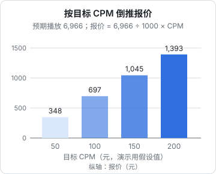

# 报价

「一条多少钱」是商单里最让人心虚的问题。网上流传的「粉丝数 × 几分钱」「一万粉报几百」都是没有出处的经验数字，不同赛道、不同平台、不同年份差好几倍，照搬只会报错。

这一章不给你一个「行情价」，因为没有可靠的公开数据。我们讲**算法**：品牌方怎么评估你的报价贵不贵（CPM、CPE），你怎么用这套逻辑倒推出一个有依据的报价，再加上成本底线、刊例价、议价和打包。最后给报价单模板。

## 品牌怎么看你的报价

品牌和代理的投放表里，每个博主旁边都会算两个数：

$$
\text{CPM} = \frac{\text{报价}}{\text{预期播放}} \times 1000
$$

$$
\text{CPE} = \frac{\text{报价}}{\text{预期互动}}
$$

- **CPM**（Cost Per Mille，每千次曝光成本）：花多少钱买 1000 次播放 / 阅读。品牌拿它和自己在信息流广告、其他博主上的 CPM 对比
- **CPE**（Cost Per Engagement，每次互动成本）：花多少钱买一次点赞、评论、收藏或转发。种草类合作更看重它
- 有转化目标的还会算 **CPA**（每次转化成本）和 **ROI**（投入产出比），但这需要链接和追踪，小博主的单子里少见

「预期播放」品牌怎么估？用你**近期内容的播放中位数**，再根据你历史商单的表现打个折。所以你的报价贵不贵，取决于：**报价 ÷ 你的稳定播放**。

品牌心里有一个可接受的 CPM / CPE 区间（来自他们过往投放的数据、代理给的基准、同类博主的报价）。这个区间不公开，因行业、平台、季节差别很大：美妆、3C、汽车、金融、教育的品牌预算充足，可接受的 CPM 高；大促前后（618、双 11）预算集中，价格也会上浮。

**你要做的，是让你的报价落在他们可接受的区间里，并且能讲出依据。**

## 倒推法：从数据到报价

### 第一步：算你的预期播放

```text
预期播放 = 近期播放中位数 × 商单系数
```

- **近期播放中位数**：最近 15–20 条同类型内容（视频算视频、图文算图文）的播放 / 阅读，排序后取中间那个
- **商单系数**：你历史商单播放 ÷ 同期自然内容播放中位数。没有商单历史时，先保守取一个小于 1 的值（比如 0.8），接几单后用自己的真实数据替换

为什么要打折？商单内容的完播和互动通常比自然内容弱一些。如实打折，品牌会觉得你懂行；不打折，数据回传时一对比，下次就不找你了。

### 第二步：算互动

```text
预期互动 = 预期播放 × 近期互动率
近期互动率 = 近期内容（点赞 + 评论 + 收藏 + 转发）总和 ÷ 播放总和
```

### 第三步：拿到品牌的目标区间

最直接的办法是问。对品牌媒介可以这样问：

```text
想了解一下这次投放的考核口径：主要看播放（CPM）还是互动（CPE）？
有目标值的话方便透露一下吗？我按这个评估一下我这边能不能做到。
```

很多媒介会说。拿不到的话，用两种方法估：

1. **看同类博主的平台报价**：星图等平台的达人报价对品牌公开，你可以用品牌视角（或请做投放的朋友）看和你同领域、同量级博主的报价和数据，算出他们的隐含 CPM
2. **用你自己的成交记录**：每成交一单，算一次实际 CPM 和 CPE，记在表里。三五单之后你就有自己的基准

### 第四步：算报价

```text
CPM 报价 = 预期播放 ÷ 1000 × 目标 CPM
CPE 报价 = 预期互动 × 目标 CPE
```

### 完整示例

一个程序员效率工具博主，抖音近 20 条视频数据（截至写报价当天）：

| 项 | 数值 |
|---|---|
| 播放中位数 | 8,600 |
| 互动率 | 6.2% |
| 历史商单 3 单，播放分别为 7,100 / 6,500 / 7,300；同期自然内容中位数 8,600 | 商单系数 ≈ 6,967 ÷ 8,600 ≈ 0.81 |

计算：

```text
预期播放 = 8,600 × 0.81 ≈ 6,966
预期互动 = 6,966 × 6.2% ≈ 432
```

假设媒介透露的考核口径是「CPM 不高于 X 元」。不同 X 对应的报价：



这张图里的 CPM 只是演示公式用的假设值，不代表任何行业行情。要点是：**报价和你的预期播放、品牌的目标 CPM 成正比**。播放翻倍，报价可以翻倍；品牌能接受的 CPM 低，你就只能报低。

如果这一单考核的是互动，假设目标 CPE 是 Y 元，报价就是 432 × Y。同一个博主，互动率高时按 CPE 算更划算，互动率低时按 CPM 算更划算。**这也是互动率比粉丝数更值钱的原因。**

## 成本底线法：低于这个数不接

倒推法告诉你品牌愿意付多少，成本法告诉你自己最低要收多少：

```text
底线价 = 工时 × 你的时薪 + 硬成本 + 平台服务费 + 预留税费
```

| 项 | 怎么算 | 示例 |
|---|---|---|
| 工时 | 第 3 章那张时间表，按这一单的形式估 | 定制视频 15 小时 |
| 时薪 | 至少不低于你本职工作的时薪；也可以是「你愿意放弃一个晚上换多少钱」 | 假设 100 元 / 小时 |
| 硬成本 | 道具、场地、外拍交通、请人帮忙、素材授权 | 200 元 |
| 平台服务费 | 星图达人侧 5% 等，见上一章 | 按报价的 5% |
| 预留税费 | 个人接单按平台代扣口径估；个体户、公司按你的税负率估 | 按 10% 预留，汇算时多退少补 |

示例：

```text
底线价 × (1 − 5% − 10%) = 15 × 100 + 200
底线价 = 1,700 ÷ 0.85 ≈ 2,000 元
```

如果倒推法算出来只有 700，说明**这个品牌按这个口径不值得你做定制**。可以：改成植入（工时少一半）、改成图文、或者拒绝。

两种方法放在一起：

| 情况 | 怎么办 |
|---|---|
| 倒推价 ＞ 底线价 | 按倒推价报，留出议价空间 |
| 倒推价 ≈ 底线价 | 可以接，但不让价，或只做让价换条件 |
| 倒推价 ＜ 底线价 | 换形式、换范围，或拒绝 |

第一单可以低于底线价，作为获得案例的投资；但要有意识，并且写清楚是「首次合作优惠」。

## 刊例价：你的公开价目表

刊例价（rate card）是你对外公开的标准价格，平台后台填的、资料卡里写的都是它。它的作用是**锚定**：所有谈判都从这里开始。

刊例价按形式和时长分档。一份典型刊例：

| 形式 | 规格 | 刊例价 | 说明 |
|---|---|---|---|
| 定制视频 | 60 秒以内 | A | 整条围绕品牌，含脚本、拍摄、剪辑、1 轮脚本修改 + 1 轮成片修改 |
| 定制视频 | 60 秒以上 | A × 1.3 | 同上 |
| 植入 | 视频内 30 秒以内口播 + 画面 | A × 0.5 | 主题由博主定，品牌确认植入段落 |
| 图文笔记 | 小红书 6–9 图 | B | 含文案、拍图，1 轮修改 |
| 视频笔记 | 小红书 1 分钟内 | B × 1.5 | |
| 平台分发 | 同一内容同步到第二个平台 | 第二平台刊例的 50% | 需第二平台也报备 |

A、B 用倒推法算出来：A ≈ 你主力平台的预期播放 × 你成交过的 CPM 中位数，再上浮 20%–30% 作为议价空间；B 同理。倍数关系（1.3、0.5、1.5）是一个示例结构，你按自己的工时差异调整。

刊例价的规则：

- **一个价目，对所有人一样**。媒介之间会交流，同样的东西给不同人报不同价，很快会被发现
- **定期调整，不频繁调整**。每季度根据近期中位数和成交情况调一次；数据涨了就涨价，数据跌了也要诚实下调
- **涨价提前通知老客户**，并给已经在谈的单子保留原价
- **平台报价和线下报价口径一致**。平台报价里是否含服务费，看平台规则；如果是对公签合同，写明含税还是不含税

## 议价：可以让，但要换

品牌说「贵了」几乎是必然的。原则和任何 B2B 谈判一样：**每一次让价都要换回点什么**。

| 你让的 | 换回的 |
|---|---|
| 价格降 10%–15% | 档期由你定（不加急） |
| 价格降一些 | 减少修改轮次（只改 1 轮） |
| 价格降一些 | 不授权投流、不授权品牌二次使用 |
| 价格降一些 | 多条打包、签季度框架 |
| 价格降一些 | 品牌加热：品牌出钱给这条内容投流（对你的账号有长期好处） |
| 送一次平台分发 | 一次性预付全款 |

不能做的让步：

- 只因为对方说「贵」就降价。先问「您是和哪个报价比的？」，弄清楚对方的口径
- 降到底线价以下而且不是有意识的投资
- 「这次便宜点，下次给你涨回来」。下次不会涨回来
- 用私下打款、不走平台、不开票来「省服务费」换低价。这既违反平台规则，也让你失去全部保障

议价话术：

```text
品牌：预算有限，能不能 ×× 元？

你：我的报价是按近期播放中位数算的，CPM 大约在 ×× 元，
    这个价格下内容质量和修改我都能保证。
    如果预算确实只有 ×× 元，我们可以调整一下形式：
    做成 30 秒植入，或者成片只改一轮、不做投流授权，这样我可以接受。
    您看哪种更合适？
```

把选择权给对方，但每个选项都是「降价 + 减范围」的组合。

## 附加项：这些要单独收钱

品牌常常把下面这些东西「默认」塞进一单里。它们每一项都有成本或机会成本，要么单独报价，要么明确写「不含」：

| 附加项 | 为什么要收钱 | 常见做法 |
|---|---|---|
| **投流 / 素材授权** | 品牌用你的视频去投广告，曝光远超你自己的账号，且占用你的肖像 | 按授权期限和渠道单独报价，第 7 章 |
| **竞品排他** | 一段时间内不能接同类品牌，等于放弃收入 | 按排他期长度加价 |
| **内容保留期** | 要求内容至少保留 N 个月不删 | 一般可接受；超过 1 年的要求要谈 |
| **置顶** | 占用你主页最好的位置 | 按天或按周计 |
| **加急** | 打乱你的生产节奏 | 加价，或者拒绝 |
| **额外修改轮次** | 每轮都要时间 | 按轮计价 |
| **多平台分发** | 等于多发一条内容 | 第二平台刊例的一定比例 |
| **评论区置顶 / 挂链接** | 链接涉及带货佣金、转化考核 | 单独说明 |
| **原片、工程文件** | 品牌拿去自己改 | 一般不给；要给就单独报价 |

## 打包报价

多条、多平台、长期合作时用打包价。打包价的结构：

```text
打包价 = Σ 各单项刊例价 × (1 − 打包折扣) + 附加项
```

打包折扣的来源是**你真实节省的成本**：一次沟通、一次拍多条、一次对账，以及确定的收入。没有节省就不该有折扣。

示例（数字为演示用）：

| 项 | 数量 | 刊例单价 | 小计 |
|---|---|---|---|
| 抖音定制视频（60 秒内） | 3 | 3,000 | 9,000 |
| 小红书图文笔记 | 3 | 1,200 | 3,600 |
| 单项合计 | | | 12,600 |
| 打包折扣 15%（一次拍摄、季度内完成、预付 50%） | | | −1,890 |
| 投流授权（3 条抖音视频，3 个月，仅品牌官方账号投放） | | | +2,000 |
| **合计** | | | **12,710** |

打包合作的注意事项：

- **按条结算或分期付款**，不要全部做完才付。常见做法是签约预付一部分，每条交付后按比例付
- 写明**每条的档期**，品牌拖延确认时不影响你后面的排期
- 写明**中途终止**怎么算：已完成的按单价结算，未完成的不收

## 报价单模板

平台内下单的，报价以平台为准；线下签合同的合作、打包合作、或品牌要求书面报价时，用这份模板：

```text
合作报价单
报价编号：BD-20261103-01        报价日期：2026-11-03
有效期至：2026-11-17

致：××科技有限公司 市场部（对接人：×××）
博主：×× 的效率工具箱（抖音 @××，小红书 @××）

一、合作内容
| 序号 | 平台 | 形式 | 规格 | 数量 | 单价（元） | 小计（元） |
| 1 | 抖音 | 定制视频 | 60 秒内，横 / 竖屏任选 | 1 | 3,000 | 3,000 |
| 2 | 小红书 | 图文笔记 | 6–9 图 | 1 | 1,200 | 1,200 |
合计：4,200 元

二、包含
  脚本 / 文案撰写；拍摄与剪辑；脚本修改 1 轮、成片修改 1 轮；
  通过平台报备发布（星图指派 / 蒲公英合作笔记）；
  发布后 7 天、30 天各回传一次数据截图。

三、不包含（如需另行报价）
  投流 / 素材授权；竞品排他；额外修改轮次；加急；
  原片和工程文件；其他平台分发；线下活动出席。

四、档期
  确认 brief 后 3 个工作日内交脚本；脚本确认后 7 个工作日内交成片；
  发布日期双方协商，品牌确认成片后 3 个工作日内发布。

五、结算
  平台内订单：按平台规则结算。
  线下合同：签约后预付 50%，发布后 7 个工作日内付清余款；
  报价为含税价 / 不含税价（二选一写明），可开具 ×× 发票。

六、说明
  内容将按平台规定标注合作 / 广告标识；
  内容需符合广告法和平台规范，博主有权拒绝无法证实的功效宣传；
  本报价有效期内有效，逾期需重新确认档期和价格。
```

这份模板的重点在「不包含」和「档期」两节。第 6、7 章会反复回到这里。

## 记一张成交表

每一单（包括没谈成的）都记下来，这是你下一次报价的依据：

下面用一单示例说明每一列记什么：

| 字段 | 示例 |
|---|---|
| 日期 | 2026-10-12 |
| 品牌 | 品牌 A |
| 形式 | 定制 |
| 报价 | 3,000 |
| 成交价 | 2,600 |
| 预期播放 | 6,900 |
| 实际播放（7 天） | 7,300 |
| 实际 CPM | 356 |
| 实际互动 | 480 |
| 实际 CPE | 5.4 |
| 工时 | 14 |
| 时薪 | 186 |
| 备注 | 换条件：不做投流授权 |

完整的表头和这行示例放在下面，复制到表格软件里，每一单一行：

```csv
日期,品牌,形式,报价,成交价,预期播放,实际播放（7 天）,实际 CPM,实际互动,实际 CPE,工时,时薪,备注
2026-10-12,品牌 A,定制,3000,2600,6900,7300,356,480,5.4,14,186,换条件：不做投流授权
```

（实际 CPM = 2,600 ÷ 7,300 × 1000 ≈ 356；时薪 = 2,600 ÷ 14 ≈ 186，这里没扣服务费和税，记表时你可以统一按到手价算。）

三个月后回头看这张表，你会清楚地知道：哪类品牌给得起价、你的商单系数是多少、你的真实时薪是多少、该不该涨价。

## 本章要点

- 没有可靠的公开「行情价」，不要照搬网上的粉丝单价；用品牌的评估逻辑倒推
- 品牌看 CPM（报价 ÷ 预期播放 × 1000）和 CPE（报价 ÷ 预期互动）；预期播放 = 近期中位数 × 商单系数
- 倒推价决定品牌愿意付多少，成本底线价（工时 × 时薪 + 硬成本 + 服务费 + 税费）决定你最低收多少；倒推价低于底线就换形式或拒绝
- 刊例价按形式和时长分档，对所有人一致，每季度按数据调整
- 议价时每次让价都换回条件：档期、修改轮次、授权范围、打包、预付；不用「绕开平台省服务费」换价格
- 投流授权、竞品排他、加急、额外修改、多平台分发、原片都要单独报价或写明不含
- 每一单记成交表：实际 CPM、CPE、商单系数、时薪，作为下一次报价的依据
