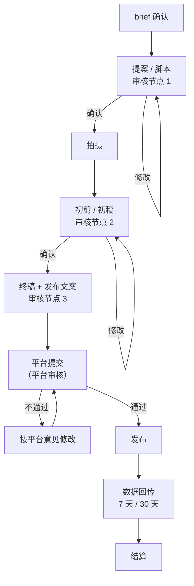

# 制作、过审与交付

提案确认后进入制作。这一阶段的难点不在拍摄剪辑本身（那是[《拍摄与剪辑实务》](../shooting-editing/)的事），而在**和品牌的协作**：什么时候给对方看、看几次、怎么算一轮修改、什么算交付完成、发完之后还要做什么。这些事情没定清楚，一单合作可以拖上一个月。

## 全流程与审核节点



三个品牌审核节点 + 一个平台审核节点：

| 节点 | 品牌看什么 | 你要交什么 |
|---|---|---|
| 1 提案 / 脚本 | 方向、结构、卖点、话术 | 第 5 章的脚本提案 |
| 2 初稿 | 画面、节奏、产品露出、口播是否准确 | 带字幕的完整粗剪，可以有水印 |
| 3 终稿 | 最终版本和发布文案 | 成片 + 发布文案 + 封面 |
| 平台审核 | 平台检查内容是否符合广告和社区规范 | 在平台上提交 |

**为什么要把节点 1 和 2 分开？** 因为方向性的修改在脚本阶段改只花一小时，到成片阶段改要重拍。节点 1 的意义就是把大改动拦在拍摄之前。

**为什么初稿要带水印？** 防止品牌在没结算的情况下拿走成片。这在线下合作里尤其重要；平台内的订单有托管，风险小一些。

## 修改轮次：怎么定义「一轮」

合同和报价单里写「含 2 轮修改」，但如果不定义清楚什么算一轮，品牌可以一条一条地发意见，每条都说「这只是一个小改动」。

定义「一轮修改」：

```text
一轮修改指：品牌方在一次反馈中，以书面形式（邮件、平台留言或微信文字）
集中提出的全部修改意见；博主按该意见完成修改并交付新版本，即为一轮。
同一轮中，品牌方在博主交付新版本前追加的意见，并入该轮；
博主交付新版本后提出的意见，计入下一轮。
```

另外几条规则写进报价单或合同：

- **修改不包括推翻重来**：已确认的脚本，在成片阶段要求改方向、改结构，视为新需求，另行报价
- **合规修改不计轮次**：为满足广告法、平台规则做的修改，你有义务配合，不计入轮次
- **你的错误不计轮次**：口播说错了参数、字幕错字，是你的问题，改了不算
- **超出轮次的修改**：按单价的一定比例收费，或协商

实际操作时，**每次交付都要求对方「一次性给出全部意见」**：

```text
v2 初稿已发您，链接：××（有效期 7 天）
麻烦这次把所有修改意见一次性整理给我，我统一修改。
按我们约定，成片阶段含 2 轮修改，这是第 1 轮。
希望 11-10 前收到反馈，这样能赶上 11-12 发布。
```

## 制作中的几件事

### 样品

- **收到即拍开箱**：包装、配件、序列号，留底。如果样品有问题（瑕疵、不是最新版本），立刻告知品牌
- **真实使用**：广告法要求代言人对没有使用过的商品不得推荐、证明（《广告法》第三十八条）。测评、体验类内容至少要真正用过；brief 里给的使用时长和你实际不符，以实际为准
- **归还还是留用**：提前确认。需要归还的写清楚时间和快递费谁出

### 画面和声音素材

- **品牌提供的素材**（官方图、产品视频、logo）：确认授权范围是「用于本次合作内容」
- **你自己用的素材**：背景音乐、字体、他人画面，商单比普通内容的版权风险更高，因为它是商业用途。平台提供的商用音乐库、免费商用字体，用之前看清楚授权范围。完整讲解见[《自媒体与短剧合规财税》](../media-compliance/)
- **出镜的其他人**：同事、朋友、路人入镜，商单里要取得他们同意。肖像权的问题第 7 章讲

### 话术自检

> [!WARNING]
> 下表的条款号按截至 2026-11 现行的《广告法》整理，法律修订后条款号和要求可能变化，以国家法律法规数据库的原文和市场监管总局的最新规定为准。

成片交付前，用第 5 章的 Must / Don't 表逐项打勾，再过一遍下面的通用禁区：

| 类别 | 例子 | 依据 |
|---|---|---|
| 绝对化用语 | 最好、第一、顶级、全网最低、100% | 《广告法》第九条 |
| 无依据的数据和对比 | 「比 ×× 安静 50%」（无出处） | 《广告法》第十一条 |
| 贬低其他产品 | 「××键盘就是垃圾」 | 《广告法》第十三条 |
| 功效、疗效承诺 | 「用了这个颈椎病好了」 | 《广告法》第十七条等 |
| 收益承诺 | 「学完这门课保证涨薪」「年化收益」 | 《广告法》第二十四条、第二十五条 |
| 未使用就推荐 | 「我用了三个月」（实际三天） | 《广告法》第三十八条 |

广告法条文的具体解读和不同品类（食品、化妆品、教育、金融等）的特殊要求，见[《自媒体与短剧合规财税》第 2 章](../media-compliance/02-advertising.md)。你不必成为法律专家，但要有一个基本判断：**说出来的每一句关于产品的话，你能拿出依据吗？**

## 广告标注：每一单都要做

> [!WARNING]
> 本节按《广告法》和 2023-05-01 施行的《互联网广告管理办法》整理，平台的标注入口和要求也会调整；以市场监管总局发布的规定原文和各平台商单后台的当前规则为准。

收了钱（或收了产品）的推广内容就是广告。《广告法》第十四条要求广告应当具有可识别性，能够使消费者辨明其为广告；《互联网广告管理办法》进一步要求，通过知识介绍、体验分享、消费测评等形式推销商品或者服务，并附加购物链接等购买方式的，广告发布者应当显著标明「广告」。

实际做法：

| 合作方式 | 标注怎么做 |
|---|---|
| 平台内订单（星图、蒲公英、花火、互选、磁力聚星） | 平台会自动给内容打上合作 / 广告标识；按平台要求发布，不要删掉或遮挡 |
| 线下合同合作、置换合作 | 按所在平台的要求进行商业内容声明（多数平台有「添加商业合作声明」之类的发布选项）；同时在文案或画面中标明「广告」或「合作」 |

不要做的：

- 用「谢谢 ×× 的支持」「×× 赞助」这种模糊说法代替标注
- 把标注藏在文案最后、折叠区、或画面一闪而过
- 品牌说「不要标，标了没人看」时妥协

坦白说，标注确实会让一部分观众划走。但被平台或监管认定为未标注的商业推广，后果比少几千播放严重得多；而且观众知道你会标注，对你的「没标注的推荐」才会更信任。这是长期口碑的一部分（第 8 章）。

## 平台审核不通过

平台审核不通过时，平台会给出原因。常见的：

| 原因 | 处理 |
|---|---|
| 违规用语（绝对化、功效） | 改话术或字幕；重新提交 |
| 资质问题（品牌未提供某类产品的资质） | 通知品牌补资质；这不是你的责任，延误时间顺延 |
| 内容与任务不符 | 对照任务要求检查；必要时联系品牌 |
| 画面问题（未成年人、危险动作、他人肖像） | 剪掉或打码 |
| 音乐版权 | 换成平台商用曲库中的音乐 |

**品牌已确认的内容被平台打回**，修改不计入你的修改轮次；如果是品牌坚持的话术导致的，在沟通记录里写清楚。

## 交付清单

发布前，把下面这张清单发给品牌，并逐项确认：

```text
【交付确认】×× 键盘 × ×× 的效率工具箱

□ 终稿版本：v3（2026-11-10 确认），时长 58 秒，竖屏 1080×1920
□ Must 项自检：8/8 已满足（附自检表）
□ 发布平台与账号：抖音 @××
□ 发布方式：星图指派任务（订单号：××）
□ 发布时间：2026-11-12 19:00
□ 发布文案：凌晨写代码终于不吵人了 #程序员的键盘# @××官方
□ 封面：已确认（附图）
□ 合作标识：平台自动添加
□ 评论区：发布后 1 小时内由博主回复首批评论；不置顶品牌链接（未约定）
□ 内容保留期：至少 6 个月不删除、不隐藏（按约定）
□ 数据回传：发布后第 7 天、第 30 天
□ 样品处理：留用 / 11-20 前寄回（运费品牌承担）
□ 素材授权：本次不含投流授权（如需另行签订）
```

清单的作用：

1. **让双方对「交付完成」有同一个定义**。清单里的事做完，就是交付完成，可以进入结算
2. **把容易被忘记的约定写出来**：评论区怎么处理、保留多久、样品怎么办、授权给不给

## 发布后

### 发布当天

- 按约定时间发布，发布后把链接发给品牌
- 前一两个小时关注评论区：回复真诚的问题；对产品的质疑**如实回答**，不知道的就说不知道，或者问品牌后再回复
- **不刷数据**：不让朋友集中点赞，不买评论。前面讲过，刷数据是违约，而且会被识别
- 品牌如果要投流加热，确认用的是平台官方工具，在你的授权范围内

### 数据回传

品牌在平台后台通常能直接看到订单数据，但很多品牌（尤其代理）需要你提供截图做报告。约定好回传时间和内容，到时间主动发：

```text
【数据回传】×× 键盘 × ×× 的效率工具箱
发布时间：2026-11-12 19:00    统计截至：2026-11-19 19:00（发布后 7 天）
链接：××

| 指标 | 数值 |
| 播放 | 7,320 |
| 完播率 | 31% |
| 点赞 | 386 |
| 评论 | 62 |
| 收藏 | 104 |
| 转发 | 27 |
| 互动率 | 7.9% |
| 平均播放时长 | 21 秒 |

评论区摘要：
- 约 1/3 的评论在问静音效果，有 5 条问「Mac 上能不能改键」
- 2 条负面：觉得外观普通；问价格（已按约定回复「等首发」）
- 有 3 条提到「去搜了」

附：后台数据截图 3 张
```

（上面的数字是示例。互动率 = (386 + 62 + 104 + 27) ÷ 7,320 ≈ 7.9%。回传前用公式核对一遍，别手抄错数字。）

**评论区摘要**是这份回传里最有价值、品牌最喜欢、但大部分博主不做的部分。它让品牌知道用户真实在想什么，下一次 brief 就会写得更好，也更愿意再找你。

### 数据不好怎么办

不是每一单都会达到预期。播放明显低于预期时：

1. **先找原因**：选题、钩子、发布时间、平台流量波动、内容被限流（看后台是否有违规提示）
2. **如实告诉品牌**，带上你的分析和改进思路。不要等品牌来问
3. **不要偷偷刷量补数据**
4. 如果合同里有「保量」条款（保证播放不低于某值，未达到就补发或退款），按合同执行。**小博主尽量不接保量单**，你无法控制平台的推荐

## 品牌要求删除或修改已发布内容

偶尔会发生：品牌发现产品信息有误、品牌内部政策变化、出现舆情，要求你删除或修改。

- 有合规问题的（比如发现说法违规），**配合删改**，这也保护你自己
- 品牌自身原因要求删除的，按合同处理：已经完成的交付，费用照付
- 删除前确认数据已经回传、结算已经确认，避免「内容没了，钱也没了」

## 本章要点

- 三个品牌审核节点（脚本、初稿、终稿）+ 平台审核；方向性修改要拦在脚本阶段；线下合作的初稿带水印
- 写清「一轮修改」的定义：一次性书面集中提出；推翻重来另算，合规修改和你自己的错误不计轮次
- 真实使用样品；商单的素材、音乐、字体、他人肖像版权风险更高；话术用 Must / Don't 表和广告法禁区自检
- 每一单都要做广告标注：平台订单不要遮挡平台标识，线下合作用平台的商业声明并标明「广告」
- 用交付清单定义「交付完成」：版本、发布时间、文案、标识、评论区、保留期、数据回传、样品、授权
- 发布后按时回传数据并附评论区摘要；数据不好如实说明，不刷量；小博主尽量不接保量单
