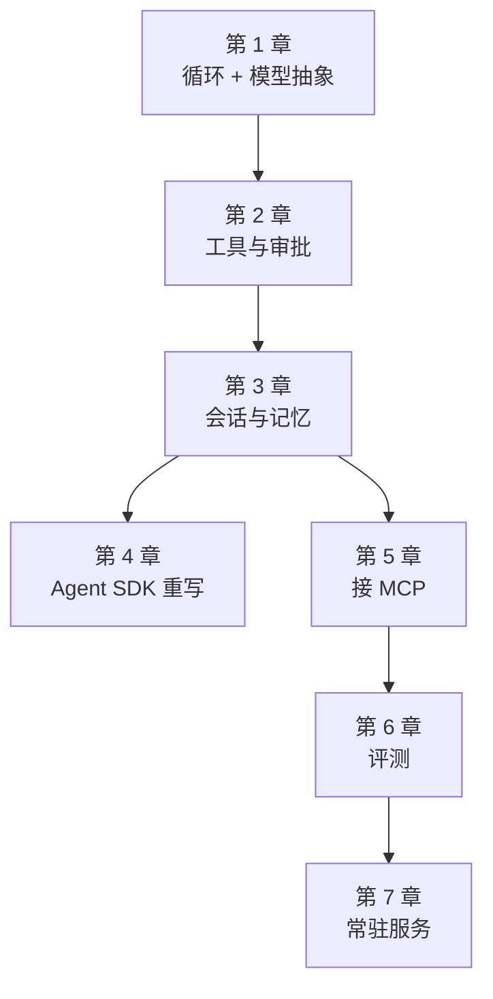
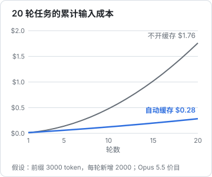

# 最小 agent loop

[《Agent 原理与设计》第 2 章](../agent-principles/02-agent-loop.md)用不到 70 行代码讲清了 agent loop 的原理。这本书接着往下走：把那个骨架写成一个**能长期维护的工程**。这一章先把地基打好：项目结构、把模型抽象成一个可替换的函数、处理完所有停止原因的循环，以及不调 API 也能跑的测试。后面六章都在这个地基上加东西。

## 这本书讲什么、适合谁、怎么读

全书用 TypeScript 从零写一个 agent，叫 `shelf-agent`：hatch-shelf 书库的维护助手。它能读书、搜索、改文件、跑 `shelf-pack check` 校验，最后作为常驻服务跑在服务器上，每晚自动检查书库，也能随时接任务。选这个案例是因为它小而完整：有只读操作也有写操作，有现成的「编译器」（校验工具）当反馈信号，还能接上[《工具设计与 MCP》](../tools-and-mcp/)里写好的 `shelf-books` MCP server。



适合已经读过[《Agent 原理与设计》](../agent-principles/)、熟悉 TypeScript 和 Node 的读者。原理只在需要时点一句，详细的讨论分别在[《上下文工程》](../context-engineering/)《工具设计与 MCP》[《评测与质量》](../llm-evals/)里，这里不重复。

建议按顺序读，边读边敲。第 4 章是一条岔路：它用 Agent SDK 把前三章的东西重写一遍，读完你会知道什么时候该自己写、什么时候该用现成的。第 5 章以后回到手写版本。

### 版本

> [!WARNING]
> 下表版本和书中用到的 beta 标识（`context-management-2025-06-27`、`clear_tool_uses_20250919`、`compact-2026-01-12` / `compact_20260112`、`stop_reason: "compaction"`）按 2026 年 11 月 npm registry 的发布记录和 `@anthropic-ai/sdk` 1.3.0、`@anthropic-ai/claude-agent-sdk` 0.3.316 自带的类型定义核对过。核对时两者已分别发布到 1.4.0 和 0.3.318，beta 标识也在持续增加（例如更新的压缩 beta `compact-2026-09-04`）。升级前看各自的更新日志，模型参数以 Anthropic 官方文档为准。

agent 相关的 SDK 变化很快。本书代码在下面这些版本上通过了类型检查和测试：

| 依赖 | 版本 | 用在 |
|---|---|---|
| Node | 22 | 全书 |
| TypeScript | 6.0 | 全书 |
| `@anthropic-ai/sdk` | 1.3.0 | 第 1–3、5–7 章，调用 Messages API |
| `zod` | 4.6.7 | 工具参数 |
| `@anthropic-ai/claude-agent-sdk` | 0.3.316 | 第 4 章 |
| `@modelcontextprotocol/client` | 2.4.0 | 第 5 章，MCP 规范 2026-07-28 |
| `vitest` | 5.0 | 测试 |

模型默认用 `claude-opus-5-5`，可以用环境变量 `AGENT_MODEL` 换掉。模型名、价格、参数以 Anthropic 官方文档为准。

## 项目骨架

`shelf-agent` 放在 hatch-shelf 仓库的 `tools/` 下，和 `shelf-pack`、`shelf-mcp` 并列，作为 pnpm workspace 的一个包：

```text
tools/shelf-agent/
├── package.json
├── tsconfig.json
└── src/
    ├── model.ts        # 模型抽象（本章）
    ├── fake-model.ts   # 测试用的假模型（本章）
    ├── loop.ts         # agent loop（本章，第 2 章扩展）
    ├── tools.ts        # 工具定义与工作区（第 2 章）
    ├── memory.ts       # 会话与长期笔记（第 3 章）
    ├── mcp.ts          # MCP 工具接入（第 5 章）
    ├── eval.ts         # 评测（第 6 章）
    ├── server.ts       # HTTP 服务（第 7 章）
    └── cli.ts          # 命令行入口
```

`package.json`：

```json
{
  "name": "shelf-agent",
  "version": "0.1.0",
  "private": true,
  "type": "module",
  "scripts": {
    "agent": "tsx src/cli.ts",
    "typecheck": "tsc --noEmit",
    "test": "vitest run"
  },
  "dependencies": {
    "@anthropic-ai/sdk": "1.3.0",
    "zod": "^4.6.7"
  },
  "devDependencies": {
    "@types/node": "^22",
    "tsx": "^4.23.15",
    "typescript": "~6.0.3",
    "vitest": "^5.0.5"
  }
}
```

`@anthropic-ai/sdk` 写死版本而不是用 `^`：agent 代码对 SDK 的类型和行为很敏感，升级要有意识地做，跑一遍测试再合并。`tsconfig.json` 继承仓库的基础配置，加上 Node 类型即可：

```json
{
  "extends": "../../tsconfig.base.json",
  "compilerOptions": { "types": ["node"] },
  "include": ["src"]
}
```

## 把模型抽象成一个函数

第一个设计决定：**循环不直接依赖 Anthropic 客户端，而是依赖一个 `Model` 函数**。

```typescript
// src/model.ts
import Anthropic from "@anthropic-ai/sdk";

// 全书统一用 beta 命名空间的类型：第 3 章的上下文编辑只在 beta 接口上，
// Agent SDK 吐出的 assistant 消息也是 BetaMessage，两边能对上
export type Message = Anthropic.Beta.BetaMessage;
export type MessageParam = Anthropic.Beta.BetaMessageParam;
export type Tool = Anthropic.Beta.BetaTool;
export type ToolUseBlock = Anthropic.Beta.BetaToolUseBlock;
export type ToolResultBlockParam = Anthropic.Beta.BetaToolResultBlockParam;
export type Usage = Anthropic.Beta.BetaUsage;

/** 循环每一轮交给模型的东西 */
export interface ModelRequest {
  system: string;
  tools: Tool[];
  messages: MessageParam[];
}

/** 模型 = 一个异步函数。真模型、假模型、录制回放都实现它 */
export type Model = (req: ModelRequest, signal?: AbortSignal) => Promise<Message>;

export interface AnthropicModelOptions {
  model?: string;
  effort?: "low" | "medium" | "high" | "xhigh" | "max";
  maxTokens?: number;
}

export function anthropicModel(opts: AnthropicModelOptions = {}): Model {
  const client = new Anthropic(); // 凭证从环境变量 ANTHROPIC_API_KEY 等读取
  const model = opts.model ?? process.env.AGENT_MODEL ?? "claude-opus-5-5";
  return async (req, signal) => {
    // 流式请求避免长输出触发 HTTP 超时；只要最终结果时用 finalMessage()
    const stream = client.beta.messages.stream(
      {
        model,
        max_tokens: opts.maxTokens ?? 32000,
        thinking: { type: "adaptive" },
        output_config: { effort: opts.effort ?? "high" },
        cache_control: { type: "ephemeral" }, // 自动缓存：每轮重发的前缀按缓存价计费
        system: req.system,
        tools: req.tools,
        messages: req.messages,
      },
      { signal },
    );
    return stream.finalMessage();
  };
}
```

这个抽象换来三样东西：

- **可测试**：测试里传一个按剧本回复的假模型，不花钱、不联网、结果确定（本章最后一节）
- **可录制回放**：在真模型外面包一层，把请求和回复存下来，以后原样回放（第 6 章）
- **可替换**：换厂商、换模型、加降级链，只改这一个文件

几个参数的取舍：

| 参数 | 取值 | 为什么 |
|---|---|---|
| `thinking` | `adaptive` | 让模型自己决定每步想多少。Opus 5.5 上思考不能关闭，深浅由 `effort` 控制 |
| `output_config.effort` | `high` | Opus 5.5 的默认是 `medium`；agent 任务多步、要自己纠错，值得多想。简单任务可以降到 `low` 省钱 |
| `cache_control` | 顶层 `ephemeral` | 自动在最后一个可缓存块上打缓存断点。agent 每轮都重发整个历史，缓存几乎是免费的大幅降本 |
| 流式 + `finalMessage()` | | `max_tokens` 较大时，非流式请求可能撞上 HTTP 超时；这里不需要逐字输出，等最终消息即可 |

## 第一版循环

```typescript
// src/loop.ts（第一版，第 2 章会扩展）
import type { Message, MessageParam, Model, Tool, ToolResultBlockParam, ToolUseBlock } from "./model";

export interface AgentTool {
  def: Tool;
  run(input: unknown): Promise<string>;
}

export interface RunOptions {
  model: Model;
  system: string;
  tools: AgentTool[];
  task: string;
  maxTurns?: number;
}

export type StopKind = "done" | "max_turns" | "max_tokens" | "refusal";

export interface RunResult {
  stop: StopKind;
  text: string;
  messages: MessageParam[];
  turns: number;
  usage: { input: number; output: number; cacheRead: number };
}

export async function runAgent(opts: RunOptions): Promise<RunResult> {
  const { model, system, tools, maxTurns = 30 } = opts;
  const byName = new Map(tools.map((t) => [t.def.name, t]));
  const messages: MessageParam[] = [{ role: "user", content: opts.task }];
  const usage = { input: 0, output: 0, cacheRead: 0 };
  let text = "";

  for (let turn = 1; turn <= maxTurns; turn++) {
    const res: Message = await model({ system, tools: tools.map((t) => t.def), messages });
    usage.input += res.usage.input_tokens;
    usage.output += res.usage.output_tokens;
    usage.cacheRead += res.usage.cache_read_input_tokens ?? 0;

    messages.push({ role: "assistant", content: res.content });
    text = res.content.flatMap((b) => (b.type === "text" ? [b.text] : [])).join("\n");

    switch (res.stop_reason) {
      case "tool_use":
        break;
      case "pause_turn":
        continue;
      case "max_tokens":
      case "model_context_window_exceeded":
        return { stop: "max_tokens", text, messages, turns: turn, usage };
      case "refusal":
        return { stop: "refusal", text, messages, turns: turn, usage };
      default:
        return { stop: "done", text, messages, turns: turn, usage };
    }

    const results: ToolResultBlockParam[] = [];
    for (const call of res.content.filter((b): b is ToolUseBlock => b.type === "tool_use")) {
      const tool = byName.get(call.name);
      try {
        if (!tool) throw new Error(`没有名为 ${call.name} 的工具`);
        results.push({ type: "tool_result", tool_use_id: call.id, content: await tool.run(call.input) });
      } catch (e) {
        results.push({ type: "tool_result", tool_use_id: call.id, content: String(e), is_error: true });
      }
    }
    messages.push({ role: "user", content: results });
  }
  return { stop: "max_turns", text, messages, turns: maxTurns, usage };
}
```

和《Agent 原理与设计》里的骨架相比，多了三件事：返回值告诉调用方**为什么停**；累计 token 用量；把每一种停止原因都处理到。

### 停止原因要逐个处理

`stop_reason` 不是只有「调工具」和「结束」两种。漏掉任何一种，agent 都会在某个时候静悄悄地出错：

| `stop_reason` | 含义 | 循环怎么做 |
|---|---|---|
| `tool_use` | 模型要调用工具 | 执行工具，结果回填，进入下一轮 |
| `end_turn` | 模型认为说完了 | 正常结束 |
| `pause_turn` | 服务端工具（如网页搜索）跑了很久，先暂停 | 把回复原样追加后**再发一次**，让它接着跑 |
| `max_tokens` | 输出被 `max_tokens` 截断 | 停下来报告。截断的回复里可能有半个工具调用，不能执行 |
| `model_context_window_exceeded` | 上下文窗口用满了 | 同上；第 3 章讲怎么避免走到这一步 |
| `refusal` | 安全分类器拒绝了这次请求 | 停下来报告，`stop_details` 里有类别 |
| `stop_sequence` | 命中自定义停止序列 | 本书没用到，按结束处理 |

把这些情况**作为返回值**交出去，而不是抛异常或者假装成功，调用方（命令行、HTTP 服务、评测）才能分别处理：命令行打印提示，服务把任务标为失败，评测把它计为不通过。

### 历史只追加，不修改

`messages.push({ role: "assistant", content: res.content })` 这一行看起来平淡，却有两层讲究：

1. **整个 `content` 原样放回**，而不是只取文字。`tool_result` 要靠 `tool_use_id` 对上前面的 `tool_use`；开了思考时，回复里还有 `thinking` 块，它们也要原样回传
2. **历史只追加，从不回头改**。新一代 Claude 模型的思考块绑定在产生它的那段对话上：如果之后的请求里 `system`、`tools` 或任何更早的消息和当时不一致，再回传这些思考块会被拒绝（2026-08-31 之后创建的账号默认强制检查，具体规则以官方文档为准）。即使不考虑这条，改历史也会让 prompt 缓存从改动点之后全部失效

第二点会影响后面好几章的设计：第 3 章不在客户端裁剪历史，而是用服务端的上下文编辑；第 5 章接 MCP 时工具列表在会话开始时就定下来，中途不增减。

### 错误也是结果

工具抛出的异常被变成 `is_error: true` 的 `tool_result` 交还给模型，而不是让整个循环崩掉。模型看到「没有名为 xxx 的工具」之后，通常会换一个存在的工具重试。第 2 章会把这一点做细：参数校验失败、路径越界、用户拒绝，都走同一条路。

## 第一个工具和入口

先接一个最简单的工具，让循环跑起来：

```typescript
// src/main-v1.ts
import { readdir } from "node:fs/promises";
import { anthropicModel } from "./model";
import { runAgent, type AgentTool } from "./loop";

const listBooks: AgentTool = {
  def: {
    name: "list_books",
    description: "列出 books/ 目录下所有书的 id（目录名）。",
    input_schema: { type: "object", properties: {} },
  },
  run: async () => (await readdir("books", { withFileTypes: true }))
    .filter((d) => d.isDirectory())
    .map((d) => d.name)
    .join("\n"),
};

const r = await runAgent({
  model: anthropicModel(),
  system: "你是 hatch-shelf 书库的助手。需要信息时先调用工具，不要猜。",
  tools: [listBooks],
  task: process.argv.slice(2).join(" ") || "书架上有几本书？",
});
console.log(r.text);
console.error(`[${r.stop}] ${r.turns} 轮，输入 ${r.usage.input}，缓存读 ${r.usage.cacheRead}，输出 ${r.usage.output}`);
```

在仓库根目录运行（`readdir("books")` 用的是当前目录）：

```bash
export ANTHROPIC_API_KEY=...   # 或者先用 ant auth login 登录
npx tsx tools/shelf-agent/src/main-v1.ts "人工智能/Agent 方向的书名里有哪些带 agent 的？"
```

这个文件只是让第一版循环跑起来看看，第 2 章扩展了 `AgentTool` 之后可以删掉，入口换成 `cli.ts`。正常情况下是两轮：第一轮模型调用 `list_books`，第二轮根据目录名回答。最后一行的用量能帮你建立直觉：第二轮的输入里，system、工具定义和第一轮的内容都会被重发一次。

## 用假模型测试

真模型每跑一次都要花钱、要联网，结果还不确定。循环本身的逻辑（工具结果有没有回填、id 对不对、轮数上限是否生效）完全不需要真模型来验证。`Model` 只是一个函数，测试里换成一个按剧本回复的假模型：

```typescript
// src/fake-model.ts
import type Anthropic from "@anthropic-ai/sdk";
import type { Message, Model, ModelRequest } from "./model";

type Block = Anthropic.Beta.BetaTextBlock | Anthropic.Beta.BetaToolUseBlock;

/** 造一条假的模型回复。只填循环会读的字段 */
export function reply(
  content: Array<string | { tool: string; input: unknown; id?: string }>,
  stop?: Anthropic.Beta.BetaStopReason,
): Message {
  let n = 0;
  const blocks: Block[] = content.map((c) =>
    typeof c === "string"
      ? ({ type: "text", text: c, citations: null } as Anthropic.Beta.BetaTextBlock)
      : ({ type: "tool_use", id: c.id ?? `toolu_${++n}`, name: c.tool, input: c.input } as Anthropic.Beta.BetaToolUseBlock),
  );
  const hasTool = blocks.some((b) => b.type === "tool_use");
  return {
    id: "msg_fake",
    type: "message",
    role: "assistant",
    model: "fake",
    content: blocks,
    stop_reason: stop ?? (hasTool ? "tool_use" : "end_turn"),
    stop_sequence: null,
    usage: { input_tokens: 100, output_tokens: 20 },
  } as unknown as Message;
}

/** 按顺序吐出预先写好的回复；可以传函数，根据收到的请求决定回复 */
export function scriptedModel(
  script: Array<Message | ((req: ModelRequest) => Message)>,
): Model & { requests: ModelRequest[] } {
  const requests: ModelRequest[] = [];
  const model = async (req: ModelRequest) => {
    // 深拷贝：循环之后还会往 messages 里追加，测试要看当时的快照
    requests.push(structuredClone(req));
    const next = script[requests.length - 1];
    if (!next) throw new Error(`脚本只有 ${script.length} 步，模型被调用了第 ${requests.length} 次`);
    return typeof next === "function" ? next(req) : next;
  };
  return Object.assign(model, { requests });
}
```

`requests` 记下了模型每次收到的请求，测试可以检查「第二次请求里，最后一条消息是不是工具结果」：

```typescript
// src/loop.test.ts
import { expect, it } from "vitest";
import { reply, scriptedModel } from "./fake-model";
import { runAgent, type AgentTool } from "./loop";

const echo: AgentTool = {
  def: { name: "list_books", description: "", input_schema: { type: "object", properties: {} } },
  run: async () => "agent-principles\ncontext-engineering",
};

it("一次工具调用，然后回答", async () => {
  const model = scriptedModel([reply([{ tool: "list_books", input: {} }]), reply(["书架上有 2 本书。"])]);
  const r = await runAgent({ model, system: "s", tools: [echo], task: "几本书？" });
  expect(r).toMatchObject({ stop: "done", text: "书架上有 2 本书。", turns: 2 });
  expect(model.requests[1].messages).toHaveLength(3); // user → assistant(tool_use) → user(tool_result)
});
```

```bash
pnpm --filter shelf-agent test
```

这类测试验证的是**你的代码**，不是模型。模型会不会选对工具、会不会把事做对，是第 6 章评测的事。两者分开，前者每次提交都跑，几百毫秒；后者按需跑，要花钱。

## 一笔成本账

每轮都重发整个历史，单轮输入随轮数线性增长，累计输入按二次方增长，token 数的推导见[《上下文工程》第 1 章](../context-engineering/01-scarce-window.md#稀缺之一钱)。换成钱，再看缓存的作用：



图里的假设：system 加工具定义 3000 token，每轮新增 2000 token，按 2026 年 10 月官方价目里 Opus 5.5 的价格计算（输入每百万 token 4 美元，5 分钟缓存写入 5 美元，缓存读取 0.2 美元）。开缓存后，每轮只有新增的部分按写入价计费，之前的前缀都按读取价。价格会变，以官方价目为准，但「agent 必须开缓存」这个结论不会变。

缓存是前缀匹配：前缀里任何一个字节变了，后面全部失效。这又回到上一节的原则：**历史只追加，system 和工具定义在会话内不变**。

## 本章要点

- 循环依赖一个 `Model` 函数而不是具体客户端：测试用假模型，评测用录制回放，换厂商只改一处
- `stop_reason` 要逐个处理：`pause_turn` 继续，`max_tokens`、上下文溢出、`refusal` 停下并作为返回值交给调用方
- assistant 回复整条原样追加，**历史只追加不修改**：思考块的校验和 prompt 缓存都依赖这一点
- 工具异常变成 `is_error` 结果交还模型，循环不崩
- 用剧本式的假模型测试循环逻辑，快、免费、确定；模型能力留给评测
- agent 的累计输入按二次方增长，自动缓存能把输入成本降到几分之一

## 动手练习

1. **测轮数上限**：在 `loop.test.ts` 里加一个用例：假模型每一轮都要求调用 `list_books`，`maxTurns` 设为 3。

   ```typescript
   it("一直调工具就停在 maxTurns", async () => {
     const call = reply([{ tool: "list_books", input: {} }]);
     const model = scriptedModel([call, call, call]);
     const r = await runAgent({ model, system: "s", tools: [echo], task: "x", maxTurns: 3 });
     expect(r).toMatchObject({ stop: "max_turns", turns: 3 });
     expect(model.requests).toHaveLength(3);
   });
   ```

   验证：`pnpm --filter shelf-agent test` 通过；把 `maxTurns` 改成 4 再跑，测试报错「脚本只有 3 步，模型被调用了第 4 次」。

   参考答案：轮数上限是循环自己的保险丝，和模型说什么无关，所以用假模型就能完全验证。

2. **截断的回复不能执行**：造一条带工具调用、但 `stop_reason` 是 `max_tokens` 的回复，断言工具一次都没被执行。

   ```typescript
   it("max_tokens 截断时不执行工具", async () => {
     let ran = 0;
     const spy: AgentTool = { ...echo, run: async () => (ran++, "x") };
     const model = scriptedModel([reply([{ tool: "list_books", input: {} }], "max_tokens")]);
     const r = await runAgent({ model, system: "s", tools: [spy], task: "x" });
     expect(r.stop).toBe("max_tokens");
     expect(ran).toBe(0);
   });
   ```

   验证：测试通过；如果把循环里 `case "max_tokens"` 那两行删掉，测试失败（循环落到 `default` 被当成 `done`）。

   参考答案：被截断的回复里可能只有半个工具调用，参数不完整，执行它比停下来更危险。逐个处理 `stop_reason` 就是为了不让这类情况悄悄滑进「正常结束」。

3. **自己算一遍缓存账**：按本章的假设（system 加工具 3000 token，每轮新增 2000 token，输入 4 美元/百万，缓存写入 5 美元/百万，缓存读取 0.2 美元/百万）算 20 轮的累计输入成本。

   ```bash
   node -e 'let w=0,r=0; for(let n=1;n<=20;n++){ const prev=n===1?0:3000+2000*(n-2), total=3000+2000*(n-1); w+=total-prev; r+=prev }
   console.log(((w*5+r*0.2)/1e6).toFixed(2), (440000*4/1e6).toFixed(2))'
   ```

   验证：输出 `0.28 1.76`，和本章的图一致。

   参考答案：开缓存后每轮只有新增的 2000 token 按写入价计费，之前的前缀都按读取价；前提是前缀一个字节都不变，所以历史只追加、system 和工具定义在会话内不变。
