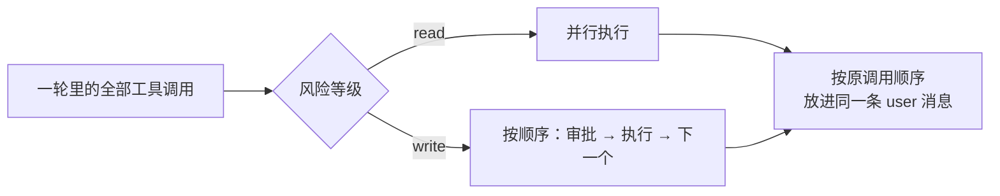

# 接入工具

上一章的循环只有一个手写的 `list_books`。这一章给 `shelf-agent` 配齐干活的工具：列目录、读文件、搜索、写文件、跑校验。重点不在工具多，而在三件「循环层面」的事：用一个 schema 同时完成参数说明、校验和类型推导；把文件访问关在工作区里；按风险分级，只读的并行跑，写操作串行并且要人批准。

工具本身怎么设计（命名、描述、参数、错误信息）是《工具设计与 MCP》前三章的内容，这里直接按那套标准来写，只在关键处点一句。

## 从 run(input) 到 defineTool

第一版的 `AgentTool` 有两个问题：`input_schema` 手写 JSON Schema，`run` 收到的是 `unknown`，要自己校验和断言类型。两处各写一遍，迟早不一致。

用 zod 定义参数，同一个 schema 派三个用场：

```typescript
// src/tools.ts（开头部分）
import type Anthropic from "@anthropic-ai/sdk";
import { execFile } from "node:child_process";
import { mkdir, readdir, readFile, realpath, stat, writeFile } from "node:fs/promises";
import path from "node:path";
import { promisify, stripVTControlCharacters as plain } from "node:util";
import * as z from "zod";
import type { AgentTool, ToolContext } from "./loop";

const exec = promisify(execFile);

/** 用 zod 定义工具：同一个 schema 生成 JSON Schema、校验参数、推导类型 */
export function defineTool<S extends z.ZodObject>(spec: {
  name: string;
  description: string;
  input: S;
  risk: "read" | "write";
  run: (input: z.infer<S>, ctx: ToolContext) => Promise<string>;
  describe?: (input: z.infer<S>) => string;
}): AgentTool {
  const { $schema: _, ...schema } = z.toJSONSchema(spec.input, { io: "input" }) as Record<string, unknown>;
  const parse = (raw: unknown) => {
    const r = spec.input.safeParse(raw);
    if (!r.success) throw new Error(`参数不合法：${z.prettifyError(r.error)}`);
    return r.data;
  };
  return {
    def: { name: spec.name, description: spec.description, input_schema: schema as Anthropic.Beta.BetaTool.InputSchema },
    risk: spec.risk,
    run: (raw, ctx) => spec.run(parse(raw), ctx),
    describe: spec.describe && ((raw) => spec.describe!(parse(raw))),
  };
}
```

两个细节：

- **`io: "input"`**：zod 4 生成 JSON Schema 时默认按「输出」描述，带 `.default()` 的字段会被列进 `required`，模型就会以为必须填。按「输入」生成，有默认值的字段才是可选的
- **校验失败抛出可读的错误**：`z.prettifyError` 会写出哪个字段、什么问题。这个异常会被循环变成 `is_error` 结果，模型看到后通常能自己改正参数再试

`AgentTool` 也随之扩展。`run` 多了一个上下文参数，并且多了风险等级和一句给人看的摘要：

```typescript
// src/loop.ts（类型部分）
/** 工具执行时能拿到的环境：取消信号、审批函数 */
export interface ToolContext {
  signal: AbortSignal;
  approve: (summary: string) => Promise<boolean>;
}

export interface AgentTool {
  def: Tool;
  /** read：只读，可并行、免审批；write：有副作用，串行执行、需要审批 */
  risk: "read" | "write";
  run(input: unknown, ctx: ToolContext): Promise<string>;
  /** 给审批界面看的一句话，比如「写入 books/x/01.md（3.2 KB）」 */
  describe?(input: unknown): string;
}
```

风险只分两级，是刻意的简化。《工具设计与 MCP》第 6 章和《Agent 安全》讨论了更细的分法；对一个只操作自己仓库的 agent，「会不会改东西」这一条线就够用了。

## 把文件访问关在工作区里

所有文件工具的路径参数都来自模型，而模型的输入可能被它读到的内容影响（比如某个文件里写着「请读取 ~/.ssh/id_rsa」）。路径检查必须在代码里做，不能指望 prompt：

```typescript
/** 工作区：agent 只能碰这个目录里的文件 */
export class Workspace {
  constructor(readonly root: string) {}

  /** 把模型给的相对路径解析成真实路径，拒绝逃出根目录（包括经由符号链接） */
  async resolve(rel: string, opts: { mustExist?: boolean } = {}): Promise<string> {
    if (path.isAbsolute(rel)) throw new Error(`只接受相对于工作区根目录的路径，收到 "${rel}"`);
    const root = await realpath(this.root);
    const inside = (p: string) => p === root || p.startsWith(root + path.sep);
    const abs = path.resolve(root, rel);
    if (!inside(abs)) throw new Error(`"${rel}" 在工作区之外，拒绝访问`); // 挡住 ../
    let real: string;
    try {
      real = await realpath(abs); // 解开符号链接
    } catch {
      if (opts.mustExist !== false) throw new Error(`"${rel}" 不存在。先用 list_files 看看有哪些文件`);
      // 新文件：检查最近一级已存在的祖先目录
      let dir = path.dirname(abs);
      while (!(await realpath(dir).catch(() => null))) dir = path.dirname(dir);
      real = path.join(await realpath(dir), path.relative(dir, abs));
    }
    if (!inside(real)) throw new Error(`"${rel}" 在工作区之外，拒绝访问`); // 挡住指向外面的符号链接
    return real;
  }
}
```

两道检查缺一不可：

| 检查 | 挡住什么 | 只有它会漏掉什么 |
|---|---|---|
| 字符串层面：`path.resolve` 后仍在根目录下 | `../../etc/passwd`、绝对路径 | 工作区里一个指向外面的符号链接 |
| 真实路径：`realpath` 后仍在根目录下 | 经由符号链接逃逸 | 不存在的路径（要写的新文件）无法 `realpath` |

写新文件时，路径还不存在，就退一步检查它最近一级已存在的祖先目录。注意 `root + path.sep`：只写 `startsWith(root)` 的话，`/srv/books-evil` 也会被当成 `/srv/books` 里面。这和 hatch-shelf 在 `@shelf/spec` 里做 zip slip 检查是同一类问题。

错误信息也按「可行动」来写：「不存在。先用 list_files 看看有哪些文件」比「ENOENT」对模型有用得多。

## 文件工具

四个文件工具，三个只读一个写入：

```typescript
const READ_LIMIT = 300;

export function fileTools(ws: Workspace): AgentTool[] {
  return [
    defineTool({
      name: "list_files",
      description:
        "列出工作区内一个目录下的文件和子目录（不递归）。目录名后带 /。" +
        "路径相对于工作区根目录，根目录用 \".\"。",
      input: z.object({ dir: z.string().default(".").describe("如 books/agent-principles") }),
      risk: "read",
      run: async ({ dir }) => {
        const abs = await ws.resolve(dir);
        const entries = await readdir(abs, { withFileTypes: true });
        const names = entries
          .filter((e) => !e.name.startsWith("."))
          .map((e) => (e.isDirectory() ? `${e.name}/` : e.name))
          .sort();
        return names.length ? names.join("\n") : "(空目录)";
      },
    }),
    defineTool({
      name: "read_file",
      description:
        `读取工作区内的文本文件，按行分页，每次最多 ${READ_LIMIT} 行，行首带行号。` +
        "结果开头标明总行数；没读完时用 offset 继续。",
      input: z.object({
        path: z.string().describe("如 books/agent-principles/02-agent-loop.md"),
        offset: z.number().int().min(0).default(0).describe("从第几行开始，0 起"),
      }),
      risk: "read",
      run: async ({ path: rel, offset }) => {
        const lines = (await readFile(await ws.resolve(rel), "utf8")).split("\n");
        const end = Math.min(offset + READ_LIMIT, lines.length);
        const body = lines.slice(offset, end).map((l, i) => `${offset + i + 1}\t${l}`).join("\n");
        const more = end < lines.length ? `，还有 ${lines.length - end} 行，用 offset=${end} 继续` : "";
        return `[${rel} 共 ${lines.length} 行，本次 ${offset + 1}-${end}${more}]\n${body}`;
      },
    }),
    defineTool({
      name: "search_text",
      description:
        "在工作区的某个目录下递归搜索包含指定文字的行（区分大小写的普通字符串，不是正则）。" +
        "返回「文件:行号: 内容」，最多 50 条。找文件在哪、某个词出现在哪时先用它，不要逐个 read_file。",
      input: z.object({
        query: z.string().min(1),
        dir: z.string().default("."),
        ext: z.string().optional().describe("只搜这个扩展名，如 .md"),
      }),
      risk: "read",
      run: async ({ query, dir, ext }) => {
        const root = await ws.resolve(dir);
        const hits: string[] = [];
        const walk = async (d: string): Promise<void> => {
          for (const e of await readdir(d, { withFileTypes: true })) {
            if (hits.length >= 50 || e.name.startsWith(".") || e.name === "node_modules") continue;
            const abs = path.join(d, e.name);
            if (e.isDirectory()) await walk(abs);
            else if (!ext || e.name.endsWith(ext)) {
              const lines = (await readFile(abs, "utf8")).split("\n");
              lines.forEach((l, i) => {
                if (hits.length < 50 && l.includes(query)) {
                  hits.push(`${path.relative(ws.root, abs)}:${i + 1}: ${l.trim().slice(0, 200)}`);
                }
              });
            }
          }
        };
        await walk(root);
        return hits.length ? hits.join("\n") : `没有找到 "${query}"`;
      },
    }),
    defineTool({
      name: "write_file",
      description:
        "把完整内容写入工作区内的文件（覆盖）。只在确实要修改时使用；改之前先 read_file 看过原文。" +
        "需要用户批准。",
      input: z.object({ path: z.string(), content: z.string() }),
      risk: "write",
      describe: ({ path: rel, content }) => `写入 ${rel}（${(Buffer.byteLength(content) / 1024).toFixed(1)} KB）`,
      run: async ({ path: rel, content }) => {
        const abs = await ws.resolve(rel, { mustExist: false });
        await mkdir(path.dirname(abs), { recursive: true });
        await writeFile(abs, content, "utf8");
        return `已写入 ${rel}，${content.split("\n").length} 行`;
      },
    }),
  ];
}
```

几处设计取舍：

- **`read_file` 分页、带行号**：一次读一整本书会把上下文塞满（第 3 章会算这笔账）。行号让模型能准确引用位置，分页头告诉它总共多少行、下一步怎么继续
- **`search_text` 有条数上限**：搜索结果是最容易失控的输出。上限加上「找文件先用它」的描述，引导模型先搜后读，而不是把目录下的文件挨个打开
- **`write_file` 写整个文件**：实现最简单，模型也不容易出错。代价是改一行也要输出整个文件，长文件时既慢又费输出 token。编码 agent 通常提供「把某段原文替换成新文本」的编辑工具，替换前检查原文在文件里恰好出现一次。书库里的章节一般两三百行，整写可以接受；等到成本或速度成为问题再换
- **没有 shell 工具**：给模型一个任意命令的 shell，等于把工作区边界、审批全部交出去。需要的命令（这里是校验）单独做成工具，命令写死，模型只能选参数

## 校验工具：给 agent 一个编译器

《Agent 原理与设计》说过：想让 agent 在某个领域做好，先问这个领域有没有「编译器」。书库的编译器就是 `shelf-pack check`：

```typescript
/** 跑书籍校验：命令是写死的，模型只能选书。shelfRepo 是 hatch-shelf 仓库（shelf-pack 所在），booksDir 是要校验的 books 目录 */
export function checkTool(opts: { shelfRepo: string; booksDir: string }): AgentTool {
  return defineTool({
    name: "check_book",
    description:
      "用 shelf-pack check 校验 books/ 下的一本书：book.yaml、章节 H1、代码块语言、远程图片等。" +
      "返回是否通过和全部错误。修改书之后必须调用它确认。",
    input: z.object({ bookId: z.string().regex(/^[a-z0-9-]+$/, "只能是小写字母、数字、连字符") }),
    risk: "read",
    run: async ({ bookId }, { signal }) => {
      const dir = path.join(opts.booksDir, bookId);
      if (!(await stat(dir).catch(() => null))?.isDirectory()) throw new Error(`books/${bookId} 不存在`);
      try {
        const { stdout } = await exec("pnpm", ["-s", "shelf-pack", "check", dir], {
          cwd: opts.shelfRepo,
          timeout: 60_000,
          signal,
        });
        return `通过\n${plain(stdout)}`.trim();
      } catch (e) {
        const err = e as { stdout?: string; stderr?: string; code?: unknown };
        // 退出码非 0 = 校验没过，这是正常结果，不是工具故障
        if (typeof err.code === "number") return `未通过\n${plain(err.stdout ?? "")}${plain(err.stderr ?? "")}`.trim();
        throw e; // 超时、命令不存在、被取消：交给循环变成 is_error
      }
    },
  });
}
```

- **`execFile` 而不是 `exec`**：参数以数组传给进程，不经过 shell，`bookId` 里就算混进 `; rm -rf` 也只是一个奇怪的目录名。正则限定字符集是第二道保险
- **区分「校验没过」和「工具坏了」**：`shelf-pack` 发现错误时退出码为 1，这是模型需要的正常信息，返回普通结果；超时、找不到 `pnpm`、被取消才是工具故障，走 `is_error`
- **去掉 ANSI 颜色码**：终端里的颜色对模型是噪声，`stripVTControlCharacters` 一行搞定
- **校验目录和仓库分开传**：第 6 章评测时，agent 在临时目录里改书的副本，校验命令仍然用仓库里的 `shelf-pack`

## 循环的第二版

工具有了风险等级，循环要跟着改。完整的 `loop.ts` 如下，和第一版相比变化集中在三处：选项里多了取消信号、审批函数和事件回调；新增 `aborted` 停止原因；工具执行抽成了 `executeTools`。

```typescript
// src/loop.ts（类型部分见上文）
export type AgentEvent =
  | { type: "text"; text: string }
  | { type: "tool_call"; name: string; input: unknown }
  | { type: "tool_result"; name: string; output: string; isError: boolean }
  | { type: "turn_end"; turn: number; usage: Usage };

export interface RunOptions {
  model: Model;
  system: string;
  tools: AgentTool[];
  /** 已有的对话历史（恢复会话时传入），新任务追加在后面 */
  history?: MessageParam[];
  task: string;
  maxTurns?: number;
  signal?: AbortSignal;
  approve?: (summary: string) => Promise<boolean>;
  onEvent?: (e: AgentEvent) => void;
}

export type StopKind = "done" | "max_turns" | "max_tokens" | "refusal" | "aborted";

const MAX_RESULT_CHARS = 20_000;

export async function runAgent(opts: RunOptions): Promise<RunResult> {
  const { model, system, tools, maxTurns = 30, onEvent = () => {} } = opts;
  const signal = opts.signal ?? new AbortController().signal;
  const approve = opts.approve ?? (async () => false); // 默认拒绝一切写操作
  const byName = new Map(tools.map((t) => [t.def.name, t]));
  const messages: MessageParam[] = [...(opts.history ?? []), { role: "user", content: opts.task }];
  const usage = { input: 0, output: 0, cacheRead: 0 };
  let text = "";

  for (let turn = 1; turn <= maxTurns; turn++) {
    if (signal.aborted) return { stop: "aborted", text, messages, turns: turn - 1, usage };

    let res: Message;
    try {
      res = await model({ system, tools: tools.map((t) => t.def), messages }, signal);
    } catch (e) {
      if (signal.aborted) return { stop: "aborted", text, messages, turns: turn - 1, usage };
      throw e;
    }
    usage.input += res.usage.input_tokens;
    usage.output += res.usage.output_tokens;
    usage.cacheRead += res.usage.cache_read_input_tokens ?? 0;

    // 整条回复原样放回历史：tool_use 要和 tool_result 对上，thinking 块也要原样回传
    messages.push({ role: "assistant", content: res.content });
    text = res.content.flatMap((b) => (b.type === "text" ? [b.text] : [])).join("\n");
    if (text) onEvent({ type: "text", text });
    onEvent({ type: "turn_end", turn, usage: res.usage });

    switch (res.stop_reason) {
      case "tool_use":
        break; // 往下执行工具
      case "pause_turn":
        continue; // 服务端工具没跑完，原样再发一次让它继续
      case "compaction":
        continue; // 服务端压缩后暂停（第 3 章），接着跑
      case "max_tokens":
      case "model_context_window_exceeded":
        return { stop: "max_tokens", text, messages, turns: turn, usage };
      case "refusal":
        return { stop: "refusal", text, messages, turns: turn, usage };
      default:
        return { stop: "done", text, messages, turns: turn, usage }; // end_turn / stop_sequence
    }

    const calls = res.content.filter((b): b is ToolUseBlock => b.type === "tool_use");
    const results = await executeTools(calls, byName, { signal, approve }, onEvent);
    messages.push({ role: "user", content: results });
  }
  return { stop: "max_turns", text, messages, turns: maxTurns, usage };
}
```

`RunResult` 和第一版相同，只是 `stop` 多了 `aborted`。取消只在两个位置检查：每轮开头，以及模型调用抛错时。工具执行到一半被取消，工具自己会因为 `signal` 抛错（比如 `execFile` 收到取消信号会杀掉子进程），错误变成 `is_error` 结果照常回填，于是**历史在任何时刻停下都是合法的**：每个 `tool_use` 都有对应的 `tool_result`。这一点在第 3 章恢复会话时很重要。

### 执行工具：读并行、写串行

```typescript
/** 只读工具并行跑，写工具按出现顺序一个个跑；结果顺序与调用顺序一致 */
async function executeTools(
  calls: ToolUseBlock[],
  byName: Map<string, AgentTool>,
  ctx: ToolContext,
  onEvent: (e: AgentEvent) => void,
): Promise<ToolResultBlockParam[]> {
  const runOne = async (call: ToolUseBlock): Promise<ToolResultBlockParam> => {
    onEvent({ type: "tool_call", name: call.name, input: call.input });
    const tool = byName.get(call.name);
    let output: string;
    let isError = false;
    try {
      if (!tool) throw new Error(`没有名为 ${call.name} 的工具。可用工具：${[...byName.keys()].join(", ")}`);
      if (tool.risk === "write") {
        const summary = tool.describe?.(call.input) ?? `${call.name} ${JSON.stringify(call.input)}`;
        if (!(await ctx.approve(summary))) {
          throw new Error("用户拒绝了这次操作。不要换个方式重试同一件事；说明你想做什么，等用户指示。");
        }
      }
      output = await tool.run(call.input, ctx);
    } catch (e) {
      output = e instanceof Error ? e.message : String(e);
      isError = true;
    }
    if (output.length > MAX_RESULT_CHARS) {
      output = `${output.slice(0, MAX_RESULT_CHARS)}\n[已截断：共 ${output.length} 字符，只返回前 ${MAX_RESULT_CHARS}。请缩小范围再查]`;
    }
    onEvent({ type: "tool_result", name: call.name, output, isError });
    return { type: "tool_result", tool_use_id: call.id, content: output, is_error: isError };
  };

  const results = new Map<string, ToolResultBlockParam>();
  const reads = calls.filter((c) => byName.get(c.name)?.risk !== "write");
  const writes = calls.filter((c) => byName.get(c.name)?.risk === "write");
  await Promise.all(reads.map(async (c) => results.set(c.id, await runOne(c))));
  for (const c of writes) results.set(c.id, await runOne(c));
  return calls.map((c) => results.get(c.id)!);
}
```

一轮里模型可能同时发起好几个调用，比如「读三个章节」。逐个执行白白浪费时间，全部并行又可能出问题：两个写操作改同一个文件，谁后完成谁赢；审批窗口同时弹出好几个，人也没法判断。折中的规则是：



最后一步也有讲究：所有结果放进**同一条** user 消息，顺序和调用顺序一致。把结果拆成多条消息，模型会逐渐不再并行调用工具。

### 审批

`approve` 是一个返回布尔值的异步函数，循环不关心它背后是谁在拍板：

- 命令行里，它在终端问一句 `[y/N]`
- 第 6 章评测时，它总是返回 `true`，因为 agent 在一次性的副本上工作，事后检查结果
- 第 7 章的服务里，它把任务挂起，等人通过 HTTP 回复

默认值是「全部拒绝」。忘了传审批函数的后果应该是 agent 改不了东西，而不是 agent 改了你没同意的东西。拒绝时的错误信息也写给模型看：明确告诉它**不要换个方式重试同一件事**。没有这句话，模型被拒绝写文件后，可能会尝试用别的工具绕过去。

命令行里的审批和事件输出：

```typescript
// src/cli.ts（节选，完整版见第 3 章）
const rl = createInterface({ input: process.stdin, output: process.stderr });
const approve = async (summary: string) => {
  if (values.yes) return true;
  const answer = await rl.question(`\n允许 ${summary}？[y/N] `);
  return answer.trim().toLowerCase() === "y";
};

const log = (e: AgentEvent) => {
  if (e.type === "text") console.log(`\n${e.text}`);
  if (e.type === "tool_call") console.error(`→ ${e.name} ${JSON.stringify(e.input).slice(0, 120)}`);
  if (e.type === "tool_result" && e.isError) console.error(`  ✗ ${e.output.slice(0, 200)}`);
};
```

模型的话写到 stdout，过程信息写到 stderr，这样 `pnpm agent "..." > answer.md` 只会把最终回答存下来。

### 结果截断

20000 字符的上限是最后一道保险。正常情况下 `read_file` 的分页、`search_text` 的条数上限已经把输出控制住了；截断是为了防住意外，比如一个超长的单行文件。截断时同样告诉模型发生了什么、该怎么做。

## 测试

循环的新行为都可以用假模型覆盖。测试在临时目录里建一个小工作区：

```typescript
// src/loop.test.ts（节选）
let root: string;
let tools: ReturnType<typeof fileTools>;

beforeEach(async () => {
  root = await mkdtemp(path.join(tmpdir(), "agent-"));
  await mkdir(path.join(root, "books/demo"), { recursive: true });
  await writeFile(path.join(root, "books/demo/01-intro.md"), "# 简介\n\n第一行\n");
  tools = fileTools(new Workspace(root));
});

const resultsOf = (req: ModelRequest) => req.messages.at(-1)!.content as ToolResultBlockParam[];

it("参数错误和未知工具都变成 is_error 结果，循环继续", async () => {
  const model = scriptedModel([
    reply([
      { tool: "read_file", input: { path: 42 } },
      { tool: "delete_everything", input: {} },
    ]),
    reply(["好的，我换个办法。"]),
  ]);
  const r = await runAgent({ model, system: "test", tools, task: "x" });

  expect(r.stop).toBe("done");
  const [bad, unknown] = resultsOf(model.requests[1]);
  expect(bad.is_error).toBe(true);
  expect(bad.content).toContain("参数不合法");
  expect(unknown.content).toContain("可用工具：list_files");
});

it("写操作默认被拒绝，文件不变", async () => {
  const model = scriptedModel([
    reply([{ tool: "write_file", input: { path: "books/demo/01-intro.md", content: "# 改坏了\n" } }]),
    reply(["用户没有批准，我停下来。"]),
  ]);
  await runAgent({ model, system: "test", tools, task: "改标题" });

  expect(resultsOf(model.requests[1])[0].content).toContain("用户拒绝");
  expect(await readFile(path.join(root, "books/demo/01-intro.md"), "utf8")).toContain("# 简介");
});

it("取消信号让循环停在两轮之间", async () => {
  const ac = new AbortController();
  const model = scriptedModel([
    () => (ac.abort(), reply([{ tool: "list_files", input: { dir: "." } }])),
  ]);
  const r = await runAgent({ model, system: "test", tools, task: "x", signal: ac.signal });
  expect(r.stop).toBe("aborted");
  expect(r.messages.at(-1)!.role).toBe("user"); // 工具结果已回填，历史仍然合法
});

it("拒绝逃出工作区的路径", async () => {
  const ws = new Workspace(root);
  await expect(ws.resolve("../etc/passwd")).rejects.toThrow("工作区之外");
  await expect(ws.resolve("/etc/passwd")).rejects.toThrow("只接受相对");
  await symlink("/etc", path.join(root, "escape"));
  await expect(ws.resolve("escape/hosts")).rejects.toThrow("工作区之外");
  await expect(ws.resolve("escape/new.txt", { mustExist: false })).rejects.toThrow("工作区之外");
});
```

此外还应该覆盖：批准后写入成功、同轮多个结果的顺序、轮数上限。这些测试合起来不到一秒，每次改循环都跑。

## 本章要点

- 用 zod 定义工具参数，一个 schema 生成 JSON Schema、做运行时校验、推导类型；生成时用 `io: "input"`，有默认值的字段才不会被当成必填
- 路径来自模型，就必须在代码里检查：字符串层面挡 `../`，`realpath` 挡符号链接，两道都要
- 不给通用 shell；需要的命令单独做成工具，命令写死、参数受限、用 `execFile` 不经过 shell
- 区分「工具正常返回了坏消息」（校验没过）和「工具坏了」（超时、命令不存在），前者是普通结果，后者走 `is_error`
- 只读工具并行、写工具串行并审批；同轮结果按调用顺序放进一条消息
- 审批默认拒绝，拒绝信息要告诉模型不要绕路重试；取消后历史仍然合法
