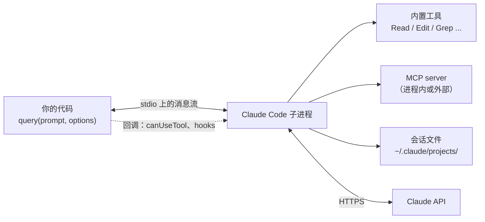
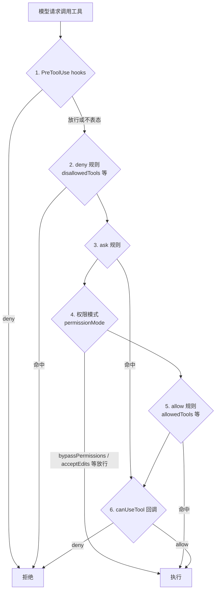
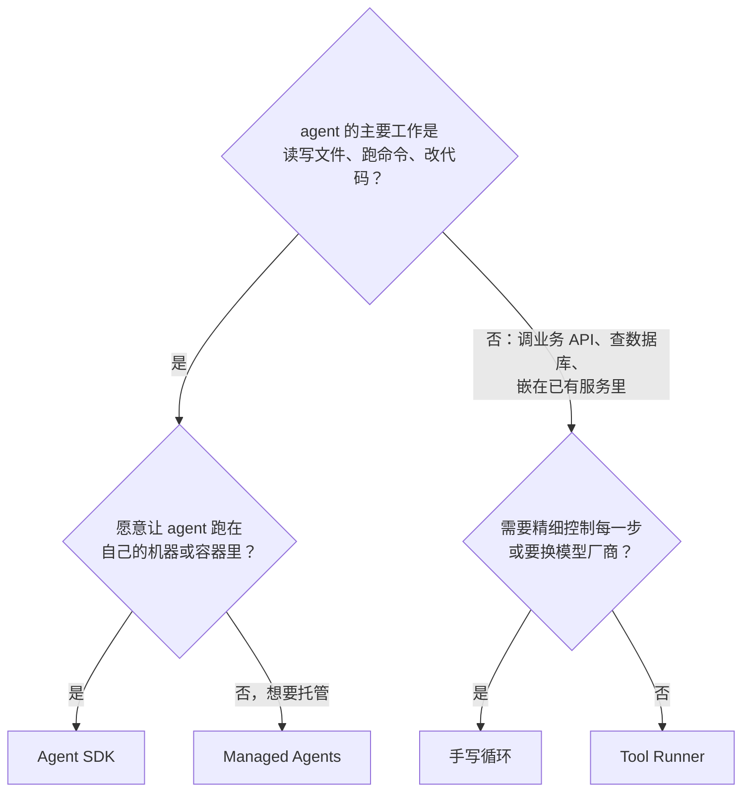

# 用 Agent SDK 重写

前三章手写了循环、工具、审批、会话和上下文管理，总共几百行。这一章换一种做法：用 Anthropic 的 Claude Agent SDK 把同一个 `shelf-agent` 重写一遍。它把 Claude Code 整个打包成一个库，循环、内置工具、权限、会话、上下文压缩都是现成的。

重写的目的不是推翻前面的代码，而是让你看清两件事：手写版本里每一块在 SDK 里对应什么；以及哪些场景该用 SDK，哪些场景值得自己写。读完这一章，后面几章回到手写版本继续。

本章基于 `@anthropic-ai/claude-agent-sdk` 0.3.316（2026-10-31 发布），它内置的 Claude Code 版本是 2.1.316。SDK 还在 0.x，小版本之间也可能有不兼容的变化，**写死版本号**，升级前看它的更新日志。

## Agent SDK 是什么

先分清三样名字相近的东西：

| | 是什么 | 循环谁写 | 内置工具 | 部署 |
|---|---|---|---|---|
| 手写循环（第 1–3 章） | 直接调用 Messages API | 你 | 没有，全是你定义的 | 你 |
| Tool Runner | `@anthropic-ai/sdk` 里的辅助函数 | SDK | 没有，全是你定义的 | 你 |
| Claude Agent SDK | Claude Code 打包成的库 | SDK | 读写文件、编辑、搜索、Bash、网页、子 agent | 你 |
| Managed Agents | Anthropic 托管的 agent 服务 | Anthropic | 托管沙箱里的 bash、文件等 | Anthropic |

Tool Runner 在《大模型应用工程》第 4 章介绍过，它只是替你写好了第 1 章那个循环。Agent SDK 不一样：调用 `query()` 时，它会**启动一个 Claude Code 子进程**，通过 stdio 和它通信。子进程拥有自己的工作目录、shell 和会话文件。你得到的是一个完整的 Claude Code，只是由代码而不是人来驱动。



SDK 包里自带对应平台的 Claude Code 可执行文件，版本和 SDK 绑定，升级 SDK 就是升级 Claude Code。Node 版本要求是 18.14 以上。

## 安装

```bash
pnpm --filter shelf-agent add @anthropic-ai/claude-agent-sdk@0.3.316 @modelcontextprotocol/sdk@^1.29
```

为什么还要装 `@modelcontextprotocol/sdk` 1.x？SDK 把它列为 peer 依赖：下面用来定义自定义工具的 `tool()` 和 `createSdkMcpServer()`，类型来自 MCP TypeScript SDK 的 1.x 版本。这和《工具设计与 MCP》以及第 5 章用的 2.x（`@modelcontextprotocol/server`、`@modelcontextprotocol/client`）是两个不同的包名，可以同时存在。协议层面它们是兼容的；区别只在写代码时的 API，最明显的一处是参数 schema 的写法，下面会看到。

## 对照表

| 手写版本 | Agent SDK |
|---|---|
| `runAgent()` 的循环 | `query({ prompt, options })`，返回消息的异步迭代器 |
| `anthropicModel()` 的模型和参数 | `options.model`、`options.effort`、`options.thinking` |
| `SYSTEM` | `options.systemPrompt`：自定义字符串，或 Claude Code 预设加追加内容 |
| `fileTools()` | 内置的 `Read`、`Glob`、`Grep`、`Edit`、`Write`，用 `options.tools` 选择给哪些 |
| `checkTool()` | `tool()` 定义，`createSdkMcpServer()` 包成进程内 MCP server |
| `Workspace` 的路径检查 | `options.cwd` 加 `PreToolUse` hook |
| `risk` 和 `approve` | `allowedTools`、`permissionMode`、`canUseTool` |
| `maxTurns`、取消信号 | `options.maxTurns`、`options.abortController`，另有 `maxBudgetUsd` |
| `SessionStore` | 内置会话持久化，`options.resume` 恢复 |
| 服务端上下文编辑 | Claude Code 自己的上下文压缩，不用配置 |
| `NOTES.md` | `settingSources` 加载项目的 `CLAUDE.md` |

## 重写

### 自定义工具

内置工具覆盖了读、写、搜索，`shelf-agent` 需要自己补的只有校验：

```typescript
// src/sdk-agent.ts
import {
  createSdkMcpServer,
  query,
  tool,
  type CanUseTool,
  type HookCallback,
  type SDKResultMessage,
} from "@anthropic-ai/claude-agent-sdk";
import { execFile } from "node:child_process";
import path from "node:path";
import { promisify, stripVTControlCharacters as plain } from "node:util";
import { z } from "zod";

const exec = promisify(execFile);
const REPO = path.resolve(process.env.SHELF_REPO ?? path.join(import.meta.dirname, "../../.."));

// 1. 自定义工具：SDK 把它包成一个进程内的 MCP server
const shelf = createSdkMcpServer({
  name: "shelf",
  version: "0.1.0",
  tools: [
    tool(
      "check_book",
      "用 shelf-pack check 校验 books/ 下的一本书，返回是否通过和全部错误。修改书之后必须调用它确认。",
      { bookId: z.string().regex(/^[a-z0-9-]+$/) }, // 注意：这里是 zod 的「原始形状」，不是 z.object
      async ({ bookId }) => {
        try {
          const { stdout } = await exec("pnpm", ["-s", "shelf-pack", "check", `books/${bookId}`], {
            cwd: REPO,
            timeout: 60_000,
          });
          return { content: [{ type: "text", text: `通过\n${plain(stdout)}` }] };
        } catch (e) {
          const err = e as { stdout?: string; code?: unknown };
          if (typeof err.code === "number") {
            return { content: [{ type: "text", text: `未通过\n${plain(err.stdout ?? "")}` }] };
          }
          return { content: [{ type: "text", text: String(e) }], isError: true };
        }
      },
      { annotations: { readOnlyHint: true } },
    ),
  ],
});
```

- 工具在 SDK 里一律是 **MCP 工具**。进程内的 server 不起子进程、不走网络，调用就是一次函数调用。模型看到的工具名是 `mcp__shelf__check_book`，即 `mcp__<server 名>__<工具名>`
- `tool()` 的第三个参数是 zod 的**原始形状**（一个普通对象，值是 zod 类型），不是 `z.object(...)`。这是 MCP SDK 1.x 的风格；《工具设计与 MCP》用的 2.x 要求完整的 `z.object`。两种写法别混
- 返回值是 MCP 的 `CallToolResult`：`content` 数组加可选的 `isError`。和第 2 章一样，「校验没过」是正常结果，只有工具本身故障才标 `isError`

### 护栏和审批

```typescript
// 2. 确定性的护栏：写文件只允许落在 books/ 下，不管模型怎么说
const onlyBooks: HookCallback = async (input) => {
  if (input.hook_event_name !== "PreToolUse") return {};
  const file = (input.tool_input as { file_path?: string }).file_path;
  if (file && !path.resolve(REPO, file).startsWith(path.join(REPO, "books") + path.sep)) {
    return {
      hookSpecificOutput: {
        hookEventName: "PreToolUse",
        permissionDecision: "deny",
        permissionDecisionReason: `只允许修改 books/ 下的文件，${file} 不在范围内`,
      },
    };
  }
  return {};
};

// 3. 没被前面规则放行的调用（这里就是 Edit / Write）走到这里，由人拍板
const askHuman = (approve: (summary: string) => Promise<boolean>): CanUseTool =>
  async (toolName, input) => {
    const file = (input as { file_path?: string }).file_path ?? "";
    return (await approve(`${toolName} ${path.relative(REPO, file)}`))
      ? { behavior: "allow", updatedInput: input }
      : { behavior: "deny", message: "用户拒绝了这次修改。不要换个方式重试；说明你想改什么，等用户指示。" };
  };
```

hook 和 `canUseTool` 都能拒绝工具调用，但用途不同，要理解 SDK 的权限判定顺序：



几条由此而来的结论：

- **hook 每次调用都会先跑**，而且它的 deny 在任何权限模式下都生效，所以「只能改 books/」这种必须守住的规则写在 hook 里。它相当于手写版本里的 `Workspace` 检查。注意示例只做了字符串层面的路径比较，没有处理符号链接；对安全要求更高的场景，参考第 2 章用 `realpath` 再查一遍
- **`allowedTools` 是「自动批准」，不是「只允许这些」**。没列出的工具照样可用，只是走到后面的步骤。要限制有哪些工具，用 `tools` 选择内置工具，或用 `disallowedTools` 把工具定义整个移除
- **被 `allowedTools` 放行的调用不会到达 `canUseTool`**。所以 `Edit`、`Write` 故意不放进 `allowedTools`，让它们落到审批回调。运行时 SDK 会打印一条 `CLAUDE_SDK_CAN_USE_TOOL_SHADOWED` 警告，提醒你 `Read` 等工具不会经过回调，这里正是我们想要的
- **无人值守时用 `permissionMode: "dontAsk"`**：所有本该询问的调用直接拒绝，不调用 `canUseTool`。比「不传回调」更明确
- **`bypassPermissions` 会放行所有工具**，包括没列在 `allowedTools` 里的。除非在一次性的沙箱里，不要用

### 组装

```typescript
export async function runSdkAgent(
  task: string,
  opts: { approve: (summary: string) => Promise<boolean>; resume?: string },
): Promise<SDKResultMessage> {
  const q = query({
    prompt: task,
    options: {
      cwd: REPO,
      model: process.env.AGENT_MODEL ?? "claude-opus-5-5",
      systemPrompt: {
        type: "preset",
        preset: "claude_code",
        append: "你在维护 hatch-shelf 书库。改书之后必须调用 check_book，没通过就继续修。",
      },
      settingSources: ["project"], // 读仓库里的 CLAUDE.md；不读用户级设置，行为可复现
      tools: ["Read", "Grep", "Glob", "Edit", "Write"], // 只给这几个内置工具，没有 Bash
      mcpServers: { shelf },
      allowedTools: ["Read", "Grep", "Glob", "mcp__shelf__check_book"], // 自动放行；Edit / Write 不在这里
      hooks: { PreToolUse: [{ matcher: "Edit|Write", hooks: [onlyBooks] }] },
      canUseTool: askHuman(opts.approve),
      maxTurns: 40,
      maxBudgetUsd: 2,
      resume: opts.resume,
    },
  });

  for await (const msg of q) {
    if (msg.type === "system" && msg.subtype === "init") {
      console.error(`会话 ${msg.session_id}，工具：${msg.tools.join(", ")}`);
    } else if (msg.type === "assistant") {
      for (const block of msg.message.content) {
        if (block.type === "text") console.log(block.text);
        if (block.type === "tool_use") console.error(`→ ${block.name} ${JSON.stringify(block.input).slice(0, 120)}`);
      }
    } else if (msg.type === "result") {
      return msg;
    }
  }
  throw new Error("没有收到 result 消息");
}
```

逐项看几个选项：

- **`systemPrompt`**：用 Claude Code 的预设，再追加一段自己的说明。预设里包含了 Claude Code 使用内置工具的全部经验，自己从头写很难写得更好。也可以传一个字符串完全自定义，那样就只剩一个很短的默认提示
- **`settingSources`**：不传时会加载用户级、项目级和本地的全部设置，你机器上的 `~/.claude/settings.json` 就会影响 agent 的行为，换台机器结果不同。这里只加载项目级，于是仓库的 `CLAUDE.md` 和 `.claude/settings.json` 生效。传空数组则完全隔离。第 3 章的 `NOTES.md` 在这里的对应物就是 `CLAUDE.md`
- **`maxBudgetUsd`**：按客户端估算的费用停止。估算可能超出设定值一点，留出余量
- **消息流**：`init` 消息告诉你实际可用的工具和 MCP server 连接状态，排查「工具为什么没出现」时先看它。`assistant` 消息里的 `message` 就是一条 Messages API 的 `BetaMessage`，和手写版本用的类型相同

### 命令行入口和结果处理

```typescript
// src/sdk-cli.ts
import { createInterface } from "node:readline/promises";
import { runSdkAgent } from "./sdk-agent";

const rl = createInterface({ input: process.stdin, output: process.stderr });
try {
  const r = await runSdkAgent(process.argv.slice(2).join(" "), {
    approve: async (s) => (await rl.question(`\n允许 ${s}？[y/N] `)).trim().toLowerCase() === "y",
  });
  if (r.subtype === "success" && !r.is_error) {
    console.error(`\n完成：${r.num_turns} 轮，约 $${r.total_cost_usd.toFixed(3)}，会话 ${r.session_id}`);
  } else {
    const why = r.subtype === "success" ? r.result : `${r.subtype} ${r.errors.join("; ")}`;
    console.error(`\n没有完成：${why}（${r.num_turns} 轮，约 $${r.total_cost_usd.toFixed(3)}）`);
    process.exitCode = 1;
  }
} catch (e) {
  // 达到 maxTurns / 预算等错误结果之后，query 可能还会抛出异常
  console.error(e instanceof Error ? e.message : e);
  process.exitCode = 1;
} finally {
  rl.close();
}
```

`result` 消息是一轮结束的信号，有两个容易踩的地方：

- **`subtype: "success"` 不等于成功**。API 报错（比如密钥无效）时，结果是 `subtype: "success"`、`is_error: true`，`result` 字段里是错误信息。要同时检查 `is_error`
- **错误类的子类型**有 `error_max_turns`、`error_max_budget_usd`、`error_during_execution` 等，对应第 1 章 `StopKind` 里的几种停止原因。达到轮数上限时，`query` 在交出这条结果之后还会抛出异常，所以外面要包 `try`

`total_cost_usd` 是估算值，不是账单，但足够用来做预算控制和趋势观察。

## 两个版本的差别

同样的 agent，SDK 版本的代码量大约是手写版本的三分之一，并且白送了不少东西：

- **更好的内置工具**：`Edit` 做精确的字符串替换，改一行不用重写整个文件；`Grep` 背后是 ripgrep；`Read` 能读图片和 PDF
- **上下文管理**：长任务里 Claude Code 会自己压缩历史，不用你配置
- **会话**：自动保存在 `~/.claude/projects/` 下，`resume` 传会话 id 就能接着跑
- **生态**：hooks、子 agent、Skills、插件，在 Claude Code 里怎么用，在这里就能怎么用

代价同样实在：

| 方面 | 手写版本 | Agent SDK |
|---|---|---|
| 循环的控制权 | 每一步都在你手里 | 通过 hooks 和回调介入，循环本身是黑盒 |
| 测试 | 换假模型，毫秒级、确定 | 背后是子进程加真模型；hooks 和回调能单测，端到端要靠评测 |
| 历史格式 | 自己的 JSONL，想怎么存就怎么存 | Claude Code 的会话格式；跨机器要配 `SessionStore` |
| 运行开销 | 一个 Node 进程 | 每个会话一个子进程，官方建议从每个 agent 1 GiB 内存起步估算 |
| 模型 | 换厂商只改 `model.ts` | 绑定 Claude（可以经由 Bedrock、Vertex 等平台） |
| 依赖的稳定性 | 依赖稳定的 Messages API | 0.x 的 SDK 加 Claude Code，变化快 |

`shelf-agent` 的 hook 和 `canUseTool` 都是普通函数，可以直接单测：构造一个 `PreToolUse` 输入，断言返回的决定。但「agent 整体能不能把书修好」，就只能交给第 6 章的评测了。

## 怎么选



几条经验：

- **以文件和命令为中心的 agent，优先 Agent SDK**。代码审查机器人、文档维护、仓库巡检，这些就是 Claude Code 擅长的事，没必要重新发明 `Edit` 工具和上下文压缩
- **嵌在业务系统里的 agent，手写或用 Tool Runner**。比如 hatch-counter 里帮店主查进货、生成补仓草稿的助手：工具全是业务接口，不需要文件系统和 shell，多一个 Claude Code 子进程只是负担。这类场景每一步都要和登录态、权限、事务打交道，手写循环更顺手
- **不想管部署，就看 Managed Agents**：循环和工具执行的沙箱都由 Anthropic 托管，你只管配置和收发事件

`shelf-agent` 两条路都走得通。本书后面几章继续用手写版本，因为它把评测、部署里的每个环节都摊开给你看；明白了这些，换成 SDK 时你也知道它替你做了什么、该在哪里介入。第 5 章接 MCP 时会顺带给出 SDK 版本的写法，第 7 章部署时会说明 SDK 版本有哪些不同。

## 本章要点

- Agent SDK 是 Claude Code 打包成的库，`query()` 会启动一个 Claude Code 子进程；它和 Tool Runner 不是一回事
- 写死 SDK 版本（本书为 0.3.316）；自定义工具用 `tool()` 加 `createSdkMcpServer()`，参数是 zod 原始形状，类型来自 MCP SDK 1.x
- 权限按 hooks → deny → ask → 权限模式 → allow → `canUseTool` 的顺序判定；必须守住的规则写在 hook 里
- `allowedTools` 是自动批准而不是白名单，被它放行的调用不会经过 `canUseTool`；限制工具用 `tools` 或 `disallowedTools`
- `settingSources` 显式指定，避免本机设置影响 agent；无人值守用 `dontAsk`，不要用 `bypassPermissions`
- 结果要同时看 `subtype` 和 `is_error`，错误结果之后 `query` 可能抛异常
- 以文件和命令为中心的 agent 用 SDK；嵌在业务系统里、要精细控制或换厂商的，手写
