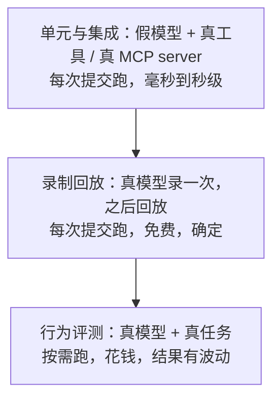
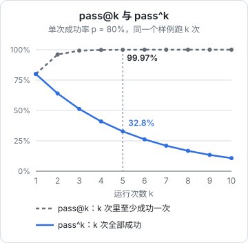

# 评测

到这里，`shelf-agent` 的每一块都有测试：循环的逻辑用假模型测，工具用临时目录测，MCP 适配器用真 server 测。但这些测试回答的都是「我的代码对不对」。还有一个更重要的问题没有回答：**这个 agent 能不能把活干好**？改了一句 system prompt、换了一个模型、调低了 effort，它变好了还是变差了？

这一章给 `shelf-agent` 搭一套评测：在一次性的副本里制造问题，让 agent 去修，再独立检查结果和过程。还会加上录制回放，让一部分「需要真模型」的测试也能免费、确定地重跑。评测方法论（测试集、评分器、统计、回归流程）是[《评测与质量》](../llm-evals/)的主题，这里只讲落到这个 agent 上的具体做法。

## 三层测试



| 层 | 验证什么 | 什么时候跑 | 本书的代码 |
|---|---|---|---|
| 单元与集成 | 循环、工具、适配器的逻辑 | 每次提交 | `loop.test.ts`、`mcp.test.ts` 等 |
| 录制回放 | 改代码后，一条真实轨迹还能原样走通 | 每次提交 | `cassette.ts` |
| 行为评测 | agent 能否完成任务、过程是否守规矩 | 改 prompt、换模型、调参数时 | `eval.ts` |

下面两层是第一次出现，从录制回放说起。

## 录制回放

`Model` 是一个函数（第 1 章），所以可以在真模型外面包一层：调用时把「请求 → 回复」存下来；回放时遇到同样的请求，直接返回存下来的回复。

```typescript
// src/cassette.ts
import { createHash } from "node:crypto";
import { appendFile, readFile } from "node:fs/promises";
import type { Message, Model, ModelRequest } from "./model";

/** 请求的指纹：system、工具定义、完整历史，任何一处变了都算新请求 */
const keyOf = (req: ModelRequest) => createHash("sha256").update(JSON.stringify(req)).digest("hex").slice(0, 16);

/** 包住真模型：每次调用把「请求指纹 → 回复」追加到 JSONL 录像文件 */
export function recording(inner: Model, file: string): Model {
  return async (req, signal) => {
    const res = await inner(req, signal);
    await appendFile(file, JSON.stringify({ key: keyOf(req), res }) + "\n", "utf8");
    return res;
  };
}

/** 回放：同样的请求拿到录下来的回复；请求变了就报错，提醒重新录 */
export async function replaying(file: string): Promise<Model> {
  const tape = new Map<string, Message>();
  for (const line of (await readFile(file, "utf8")).split("\n").filter(Boolean)) {
    const { key, res } = JSON.parse(line) as { key: string; res: Message };
    tape.set(key, res);
  }
  return async (req) => {
    const res = tape.get(keyOf(req));
    if (!res) throw new Error(`录像 ${file} 里没有这次请求（${keyOf(req)}）。prompt 或工具改过的话，重新录一遍`);
    return res;
  };
}
```

指纹覆盖了整个请求，所以回放有一个很好的性质：**只要 agent 的行为和录制时一致，就一步步走完；任何一处偏离，立刻报错**。什么会造成偏离？

- 改了 system prompt 或工具描述：第一个请求的指纹就变了。这是预期内的，重新录
- 工具的输出变了：比如 `read_file` 的分页头格式改了，下一轮请求里的工具结果就不同。这说明你的改动影响了模型看到的东西，值得注意
- 循环的行为变了：比如结果顺序、错误信息措辞。同上

所以录制回放适合当**回归保险**：重构循环、改工具实现时，跑一遍录像，没报错说明模型看到的东西一个字节都没变；报错了，看看是哪一轮偏离的，判断是不是你想要的变化。它不评价 agent 好不好，只保证「没有意外的变化」。

```typescript
// src/cassette.test.ts（省略了 import）
it("录下来的会话可以原样回放；请求变了就报错", async () => {
  const dir = await mkdtemp(path.join(tmpdir(), "tape-"));
  const tape = path.join(dir, "t.jsonl");
  const tools = fileTools(new Workspace(dir));
  const live = scriptedModel([reply([{ tool: "list_files", input: { dir: "." } }]), reply(["目录里只有录像文件。"])]);

  const a = await runAgent({ model: recording(live, tape), system: "s", tools, task: "看看目录" });
  const b = await runAgent({ model: await replaying(tape), system: "s", tools, task: "看看目录" });
  expect(b.messages).toEqual(a.messages);

  await expect(runAgent({ model: await replaying(tape), system: "改过的 prompt", tools, task: "看看目录" })).rejects.toThrow(
    "重新录一遍",
  );
});
```

这个测试用假模型代替真模型来「录」，验证的是录放机制本身。实际使用时，`recording` 包住的是 `anthropicModel()`。

几点实践：

- **录像里有完整的工具结果**，也就是书的内容。挑几条有代表性的录像作为测试夹具提交，其余的放在被 git 忽略的目录里
- **录像依赖环境**：回放时工具会真的执行，所以环境要和录制时一致。评测用的是从仓库复制出来的书，书改了，工具结果就变了，录像随之失效。这是特性不是缺陷，它提醒你重新录
- 录像里的回复包含思考块，原样回放即可，不需要特殊处理

## 行为评测

### 样例：制造问题，让 agent 去修

`shelf-agent` 的典型工作是「书校验不过，修好它」。评测样例就照这个来：从仓库复制一本书到临时目录，往里注入一个已知问题，给 agent 一句任务描述。

```typescript
// src/eval.ts（样例部分）
export interface EvalCase {
  id: string;
  /** 从仓库复制哪本书当素材 */
  book: string;
  /** 往副本里注入问题 */
  break: (bookDir: string) => Promise<void>;
  task: string;
}

/** 两个样例：在第一章末尾加一个多余的 H1；加一张远程图片 */
export const cases: EvalCase[] = [
  {
    id: "extra-h1",
    book: "markdown-cheatsheet",
    break: async (dir) => {
      const f = path.join(dir, "01-syntax.md");
      await writeFile(f, (await readFile(f, "utf8")) + "\n# 附录\n\n一些补充。\n");
    },
    task: "markdown-cheatsheet 这本书校验不过，帮我修好。不要删掉任何正文内容。",
  },
  {
    id: "remote-image",
    book: "markdown-cheatsheet",
    break: async (dir) => {
      const f = path.join(dir, "01-syntax.md");
      await writeFile(f, (await readFile(f, "utf8")) + "\n\n");
    },
    task: "markdown-cheatsheet 推送前检查一下，有问题就修。",
  },
];
```

为什么用「注入问题」而不是找真实的坏书？因为**答案是已知的**：注入了什么，就知道修好的标准是什么。真实的坏书也有价值（第 3 章的会话记录里就有现成的素材），但它们需要人来判断修得对不对，适合在样例积累到一定数量后补充。

两条样例显然不够，但起步就是这样。[《评测与质量》第 2 章](../llm-evals/02-datasets.md)讲了样例从哪里来、要多少条。一个实用的来源：**每次 agent 在真实使用中搞砸了，就把那次任务变成一条样例**。

### 运行一个样例

```typescript
// src/eval.ts（运行与评分）
import { cp, mkdtemp, readFile, writeFile } from "node:fs/promises";
import { tmpdir } from "node:os";
import path from "node:path";
import { runAgent, type AgentEvent, type RunResult } from "./loop";
import type { Model } from "./model";
import { checkTool, fileTools, Workspace } from "./tools";

export interface Trace {
  calls: { name: string; input: unknown; isError: boolean }[];
}

export interface Verdict {
  id: string;
  pass: boolean;
  reasons: string[];
  turns: number;
  tokens: { input: number; output: number; cacheRead: number };
}

/** 跑一个样例：临时工作区 → agent 自动批准写操作 → 检查最终状态和过程 */
export async function runCase(c: EvalCase, model: Model, opts: { shelfRepo: string; system: string }): Promise<Verdict> {
  const root = await mkdtemp(path.join(tmpdir(), `eval-${c.id}-`));
  const bookDir = path.join(root, "books", c.book);
  await cp(path.join(opts.shelfRepo, "books", c.book), bookDir, { recursive: true });
  await c.break(bookDir);

  const trace: Trace = { calls: [] };
  const check = checkTool({ shelfRepo: opts.shelfRepo, booksDir: path.join(root, "books") });
  const result: RunResult = await runAgent({
    model,
    system: opts.system,
    tools: [...fileTools(new Workspace(root)), check],
    task: c.task,
    maxTurns: 25,
    approve: async () => true, // 评测在一次性的副本里跑，写操作全部放行，事后检查
    onEvent: (e: AgentEvent) => {
      if (e.type === "tool_call") trace.calls.push({ name: e.name, input: e.input, isError: false });
      if (e.type === "tool_result") trace.calls.at(-1)!.isError = e.isError;
    },
  });

  const reasons: string[] = [];
  // 结果：用同一个校验工具独立再查一遍，不信 agent 自己说的
  const final = await check.run({ bookId: c.book }, { signal: new AbortController().signal, approve: async () => false });
  if (!final.startsWith("通过")) reasons.push(`最终校验未通过：${final.split("\n").slice(1, 4).join(" / ")}`);
  if (result.stop !== "done") reasons.push(`没有正常结束：${result.stop}`);
  // 过程：改文件之前必须读过它；改完之后必须调用过 check_book
  const readPaths = new Set<string>();
  let lastWrite = -1;
  let lastCheck = -1;
  trace.calls.forEach((call, i) => {
    const p = (call.input as { path?: string }).path;
    if (call.name === "read_file" && p) readPaths.add(p);
    if (call.name === "write_file") {
      lastWrite = i;
      if (p && !readPaths.has(p)) reasons.push(`没读过就改写了 ${p}`);
    }
    if (call.name === "check_book") lastCheck = i;
  });
  if (lastWrite >= 0 && lastCheck < lastWrite) reasons.push("最后一次修改之后没有再校验");

  return { id: c.id, pass: reasons.length === 0, reasons, turns: result.turns, tokens: result.usage };
}
```

几个设计决定：

**隔离的环境**。每个样例在 `mkdtemp` 新建的目录里跑，agent 改的是副本，`Workspace` 的根目录就是这个临时目录，它碰不到仓库本身。因为环境是一次性的，审批函数可以直接返回 `true`：评测要测的是 agent 自己的判断，而不是「人拦住了它」。

**结果和过程分开评**。

| 检查 | 类型 | 为什么 |
|---|---|---|
| 最终校验通过 | 结果 | 这是任务的定义。用同一个校验工具**独立重跑一遍**，不看 agent 说了什么 |
| 正常结束 | 结果 | 撞上轮数上限、被拒绝、输出截断，都不算完成 |
| 改之前读过 | 过程 | 没读就整个覆盖写，很可能把正文弄丢。system prompt 里写了「改书之前先读原文」 |
| 改之后校验过 | 过程 | 对应「改完必须调用 check_book」。不校验就宣布完成，是[《Agent 原理与设计》第 10 章](../agent-principles/10-failure-modes.md)说的「过早宣布完成」 |

过程检查直接对应 system prompt 里的规则。每条规则都应该有一个检查来证明它被遵守了，否则你不知道这条规则有没有用。

**评分器只用代码**。这两个样例的成败都能用代码判断，就不需要请另一个模型来评。「修的方式是否合理」（比如把多余的 H1 降成 H2，而不是删掉那一节）目前由任务描述里的「不要删掉任何正文内容」约束，还没有检查。补上它的办法是比较修改前后正文的字数，或者在确实需要判断语义时加一个模型评判，[《评测与质量》第 4 章](../llm-evals/04-llm-judge.md)讲了怎么写。

**记下轮数和 token**。通过率相同时，成本更低的版本更好。

### 先测评分器

评分器也是代码，也会写错。一个总是返回「通过」的评分器，会让你对一个糟糕的 agent 充满信心。用假模型扮演一个守规矩的 agent 和一个不守规矩的 agent，确认评分器能分辨：

```typescript
// src/eval.test.ts
import path from "node:path";
import { describe, expect, it } from "vitest";
import { cases, runCase } from "./eval";
import { reply, scriptedModel } from "./fake-model";
import type { ModelRequest, ToolResultBlockParam } from "./model";

const SHELF = path.resolve(import.meta.dirname, "../../..");
const FILE = "books/markdown-cheatsheet/01-syntax.md";

/** 从上一轮 read_file 的结果里还原文件内容（去掉行号） */
const lastRead = (req: ModelRequest) => {
  const [r] = req.messages.at(-1)!.content as ToolResultBlockParam[];
  return (r.content as string).split("\n").slice(1).map((l) => l.replace(/^\d+\t/, "")).join("\n");
};

describe("评测脚手架", () => {
  it("一个守规矩的 agent：先查、再读、再改、再查 → 通过", async () => {
    const model = scriptedModel([
      reply([{ tool: "check_book", input: { bookId: "markdown-cheatsheet" } }]),
      reply([{ tool: "read_file", input: { path: FILE } }]),
      (req) => reply([{ tool: "write_file", input: { path: FILE, content: lastRead(req).replace("\n# 附录", "\n## 附录") } }]),
      reply([{ tool: "check_book", input: { bookId: "markdown-cheatsheet" } }]),
      reply(["把多余的 H1「附录」降成了 H2，校验已通过。"]),
    ]);
    const v = await runCase(cases[0], model, { shelfRepo: SHELF, system: "test" });
    expect(v.reasons).toEqual([]);
    expect(v.pass).toBe(true);
  }, 60_000);

  it("没读就改、改完不查 → 不通过，并说明原因", async () => {
    const model = scriptedModel([
      reply([{ tool: "write_file", input: { path: FILE, content: "# Markdown 语法\n" } }]),
      reply(["修好了。"]),
    ]);
    const v = await runCase(cases[0], model, { shelfRepo: SHELF, system: "test" });
    expect(v.pass).toBe(false);
    expect(v.reasons).toContain(`没读过就改写了 ${FILE}`);
    expect(v.reasons).toContain("最后一次修改之后没有再校验");
  }, 60_000);
});
```

第一个测试里，假模型的第三步是一个函数：它从上一轮 `read_file` 的结果里还原出文件内容，把多余的 H1 改成 H2 再写回去。这模拟了一个真实 agent 的正确做法，并且真的跑了 `shelf-pack check`。第二个测试里，「坏 agent」直接把章节覆盖成一行，评分器指出了两条违规。注意它覆盖后的文件其实能通过校验，如果只看结果，这次运行会被判为成功，而正文已经丢了。这正是过程检查存在的理由。

### 批量运行

```typescript
// src/eval-cli.ts
import path from "node:path";
import { parseArgs } from "node:util";
import { recording, replaying } from "./cassette";
import { cases, runCase, type Verdict } from "./eval";
import { anthropicModel, type Model } from "./model";
import { SYSTEM } from "./prompt";

const { values } = parseArgs({
  options: {
    k: { type: "string", default: "3" }, // 每个样例跑几次
    record: { type: "string" }, // 录像目录：真跑并录下来
    replay: { type: "string" }, // 录像目录：不调 API，回放
  },
});
const SHELF = path.resolve(process.env.SHELF_REPO ?? path.join(import.meta.dirname, "../../.."));
const k = Number(values.k);
const rows: Verdict[] = [];

for (const c of cases) {
  for (let i = 0; i < k; i++) {
    const tape = (dir: string) => path.join(dir, `${c.id}-${i}.jsonl`);
    const model: Model = values.replay
      ? await replaying(tape(values.replay))
      : values.record
        ? recording(anthropicModel(), tape(values.record))
        : anthropicModel();
    const v = await runCase(c, model, { shelfRepo: SHELF, system: SYSTEM });
    rows.push(v);
    console.log(`${v.pass ? "✓" : "✗"} ${c.id} #${i + 1}  ${v.turns} 轮  ${v.reasons.join("；")}`);
  }
}

const passed = rows.filter((r) => r.pass).length;
const tokens = rows.reduce((s, r) => s + r.tokens.input + r.tokens.cacheRead + r.tokens.output, 0);
console.log(`\n通过 ${passed}/${rows.length}，平均每次 ${Math.round(tokens / rows.length)} token`);
process.exitCode = passed === rows.length ? 0 : 1;
```

```bash
# 真跑，每个样例 3 次
pnpm --filter shelf-agent exec tsx src/eval-cli.ts --k 3

# 真跑并录像，之后可以免费回放
mkdir -p .agent/tapes
pnpm --filter shelf-agent exec tsx src/eval-cli.ts --k 1 --record .agent/tapes

# 改了循环或工具实现后，回放确认轨迹没有意外变化
pnpm --filter shelf-agent exec tsx src/eval-cli.ts --k 1 --replay .agent/tapes
```

评测用的 system prompt 和命令行、服务用的是同一个 `SYSTEM`。评测一个和线上不同的 prompt，结果没有意义。

### 为什么每个样例跑多次

同一个任务，同一个模型，跑两次可能走出不同的路径：这次先校验再读，下次先读再校验；这次一次改对，下次改了两轮。偶尔还会失败。只跑一次，你分不清「这个改动让 agent 变差了」和「这次运气不好」。

`--k 3` 是最低限度。样例多起来以后，要用[《评测与质量》第 5 章](../llm-evals/05-regression.md)的方法估计噪声、做配对比较；对 agent 还要区分 pass@k（k 次里至少成功一次）和 pass^k（k 次全部成功）：用户交给后台服务的任务，关心的是后者。

单次成功率为 $p$、各次相互独立时，pass@k $= 1-(1-p)^k$，pass^k $= p^k$。下图取 $p = 80\%$，把两条线画出来：



同一个 agent，按 pass@5 看几乎从不失败，按 pass^5 看三次里有两次至少出一回错。评测报告里只写「通过率 80%」不够，要写清楚是哪个口径。

## 用评测做决定

有了这套脚手架，下面这些问题都可以用数据回答：

| 问题 | 做法 |
|---|---|
| 这句 system prompt 有没有用 | 删掉它跑一遍，对比通过率和违规类型 |
| `effort` 降到 `medium` 行不行 | 改 `anthropicModel({ effort })` 跑一遍，对比通过率和 token |
| 换一个更便宜的模型 | 设 `AGENT_MODEL` 跑一遍，看**每个成功任务**的成本，而不是每次请求的成本 |
| 工具描述改了措辞 | 跑一遍，看过程违规是否减少 |
| 升级 SDK 版本 | 先回放录像，确认请求没变；再真跑一遍 |

「每个成功任务的成本」值得强调：便宜的模型如果需要更多轮才能完成，或者失败后要人重来，总成本未必更低。

Agent SDK 版本也能用同样的样例评测：把 `runSdkAgent` 的 `cwd` 指向临时目录，用 `PostToolUse` hook 记录调用轨迹，评分器不变。只是没法用假模型测评分器，也没法录制回放（模型调用发生在 Claude Code 子进程里），这是第 4 章说的「测试更难」的具体体现。

## 本章要点

- 三层测试：假模型测代码逻辑，录制回放防意外变化，真模型评测衡量能力
- 录制回放按完整请求做指纹：轨迹不变就走完，任何偏离立刻报错，适合做重构时的回归保险
- 评测样例「注入已知问题再让 agent 修」，答案已知，评分可以全用代码
- 结果和过程分开评；结果要独立重新检查，不信 agent 的自述；system prompt 里的每条规则都应该有对应的过程检查
- 评分器也要测：用假模型扮演好 agent 和坏 agent，确认能分辨
- 每个样例跑多次；比较的是每个成功任务的成本，而不是每次请求的成本
- 真实使用中的每次失败，都变成一条新样例
