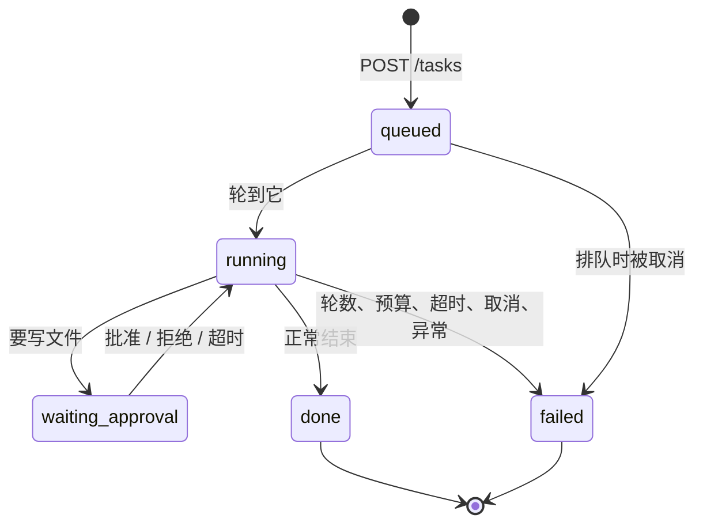
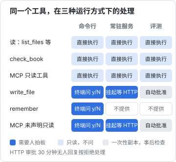

# 部署成常驻服务

命令行版本的 `shelf-agent` 有一个隐含前提：你就坐在终端前。审批靠你按 `y`，出了问题你当场看到，跑完你自己读结果。这一章去掉这个前提，把它变成跑在服务器上的常驻服务：每晚自动巡检书库，白天你可以随时从手机或脚本给它派活，需要改文件时它停下来等你批准。

代码上的变化不大，循环、工具、模型都不用动；变化在循环**周围**：任务从哪来、审批谁来做、跑飞了怎么停、过程怎么留痕、进程挂了怎么办。

## 从命令行到服务，变了什么

| 问题 | 命令行 | 常驻服务 |
|---|---|---|
| 任务从哪来 | 命令行参数 | HTTP 请求、定时器 |
| 审批 | 终端里问 `[y/N]` | 任务挂起，等人通过 HTTP 回复；超时按拒绝处理 |
| 并发 | 一次一个 | 排队，同一个工作区一次只跑一个 |
| 跑飞了 | 你按 Ctrl-C | 超时、token 预算、手动取消 |
| 结果去哪 | 打印到终端 | 存在任务状态里，事件流实时推送 |
| 留痕 | 终端滚动记录 | 每个任务一份 JSONL 运行记录 |
| 凭证 | 你 shell 里的环境变量 | 只有服务进程能读的环境文件 |
| 进程挂了 | 你重跑 | systemd 或 Docker 自动拉起 |

## 服务设计

### 接口

| 方法和路径 | 作用 |
|---|---|
| `POST /tasks` | 提交任务，body 是 `{ "prompt": "..." }`，返回任务 id |
| `GET /tasks/:id` | 任务状态、等待审批的操作、结果、token 用量 |
| `GET /tasks/:id/events` | SSE 事件流：先补发历史事件，再推实时事件 |
| `POST /tasks/:id/approval` | 回复审批，body 是 `{ "allow": true }` 或 `false` |
| `POST /tasks/:id/cancel` | 取消任务 |
| `GET /healthz` | 健康检查，不需要认证 |

除了健康检查，所有接口都要求 `Authorization: Bearer <token>`。

### 任务的状态



`waiting_approval` 是命令行版本里没有的状态。它让「人在回路」变成异步的：agent 停在那里，你什么时候看到通知，什么时候回复。30 分钟没人回复按拒绝处理，agent 会说明它想做什么然后结束。

审批函数是第 2 章预留的接口，三种运行方式各有各的实现：



服务版本不提供 `remember`：长期笔记会影响以后所有任务，无人值守时不让 agent 自己往里写。

### 为什么一次只跑一个

agent 改的是工作区里的文件。两个任务同时改同一本书，结果取决于谁后写，而且两个 agent 都以为自己看到的是最新内容。对个人用的书库维护助手，排队完全够用。真要并行，给每个任务一份独立的工作区副本（比如 `git worktree`），跑完再合并，那就是另一个量级的复杂度了，《多 Agent 编排》会讨论。

## 代码

服务用 Node 自带的 `node:http`，不引入框架。接口只有几个，框架带来的东西用不上。

### 任务和配置

```typescript
// src/server.ts
import { randomUUID, timingSafeEqual } from "node:crypto";
import { appendFile, mkdir } from "node:fs/promises";
import { createServer, type IncomingMessage, type ServerResponse } from "node:http";
import path from "node:path";
import { runAgent, type AgentEvent } from "./loop";
import { anthropicModel, type Model } from "./model";
import { SYSTEM } from "./prompt";
import { checkTool, fileTools, Workspace } from "./tools";

type Status = "queued" | "running" | "waiting_approval" | "done" | "failed";

interface Task {
  id: string;
  prompt: string;
  status: Status;
  createdAt: string;
  result?: string;
  stop?: string;
  tokens: number;
  pending?: { summary: string; resolve: (ok: boolean) => void };
  events: AgentEvent[];
  listeners: Set<(e: AgentEvent | { type: "status"; status: Status }) => void>;
  abort: AbortController;
}

export interface ServiceConfig {
  repo: string; // agent 的工作区：一份专用的仓库副本
  shelfRepo?: string; // shelf-pack 所在的仓库，默认就是 repo
  stateDir: string; // 运行记录
  token: string; // 调用方要带的 Bearer token
  model?: Model;
  taskTimeoutMs?: number;
  taskTokenBudget?: number; // 输入（含缓存读）+ 输出 token 的上限
  approvalTimeoutMs?: number;
}
```

`model` 可以注入，测试时传假模型，和前几章一样。

### 执行任务

```typescript
export function createAgentService(cfg: ServiceConfig) {
  const model = cfg.model ?? anthropicModel();
  const ws = new Workspace(cfg.repo);
  const tools = [...fileTools(ws), checkTool({ shelfRepo: cfg.shelfRepo ?? cfg.repo, booksDir: path.join(cfg.repo, "books") })];
  const tasks = new Map<string, Task>();
  const queue: Task[] = [];
  let running: Promise<void> | null = null;
  let closing = false;

  const emit = (t: Task, e: AgentEvent | { type: "status"; status: Status }) => {
    if (e.type !== "status") t.events.push(e);
    else t.status = e.status;
    for (const l of t.listeners) l(e);
    void appendFile(path.join(cfg.stateDir, "traces", `${t.id}.jsonl`), JSON.stringify({ at: new Date().toISOString(), ...e }) + "\n");
  };

  async function work(t: Task) {
    emit(t, { type: "status", status: "running" });
    const timer = setTimeout(() => t.abort.abort(), cfg.taskTimeoutMs ?? 15 * 60_000);
    try {
      const r = await runAgent({
        model,
        system: SYSTEM,
        tools,
        task: t.prompt,
        maxTurns: 40,
        signal: t.abort.signal,
        // 无人值守时的审批：挂起任务，等人通过 HTTP 回复；超时按拒绝处理
        approve: (summary) =>
          new Promise<boolean>((resolve) => {
            const timeout = setTimeout(() => done(false), cfg.approvalTimeoutMs ?? 30 * 60_000);
            const done = (ok: boolean) => {
              clearTimeout(timeout);
              t.pending = undefined;
              emit(t, { type: "status", status: "running" });
              resolve(ok);
            };
            t.pending = { summary, resolve: done };
            emit(t, { type: "status", status: "waiting_approval" });
          }),
        onEvent: (e) => {
          emit(t, e);
          if (e.type === "turn_end") {
            const u = e.usage;
            t.tokens += u.input_tokens + (u.cache_read_input_tokens ?? 0) + u.output_tokens;
            if (t.tokens > (cfg.taskTokenBudget ?? 2_000_000)) t.abort.abort(); // 预算保险丝
          }
        },
      });
      t.result = r.text;
      t.stop = r.stop;
      emit(t, { type: "status", status: r.stop === "done" ? "done" : "failed" });
    } catch (e) {
      t.result = e instanceof Error ? e.message : String(e);
      emit(t, { type: "status", status: "failed" });
    } finally {
      clearTimeout(timer);
    }
  }

  /** 一次只跑一个任务：同一个工作区上并发改文件只会互相踩 */
  function pump() {
    if (running || closing) return;
    const next = queue.shift();
    if (!next) return;
    running = work(next).finally(() => {
      running = null;
      pump();
    });
  }
```

三道保险丝，各管一种失控：

| 保险丝 | 默认值 | 防什么 |
|---|---|---|
| `maxTurns` | 40 | 原地打转，反复调用工具 |
| `taskTimeoutMs` | 15 分钟 | 单次调用卡住、工具挂起 |
| `taskTokenBudget` | 200 万 token | 每轮都读大量内容，轮数不多但很贵 |

三者都通过同一个 `AbortController` 生效，第 2 章已经保证了在任何时刻取消都能留下合法的历史。token 预算把缓存读取也算在内，偏保守；想按钱算，就按价目表把几类 token 分别加权。

`emit` 做三件事：更新内存里的状态、推给正在监听的 SSE 连接、追加到这个任务的运行记录文件。运行记录是事后排查的依据：agent 做了一件奇怪的事，打开 `traces/<id>.jsonl` 就能看到它每一步调用了什么、拿到了什么。

### HTTP 层

```typescript
  const json = (res: ServerResponse, code: number, body: unknown) => {
    res.writeHead(code, { "content-type": "application/json; charset=utf-8" }).end(JSON.stringify(body));
  };
  const readBody = async (req: IncomingMessage) => {
    let raw = "";
    for await (const chunk of req) {
      raw += chunk;
      if (raw.length > 64 * 1024) throw new Error("请求体太大");
    }
    return raw ? (JSON.parse(raw) as Record<string, unknown>) : {};
  };
  const authorized = (req: IncomingMessage) => {
    const got = Buffer.from(req.headers.authorization ?? "");
    const want = Buffer.from(`Bearer ${cfg.token}`);
    return got.length === want.length && timingSafeEqual(got, want);
  };
  const view = (t: Task) => ({
    id: t.id,
    prompt: t.prompt,
    status: t.status,
    createdAt: t.createdAt,
    pendingApproval: t.pending?.summary,
    result: t.result,
    stop: t.stop,
    tokens: t.tokens,
  });

  const server = createServer(async (req, res) => {
    const url = new URL(req.url ?? "/", "http://localhost");
    if (url.pathname === "/healthz") return json(res, 200, { ok: true, queued: queue.length, busy: !!running });
    if (!authorized(req)) return json(res, 401, { error: "unauthorized" });

    try {
      if (req.method === "POST" && url.pathname === "/tasks") {
        const { prompt } = await readBody(req);
        if (typeof prompt !== "string" || !prompt.trim()) return json(res, 400, { error: "prompt 不能为空" });
        if (closing) return json(res, 503, { error: "服务正在停止" });
        const t: Task = {
          id: randomUUID(),
          prompt,
          status: "queued",
          createdAt: new Date().toISOString(),
          tokens: 0,
          events: [],
          listeners: new Set(),
          abort: new AbortController(),
        };
        tasks.set(t.id, t);
        queue.push(t);
        pump();
        return json(res, 202, { id: t.id });
      }

      const m = url.pathname.match(/^\/tasks\/([0-9a-f-]{36})(\/events|\/approval|\/cancel)?$/);
      const t = m && tasks.get(m[1]);
      if (!t) return json(res, 404, { error: "没有这个任务" });

      if (req.method === "GET" && !m[2]) return json(res, 200, view(t));

      if (req.method === "GET" && m[2] === "/events") {
        // SSE：先补发历史事件，再推实时事件
        res.writeHead(200, { "content-type": "text/event-stream", "cache-control": "no-cache" });
        const send = (e: unknown) => res.write(`data: ${JSON.stringify(e)}\n\n`);
        t.events.forEach(send);
        send({ type: "status", status: t.status });
        t.listeners.add(send);
        req.on("close", () => t.listeners.delete(send));
        return;
      }

      if (req.method === "POST" && m[2] === "/approval") {
        if (!t.pending) return json(res, 409, { error: "这个任务没有等待审批的操作" });
        const { allow } = await readBody(req);
        t.pending.resolve(allow === true);
        return json(res, 200, view(t));
      }

      if (req.method === "POST" && m[2] === "/cancel") {
        t.abort.abort();
        t.pending?.resolve(false);
        const i = queue.indexOf(t);
        if (i >= 0) {
          queue.splice(i, 1);
          emit(t, { type: "status", status: "failed" });
        }
        return json(res, 200, view(t));
      }
      return json(res, 405, { error: "method not allowed" });
    } catch (e) {
      return json(res, 400, { error: e instanceof Error ? e.message : String(e) });
    }
  });

  return {
    server,
    async init() {
      await mkdir(path.join(cfg.stateDir, "traces"), { recursive: true });
    },
    /** 优雅退出：不再接新任务，取消正在跑的，等它把状态写完 */
    async close() {
      closing = true;
      for (const t of tasks.values()) if (t.status !== "done" && t.status !== "failed") t.abort.abort();
      for (const t of tasks.values()) t.pending?.resolve(false);
      await running;
      server.closeAllConnections();
      await new Promise((r) => server.close(r));
    },
  };
}
```

几处细节：

- **令牌比较用 `timingSafeEqual`**：普通的 `===` 比较遇到第一个不同的字符就返回，理论上可以通过响应时间逐位猜出令牌
- **审批只接受 `allow === true`**：body 写错、少了字段，一律当拒绝
- **请求体限制 64 KB**：任务描述用不了这么多，防止有人塞一个巨大的请求
- **审批的摘要是给人看的**：`pendingApproval` 是第 2 章 `describe()` 生成的那句「写入 books/x/01.md（3.2 KB）」。要看具体改了什么，读事件流里的 `tool_call` 事件，里面有完整的参数
- **任务存在内存里**：服务重启后，任务列表就没了，运行记录文件还在。对个人工具这是可以接受的取舍；需要重启后还能查任务，把任务表存进 SQLite，hatch-shelf 的 App 里已经有现成的经验

这里为了简单用了本地的 `checkTool`。换成第 5 章的 `shelf-books` MCP server 时，在 `work()` 开头连接、`finally` 里关闭：每个任务一个新连接，server 挂了也只影响一个任务，不需要写重连逻辑。

### 入口

```typescript
// src/main.ts
import path from "node:path";
import { createAgentService } from "./server";

const token = process.env.AGENT_TOKEN;
if (!token || token.length < 32) throw new Error("AGENT_TOKEN 未设置或太短（至少 32 个字符）");

const svc = createAgentService({
  repo: path.resolve(process.env.SHELF_REPO ?? "/workspace"),
  shelfRepo: process.env.SHELF_TOOLS && path.resolve(process.env.SHELF_TOOLS),
  stateDir: path.resolve(process.env.AGENT_STATE ?? "/state"),
  token,
});
await svc.init();

const port = Number(process.env.PORT ?? 8787);
const host = process.env.HOST ?? "127.0.0.1"; // 默认只听本机，对外由 nginx 或内网转发
svc.server.listen(port, host, () => console.log(`shelf-agent 监听 ${host}:${port}`));

for (const sig of ["SIGTERM", "SIGINT"] as const) {
  process.once(sig, async () => {
    console.log(`收到 ${sig}，正在停止`);
    await svc.close();
    process.exit(0);
  });
}
```

`docker stop` 和 `systemctl stop` 都先发 `SIGTERM`，等一段时间再强杀。收到信号后取消正在跑的任务、等它写完状态再退出，运行记录就不会停在半截。

### 测试

服务也用假模型测，覆盖最关键的一条路径：提交任务 → 挂起等审批 → 批准 → 完成。

```typescript
// src/server.test.ts（节选）
it("任务排队执行，写操作挂起等审批，批准后完成", async () => {
  const repo = await mkdtemp(path.join(tmpdir(), "svc-"));
  await mkdir(path.join(repo, "books/demo"), { recursive: true });
  await writeFile(path.join(repo, "books/demo/01.md"), "# 旧标题\n");
  const model = scriptedModel([
    reply([{ tool: "write_file", input: { path: "books/demo/01.md", content: "# 新标题\n" } }]),
    reply(["标题改好了。"]),
  ]);
  const svc = createAgentService({ repo, stateDir: path.join(repo, ".state"), token: TOKEN, model });
  await svc.init();
  await new Promise<void>((r) => svc.server.listen(0, "127.0.0.1", r));
  // ……用 fetch 提交任务，轮询到 waiting_approval，断言 pendingApproval 的摘要，
  // POST /approval 批准，轮询到 done，断言文件已改、运行记录里有 waiting_approval
  await svc.close();
});
```

`listen(0)` 让系统分配一个空闲端口，测试之间不会抢端口。

## 部署

### 工作区：一份专用的副本

服务不应该直接改你日常写书用的那份仓库。给它一份专用的克隆，比如 `/srv/shelf-workspace`：

- agent 改出问题，`git checkout .` 就能复原
- 它改了什么，`git diff` 一目了然；满意了你自己提交、推送
- agent 没有 git 凭证，推不了任何东西。提交和推送是你的动作，不是它的

服务的代码和依赖打进镜像，工作区以卷的方式挂进去。这样即使 agent 改了工作区里 `tools/shelf-agent/` 的代码，也影响不到正在运行的服务。

### Docker 镜像

```dockerfile
# tools/shelf-agent/Dockerfile，构建上下文是仓库根目录
FROM node:22-slim
RUN npm install -g pnpm@9.15.0
WORKDIR /app
COPY . .
# 只装 shelf-agent 和 shelf-pack 及其依赖（包括 @shelf/spec），不装 App
RUN pnpm install --frozen-lockfile --filter "shelf-agent..." --filter "shelf-pack..." \
  && chown -R node:node /app
USER node
ENV NODE_ENV=production
CMD ["./node_modules/.bin/tsx", "tools/shelf-agent/src/main.ts"]
```

仓库根目录要有 `.dockerignore`，排除 `node_modules`、`app/`、`books/`、`.agent/` 和各种 `.env`：书不需要进镜像，工作区里有；密钥更不能进镜像。

### Compose

```yaml
# tools/shelf-agent/docker-compose.yml
services:
  shelf-agent:
    build:
      context: ../..
      dockerfile: tools/shelf-agent/Dockerfile
    restart: unless-stopped
    env_file: /etc/shelf-agent/agent.env # ANTHROPIC_API_KEY、AGENT_TOKEN，权限 600
    environment:
      SHELF_REPO: /workspace
      SHELF_TOOLS: /app
      AGENT_STATE: /state
      HOST: 0.0.0.0 # 容器内监听所有地址，对宿主机只发布到 127.0.0.1
    volumes:
      - /srv/shelf-workspace:/workspace
      - agent-state:/state
    ports:
      - "127.0.0.1:8787:8787"
    read_only: true
    tmpfs:
      - /tmp
      - /home/node
    mem_limit: 512m
    healthcheck:
      test: ["CMD", "node", "-e", "fetch('http://127.0.0.1:8787/healthz').then(r=>process.exit(r.ok?0:1),()=>process.exit(1))"]
      interval: 30s
      timeout: 5s
    logging:
      driver: json-file
      options: { max-size: "20m", max-file: "3" }

volumes:
  agent-state:
```

逐条说明：

- **端口只发布到 `127.0.0.1`**：和 hatch-counter 的 API 一样，对外由宿主机上的 nginx 终止 TLS 再转发。agent 能改文件、会花钱，绝不能把一个没有 TLS 的接口直接挂到公网上。nginx 的配置见《Nginx 与反向代理》
- **密钥放在宿主机上的环境文件里**，权限 600，不进镜像、不进仓库、不写在 compose 里
- **只读根文件系统**：容器里只有 `/workspace`、`/state` 和两个 tmpfs 可写。`tsx` 的编译缓存和 pnpm 运行脚本时可能写的缓存都落在 tmpfs 上
- **内存上限**：手写版本是一个普通的 Node 进程，512 MB 足够。Agent SDK 版本不一样，见本章最后一节
- **日志轮转**：不配的话，`json-file` 日志会慢慢吃满磁盘

工作区目录的属主要是容器里的 `node` 用户（官方 Node 镜像里 uid 是 1000），否则 agent 写不了文件：`sudo chown -R 1000:1000 /srv/shelf-workspace`。

### 不用 Docker：systemd

机器上已经装了 Node 和 pnpm 的话，直接用 systemd 托管也很简单，安全加固写在 unit 文件里：

```ini
# /etc/systemd/system/shelf-agent.service
[Unit]
Description=shelf-agent 书库维护助手
After=network-online.target
Wants=network-online.target

[Service]
User=shelf-agent
WorkingDirectory=/opt/hatch-shelf
EnvironmentFile=/etc/shelf-agent/agent.env
Environment=SHELF_REPO=/srv/shelf-workspace SHELF_TOOLS=/opt/hatch-shelf AGENT_STATE=/var/lib/shelf-agent
# pnpm、tsx 可能往家目录写缓存；家目录指到可写的状态目录
Environment=HOME=/var/lib/shelf-agent
ExecStart=/opt/hatch-shelf/node_modules/.bin/tsx tools/shelf-agent/src/main.ts
Restart=on-failure
RestartSec=5
StateDirectory=shelf-agent
NoNewPrivileges=true
ProtectSystem=strict
ProtectHome=true
PrivateTmp=true
ReadWritePaths=/srv/shelf-workspace

[Install]
WantedBy=multi-user.target
```

`ProtectSystem=strict` 让整个文件系统只读，`ReadWritePaths` 和 `StateDirectory` 开出两个例外：工作区和运行记录目录。效果和 Docker 的只读根文件系统相同。服务用一个专门的系统用户运行，没有登录 shell、不在 sudo 组。

### 每晚巡检

定时任务不需要写进服务里，宿主机上的 systemd timer 发一个 HTTP 请求就行：

```bash
#!/usr/bin/env bash
# /usr/local/bin/shelf-agent-nightly
set -euo pipefail
source /etc/shelf-agent/client.env # AGENT_TOKEN
git -C /srv/shelf-workspace pull --ff-only
curl -fsS -X POST http://127.0.0.1:8787/tasks \
  -H "authorization: Bearer $AGENT_TOKEN" \
  -H "content-type: application/json" \
  -d '{"prompt":"逐本校验 books/ 下所有书，列出未通过的书和每条错误。只报告，不要修改任何文件。"}'
```

```ini
# /etc/systemd/system/shelf-agent-nightly.service
[Unit]
Description=shelf-agent 每晚巡检

[Service]
Type=oneshot
ExecStart=/usr/local/bin/shelf-agent-nightly
```

```ini
# /etc/systemd/system/shelf-agent-nightly.timer
[Unit]
Description=每天凌晨 3 点触发 shelf-agent 巡检

[Timer]
OnCalendar=*-*-* 03:00:00
Persistent=true

[Install]
WantedBy=timers.target
```

```bash
sudo systemctl enable --now shelf-agent-nightly.timer
systemctl list-timers shelf-agent-nightly.timer
```

`Persistent=true` 让机器在 3 点关机的那天，开机后补跑一次。

巡检任务的 prompt 写明「只报告，不要修改」。就算 agent 没听话想改文件，凌晨也没人批准，30 分钟后审批超时、按拒绝处理。这是两道防线：prompt 管意图，审批管能力。要把报告推到手机，在脚本里记下返回的任务 id，轮询到结束后把 `result` 发到你常用的通知渠道即可。

## 上线之后

### 看什么

| 信号 | 从哪看 | 关注什么 |
|---|---|---|
| 服务活着 | `/healthz`、容器健康状态 | 连续失败就告警 |
| 任务结果 | `GET /tasks/:id` 的 `status` 和 `stop` | `failed` 的比例；`stop` 是 `max_turns` 还是 `refusal` |
| 成本 | 任务的 `tokens`，运行记录里每轮的 `usage` | 单个任务的 token 突然变多，通常是 agent 在原地打转 |
| 过程 | `traces/<id>.jsonl` | 失败任务逐个看，看完变成第 6 章的评测样例 |

日志、指标、告警的通用做法见《可观测性与性能》；大模型应用上线后的成本、限流、降级见《LLM 应用上线》。

### 模型拒绝和故障

- `stop` 为 `refusal` 的任务会被标为失败，结果里带着模型的说明。这类情况在书库维护里极少见，偶尔出现时人看一眼即可。对于更容易触发安全分类器的业务，Messages API 提供了服务端回退（beta），在拒绝时自动换一个模型重跑，用之前查官方文档
- API 限流和临时故障，`@anthropic-ai/sdk` 默认会自动重试两次。重试仍然失败，`runAgent` 抛出异常，任务标为失败，结果里是错误信息。《大模型应用工程》第 9 章讲了更完整的重试和降级

### Agent SDK 版本部署时的不同

如果你用的是第 4 章的 SDK 版本，部署时要注意它的进程模型：

- **每个会话一个 Claude Code 子进程**，子进程拥有自己的 shell、工作目录和会话文件。官方建议按每个 agent 1 GiB 内存、5 GiB 磁盘、1 个 CPU 起步估算，再按实际会话长度调整。上面 512 MB 的内存上限要放宽
- **会话文件在本地磁盘**（`~/.claude/projects/` 下，或 `CLAUDE_CONFIG_DIR` 指定的目录）。容器重建就没了。要能跨重启恢复会话，挂一个卷，或者配置 SDK 的 `SessionStore` 把会话同步到外部存储
- **隔离设置**：服务器上用 `settingSources: []` 或只加载项目级设置，不让机器上的用户级配置影响 agent；多个用户共用一个容器时，每人一个 `cwd` 和一个 `CLAUDE_CONFIG_DIR`
- **`env` 选项会替换而不是合并环境变量**：传 `env` 时要写成 `{ ...process.env, KEY: "value" }`，否则子进程连 `PATH` 和 API 密钥都没有
- **无人值守用 `permissionMode: "dontAsk"`**，需要审批的调用直接拒绝；要像本章这样挂起等人，就在 `canUseTool` 里返回一个等待 HTTP 回复的 Promise，思路和手写版本完全相同
- **可观测性**：Claude Code 支持通过 OpenTelemetry 环境变量导出指标、日志和追踪，接到你已有的收集器上即可，具体变量名以官方文档为准

## 全书回顾

| 章 | 加了什么 | 关键决定 |
|---|---|---|
| 1 | 循环、模型抽象、假模型 | 循环依赖一个函数；逐个处理停止原因；历史只追加 |
| 2 | 工具、工作区、审批 | zod 一个 schema 三用；路径两道检查；读并行写串行；审批默认拒绝 |
| 3 | 会话、上下文编辑、长期笔记 | JSONL 存会话；服务端清理旧工具结果；笔记放第一条消息，写入要批准 |
| 4 | Agent SDK 重写 | 文件和命令为中心用 SDK；必守的规则写在 hook 里 |
| 5 | MCP 适配器 | 能力写一次做成 server；注解只是提示；工具表在会话开始时定下 |
| 6 | 录制回放、行为评测 | 结果独立重查，过程对应 prompt 规则；评分器也要测 |
| 7 | 常驻服务 | 异步审批；三道保险丝；专用工作区；只读文件系统 |

回头看，循环本身从第 2 章以后就没再变过。工具、记忆、MCP、评测、服务，都是插在循环周围的东西，通过 `Model`、`AgentTool`、`approve`、`onEvent` 这几个接口接进来。这也是《Agent 原理与设计》第 2 章那句话的落地：**复杂度都在循环之外**。

## 接下来读什么

- 《Agent 安全》：本书一路上做了不少安全决定（工作区、审批、白名单、记忆投毒），这本书把它们放进完整的威胁模型里，讲 prompt 注入、沙箱和审计
- 《多 Agent 编排》：一个 agent 不够用的时候，怎么拆给多个 agent、怎么隔离上下文、怎么汇总结果
- 《LLM 应用上线》：把 agent 当成一个线上的大模型应用来运营，成本、限流、监控、迭代
- 《个人 Agent 工作流》：想清楚还有哪些活可以交给自己写的 agent

## 本章要点

- 从命令行到服务，循环不变，变的是任务来源、审批方式、保险丝、留痕和凭证
- 审批变成异步的：任务挂起等 HTTP 回复，超时按拒绝处理；无人值守时不让 agent 写长期记忆
- 同一个工作区一次只跑一个任务；轮数、时间、token 三道保险丝共用一个取消信号
- 每个任务一份 JSONL 运行记录，失败任务逐个看，变成评测样例
- agent 在专用的仓库副本里工作，没有 git 凭证；改动由你审阅、提交
- 端口只听本机，TLS 交给 nginx；密钥放在权限 600 的环境文件里；只读根文件系统，只开放工作区和状态目录
- 定时任务交给宿主机的 systemd timer；prompt 管意图，审批管能力
