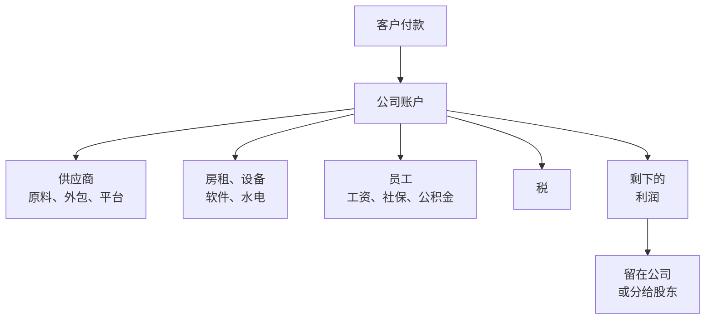
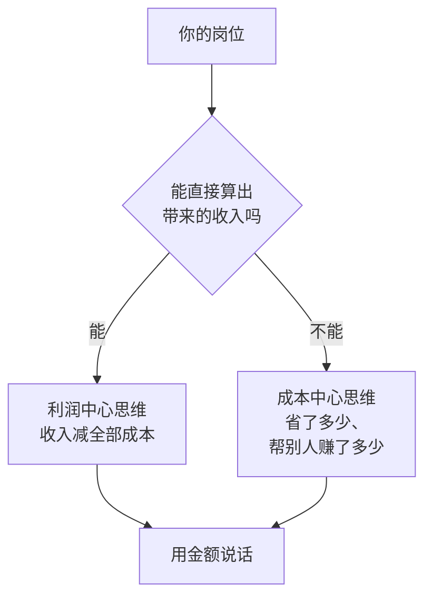

# 换个位置看你的公司

**这本书讲什么**：你可能已经工作了好几年，每个月按时收到工资，对公司的业务也很熟。但如果有人问：公司一年收进来多少钱、花出去多少、你这个岗位一年让公司多赚了还是多花了多少，大多数人答不上来。这不是因为不聪明，而是因为员工的位置看不到这些数字，也没有人要求你去看。

这本书想做的事很简单：**让一个只领过工资的人学会用老板的眼光算账**。不讲怎么做账、报税，也不讲融资和上市，只讲一门生意最基本的几个问题：钱从哪来，花到哪去，为什么有的生意赚钱、有的生意看着热闹却撑不下去。

**适合谁**：设计、HR、财务、运营、销售、行政、教师、程序员……任何岗位都行，不需要会计基础，也不需要会写代码。用到的数学只有加减乘除。

**怎么读**：

| 章 | 内容 |
|---|---|
| 第 1 章 | 从你自己的工资出发，看公司的钱怎么流 |
| 第 2 章 | 一门生意的四根骨头：谁付钱、为什么付、怎么找到、交付花什么 |
| 第 3 章 | 收入、成本、利润，以及盈亏平衡点 |
| 第 4 章 | 固定成本怎么放大盈亏，生意通常死于什么 |
| 第 5 章 | 一单、一个客户、一小时到底赚多少 |
| 第 6 章 | 从上市公司的年报里读出别人的生意 |
| 第 7 章 | 这门生意为什么轮得到你：竞争与位置 |
| 第 8 章 | 把五门身边的小生意各算一遍 |
| 第 9 章 | 日常怎么练商业嗅觉，以及接下来读什么 |

建议按顺序读，第 3 到第 5 章是全书的核心，后面几章都在用这三章的工具。书里的例子大多是**假设的数字**，会在用到时说明；它们是为了让算式能算对、让道理看得清，不代表某个行业的真实水平。

## 钱是怎么走到你工资卡里的

先从一个问题开始：你的工资是谁付的？

「公司付的」是员工视角的答案。往前再推一步，公司的钱从哪来？绝大多数公司只有两个来源：**客户付的钱**，和**股东或银行投进来、借进来的钱**。后者是暂时的，迟早要靠前者还上或者赚回来。所以更准确的答案是：**你的工资是客户付的，公司只是中间经手**。

这条路径中间要经过很多站：

客户付的每 100 元，要先分给供应商、房东、员工、税务局，最后剩下的才是利润。员工拿到的那一份，在老板眼里是**成本**。这句话听起来不舒服，但它是理解所有商业问题的起点：在一张利润表上，你和房租、电脑、广告费排在同一个区域。

这并不意味着你不重要。恰恰相反，在很多公司里，人力是最大的一项成本，也是最能创造价值的一项投入。老板关心的不是「这个人花了多少」，而是「花在这个人身上的钱，换回来了多少」。

## 你的工资在利润表哪一行

**利润表**是公司记录「一段时间里赚了多少」的表格，按从收入减到利润的顺序排下来。它的定义和另外两张报表在[《财务与税务》第 1 章](../opc-finance/01-bookkeeping-basics.md#三张报表看什么)讲过，这里只看结构。简化后的利润表长这样：

| 行 | 内容 |
|---|---|
| 营业收入 | 卖东西、提供服务收到的钱 |
| 减：营业成本 | 为了交付这些东西直接花的钱 |
| = 毛利 | 卖一单「直接」赚了多少 |
| 减：销售费用 | 为了卖出去花的钱：销售人员、广告、渠道 |
| 减：管理费用 | 维持公司运转的钱：行政、人事、财务、管理层、办公室 |
| 减：研发费用 | 开发新产品、新技术的钱 |
| 减：财务费用 | 利息、手续费 |
| = 营业利润 | 经营本身赚了多少 |
| 减：所得税等 | |
| = 净利润 | 最后剩下的 |

同样是工资，记在哪一行取决于你做什么：

| 岗位 | 工资通常记在 | 原因 |
|---|---|---|
| 工厂工人、餐厅厨师、外包项目的交付工程师 | 营业成本 | 直接参与生产或交付，多一单就多一份工作量 |
| 销售、市场、电商运营、客服（售前） | 销售费用 | 为了把东西卖出去 |
| 人事、财务、行政、法务、总经理 | 管理费用 | 维持公司运转，和卖多少没有直接关系 |
| 产品经理、研发工程师、设计师（做新产品） | 研发费用 | 为将来的产品投入 |

> [!NOTE]
> 实际的会计处理会更细，比如研发人员的工资在某些条件下可以「资本化」，先记成资产再分年摊销；同一个设计师做客户项目和做内部产品，工资也可能分到不同的行。具体以公司财务的处理为准，这里只为了让你知道自己大致在哪一区。

知道自己在哪一行有什么用？它决定了公司在困难时怎么看你。**营业成本**里的人，和业务量绑在一起，订单多了要加人，订单少了会减人。**销售费用**里的人，通常要看业绩，比如销售额或者获客数。**管理费用**里的人，在公司想「降本增效」时首先被审视，因为这部分开支不直接产生收入。**研发费用**里的人，取决于老板对未来的信心。

## 公司为一个人花的钱，远不止工资

你看到的是工资条上的数字，公司看到的是另一个数字。

> [!WARNING]
> 下面的社保、公积金比例按常见情况举例：养老保险单位缴费多为 16%，医疗（含生育）、失业、工伤的单位费率各地差别较大，工伤还按行业分档；公积金单位比例在 5% 到 12% 之间由单位选择；缴费基数有上下限。以上都可能调整，以当地人社局、医保局、住房公积金管理中心公布的最新标准为准。

假设一个在一线城市办公室工作的员工，税前月薪 1.5 万元，社保和公积金都按实际工资缴，我们把公司每月为他花的钱列出来：

| 项目 | 金额（元/月） | 怎么估的 |
|---|---|---|
| 税前工资 | 15,000 | 工资条上的应发工资 |
| 社保单位部分 | 3,900 | 按工资的 26% 假设，含养老、医疗、失业、工伤 |
| 公积金单位部分 | 1,050 | 按 7% 假设 |
| 工位与场地 | 2,000 | 办公室租金、物业、水电，按人头分摊 |
| 管理与职能分摊 | 2,000 | 人事、财务、行政、管理层的成本，按人头分摊 |
| 设备与软件 | 500 | 电脑三年折旧、办公软件、账号 |
| 招聘与培训摊销 | 300 | 招一个人的猎头费、面试时间、入职培训，摊到在职期间 |
| 福利与活动 | 250 | 体检、团建、节日礼品、下午茶 |
| **合计** | **25,000** | |

这张表还没算年终奖、加班餐、出差、离职时可能的经济补偿。按这个估算，**公司为一个人每月花的钱大约是工资的 1.6 到 1.7 倍**。不同行业、不同城市差别很大：在自有厂房、没有独立办公室的工厂，倍数会低一些；在租金高、职能部门大的公司，倍数会更高。常见的经验是在 1.3 到 2 倍之间，但你不需要记住某个倍数，只需要记住**工资只是冰山露出水面的部分**。

从这个角度看几件常见的事，会有不同的理解：

- **为什么老板对加人很谨慎**。在你看来是「再招一个 1.5 万的人」，在老板看来是每月多 2.5 万、一年 30 万的固定支出，而且这个支出一旦开始就很难停下
- **为什么外包、劳务派遣、兼职那么常见**。它们把一部分固定成本变成了按需支付的成本，第 3 章会讲这两类成本的区别
- **为什么有的公司宁可多付工资也要压缩办公面积**。场地是按人头分摊的，少一个工位就少一份分摊

反过来，这张表也告诉你：如果将来你自己做生意，给自己定的「工资」不能只算到手的数字，社保、场地、设备、自己的时间，这些都要算进成本。

## 一个人要创造多少，才算「值」

既然公司一年为你花 30 万，那么你要为公司带来多少，公司才觉得值？

这取决于你所在的位置。最简单的是销售类、交付类岗位，可以直接算：

**例：一个外包设计团队的设计师**。假设公司每接一个设计项目收 2 万元，项目里用到的外部素材、字体授权、打印打样等直接花费约 2,000 元，一个设计师一个月能完成 2 个项目。那么他每月带来的「扣掉直接花费后的钱」是：

$$
(20{,}000 - 2{,}000) \times 2 = 36{,}000 \text{ 元}
$$

扣掉公司为他花的 2.5 万，每月剩 1.1 万。这 1.1 万还要用来养销售、养老板、交房租之外的其他开支，最后剩下的才是利润。如果这个设计师一个月只能完成 1.5 个项目，就只剩 2.7 万，几乎只够覆盖他自己。

**例：一个电商运营**。他的工作不直接产出订单，但可以通过改主图、调价格、做活动让店铺销量变化。假设他接手后，店铺月销售额从 30 万提到 36 万，商品的毛利率是 40%（第 3 章解释），那么他带来的额外毛利是：

$$
(360{,}000 - 300{,}000) \times 40\% = 24{,}000 \text{ 元/月}
$$

和他每月 2.5 万的成本基本持平。老板会觉得「勉强值」，而运营自己可能觉得「我把销量提了 20%」。两个人说的都对，只是一个看的是增长率，一个看的是绝对金额。

这类计算不需要很精确，但值得你自己算一遍。很多关于加薪、晋升、裁员的分歧，都来自双方算账的方式不一样。

## 成本中心和利润中心

大一些的公司会把部门分成两类，这个分法能帮你理解自己在公司里的处境：

| | 成本中心 | 利润中心 |
|---|---|---|
| 是什么 | 只管花钱、不直接带来收入的部门 | 既有收入、又有成本，可以算出盈亏的部门 |
| 典型例子 | 人事、财务、行政、IT 运维、法务、内部培训 | 一条产品线、一个销售大区、一家门店、一个事业部 |
| 怎么考核 | 预算有没有超、服务质量好不好 | 利润、增长 |
| 老板的问题 | 能不能用更少的钱做到同样的事 | 能不能赚更多 |

还有一些介于两者之间的叫法，比如**费用中心**、**收入中心**，原理一样，看的是这个部门能不能算出自己的账。

成本中心不等于不重要。财务部门少了，公司可能被罚款；IT 部门少了，系统可能停摆。但成本中心的价值很难用数字表达，所以它的处境有两个特点：

1. **好的时候被忽视，坏的时候被审视**。公司赚钱时没人关心人事部花了多少，公司亏钱时第一份削减名单常常从这里开始
2. **价值要自己翻译成钱**。「我们部门优化了招聘流程」不如「招聘周期从 45 天降到 30 天，按每个空岗每天少产出 X 元算，一年省了 Y 元」有说服力

如果你在成本中心，可以经常问自己：**我的工作让公司少花了多少，或者让利润中心多赚了多少？** 如果你在利润中心，可以问：**我负责的这块，扣掉所有成本后，真的赚钱吗？** 很多利润中心看着收入很大，分摊完总部的管理费、场地费之后其实是亏的。

## 老板每天在看什么

员工每天看的是任务清单：今天要交什么、明天要开什么会。老板每天看的东西不一样。一个几十人公司的老板，常常会盯着这几个数字：

| 老板看的 | 员工常看的 |
|---|---|
| 这个月进账多少，下个月还能进多少 | 这个月任务完成没有 |
| 账上还有多少钱，够撑几个月 | 工资哪天发 |
| 哪个客户占比太大，跑了怎么办 | 哪个客户难伺候 |
| 哪块业务赚钱、哪块在亏 | 哪个项目有意思 |
| 加一个人能多赚多少 | 团队人手够不够 |

这不是说员工的视角错了，而是两个位置关心的问题不一样。员工的工作是把事情做好，老板的工作是保证**做这些事的钱能持续地赚回来**。

这本书接下来要做的，就是把右边那一列慢慢换到左边。你不需要变成老板，但当你能用老板的数字思考时，会发生几件事：

- 你能看懂公司的决策，少一些「领导为什么这么傻」的困惑
- 你能用对方的语言争取资源和加薪
- 如果有一天你想自己做点什么，不会只凭一腔热情，而是先把账算清楚

## 一个小练习

在读下一章之前，试着回答下面几个问题。不知道的可以估，估不出来也没关系，读完全书再回来看：

1. 你们公司一年的营业收入大约是多少？有多少员工？平均每个员工对应多少收入？
2. 你的工资在利润表的哪一行？
3. 按本章的表格，公司每月为你花多少钱？
4. 你所在的部门是成本中心还是利润中心？它的价值能不能用金额表达？
5. 公司的钱主要来自哪几类客户？最大的一个客户占多少？

第 1 题里的「人均收入」是一个很粗但很有用的数字。一家 100 人、年收入 5000 万的公司，人均 50 万；如果每个人的平均成本是 30 万，那剩下的 20 万要覆盖房租、原料、广告、税，才能有利润。光是这一个数字，就能让你对公司的处境有一个大概的感觉。

## 本章要点

- 你的工资归根到底是客户付的，公司是中间经手人；在利润表上，工资是成本
- 同样是工资，按岗位分别记在营业成本、销售费用、管理费用、研发费用里，位置决定了公司在困难时怎么看你
- 公司为一个人花的钱远不止工资：社保公积金单位部分、场地、设备、管理分摊加起来，常见在工资的 1.3 到 2 倍之间（本章例子为 1.67 倍）
- 判断一个岗位值不值，要看它带来的钱（扣掉直接花费后）是否超过公司为它花的全部成本
- 成本中心要把价值翻译成「省了多少、帮别人赚了多少」，利润中心要算扣掉全部成本后是否真的赚钱
- 老板看的是进账、余额、客户集中度和每块业务的盈亏；学会用这些数字思考，是本书的目标
