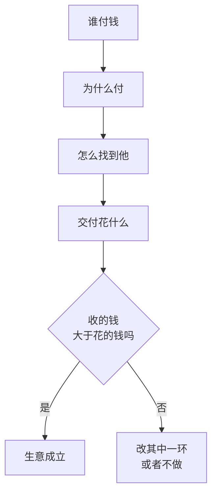

# 一门生意的骨架

一门生意不管看起来多复杂，拆到底都是四个问题：

1. **谁付钱**
2. **他为什么愿意付**
3. **你怎么找到他、让他知道你**
4. **把东西交到他手里，你要花什么**

这四个问题就是生意的骨架。商业模式的各种分类（买断、订阅、广告、抽成……）是在骨架之上长出来的肉，[《定价与商业模式》第 1 章](../pricing-monetization/01-business-models.md#常见的几种模式)有完整的表格，这一章不重复。我们只练一件事：**看到任何一门生意，都能在一两分钟内把这四个问题答出来**。

## 四个问题分别在问什么

### 谁付钱

这个问题看起来最简单，却最容易答错。常见的错法是把**使用者**当成**付费者**：

| 生意 | 使用者 | 付费者 |
|---|---|---|
| 儿童绘画班 | 孩子 | 家长 |
| 公司食堂 | 员工 | 公司（全部或部分） |
| 医院 | 病人 | 病人 + 医保 |
| 写字楼保洁 | 租户 | 物业公司 |
| 免费的短视频 App | 观众 | 广告主 |

使用者和付费者不同的时候，你要讨好的是两拨人：使用者决定用不用，付费者决定买不买。绘画班要让孩子喜欢，更要让家长看到孩子的作品、相信钱花得值。

还要问的是：**付费者有没有钱，付钱方不方便**。大学生可能非常需要职业规划，但付费能力有限；中小企业老板付费能力强，但他们的钱要经过报销、对公转账、开发票，流程慢，账期长。

### 为什么付

人愿意付钱，通常是因为下面几类原因之一，或者几类叠加：

| 原因 | 例子 |
|---|---|
| 省时间 | 外卖、家政、代账、洗衣 |
| 省钱或多赚钱 | 二手交易、团购、培训考证、销售咨询 |
| 解决做不到的事 | 修车、看病、法律咨询、装修 |
| 减少风险和麻烦 | 保险、律师审合同、品牌货而不是杂牌货 |
| 体验和情绪 | 奶茶、旅游、剧本杀、宠物用品 |
| 身份和归属 | 奢侈品、会员俱乐部、某个圈子的课程 |

一个有用的检验是：**如果你不存在，客户会怎么办？** 他可能自己做、找别人做、或者干脆不做。这三个替代方案的成本，就是你价格的天花板。客户自己做早饭要 20 分钟，那么一份早餐的价值里有一部分是这 20 分钟；楼下另一家早餐铺卖 8 元，那么你卖 15 元就要给出 7 元的理由。

### 怎么找到他

很多生意的问题不是东西不好，而是客户不知道你存在。找到客户的方式大致分几类：

| 方式 | 例子 | 特点 |
|---|---|---|
| 位置 | 地铁口的便利店、学校旁的文具店 | 房租高，但客户自己走过来 |
| 口碑和转介绍 | 老客户推荐的装修队、私教 | 成本低、信任高，但慢、难以控制 |
| 平台 | 美团、大众点评、淘宝、抖音 | 起量快，平台抽成、规则会变 |
| 内容 | 小红书笔记、公众号文章、短视频 | 一次投入长期有效，但要持续产出 |
| 销售 | 打电话、拜访、展会、招投标 | 适合客单价高的生意，人力成本高 |
| 广告 | 电梯广告、信息流投放 | 花钱买注意力，算得清就可以放大 |

找到一个客户花的钱，叫**获客成本**，第 5 章会专门算。这里只需要记住：**获客方式决定了生意的很大一部分成本结构**。开在黄金地段的店，获客成本藏在房租里；靠平台接单的店，获客成本藏在佣金和推广费里；靠销售的公司，获客成本藏在销售的工资和提成里。

### 交付花什么

把东西交到客户手里，你要花哪些钱和时间？这里要区分两类：

- **每多一单就多花的**：原料、包装、配送、按单计算的佣金、做这一单要用的工时
- **不管有没有单都要花的**：房租、设备、固定工资、软件订阅

这就是第 3 章要讲的可变成本和固定成本。在这一章只要能把它们列出来就够了。

还有一个常被忽略的问题：**交付能不能复制**。一碗面可以让另一个厨师照着方子做，一次心理咨询很难让别人替你做。能复制的交付，生意可以变大；依赖某个人的交付，生意的上限就是这个人的时间。

## 用身边的生意练一练

下面拆四门你一定见过的生意。数字都是**假设的**，只是为了说明骨架，不代表行业的真实水平。

### 小区门口的早餐铺

| 问题 | 答案 |
|---|---|
| 谁付钱 | 赶时间上班的人、送孩子上学的家长、附近的老人 |
| 为什么付 | 省时间（不用自己做）、便宜、热乎 |
| 怎么找到 | 位置：开在出小区必经的路上，早上自然有人流 |
| 交付花什么 | 面粉、肉、菜、豆浆原料、包装袋（按份）；房租、两个人的人工、燃气水电（固定） |

这门生意的关键在**位置和效率**：早上 6 点到 9 点集中出单，三个小时要卖出一天大部分的量。假设平均每单 8 元，原料和包装约 3 元，每天卖 400 单，那么每天扣掉原料后剩 2,000 元，一个月 6 万元，再减去房租和人工。它的软肋也很清楚：早高峰之外几乎没有生意，所以很多早餐铺中午改卖面条、下午卖包子，用同一个店面多赚一个时段。

### 快递驿站

| 问题 | 答案 |
|---|---|
| 谁付钱 | 主要是快递公司（每派一件给驿站一笔派件费），其次是寄件的居民 |
| 为什么付 | 快递公司省掉送货上门的人力；居民方便取件 |
| 怎么找到 | 和快递公司的网点签约；位置在小区里或门口 |
| 交付花什么 | 场地、货架、扫描设备、看店的人（大部分是固定的）；按件几乎没有额外成本 |

这是一个**使用者和付费者不同**的典型：取快递的居民一分钱不付，付钱的是快递公司。每件的派件费很低，假设只有几毛钱，所以驿站必须靠**件量**：一天 1,000 件和 300 件是两门完全不同的生意。很多驿站还会顺带卖饮料、做团购自提、接寄件，用已经付了房租的场地多赚一份钱。

### 驾校

| 问题 | 答案 |
|---|---|
| 谁付钱 | 学车的人，多数是学生和年轻上班族 |
| 为什么付 | 拿驾照是必须的，自己没法学 |
| 怎么找到 | 招生代理、在校园里摆点、老学员介绍、地图和点评平台 |
| 交付花什么 | 教练车、油费、场地、教练工资、考试相关费用 |

驾校的特点是**一次性预收全部学费**，交付却要持续几个月。这让驾校手里常常有一大笔「还没提供服务的钱」，第 4 章会讲这种预收的好处和风险。另一个特点是客户**一辈子通常只买一次**，所以驾校几乎不能靠老客户复购，只能靠口碑和招生渠道源源不断地找新客户。

### 打印复印店

| 问题 | 答案 |
|---|---|
| 谁付钱 | 学生、附近的小公司、办事需要打印材料的人 |
| 为什么付 | 自己没有打印机，或者需要彩印、装订、大幅面 |
| 怎么找到 | 位置：学校、政务服务中心、写字楼附近 |
| 交付花什么 | 纸张、墨粉（按张）；打印机租赁或折旧、房租、人工（固定） |

一张黑白打印的可变成本很低，假设只有几分钱，售价却可以是几毛到一块。看起来利润很高，但它的收入**极其依赖时段和季节**：学校开学、考试、毕业季忙不过来，寒暑假门可罗雀。房租和人工却是每个月都要付的。很多打印店会接图文设计、名片、横幅这些客单价更高的活，把淡季的固定成本摊薄。

## 从四门生意里看到什么

把四门生意放在一起，能看出几个规律：

| | 早餐铺 | 快递驿站 | 驾校 | 打印店 |
|---|---|---|---|---|
| 主要付费者 | 用户 | 快递公司 | 用户 | 用户 |
| 获客靠 | 位置 | 签约 + 位置 | 渠道 + 口碑 | 位置 |
| 每单可变成本 | 较高 | 几乎为零 | 中等 | 很低 |
| 收钱时间 | 当场 | 按月结算 | 一次预收 | 当场 |
| 主要风险 | 人流变化 | 件量不足、派件费下调 | 招生不足 | 淡季 |

- **获客方式和成本结构是绑在一起的**。靠位置的生意，房租就是获客成本
- **每单可变成本低的生意，靠量**。驿站和打印店都是这样，量不够时固定成本压得喘不过气
- **收钱的时间点和交付的时间点不一定一致**。驾校先收钱后交付，驿站先干活后收钱，这会直接影响手里有没有现金
- **几乎每门生意都在想办法用已经付了钱的东西多赚一份**：早餐铺卖午饭，驿站卖饮料，打印店接设计

这几个观察，就是后面几章要展开的内容。

## 拆你自己的公司

最后，用同样的四个问题拆一下你所在的公司。这比拆早餐铺难，因为大公司往往有好几条业务，每条的骨架不同。可以先只拆收入最大的那一条：

| 问题 | 你的公司 |
|---|---|
| 谁付钱 | |
| 他为什么付 | |
| 公司怎么找到他 | |
| 交付要花什么（每单多花的 / 不管有没有单都要花的） | |
| 钱什么时候收到 | |

如果有几栏你填不出来，说明你对公司业务的了解停留在自己的岗位上。这很正常。可以找销售、财务或者负责这条业务的同事聊一聊，第 9 章有一份可以拿去问的问题清单。

## 本章要点

- 任何生意都可以拆成四个问题：谁付钱、为什么付、怎么找到他、交付花什么
- 使用者和付费者经常不是同一个人，你要同时打动两拨人
- 「如果你不存在，客户会怎么办」决定了价格的天花板
- 获客方式和成本结构绑在一起：靠位置的生意，房租就是获客成本；靠平台的生意，佣金和推广费就是获客成本
- 交付成本要分清每单多花的和不管有没有单都要花的，后者是第 3 章的主角
- 收钱的时间和交付的时间不一致，会直接影响现金；这是第 4 章的话题
- 商业模式的完整分类见《定价与商业模式》，本书只练习拆骨架
