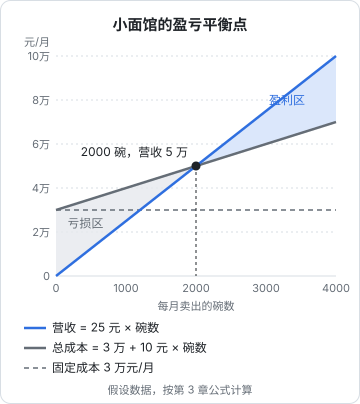

# 收入、成本与利润

上一章拆骨架时，我们只问了「收的钱大于花的钱吗」。这一章把这个问题算细：收入有几种说法，成本有哪两类，利润有几层，以及一门生意**至少要卖多少才不亏**。

这一章会用一个贯穿全章的例子：一家社区小面馆。数字是**假设的**，选它们只是因为好算、能自洽。

## 面馆的基本情况

| 项目 | 假设 |
|---|---|
| 平均每碗售价 | 25 元（堂食和外卖同价） |
| 每碗食材 | 8 元 |
| 外卖的包装、平台费用、满减补贴，摊到每碗 | 平均 2 元（外卖占四分之一，第 5 章拆开算） |
| 房租 | 12,000 元/月 |
| 两个雇员的工资和社保 | 13,000 元/月 |
| 水电燃气 | 3,000 元/月 |
| 装修和设备摊销、杂费 | 2,000 元/月 |
| 店主 | 自己掌勺，不给自己发工资 |

这个月卖了 2,400 碗。它赚钱了吗？

## 三层利润

先把这个月的账按第 1 章的利润表结构排一遍：

| 行 | 金额（元） | 说明 |
|---|---|---|
| 营收 | 60,000 | 2,400 碗 × 25 元 |
| 减：食材 | 19,200 | 2,400 × 8 |
| 减：外卖相关 | 4,800 | 2,400 × 2 |
| **= 扣掉每碗直接花费后剩下的** | **36,000** | |
| 减：房租 | 12,000 | |
| 减：人工 | 13,000 | |
| 减：水电燃气 | 3,000 | |
| 减：摊销、杂费 | 2,000 | |
| **= 经营利润** | **6,000** | |

这里有几个容易混用的词，分清楚：

- **营收**（营业收入）：卖出去的总金额，60,000 元。员工常听到的「业绩」「流水」「GMV」，指的大多是它或者比它更大的数字（比如没扣退款、没扣优惠的成交额），**它不代表赚了多少**
- **毛利**：营收减去直接为这些商品花的钱（会计上叫营业成本）。餐饮行业常说的毛利只扣食材：$60{,}000 - 19{,}200 = 40{,}800$ 元
- **经营利润**（也叫营业利润）：再扣掉房租、人工这些运营开支后剩下的，6,000 元
- **净利润**：经营利润再扣掉利息、所得税等，是最后真正剩下的。税怎么算见[《财务与税务》第 2 章](../opc-finance/02-taxes.md)，本书的例子都停在经营利润

把它们写成比率，叫**毛利率**、**经营利润率**、**净利率**：

$$
\text{毛利率} = \frac{\text{毛利}}{\text{营收}} = \frac{40{,}800}{60{,}000} = 68\%
$$

$$
\text{经营利润率} = \frac{6{,}000}{60{,}000} = 10\%
$$

68% 的毛利率听起来很高，10% 的经营利润率就平常了。中间的差距被房租和人工吃掉了。这就是为什么**只看毛利率会高估一门生意**：开店的人常说「一碗面成本才 8 块」，却忘了一个月 3 万元的房租人工是要先挣回来的。

> [!IMPORTANT]
> 还有一件事：这家店的店主自己掌勺，没有给自己发工资。所以这 6,000 元不是「老板白赚的」，而是店主每天在后厨干十几个小时的报酬，外加他投进去的装修钱的回报。如果请一个厨师来替他，要多付至少几千元，店就接近不赚钱了。看小生意的利润，**一定要问老板自己的工资算没算进去**。

## 固定成本和可变成本

上面那张表里，成本其实分成两类：

| | 可变成本 | 固定成本 |
|---|---|---|
| 定义 | 每多卖一份，就多花一份 | 在一定范围内，卖多卖少都要花 |
| 面馆的例子 | 食材、包装、平台佣金 | 房租、雇员工资、装修摊销 |
| 卖 0 碗时 | 0 | 照样 30,000 元 |
| 卖 4,000 碗时 | 40,000 元 | 还是 30,000 元 |

这个区分看起来简单，却是这一章最重要的概念，因为它决定了**卖得多和卖得少时，利润会怎么变**。

几个细节：

- **「固定」是有范围的**。面馆一个月卖到 3,500 碗以上，两个雇员忙不过来，要再请一个人，固定成本就跳一个台阶。这种叫**阶梯成本**，在一个区间里固定，跨过区间就跳
- **同一项开支在不同生意里归类不同**。外卖平台的佣金按单收，是可变的；如果改成每月付一笔固定的推广费，它就变成了固定的
- **人工是最常见的「可以变换」的成本**。雇全职员工是固定成本，按小时请兼职、按件付外包，就把它变成了可变成本。代价是单价更高、稳定性更差

## 边际贡献：每多卖一份，能多剩多少

把售价减去每份的可变成本，叫**单位边际贡献**（也有人叫「单位贡献毛益」）：

$$
\text{单位边际贡献} = \text{售价} - \text{单位可变成本} = 25 - 10 = 15 \text{ 元}
$$

它的意思是：每多卖一碗面，就多出 15 元**用来覆盖固定成本**；固定成本全覆盖之后，每一碗的 15 元才是利润。

边际贡献和毛利很像，区别在于扣掉的东西：毛利扣的是会计上的营业成本，边际贡献扣的是全部可变成本。面馆的毛利只扣了食材（每碗剩 17 元），边际贡献还扣了外卖相关的 2 元（每碗剩 15 元）。做经营判断时，边际贡献更有用，因为它直接回答「多卖一份能多剩多少」。

把单位边际贡献除以售价，叫**边际贡献率**：$15 / 25 = 60\%$。意思是每 100 元营收里，有 60 元可以拿去覆盖固定成本。

## 盈亏平衡点

现在可以回答这一章最核心的问题：面馆一个月至少要卖多少碗，才能不亏？

不亏，就是边际贡献的总和刚好等于固定成本：

$$
\text{盈亏平衡销量} = \frac{\text{固定成本}}{\text{单位边际贡献}} = \frac{30{,}000}{15} = 2{,}000 \text{ 碗/月}
$$

按一个月 30 天，大约每天 67 碗。换成营收：

$$
\text{盈亏平衡营收} = \frac{\text{固定成本}}{\text{边际贡献率}} = \frac{30{,}000}{60\%} = 50{,}000 \text{ 元/月}
$$

画成图就是这样：

图里有三条线：

- **固定成本线**是一条水平虚线，不管卖多少都在 3 万
- **总成本线**从 3 万出发，每多卖一碗往上加 10 元
- **营收线**从 0 出发，每多卖一碗往上加 25 元

营收线比总成本线陡，所以它迟早会追上。追上的那一点就是盈亏平衡点。点的左边，营收在总成本下面，每个月都在亏；点的右边，两条线之间的距离就是利润，而且越往右越大。

验算一下这个月的数：卖了 2,400 碗，比平衡点多 400 碗，每碗贡献 15 元，利润就是 $400 \times 15 = 6{,}000$ 元，和上面那张表一致。

**这个算法给了一个很实用的视角**：过了平衡点之后，每一单的利润不是「售价减成本」，而是单位边际贡献。第 2,001 碗面给老板带来的是整整 15 元的利润，而第 1,999 碗只是让亏损少了 15 元。

## 想赚到一个目标利润，要卖多少

同样的公式可以倒过来用。如果店主希望每个月至少剩 15,000 元（相当于给自己发一份像样的工资），要卖多少碗？

$$
\text{目标销量} = \frac{\text{固定成本} + \text{目标利润}}{\text{单位边际贡献}} = \frac{30{,}000 + 15{,}000}{15} = 3{,}000 \text{ 碗/月}
$$

每天 100 碗。从每天 80 碗（2,400 ÷ 30）提到 100 碗，要多 25%。这时候店主就面对真实的经营问题了：多出来的 20 碗从哪来？延长营业时间？上外卖平台多投推广？推出早餐？每一种办法都会改变成本结构，需要重新算一遍。

## 哪个数字最敏感

平衡点由三个数决定：售价、单位可变成本、固定成本。分别把它们改一点，看平衡点怎么变：

| 变化 | 单位边际贡献 | 固定成本 | 盈亏平衡销量 | 每天 |
|---|---|---|---|---|
| 现状 | 15 | 30,000 | 2,000 | 67 |
| 售价涨 2 元（27 元） | 17 | 30,000 | 1,765 | 59 |
| 食材每碗省 1 元 | 16 | 30,000 | 1,875 | 63 |
| 房租涨 3,000 元 | 15 | 33,000 | 2,200 | 73 |
| 售价降 3 元搞促销（22 元） | 12 | 30,000 | 2,500 | 83 |

（销量四舍五入到整数。）

几个观察：

- **涨价的效果比降成本更大**。售价涨 2 元，边际贡献从 15 涨到 17，涨了 13%；食材省 1 元只涨了 7%。前提是涨价后客人不流失，这正是定价难的地方，定价的心理和方法见[《定价与商业模式》](../pricing-monetization/)
- **降价促销很贵**。降 3 元看起来只是 12%，但边际贡献从 15 降到 12，少了 20%，要多卖 25% 才能保持同样的利润。促销如果没有带来足够多的新客人，就是在亏钱买热闹
- **房租是开店前就定下的**。签一份贵的租约，等于把平衡线永久地往右推

## 毛利率能告诉你什么

毛利率高低，往往说明了一门生意的性质：

| 毛利率 | 常见在 | 意味着 |
|---|---|---|
| 很低 | 批发、代工、大宗商品贸易 | 靠周转和规模，一点点费用的失控就会亏 |
| 中等 | 餐饮、零售、制造业 | 要同时管好价格、成本和运营效率 |
| 很高 | 软件、咨询、品牌消费品、知识服务 | 每单直接成本低，钱大多花在获客、研发和人上 |

上面只是方向，具体到某个行业某家公司差别很大，第 6 章会讲怎么从财报里查。

毛利率高不等于赚钱多。一家软件公司毛利率可能很高，但它要养大量的销售和研发，最后的净利率可能很低甚至是负的；一家超市毛利率不高，但费用控制得好、周转快，反而能稳定赚钱。**毛利率说明的是「每卖一份能留下多少空间」，空间用来干什么、够不够用，要看下面的费用**。

## 本章要点

- 营收不是利润；毛利只扣直接成本，经营利润再扣运营开支，净利润再扣利息和税
- 只看毛利率会高估一门生意，房租和人工常常吃掉大部分毛利
- 看小生意的利润，先问老板自己的工资有没有算进去
- 成本分两类：可变成本随销量变，固定成本在一定范围内不变；固定成本跨过区间会跳台阶
- 单位边际贡献 = 售价 − 单位可变成本，它是每多卖一份能多剩的钱
- 盈亏平衡销量 = 固定成本 ÷ 单位边际贡献；目标销量 = （固定成本 + 目标利润）÷ 单位边际贡献
- 涨价对平衡点的影响通常比降成本大，降价促销比看起来更贵，签租约等于提前决定了平衡点
