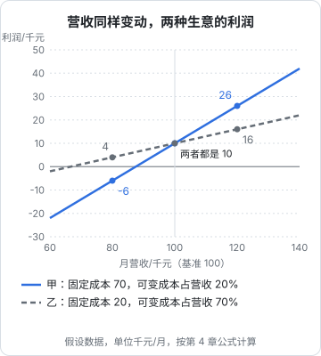
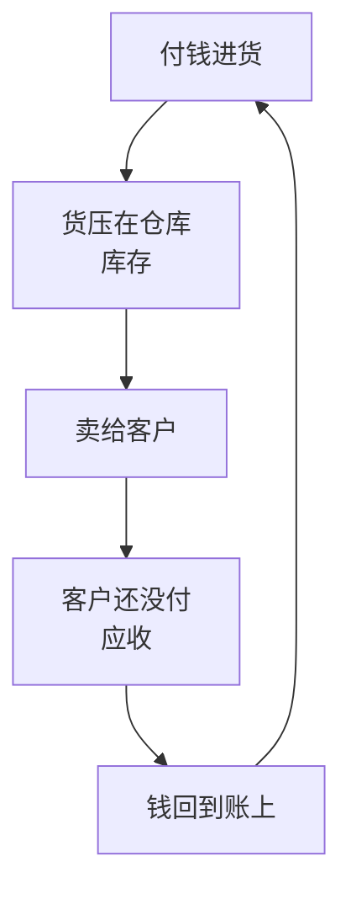

# 经营杠杆与生意为什么会死

上一章的面馆，过了盈亏平衡点之后每碗面多赚 15 元。这一章换个角度：**同样是营收涨 20% 或跌 20%，为什么有的生意利润翻倍，有的生意直接亏损？** 然后看生意最常见的几种死法。

## 两门营收一样的生意

假设有两门生意，每月营收都是 10 万元，经营利润都是 1 万元，但成本结构完全不同（单位千元/月，**假设数据**）：

| | 甲：高固定成本 | 乙：低固定成本 |
|---|---|---|
| 例子 | 自己租场地、雇全职员工的健身房 | 不租场地、按单找兼职的活动策划 |
| 营收 | 100 | 100 |
| 可变成本 | 20（占营收 20%） | 70（占营收 70%） |
| 边际贡献 | 80 | 30 |
| 固定成本 | 70 | 20 |
| 经营利润 | 10 | 10 |

现在营收分别涨 20% 和跌 20%。可变成本跟着按比例变，固定成本不动：

| 营收 | 甲的利润 | 乙的利润 |
|---|---|---|
| 80（跌 20%） | 80 − 16 − 70 = **−6** | 80 − 56 − 20 = **4** |
| 100（基准） | 10 | 10 |
| 120（涨 20%） | 120 − 24 − 70 = **26** | 120 − 84 − 20 = **16** |

营收同样涨 20%，甲的利润涨了 160%，乙涨了 60%；营收同样跌 20%，甲从赚 1 万变成亏 6 千，乙只是少赚了一些。

这种「固定成本越高，利润对营收越敏感」的现象，叫**经营杠杆**。可以用一个数衡量它：

$$
\text{经营杠杆系数} = \frac{\text{边际贡献}}{\text{经营利润}}
$$

甲是 $80 / 10 = 8$，乙是 $30 / 10 = 3$。意思是：营收每变动 1%，甲的利润变动约 8%，乙约 3%。用上面的数验证：营收涨 20%，甲的利润涨 $8 \times 20\% = 160\%$，乙涨 $3 \times 20\% = 60\%$，和表里一致。

> [!NOTE]
> 经营杠杆系数不是固定的：越接近盈亏平衡点，经营利润越小，系数越大。甲的盈亏平衡营收是 $70 / 80\% = 87.5$ 千元，乙是 $20 / 30\% \approx 66.7$ 千元。甲离平衡点只有 12.5% 的距离，乙有三分之一。

### 杠杆是双向的

经营杠杆本身没有好坏。它意味着：

- **生意好的时候，高固定成本的生意赚得快**。健身房会员从 500 人涨到 600 人，场地和教练不用加，多出来的会费几乎全是利润。软件公司也是这样：做出来之后，多卖一份几乎不增加成本
- **生意差的时候，高固定成本的生意亏得也快**。会员掉到 400 人，房租一分不少，很快就入不敷出

所以判断一门生意时，除了问「现在赚不赚钱」，还要问**「如果营收掉 20%，它会怎样」**。高杠杆的生意要有足够的现金垫底，或者有办法在需求下降时把一部分固定成本变成可变的（比如把全职换成兼职、把自有场地换成按次租用）。

小生意起步时，通常建议**先低杠杆、再高杠杆**：先用按单付费的方式验证有没有人买，确认需求稳定了，再签长租约、雇全职员工，用固定成本换更高的单位利润。

## 利润和现金不是一回事

第 3 章算的都是利润。但生意不是因为利润为负才倒闭的，而是因为**账上没钱了**。利润和现金之间差了什么，[《财务与税务》第 4 章](../opc-finance/04-cash-flow.md#利润不等于现金)有一张完整的对照表。这里只讲三个最影响普通生意的项目：库存、应收、预收。

钱在这个圈里转一圈的时间越长，生意需要垫的钱就越多。

### 库存：钱变成了货

**例：一家服装店**（假设）。店主 3 月初花 10 万元进了一批春装，打算三个月卖完，售价总额 20 万元。

- 3 月卖了 6 万元，账面利润看起来不错，但手里现金是：$-10 + 6 = -4$ 万元
- 4 月又卖了 8 万元，现金回到 +4 万
- 5 月天热了，剩下的春装卖不动，打五折清掉一部分

账面上，春装的毛利率是 50%；实际上，资金在库存里压了三个月，最后一批还要打折。卖不掉的库存不是资产，是**变不回钱的钱**。服装、生鲜、电子产品这类会过季、会坏、会贬值的商品，库存是头号风险。

### 应收：干完活还没收到钱

**例：一家给企业做活动的策划公司**（假设）。接了一个 30 万元的项目，要先垫付场地、搭建、物料 18 万元，合同约定活动结束后 90 天付款。

- 活动做完，利润表上确认了 30 万收入、12 万毛利
- 现金上，公司先掏出去 18 万，要等三个月才收回 30 万
- 如果同时接了三个这样的项目，就要垫 54 万

这就是很多 To B 生意「越接单越缺钱」的原因。大客户的账期往往更长，而且你没有议价能力。账期怎么谈、怎么催款，见[《财务与税务》第 4 章的账期一节](../opc-finance/04-cash-flow.md#账期开了票不等于有钱)。

### 预收：先拿钱后干活

反过来的情况是**预收**：客户先付钱，你后提供服务。健身房年卡、理发店充值卡、驾校学费、培训课程、预售的商品都是这样。

预收对现金非常友好：钱先到手，可以用来付房租、进货、扩张。但它有两个陷阱：

1. **预收的钱不是你的**。在会计上它是负债，你欠客户还没提供的服务。如果把预收款当利润花掉，等到要交付的时候就没钱了
2. **预收会掩盖生意的真实状况**。一家健身房每月新卖 100 张年卡，现金流看起来很健康；一旦新卡卖不动，过去卖出的年卡还要继续提供服务，场地、教练的成本一分不少，现金会突然断掉。健身房、教培机构「跑路」的新闻，很多就是这个机制

> [!WARNING]
> 面向个人销售充值卡、会员卡、课程包等预付产品，各地有专门的监管规定，部分行业对单张卡金额、预收资金存管、退款都有要求。具体以商务部门、市场监管部门和行业主管部门的最新规定为准，开展前向当地相关部门核实。

## 生意最常见的几种死法

利润和现金之外，还有一些模式反复出现。下面这几种，每一种都能在身边找到例子。

### 扩张太快

**例：第 3 章的面馆开第二家店**（假设）。第一家店每月经营利润 6,000 元，店主觉得模式跑通了，决定开分店：

| 项目 | 金额 |
|---|---|
| 装修和设备 | 15 万元，一次性 |
| 房租押金（三个月） | 3.6 万元 |
| 新店要请一个厨师（店主分身乏术） | 每月 8,000 元，固定成本从 3 万变成 3.8 万 |
| 新店盈亏平衡销量 | $38{,}000 / 15 \approx 2{,}533$ 碗/月，每天约 84 碗 |
| 新店头三个月每天 40 碗 | 每月边际贡献 $1{,}200 \times 15 = 18{,}000$，亏损 20,000 元 |

开业前就要掏出将近 19 万元，头三个月每月还要亏 2 万。而第一家店一年只赚 7.2 万。更隐蔽的问题是：店主去照看新店了，老店的出品和服务开始下滑，原来的 6,000 元也保不住。

扩张太快的本质是**用一门生意的利润，去赌另一门还没验证的生意**，而且同时稀释了自己的注意力。成熟的做法是：老店的现金能覆盖新店的全部投入加至少半年的亏损，并且老店离开你也能正常运转，再考虑开第二家。

### 单一大客户

**例：一家五人的设计工作室**（假设）。每月营收 5 万元，其中 3 万来自同一家公司。每单的直接花费（素材、打样）占营收约 10%，房租和工资等固定成本每月 3 万元。

- 现在：边际贡献 $50{,}000 \times 90\% = 45{,}000$，利润 15,000 元
- 大客户换了供应商：营收剩 2 万，边际贡献 18,000，**每月亏 12,000 元**

失去一个客户，就从赚钱变成亏钱。单一大客户的风险不只是可能流失：

- **议价权在对方手里**。对方要求降价、延长账期、增加免费修改，你很难拒绝
- **你会被对方的节奏绑住**。为了服务好它，你没有精力开发新客户，依赖越来越深
- **对方的问题会变成你的问题**。它业务收缩、资金紧张、换了对接人，都可能让你一夜之间失去大部分收入

常见的警戒线是**单一客户占营收超过三成就要警惕**，不是硬规则，但值得记住。

### 现金断裂

前面讲的库存、应收、扩张、大客户，最后都会汇到同一个结局：账上没钱了。现金断裂的可怕之处在于它常常发生在**账面盈利**的时候：

- 订单越来越多，但每一单都要垫钱，应收越积越多
- 为了拿更低的进货价，一次进了半年的货
- 预收款花在了扩张上，新客户却没跟上

预防现金断裂的工具是**跑道**（还能撑几个月）和**现金预测表**（未来几个月每月进多少、出多少）。这两样怎么算、怎么做，[《财务与税务》第 4 章](../opc-finance/04-cash-flow.md#跑道你还能撑几个月)讲得很具体，这里不重复。记住一个原则就够了：**看利润判断生意成不成立，看现金判断还能活多久**。

### 其他几种

| 死法 | 表现 | 常见在 |
|---|---|---|
| 平台依赖 | 平台改规则、提佣金、降流量，收入断崖下跌 | 靠单一平台接单的店铺、主播 |
| 老板就是产品 | 老板生病、累垮或离开，生意停摆 | 个人工作室、手艺型小店 |
| 价格战 | 同行降价，跟就亏，不跟就没客人 | 门槛低、同质化的生意 |
| 成本被锁死 | 签了长租约、买了专用设备，需求变了也退不出 | 重装修的实体店 |

这些死法没有一种是突然发生的，它们都会在账上提前留下痕迹：客户集中度越来越高、应收越来越多、平台占比越来越大、老板的工时越来越长。**会算账的价值，就是在痕迹出现时看得见**。

## 本章要点

- 经营杠杆：固定成本越高，利润对营收变化越敏感；经营杠杆系数 = 边际贡献 ÷ 经营利润
- 高杠杆的生意好时赚得快、差时亏得快；判断生意时要问「营收掉 20% 会怎样」，起步时宜先低杠杆后高杠杆
- 利润不等于现金：库存把钱变成货，应收让你先垫钱，预收先拿钱但它是负债
- 预收款不是利润，把它花掉、或者被它掩盖了新客下滑，是健身房、教培机构出问题的常见机制
- 扩张太快是用老生意的利润去赌新生意，同时稀释老板的注意力
- 单一客户占比过高会让你失去议价权，失去它可能直接从盈利变成亏损
- 生意的死法会在账上提前留下痕迹；跑道和现金预测表的做法见《财务与税务》第 4 章
