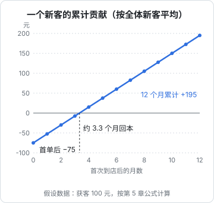
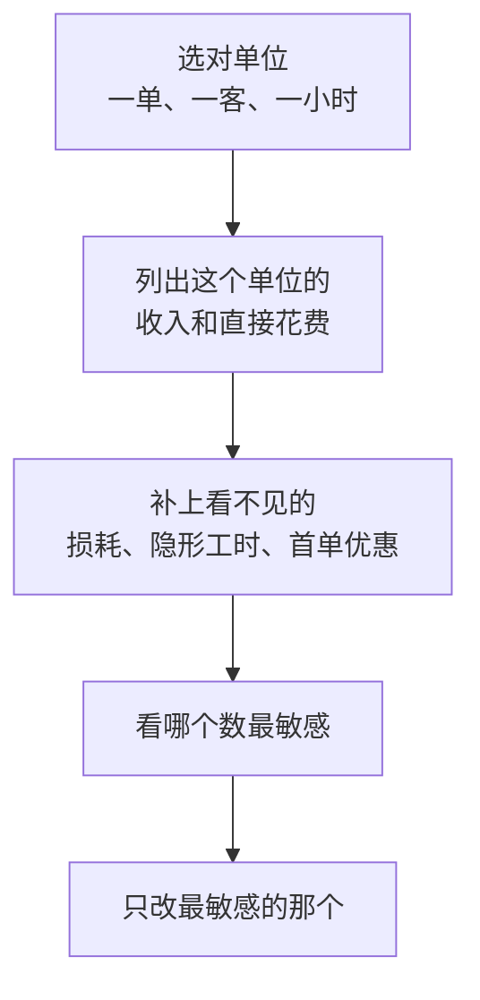

# 单位经济：一单、一个客户、一小时

前两章算的都是整门生意一个月的账。但老板做决定时，很少直接看月度总账，而是看更小的单位：**这一单赚多少？这个客户值不值得花钱拉？我这一小时值多少钱？** 这种按最小单位算账的方法，叫**单位经济**（unit economics）。

整门生意的账是结果，单位经济是原因。总账告诉你这个月赚了 6,000 元，单位经济告诉你为什么是 6,000 元，以及哪里能改。

## 选对「单位」

不同生意，最有意义的单位不一样：

| 单位 | 回答的问题 | 适合 |
|---|---|---|
| 一单 / 一件 | 卖出一份能剩多少 | 餐饮、零售、电商 |
| 一个客户 | 花多少钱拉来一个客户，他能带来多少 | 有回头客的服务业、会员制、订阅 |
| 一小时 | 我（或员工）的时间值多少 | 手艺、咨询、设计、家政、教练 |
| 一平方米 | 店面每一块地方产出多少 | 实体零售、餐饮 |
| 一个员工 | 每个人带来多少营收和利润 | 任何雇人的生意 |

这一章挑前三个最常用的单位，各用一个例子。数字都是**假设的**。

## 一单：面馆的堂食和外卖

第 3 章的面馆，平均每碗的可变成本是 10 元。这个 10 元是平均出来的：堂食和外卖其实差别很大。把它拆开：

> [!WARNING]
> 外卖平台的佣金比例、配送费分摊、满减和红包规则各平台不同、各城市不同，而且经常调整。下表的费用结构按 2026 年 3 月中国新闻网「民生调查局」对北京商家的报道整理（技术服务费约为订单金额的 6%，3 公里内商家承担基础运费约 3.5 元，参加活动还要承担红包），金额按假设取整；这是媒体个案，不是平台公布的统一费率，实际以商家后台的结算明细和平台最新合同为准。

| 每碗 | 堂食 | 外卖 |
|---|---|---|
| 售价 | 25 | 25 |
| 食材 | 8 | 8 |
| 包装 | 0 | 1.5 |
| 平台技术服务费（假设 6%） | 0 | 1.5 |
| 商家承担的配送费 | 0 | 3 |
| 商家承担的满减、红包 | 0 | 2 |
| **单位边际贡献** | **17** | **9** |

很多人以为平台「抽成」就是佣金那一项。实际上名义佣金只占一小块，配送费和活动补贴加起来往往更多：上表外卖一碗被扣掉的 6.5 元里，技术服务费只有 1.5 元。看平台费用时要把这几项加在一起，算成占售价的比例（这里是 26%），才能和堂食比。

2025 年京东、淘宝闪购和美团打补贴战，消费者端很热闹，商家端的账却不一定更好看：前面提到的报道里，一份 20 元的订单，商家参加配送费活动、补贴 7 元红包后，实际到手不足 4 元；京东外卖宣称的免佣金从 2026 年 1 月 1 日起开始收费，淘宝闪购部分地区新签合同的佣金也有上调。2026 年 6 月，市场监管总局就《外卖平台补贴行为规范十条》公开征求意见，其中一条是平台不得强制商家参加补贴活动或承担补贴成本；截至 2026 年 11 月本书修订时，没查到它正式发布的消息。这些变化对单位经济的启示是一样的：**补贴期多出来的单量，要按每一单扣完全部费用后的数字去算，不能只看订单数涨了多少**。

堂食每碗剩 17 元，外卖只剩 9 元，差不多一半。外卖占四分之一时，平均每碗正好是 $0.75 \times 17 + 0.25 \times 9 = 15$ 元，和第 3 章一致。

看到这张表，很多人的第一反应是「外卖不赚钱，砍掉」。但单位经济要和固定成本一起看：

- **如果堂食座位在饭点已经坐满**，外卖是在不增加房租和人工的前提下多卖的。每碗 9 元虽然少，但全部是增量。一个月多卖 600 碗外卖，就多 5,400 元
- **如果外卖多到要再请一个人打包**，就要用新增的人工去比新增的边际贡献
- **如果外卖抢走了原本会来堂食的客人**，每转移一碗就少赚 8 元

所以「外卖赚不赚钱」没有统一答案，取决于它是增量还是替代。这种思路叫**增量分析**：只看这个决定会多带来什么、多花掉什么，不被平均数误导。

## 一个客户：宠物洗护店的获客

有回头客的生意，单位应该是「一个客户」而不是「一单」，因为拉来一个客户的钱，要靠他之后很多次消费才能挣回来。

假设一家宠物洗护店：

| 项目 | 假设 |
|---|---|
| 洗护一次的价格 | 120 元 |
| 每次的直接成本 | 洗护用品 15 元 + 洗护师提成 30 元 = 45 元 |
| 每次的边际贡献 | 75 元 |
| 获客方式 | 在点评平台做推广，每月 3,000 元，带来 30 位新客 |
| 新客首单优惠 | 立减 50 元 |
| 回头率 | 60% 的新客之后会再来 |
| 回头客的频率 | 平均每两个月来一次（一年 6 次） |

### 获客成本

**获客成本**（CAC，customer acquisition cost）是拉来一个新客户平均花的钱：

$$
\text{获客成本} = \frac{\text{推广花费}}{\text{新客数}} = \frac{3{,}000}{30} = 100 \text{ 元}
$$

首单优惠也是获客的代价。首单收 70 元，扣掉 45 元的直接成本，首单只贡献 25 元。所以新客第一次来完，店里在这个客人身上还亏：

$$
25 - 100 = -75 \text{ 元}
$$

### 回本周期

之后这 75 元要靠回头消费挣回来。按全体新客平均（不是只看回头客），每个新客每月带来的边际贡献是：

$$
60\% \times \frac{6}{12} \times 75 = 22.5 \text{ 元/月}
$$

所以平均要：

$$
\text{回本月数} = \frac{75}{22.5} \approx 3.3 \text{ 个月}
$$

一年下来，每个新客平均累计贡献 $-75 + 22.5 \times 12 = 195$ 元。这 195 元还要拿去覆盖房租、店长工资等固定成本，剩下的才是利润。

### 哪个数字最要命

把几个假设分别改一改：

| 变化 | 每月预期贡献 | 回本月数 |
|---|---|---|
| 现状 | 22.5 | 3.3 |
| 回头率降到 30% | 11.25 | 6.7 |
| 推广变贵，获客成本 200 元 | 22.5 | 7.8 |
| 首单优惠从 50 元减到 20 元（假设新客数不变） | 22.5 | 2.0 |
| 回头客改为每月来一次 | 45 | 1.7 |

（获客成本 200 元时，首单后亏 175 元；首单优惠 20 元时，首单贡献 55 元，首单后亏 45 元。）

能看出两件事：

- **回头率和到店频率比获客成本更重要**。回头率减半，回本时间翻倍。所以服务业老板花大力气做会员、提醒复购、维护老客，本质上是在改善单位经济
- **首单优惠是一把双刃剑**。它能拉来更多新客，但也直接加深了首单的亏损，而且会吸引来只薅优惠、不回头的客人，实际回头率可能低于平均

订阅类产品的同类计算叫 LTV（客户生命周期价值）和 LTV / CAC，公式和流失率的关系在[《数据分析与埋点》第 4 章](../product-analytics/04-retention-ltv.md#回本周期与-ltv--cac)讲过。思路完全一样：**拉一个客户花多少，他在离开前能带来多少，多久能挣回来**。

## 一小时：摄影师的时间

靠手艺、靠专业吃饭的生意，最终的限制是时间。所以最有用的单位是**每小时赚多少**。

假设一位独立摄影师，有两种产品：

| | 个人写真 | 证件照 |
|---|---|---|
| 价格 | 800 元 | 99 元 |
| 直接花费 | 影棚 100 + 化妆师 150 = 250 元 | 打印冲印 5 元 |
| 边际贡献 | 550 元 | 94 元 |
| 沟通、约时间 | 1 小时 | 10 分钟 |
| 拍摄 | 2 小时 | 20 分钟 |
| 选片、修图 | 4 小时 | 10 分钟 |
| 交付、路上 | 1 小时 | 0 |
| 总耗时 | 8 小时 | 40 分钟 |
| **每小时边际贡献** | **约 69 元** | **约 141 元** |

写真单价是证件照的 8 倍，按小时算却只有一半。原因是写真的「隐形工时」太多：修图 4 小时、沟通 1 小时，客户看不见，却实实在在花掉了。

这不是说证件照更好。证件照要求店面有稳定的客流，一天能不能接到 10 单是个问题；写真一单的金额大，适合靠作品集和口碑接单。但算完这张表，摄影师至少会想：写真能不能把修图外包出去？能不能用固定流程把沟通时间压到半小时？能不能涨价？

### 可收费工时只是一部分

按小时算还有一个常被忽略的问题：你不是每个工作小时都在为客户干活。找客户、发作品、回消息、学习、记账、处理退款，都是**不能收费的工时**。

假设这位摄影师每月工作 200 小时，其中能直接对应到订单的只有 120 小时，**可收费比例**就是 60%。那么他真正的时薪要按 200 小时算，而不是 120 小时：

$$
\text{真实时薪} = \frac{\text{月边际贡献合计}}{\text{全部工作小时}}
$$

很多从公司出来接私活的人，报价时按「我一小时干活值多少」来算，结果做了一年发现收入比上班还低，原因就在这里。一年真正能卖出多少小时、扣掉成本后的有效时薪怎么算，见[《把职场技能变成生意》第 4 章](../skills-to-business/04-capacity-and-ceiling.md#有效时薪扣掉成本以后)。

## 零售：看不见的损耗

最后看一个零售的例子，它提醒你单位经济里有些成本是**不按单出现**的。

假设一家社区水果店，某种苹果进价 6 元一斤，卖 10 元一斤。账面毛利率：

$$
\frac{10 - 6}{10} = 40\%
$$

但水果会碰伤、会烂、会被挑剩。假设进 100 斤只能卖出 85 斤，**损耗率**是 15%。那么每卖出一斤，实际承担的进货成本是：

$$
\frac{6}{1 - 15\%} = \frac{6}{0.85} \approx 7.06 \text{ 元}
$$

真实毛利率变成：

$$
\frac{10 - 7.06}{10} \approx 29.4\%
$$

如果损耗率是 25%，每斤实际成本是 8 元，毛利率只剩 20%，是账面的一半。所以水果店、生鲜店、面包店的老板最关心的往往不是进价，而是**损耗**：进多少、什么时候打折清货、怎么摆放能少碰伤。晚上八点的水果打折，就是在用一点毛利换更低的损耗。

同样的道理也适用于其他「不按单出现」的成本：电商的退货、服务业的返工、餐饮的试菜和员工餐。它们不出现在某一单的账上，却会分摊到每一单。

## 单位经济的几个原则

把这一章的例子收拢一下：

- **单位经济不成立，规模越大亏得越多**。如果一单在扣掉直接花费后是负的，多卖只会多亏；如果一个客户的获客成本永远挣不回来，越推广越亏。很多靠补贴扩张的生意倒下，就是这个原因
- **平均数会骗人**。面馆的平均每碗 15 元，掩盖了堂食和外卖的差别；宠物店的平均回头率，掩盖了薅优惠的新客。能拆开就拆开
- **最敏感的那个数，就是最值得花精力改的地方**。不要同时改五件事

## 本章要点

- 单位经济按最小单位算账：一单、一个客户、一小时、一平方米、一个员工，选对单位比算得精确更重要
- 外卖这类「每单赚得少」的业务是否值得做，要看它是增量还是替代，这叫增量分析
- 获客成本 = 推广花费 ÷ 新客数；首单优惠也是获客成本的一部分
- 回本月数 = 首单后的亏损 ÷ 每个新客平均每月的贡献；回头率和到店频率通常比获客成本更关键
- 按小时算，要算上沟通、修改、交付等隐形工时，以及找客户、学习等不能收费的工时
- 零售要把损耗算进单位成本：实际单位成本 = 进价 ÷（1 − 损耗率）
- 单位经济不成立的生意，规模越大亏得越多
