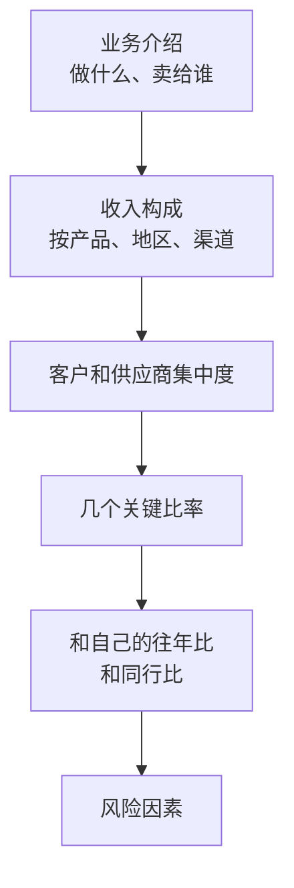

# 用财报读别人的生意

前面几章算的都是小生意的账，数字是我们自己假设的。真实世界里，有一类公司的账是公开的：**上市公司**，以及正在申请上市的公司。它们每年都要公布年报，上市前要公布招股说明书（简称招股书），里面有收入、成本、利润、客户集中度，甚至有管理层自己对生意的描述。

这是普通人能免费看到的、最详细的商业资料。这一章讲怎么用前几章学到的工具，从这些资料里读出一门生意的骨架和赚钱能力。

会计恒等式、复式记账、三张报表的定义，在[《财务与税务》第 1 章](../opc-finance/01-bookkeeping-basics.md)讲过，这里不重复。我们不学怎么编报表，只学**怎么读**。

## 去哪里找

> [!WARNING]
> 下面的网站和年报章节名称按目前的常见情况整理，信息披露规则和网站可能调整；以证监会、各证券交易所公布的最新信息为准。

| 市场 | 去哪里找 |
|---|---|
| A 股（上交所、深交所、北交所） | 巨潮资讯网（cninfo.com.cn），或各交易所官网的「信息披露」栏目 |
| 港股 | 香港交易所的「披露易」（hkexnews.hk） |
| 美股 | 美国证券交易委员会的 EDGAR 系统（sec.gov），年报叫 10-K，招股书叫 S-1 或 F-1 |

用公司名或股票代码搜索，找「年度报告」。A 股年报通常有几百页，不需要从头读。

**招股书比年报更适合入门**。公司上市前要向投资人解释清楚自己是做什么的、怎么赚钱、有什么风险，所以招股书里的「业务」章节往往是这家公司最完整、最通俗的自我介绍，还会附上行业介绍和竞争对手。想了解一个陌生的行业，找一家这个行业里最近上市的公司，读它的招股书，是很高效的办法。

## 先读文字，再读数字

拿到一份年报，建议按这个顺序：

### 第一步：用四个问题拆骨架

在年报的「公司业务概要」「管理层讨论与分析」这类章节里，找到第 2 章的四个问题的答案：谁付钱、为什么付、怎么找到客户、交付花什么。如果读完还答不出来，说明这家公司的业务对你来说太复杂了，换一家更简单的。

### 第二步：看收入构成

年报里通常有一张表，按**产品**、**地区**、**销售模式**拆分营收和毛利率。这张表往往比公司的宣传语更能说明它到底靠什么赚钱。

比如一家看起来是「连锁茶饮品牌」的公司，收入构成表可能显示：大部分收入来自**向加盟店销售原料和设备**，而不是卖奶茶。那它的真实生意是**给加盟商供货**，它的客户是加盟商，而不是喝奶茶的人。这个发现会改变你对它所有数字的理解。

### 第三步：看集中度

A 股年报一般会披露「前五名客户销售额占年度销售总额比例」和「前五名供应商采购额占比」。第 4 章讲过单一大客户的风险，这里就能直接看到：前五名客户占 70% 的公司，和占 5% 的公司，是完全不同的处境。

## 看哪几个数

数字很多，入门只看下面几个。它们都可以从利润表、资产负债表、现金流量表上直接算出来：

| 指标 | 怎么算 | 回答什么 |
|---|---|---|
| 毛利率 | 毛利 ÷ 营业收入 | 卖一份能留下多少空间（第 3 章） |
| 销售费用率 | 销售费用 ÷ 营业收入 | 为了卖出去花多大代价 |
| 管理费用率 | 管理费用 ÷ 营业收入 | 维持运转要多少开销 |
| 研发费用率 | 研发费用 ÷ 营业收入 | 为未来投入多少 |
| 净利率 | 净利润 ÷ 营业收入 | 最后剩下多少 |
| 应收账款周转天数 | 应收账款 ÷ 营业收入 × 365 | 卖出去之后平均多少天收到钱（第 4 章） |
| 存货周转天数 | 存货 ÷ 营业成本 × 365 | 货平均在仓库里压多少天 |
| 经营现金流 ÷ 净利润 | 经营活动现金流量净额 ÷ 净利润 | 利润里有多少变成了真金白银 |

几点说明：

- 周转天数严格来说要用期初和期末的平均值，入门时用期末值估算就够了
- A 股公司还会披露**扣除非经常性损益后的净利润**（常简称「扣非净利润」），它去掉了卖资产、政府补助这类一次性收益，更能反映主业赚了多少。两者差距大时要留意
- 经营现金流 ÷ 净利润长期大于 1，说明利润很「实」；长期小于 1 甚至为负，说明利润大多压在应收或存货里，第 4 章讲的现金问题可能正在积累

## 三家假设公司

真实公司的数字每年都在变，凭记忆引用很容易出错。下面用三家**假设的公司**演示怎么读，它们分别代表三种常见的生意。单位都是亿元，数字是为了演示而设定的：

| | 甲：连锁茶饮（加盟为主） | 乙：企业软件 | 丙：电子产品代工 |
|---|---|---|---|
| 营业收入 | 50 | 20 | 80 |
| 营业成本 | 35 | 6 | 72 |
| 销售费用 | 4 | 6 | 0.8 |
| 管理费用 | 2 | 2 | 2.4 |
| 研发费用 | 0.5 | 5 | 2.4 |
| 净利润 | 6.4 | 0.9 | 2.0 |
| 期末应收账款 | 1 | 8 | 16 |
| 期末存货 | 3 | 0.5 | 12 |
| 经营活动现金流量净额 | 9 | −0.5 | 3 |

按上面的公式算出来（百分比和天数四舍五入）：

| 指标 | 甲 | 乙 | 丙 |
|---|---|---|---|
| 毛利率 | 30% | 70% | 10% |
| 销售费用率 | 8% | 30% | 1% |
| 管理费用率 | 4% | 10% | 3% |
| 研发费用率 | 1% | 25% | 3% |
| 净利率 | 12.8% | 4.5% | 2.5% |
| 应收账款周转天数 | 7 天 | 146 天 | 73 天 |
| 存货周转天数 | 31 天 | 不适用 | 61 天 |
| 经营现金流 ÷ 净利润 | 1.4 | 为负 | 1.5 |

（净利润已经扣掉了税和其他项目，所以营收减去表里各项成本费用，不等于净利润。乙的存货很少，周转天数没有意义。）

### 甲：毛利不高，但钱收得快

甲的毛利率只有 30%，因为它主要是把原料卖给加盟商，本身就是一门「供货」的生意。但它的费用很省：不用自己开店，所以没有大量的门店房租和店员工资；加盟商自己找客人，所以销售费用也不高。最后净利率 12.8%，比乙高得多。

更关键的是钱收得快：应收只有 7 天，因为加盟商通常要先付款才能拿货。经营现金流是净利润的 1.4 倍，利润非常「实」。

读到这里，可以提出几个问题：加盟店自己赚钱吗？如果加盟店大量亏损关店，甲的原料就卖不出去了。这在年报里找不到直接答案，但可以去看门店数量的变化、加盟店的新开和关闭数，以及风险因素里有没有相关的描述。

### 乙：毛利很高，但费用更高

乙的毛利率 70%，软件做出来后多卖一份几乎不花钱，这是第 4 章说的高经营杠杆。但它的销售费用率 30%、研发费用率 25%，加上管理费用，把毛利几乎吃光，净利率只有 4.5%。

更值得注意的是应收 146 天：卖给企业客户的软件，经常是项目制，验收后分期付款，大客户的账期很长。结果是账面赚了 0.9 亿，经营现金流却是负的。这家公司可能需要借钱或者融资来维持运转。

读乙时要问：销售费用为什么这么高，是在扩张期抢客户，还是每年都要花这么多才能维持收入？如果是后者，高毛利率只是表面的。

### 丙：毛利很薄，靠规模和周转

丙的毛利率只有 10%，营收最大，净利率最低。代工的生意就是这样：品牌方掌握定价权，代工厂拼的是规模、效率和成本控制。费用率一共只有 7% 左右，必须压得很低，否则 10% 的毛利根本不够分。

丙的风险在应收和存货：16 亿应收、12 亿存货，合计 28 亿，相当于一年营收的三分之一多压在这两项上。如果下游品牌方销量下滑、要求延期付款，或者某批备货卖不出去，这家公司会很快感到压力。这时就要回去看前五名客户占比：代工厂的客户往往高度集中。

### 从三家公司看到什么

| | 毛利率 | 费用率 | 收钱速度 | 主要风险 |
|---|---|---|---|---|
| 甲 | 中 | 低 | 快 | 加盟店的健康 |
| 乙 | 高 | 很高 | 慢 | 费用能不能降下来、回款 |
| 丙 | 低 | 很低 | 中 | 客户集中、库存 |

**毛利率高不等于好生意，毛利率低也不等于坏生意**。要把毛利率、费用率、周转、现金流放在一起看，才能看出一门生意的完整形状。

## 读数字时的几个陷阱

- **单看一年没有意义**。至少拉三到五年，看趋势：毛利率在升还是降、应收天数在变长还是变短
- **跨行业直接比较意义不大**。软件公司和超市的毛利率不在一个量级，要和同行比
- **会计口径会变**。公司改变收入确认方式、费用分类方式时，前后年份可能不可比，年报里会有说明
- **数字背后是选择**。销售费用高，可能是在为将来投入，也可能是生意本身就要靠砸钱维持；研发费用低，可能是效率高，也可能是没在投入未来。数字只告诉你「是什么」，「为什么」要读文字
- **引用真实数字时写清年份和来源**。比如「某公司 2025 年年报，营业收入 X 亿元」。不要凭记忆引用，也不要只记住一个比例就到处用

## 拿你熟悉的行业练一次

找一家和你工作的行业相关的上市公司（可以是你们的客户、供应商或竞争对手），做下面这个练习：

| 要找的 | 在哪找 | 你的答案 |
|---|---|---|
| 四个骨架问题 | 业务介绍、招股书的业务章节 | |
| 收入最大的产品或业务 | 收入构成表 | |
| 前五名客户占比 | 年报的客户和供应商部分 | |
| 毛利率、三项费用率、净利率 | 利润表 | |
| 应收周转天数、存货周转天数 | 资产负债表 + 利润表 | |
| 经营现金流 ÷ 净利润 | 现金流量表 + 利润表 | |
| 最让你意外的一个发现 | | |

最后一行最重要。读年报的收获，往往就是一个和你原来的印象不一样的发现：你以为它靠卖产品赚钱，其实靠服务；你以为它客户很分散，其实一家大客户占了一半。

## 本章要点

- 上市公司的年报和招股书是普通人能看到的最详细的商业资料；招股书的业务章节最适合入门
- 先读文字再读数字：用四个问题拆骨架，看收入构成，看客户和供应商集中度
- 入门看八个数：毛利率、三项费用率、净利率、应收周转天数、存货周转天数、经营现金流 ÷ 净利润
- 毛利率要和费用率一起看；利润要和现金流一起看；单年要和多年比，自己要和同行比
- 加盟供货、企业软件、代工三种生意，毛利率、费用、收款速度和风险完全不同
- 引用真实公司的数字必须写清年份和来源，不凭记忆引用
