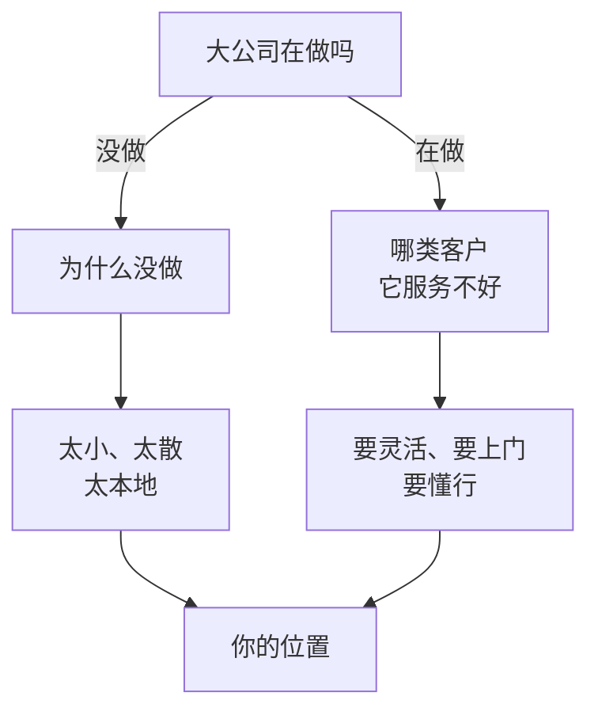

# 竞争与位置

前面几章都在算一门生意自己的账。但生意不是在真空里做的：你算出来的价格、销量、回头率，都取决于客户还有没有别的选择。这一章回答一个问题：**这门生意，为什么轮得到你？**

## 客户的四个选择

客户每次花钱，其实都在几个选项里挑：

1. 找你
2. 找你的同行
3. 自己做
4. 不做了

第 2 章讲过，这几个替代方案的成本决定了你价格的天花板。这一章换个角度：**你凭什么在这四个选项里被选中，而且下次还被选中？**

员工很少需要回答这个问题，因为公司已经替你回答了：品牌、渠道、销售团队把客户带到你面前。一旦自己做生意，这个问题每天都在。

## 先看市场够不够大

「轮得到你」的第一个前提是：**附近有足够多的人需要这个东西**。小生意尤其要算这一步，因为它的客户大多来自一个很小的范围。

用第 5 章的宠物洗护店举例（**假设数据**）。先算这家店一个月至少要洗多少次才不亏：

| 项目 | 假设 |
|---|---|
| 每次边际贡献 | 75 元 |
| 固定成本（房租、店长工资、水电、设备摊销） | 25,000 元/月 |
| 盈亏平衡 | $25{,}000 / 75 \approx 334$ 次/月 |

再自下而上估算一个小区能提供多少：

| 项目 | 假设 |
|---|---|
| 小区户数 | 3,000 户 |
| 养狗的比例 | 10%，即 300 户 |
| 会到店洗护的比例 | 60%，即 180 户 |
| 每户频率 | 两个月一次 |
| 一个小区每月的需求 | $180 / 2 = 90$ 次 |

就算这个小区所有到店洗护的需求都被你拿下，每月也只有 90 次，离 334 次差得远。要活下来，至少需要覆盖四个这样的小区，并且在每个小区都拿到全部份额，这几乎不可能。更现实的是覆盖十个左右的小区、在每个小区拿到三到四成份额。

这个算法叫**自下而上估算市场**：从具体的户数、比例、频率出发，一层层乘出来。它很粗，每个比例都可以争论，但它能在开店前回答一个关键问题：**选址附近的需求，够不够养活这家店**。很多店倒下，就是因为一开始没算这一步，凭「我觉得这附近很多人养狗」就签了租约。

## 小生意的五种壁垒

假设市场够大，接下来的问题是：为什么客户找你而不找别人？能让客户持续选择你、让别人难以抢走的东西，叫**壁垒**，也常被叫作「护城河」。

大公司的壁垒是品牌、规模、专利、网络效应。小生意没有这些，但有自己的几种：

| 壁垒 | 是什么 | 例子 | 会怎么被削弱 |
|---|---|---|---|
| 地段 | 客户最方便到达的位置 | 小区唯一出口的便利店、医院门口的药店 | 租约到期涨租、隔壁开了同类店、人流改道 |
| 关系 | 客户因为信任你这个人而选你 | 跟了十年的裁缝、老板娘记得你口味的面馆 | 关键人离开、服务质量下降 |
| 口碑 | 别人推荐你，客户不需要自己比较 | 业主群里人人推荐的水电师傅 | 一两次严重的差评、规模扩大后服务变形 |
| 专业 | 你会别人不会的，或者做得明显更好 | 能修老式机械表的师傅、懂某个细分行业的会计 | 技术普及、工具替代、年轻同行追上来 |
| 成本 | 同样的东西，你能做得比别人便宜 | 自家房子开店不付房租、夫妻店不算人工 | 规模更大的对手出现、自己的成本优势消失 |

几个观察：

- **小生意的壁垒大多是「软」的**。它们不写在合同里，也无法申请专利，但真实存在。一家开了十五年的社区修鞋店，新开的连锁店很难抢走它的老客户
- **成本壁垒要小心看**。「自家房子不付房租」的店，看起来比同行便宜，其实是把房子的租金收入让给了生意。如果哪天要搬，这个优势就没了。第 3 章说的「老板工资算没算进去」也是同样的道理
- **最可靠的往往是几种叠加**。好位置 + 老板记得每位熟客 + 业主群里口碑好，这三样同时具备的店，很难被替代

### 壁垒和单位经济的关系

壁垒最终会反映在第 5 章的数字上：

- 有**地段**，获客成本低（客人自己走进来）
- 有**口碑**和**关系**，回头率高、获客成本低
- 有**专业**，能卖出更高的价格
- 有**成本**优势，单位可变成本或固定成本更低

反过来说，如果一门生意的获客成本一直很高、回头率一直很低、价格只能跟着同行走，那它多半没有壁垒，只是在「谁都能做」的市场里竞争。

## 和大公司错位竞争

小生意面对的竞争对手，越来越多是大公司：连锁品牌、电商平台、互联网服务。正面硬拼规模和价格几乎不可能赢，但大公司有它们**做不了、不想做或者做不好**的事情。

| 维度 | 大公司的选择 | 小生意可以选 |
|---|---|---|
| 客户范围 | 服务最多的人，取平均需求 | 只服务一小群人，满足他们的特殊需求 |
| 标准化 | 流程统一，不轻易例外 | 灵活，能按客户的情况调整 |
| 响应 | 走流程、排队、客服转接 | 老板本人当天回复 |
| 规模下限 | 太小的单不接或不重视 | 小单也认真做 |
| 地域 | 覆盖全国，不懂当地 | 只做附近，懂本地的人和规则 |

几个具体的例子：

**社区水果店和生鲜电商**。生鲜电商价格透明、送货上门，水果店很难在价格上赢。但水果店可以让客人现场挑、可以切一块试吃、可以让熟客先拿走下次付钱，还能告诉客人「今天的芒果不好，别买」。这些是电商的标准流程里没有的。

**独立设计师和大广告公司**。大广告公司服务的是预算几十万、几百万的品牌客户，一家小餐馆想做个菜单、一家刚开的工作室想做个标志，大公司不会接，或者报价高到对方承受不起。独立设计师在这个价位段几乎没有大公司竞争，拼的是作品风格和沟通效率。

**小型代账公司和互联网代账平台**。互联网代账平台可以把价格压得很低，但它们靠标准化和系统处理，遇到账务混乱、需要上门取票、需要解释税务问题的客户，服务就跟不上。小代账公司可以专门接这类「麻烦但愿意多付一点」的客户。

错位竞争的关键是**主动选择不做什么**。想同时服务所有人、价格又要比平台低、服务又要比连锁好，最后什么都不突出。选一小群人，把他们服务好，让他们替你传口碑，这是小生意最常见的生存方式。

## 不要打价格战

同质化的生意最容易陷入价格战：隔壁降 2 元，你也降 2 元，最后谁都不赚钱。第 3 章算过，面馆降价 3 元，要多卖 25% 才能保住利润，而同行跟着降价时，你多卖的那部分也拿不到。

### 算一笔价格战的账

把第 3 章的面馆放到一条街上：对面还有一家成本结构一模一样的面馆，两家各卖 2,400 碗，每碗 25 元、边际贡献 15 元，每月固定成本各 3 万元，各赚 6,000 元。这条街每月吃面的总量大约 4,800 碗，降价很难让附近的人多吃很多面。

现在有一家降价 3 元，每碗边际贡献从 15 元变成 12 元。**假设**价格敏感的客人有 400 碗会从不降价的那家转到降价的那家，两家都降价时，街上的总量多出 5%（每家多 120 碗）：

| 情形 | 你的销量 | 你的利润 | 对面的销量 | 对面的利润 |
|---|---|---|---|---|
| 都不降 | 2,400 | 6,000 | 2,400 | 6,000 |
| 对面降，你不降 | 2,000 | 0 | 2,800 | 3,600 |
| 你降，对面不降 | 2,800 | 3,600 | 2,000 | 0 |
| 都降 | 2,520 | 240 | 2,520 | 240 |

利润按第 3 章的公式算：销量 × 每碗边际贡献 − 30,000。比如「对面降，你不降」时，对面是 $2{,}800 \times 12 - 30{,}000 = 3{,}600$ 元，你是 $2{,}000 \times 15 - 30{,}000 = 0$。

这张表有三个反直觉的地方：

- **先降价的一方也少赚了**。对面多抢了 400 碗，利润却从 6,000 元掉到 3,600 元，因为它在原来的 2,400 碗上每碗都让掉了 3 元，一共 7,200 元，多卖的 400 碗只补回来 4,800 元
- **被抢的一方掉得更狠**。你一碗没降，利润直接回到盈亏平衡点。这就是为什么对方一降价，你很难忍住不跟
- **两家都跟，两家都接近白干**。总量只多了 5%，远不够补回每碗少掉的 3 元。要回到每家 6,000 元，每家得卖 3,000 碗，也就是整条街要多吃 25% 的面

注意表里的顺序：对方不降时，你先降只会让自己少赚（3,600 元比 6,000 元）；可一旦对方降了，你跟着降（240 元）又比不跟（0 元）好一点。所以先动手的一方吃亏，跟进的一方也只是止损，最后两家都落到比原来差得多的位置。打破这个局面的办法通常不在价格上，而在下面几个问题里。

面对降价的对手，可以先问几个问题：

1. **对方的成本真的比我低吗**？如果是，它能长期维持这个价格，你需要换一个位置，而不是硬拼
2. **对方是在亏本抢客吗**？补贴是暂时的，它能撑多久？你的现金能撑多久（第 4 章的跑道）？
3. **我的客户里，有多少是只看价格的**？如果大部分客人选你是因为口碑、关系、方便，少量价格敏感的客人流走，未必是坏事

价格之外，还有很多可以调整的东西：份量、服务、附加的小东西、营业时间、会员权益。在这些地方做出差异，比单纯降价更可持续。

## 用一张表看自己的位置

把这一章的内容收成一张表，可以用来审视任何一门生意，包括你所在的公司：

| 问题 | 回答 |
|---|---|
| 客户除了我，还能选谁？自己做的成本是多少？ | |
| 附近（或目标人群里）的需求够不够养活这门生意？ | |
| 我有五种壁垒里的哪几种？ | |
| 这些壁垒会怎么被削弱？ | |
| 哪些客户大公司服务不好，而我能服务好？ | |
| 我主动选择不做什么？ | |

## 本章要点

- 客户每次花钱都在四个选项里挑：你、你的同行、自己做、不做；你要回答的是凭什么被选中
- 开店前先自下而上估算市场：户数 × 比例 × 频率，和盈亏平衡销量比一比，看附近的需求够不够
- 小生意的壁垒是地段、关系、口碑、专业、成本，大多是软的，几种叠加最可靠
- 壁垒最终体现在单位经济上：更低的获客成本、更高的回头率、更高的价格或更低的成本
- 和大公司错位竞争：选它们做不了、不想做、做不好的客户；关键是主动选择不做什么
- 价格战通常没有赢家，先看对手的成本和自己的客户结构，再在价格以外的地方做出差异
