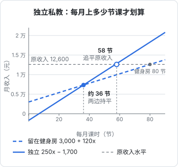

# 拆五门身边的小生意

这一章把前面七章的工具全部用一遍：挑五门身边常见、普通人也可能去做的小生意，按同样的步骤各算一遍账。

> [!IMPORTANT]
> 这一章的所有数字都是**假设的**，是为了让算式自洽、能看清结构而设定的，不代表任何城市、任何行业的真实水平。房租、人工、价格在不同城市可能差好几倍。真要做其中一门生意，请用你所在地方的真实报价重新算一遍，算法照搬即可。

每门生意都按这个顺序：

1. 骨架：谁付钱、为什么付、怎么找到、交付花什么（第 2 章）
2. 月度账：营收、可变成本、固定成本、利润（第 3 章）
3. 盈亏平衡点和最敏感的数字（第 3 章）
4. 现金和风险（第 4 章）
5. 单位经济：一单、一客或一小时（第 5 章）

## 社区奶茶店

### 骨架

| 问题 | 答案 |
|---|---|
| 谁付钱 | 附近的学生、上班族、逛街的年轻人 |
| 为什么付 | 体验和情绪：好喝、解渴、下午犒劳自己 |
| 怎么找到 | 位置（人流）为主，外卖平台为辅 |
| 交付花什么 | 原料、杯子、外卖佣金（按杯）；房租、店员、装修设备（固定） |

### 月度账

假设一家十几平方米的自营小店（不是加盟），店主自己全职在店里，不给自己发工资：

| 项目 | 金额 |
|---|---|
| 平均每杯售价 | 15 元 |
| 每杯可变成本（原料包材 4.5 元 + 外卖相关平均 1.5 元） | 6 元 |
| 单位边际贡献 | 9 元 |
| 房租 | 8,000 元/月 |
| 两名店员工资和社保 | 9,000 元/月 |
| 水电 | 1,500 元/月 |
| 装修设备摊销（投入 15 万元，按 36 个月摊） | 约 4,200 元/月 |
| 其他杂费 | 800 元/月 |
| **固定成本合计** | **23,500 元/月** |

每天卖 120 杯，一个月 3,600 杯：

$$
3{,}600 \times 9 - 23{,}500 = 32{,}400 - 23{,}500 = 8{,}900 \text{ 元}
$$

### 盈亏平衡

$$
23{,}500 / 9 \approx 2{,}611 \text{ 杯/月，每天约 87 杯}
$$

每天 120 杯，比平衡点高出约 38%。看起来安全，但奶茶的销量**季节性很强**。假设冬天销量掉三成，每天 84 杯、一个月 2,520 杯：

$$
2{,}520 \times 9 - 23{,}500 = 22{,}680 - 23{,}500 = -820 \text{ 元}
$$

冬天就是小亏。一年算下来，夏天赚的钱要拿来补冬天。

### 现金和风险

店主每月手里实际多出来的现金，是利润加上摊销（摊销是早就花出去的钱，不再付现金）：$8{,}900 + 4{,}200 = 13{,}100$ 元。要收回 15 万元的初始投入，大约需要：

$$
150{,}000 / 13{,}100 \approx 11.5 \text{ 个月}
$$

这是在**不算店主自己工资**、而且每个月都卖到 120 杯的前提下。算上冬天的淡季，回本可能要一年半以上。

如果是加盟店，还要加上加盟费、管理费，原料通常要从品牌方指定采购，单杯可变成本可能更高，换来的是品牌带来的客流。这笔账要拿品牌方给的条件逐项算，不能只看对方给的「回本周期」。

### 单位经济

最敏感的数是**销量**，其次是**房租**。奶茶的单位边际贡献只有 9 元，每天少卖 10 杯，一个月就少 2,700 元，占利润的三成。这就是为什么奶茶店的选址几乎决定了一切。

## 美甲工作室

### 骨架

| 问题 | 答案 |
|---|---|
| 谁付钱 | 附近的上班族、年轻女性为主 |
| 为什么付 | 体验、外表，以及老顾客对美甲师手艺的信任 |
| 怎么找到 | 小红书、点评平台的作品展示，老客介绍 |
| 交付花什么 | 甲油胶、饰品（按单）；工作室房租、工具（固定）；美甲师本人的时间 |

### 月度账

假设一位美甲师在商住楼里租一间小工作室，一个人做：

| 项目 | 金额 |
|---|---|
| 平均客单价 | 200 元 |
| 每单材料 | 20 元 |
| 单位边际贡献 | 180 元 |
| 每单耗时 | 2 小时 |
| 平均每天 3 单，每月工作 26 天 | 78 单 |
| 房租 | 3,500 元/月 |
| 水电网 | 400 元/月 |
| 平台推广 | 1,000 元/月 |
| 工具和设备摊销 | 300 元/月 |
| **固定成本合计** | **5,200 元/月** |

$$
78 \times 180 - 5{,}200 = 14{,}040 - 5{,}200 = 8{,}840 \text{ 元}
$$

### 盈亏平衡

$$
5{,}200 / 180 \approx 29 \text{ 单/月}
$$

固定成本很低，平衡点只有每月 29 单，**经营杠杆很低**（第 4 章）。生意不好时也亏不了多少，这是一个人起步的好处。

### 现金和风险

真正的问题不是亏损，而是**天花板**。一个人一天最多做 4 单，一个月 104 单：

$$
104 \times 180 - 5{,}200 = 18{,}720 - 5{,}200 = 13{,}520 \text{ 元}
$$

这就是满负荷的上限。要再往上，只有两条路：涨价，或者雇人。客单价涨到 240 元、仍然每月 78 单时：$78 \times 220 - 5{,}200 = 11{,}960$ 元。雇人则意味着固定成本跳台阶，要按第 3 章重新算平衡点，而且口碑能不能跟着转移给新美甲师，是另一个问题。

另外，这 8,840 元里还没扣美甲师自己的社保。以灵活就业身份自己缴社保，费用全部由个人承担，具体怎么缴见[《过渡期收入与个人保障》第 5 章](../opc-transition/05-social-insurance.md)。

### 单位经济：一小时

每单 2 小时，再加上每天约 1.5 小时回消息、拍作品、发笔记：

$$
\frac{8{,}840}{78 \times 2 + 26 \times 1.5} = \frac{8{,}840}{195} \approx 45 \text{ 元/小时}
$$

这才是这门生意的真实时薪。要提高它，最有效的是涨价和提高每天的单数，而不是省材料。

## 平面设计工作室

### 骨架

| 问题 | 答案 |
|---|---|
| 谁付钱 | 小餐饮、小品牌、初创公司、需要活动物料的企业 |
| 为什么付 | 自己做不了，需要专业的视觉 |
| 怎么找到 | 作品集、老客户转介绍、设计平台 |
| 交付花什么 | 素材和字体授权、打样（按项目）；设计师工资、办公、软件订阅（固定）；大量时间 |

### 月度账

假设老板加一名全职设计师，两个人：

| 项目 | 金额 |
|---|---|
| 平均每月项目数 | 6 个 |
| 平均每个项目收费 | 8,000 元 |
| 每个项目的素材、授权、打样 | 500 元 |
| 每个项目的边际贡献 | 7,500 元 |
| 设计师工资 10,000 元 + 单位社保公积金（按 30% 假设）3,000 元 | 13,000 元/月 |
| 共享办公两个工位 | 3,000 元/月 |
| 设计软件、字体、素材库订阅 | 1,500 元/月 |
| 代账 | 300 元/月 |
| 其他 | 700 元/月 |
| **固定成本合计** | **18,500 元/月** |

$$
6 \times 7{,}500 - 18{,}500 = 45{,}000 - 18{,}500 = 26{,}500 \text{ 元}
$$

这 26,500 元还没给老板发工资，老板自己也在做设计、跑客户。

### 盈亏平衡

$$
18{,}500 / 7{,}500 \approx 2.5 \text{ 个项目/月}
$$

### 现金和风险

设计工作室的账面利润不错，但有三个现金和风险问题：

- **应收**。假设项目合同是「预付 50%、交付后付 50%」，尾款平均晚 60 天到。每月 48,000 元的营收里，有 24,000 元要两个月后才到。工作室手里至少要备两个月的固定成本，也就是 37,000 元左右的周转金
- **大客户**。如果 6 个项目里有 2 个来自同一家公司，它占了三分之一的营收，第 4 章的警戒线就到了
- **改稿**。每多一轮修改，就多几个小时的工时，收入却不变。合同里不写清楚包含几轮修改，项目做着做着就从赚钱变成亏钱

> [!NOTE]
> 字体和图片素材的商用授权是设计行业常见的纠纷来源。工作室要确认每一款字体、每一张素材的授权范围是否覆盖客户的用途，费用也要算进项目成本。

### 单位经济：一个项目

假设一个 8,000 元的项目，正常需要 40 小时（含沟通）。如果客户多要了两轮修改，每轮 8 小时，就变成 56 小时，每小时的边际贡献从 $7{,}500 / 40 \approx 188$ 元降到 $7{,}500 / 56 \approx 134$ 元。**项目制生意的利润，很大程度上取决于能不能控制范围**。

## 健身私教

### 骨架

| 问题 | 答案 |
|---|---|
| 谁付钱 | 想减脂、增肌、康复的上班族 |
| 为什么付 | 自己练不会、练不坚持、怕受伤 |
| 怎么找到 | 健身房分配、老学员介绍、社交平台 |
| 交付花什么 | 场地、私教本人的时间 |

私教有两种做法，正好可以比较「当员工」和「自己做」的账。

### 两种做法的月度账

| 项目 | 在健身房当教练 | 独立私教 |
|---|---|---|
| 每节课价格 | 300 元（健身房收） | 300 元（自己收） |
| 每节课到手 | 提成 40%，即 120 元 | 扣掉按次租场地 50 元，250 元 |
| 底薪 | 3,000 元/月 | 0 |
| 推广 | 健身房负责 | 1,500 元/月 |
| 意外和责任保险 | 健身房负责 | 200 元/月 |
| 每月 80 节课 | $3{,}000 + 80 \times 120 = 12{,}600$ 元 | $80 \times 250 - 1{,}700 = 18{,}300$ 元 |
| 每月 40 节课 | $3{,}000 + 40 \times 120 = 7{,}800$ 元 | $40 \times 250 - 1{,}700 = 8{,}300$ 元 |

### 平衡点：独立后要上多少课才不亏

这里的「平衡点」不是不亏钱，而是**收入不低于在健身房上 80 节课时的 12,600 元**：

$$
\frac{12{,}600 + 1{,}700}{250} = 57.2 \text{，即每月至少 58 节}
$$

下图把两种做法的收入线和原收入画在一起。只比两条线，每月约 36 节时两边持平（$4{,}700 / 130 \approx 36.2$）；要追平原来的 12,600 元，得上到 58 节：

在健身房，客人是健身房带来的；独立后，每一节课都要自己找。每月 58 节，意味着要有十几个稳定续课的学员。

### 现金和风险

- **课包是预收**。私教通常卖 10 节、20 节的课包，钱先到手。第 4 章讲过，预收的钱是负债，学员要求退课时要退得出来
- **独立后的社保要自己缴**，见[《过渡期收入与个人保障》第 5 章](../opc-transition/05-social-insurance.md)
- **身体就是产能**。一天上 6 节课已经很累，生病、受伤就没有收入

> [!WARNING]
> 向个人销售课程包属于预付消费，部分地区对健身行业的预付卡、课程包有专门规定（如单笔金额、资金存管、冷静期退款）。开展前向当地商务、市场监管或体育主管部门核实最新要求，以官方规定为准。

### 单位经济：一个学员

假设一个学员平均续两次 20 节的课包，一共 40 节：独立私教从他身上得到 $40 \times 250 = 10{,}000$ 元。如果为了找到这个学员，在社交平台上花了 500 元推广，加上体验课的时间，获客成本相对他带来的收入很低。**私教生意的关键是续课率**，和第 5 章的宠物店一样，回头比拉新重要。

## 代账公司

### 骨架

| 问题 | 答案 |
|---|---|
| 谁付钱 | 小微企业、个体户 |
| 为什么付 | 省时间、减少风险：法律要求记账报税，老板自己不会、不想做 |
| 怎么找到 | 工商注册代办的合作、老客户介绍、园区和商会 |
| 交付花什么 | 会计的时间、财务软件、外勤取送票据 |

> [!WARNING]
> 从事代理记账业务需要取得财政部门批准的代理记账许可，人员资质也有要求。具体条件以财政部《代理记账管理办法》和当地财政部门的最新规定为准。

### 月度账

假设一家三人小代账公司：老板加两名记账会计，老板自己也做账、跑客户。

| 项目 | 金额 |
|---|---|
| 小规模纳税人客户 150 家 × 200 元 | 30,000 元/月 |
| 一般纳税人客户 20 家 × 600 元 | 12,000 元/月 |
| **营收合计** | **42,000 元/月** |
| 两名会计，每人工资 7,000 元 + 单位社保公积金（按 30% 假设） | 18,200 元/月 |
| 办公室 | 4,000 元/月 |
| 财务软件 | 800 元/月 |
| 外勤交通 | 500 元/月 |
| 其他 | 500 元/月 |
| **成本合计** | **24,000 元/月** |

$$
42{,}000 - 24{,}000 = 18{,}000 \text{ 元}
$$

代账的成本几乎都是固定的，每多一个客户，短期内几乎不多花钱，直到会计忙不过来。

### 平衡点和阶梯成本

平均每家客户每月收费：$42{,}000 / 170 \approx 247$ 元。按这个平均数，平衡点是：

$$
24{,}000 / 247 \approx 97 \text{ 家}
$$

但它是一门典型的**阶梯成本**生意。假设一名会计最多服务 85 家左右，现在两个人服务 170 家，已经满了。第 171 家客户进来，就要再招一名会计，固定成本一下多出 9,100 元。要等新会计的客户也接近满额，才能重新赚到钱。

### 现金和风险

- **现金节奏好**。代账费常常按年预收，现金流比账面更好看；但第 4 章说过，预收的钱是负债
- **流失**。小微企业本身就容易关停、换代账。假设每年流失 15% 的客户，就是 170 × 15% ≈ 26 家，光是保持规模，一年就要新签 26 家
- **低价竞争**。互联网代账平台把价格压得很低，第 7 章讲过小代账公司的错位：接账务复杂、需要上门、需要解释的客户
- **出错的代价**。漏报、错报会给客户带来罚款，处理不好就是口碑问题

### 单位经济：一个客户

每家客户平均每月收入 247 元，平均分摊的成本 $24{,}000 / 170 \approx 141$ 元，每家每月贡献约 106 元。一个客户如果平均留存 4 年，总贡献约 $106 \times 48 \approx 5{,}088$ 元。这决定了代账公司为了签下一个客户，最多愿意花多少：给介绍人的返佣、给新客的优惠，都要在这个范围之内。

## 五门生意放在一起

| | 奶茶店 | 美甲工作室 | 设计工作室 | 独立私教 | 代账公司 |
|---|---|---|---|---|---|
| 固定成本 | 高 | 低 | 中 | 很低 | 中 |
| 经营杠杆 | 高 | 低 | 低 | 很低 | 中 |
| 最敏感的数 | 销量（选址） | 每天单数、价格 | 项目数、改稿 | 课时数 | 客户数、流失 |
| 天花板 | 店面产能 | 一个人的时间 | 两个人的时间 | 一个人的体力 | 会计人数 |
| 收钱方式 | 当场 | 当场 | 预付 + 尾款 | 预收课包 | 预收年费 |
| 主要风险 | 季节、选址 | 天花板 | 应收、大客户 | 获客、身体 | 流失、低价竞争 |

把五门生意的账都算完，能看到几个共性：

1. **老板的工资几乎都没算进去**。五门生意的「利润」，实际上都是老板的劳动报酬加投资回报。拿它和打工收入比时，要和全职工资比，并且算上自己缴的社保
2. **越轻的生意，天花板越近**。美甲和私教几乎不需要投入，亏也亏不多，但收入上限就是一个人的时间。想突破天花板，就要加固定成本，经营杠杆随之变高
3. **最敏感的数各不相同**。奶茶店要盯销量，设计工作室要盯范围，代账要盯流失。找到那一个数，比把所有数都优化一点更有用
4. **现金节奏和利润是两回事**。奶茶、美甲当场收钱；设计要等尾款；私教和代账先收钱，但预收的是负债
5. **每一门都有自己的「死法」**。在开始之前就知道它，比亏了钱再总结便宜得多

这些生意里，有不少可以由一个人、靠职场里积累的技能做起来，比如设计、财务、培训。系列的第三本书《把职场技能变成生意》会接着讲这一类不写代码的服务型一人公司。真实的一人公司案例，可以看[《一人公司案例库》](../opc-cases/)。

## 本章要点

- 拆生意的五步：骨架、月度账、盈亏平衡、现金和风险、单位经济
- 奶茶店是高固定成本、高经营杠杆，选址决定销量，季节性让冬天可能亏损
- 美甲、私教这类一人生意平衡点低、亏不多，但天花板就是一个人的时间和体力
- 设计这类项目制生意要盯应收、大客户和改稿范围
- 代账是阶梯成本加预收的生意，流失率和每个会计能服务的客户数决定利润
- 五门小生意的「利润」大多是老板的劳动报酬；比较时要和全职工资加自缴社保比
