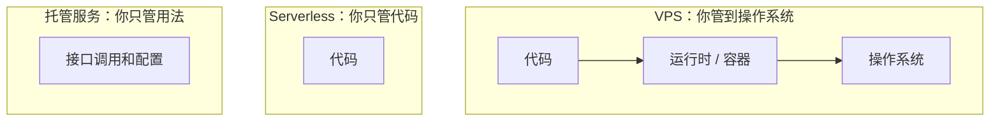
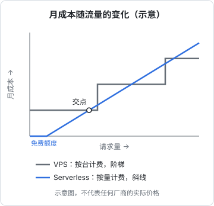
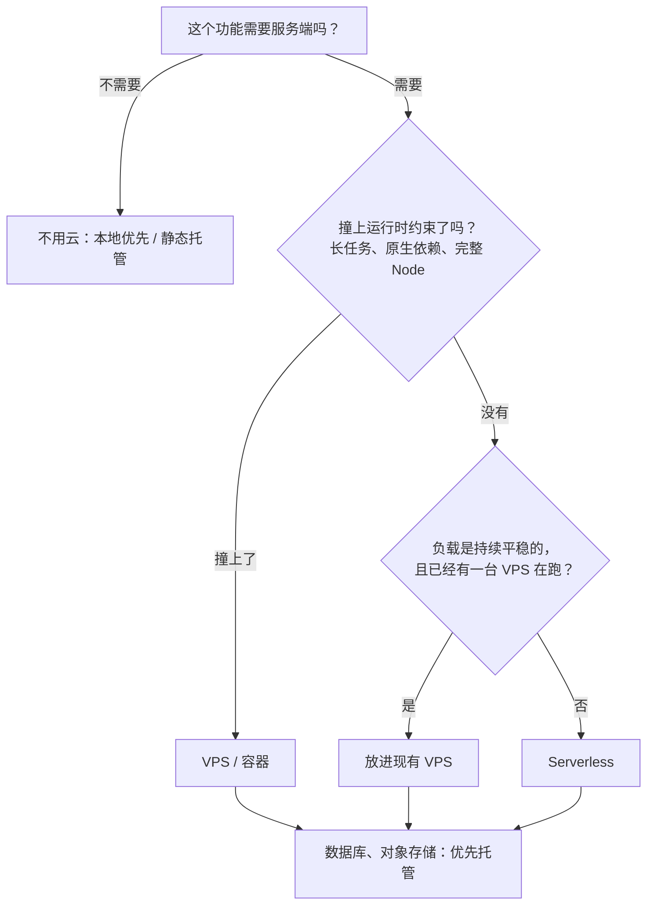
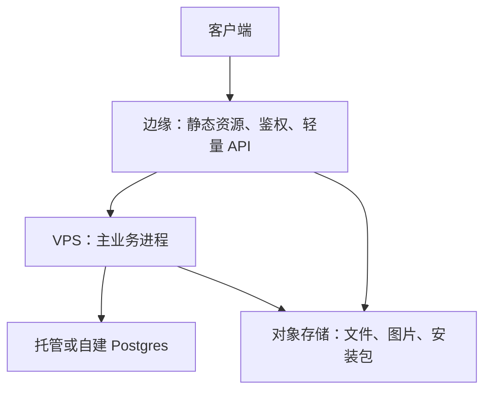

# VPS、Serverless 与托管服务怎么选

一个人做产品，「服务端跑在哪」这个问题会反复出现：新项目开张时、流量涨了时、账单吓人时、半夜被告警叫醒时。可选项大致分三类：租一台虚拟机自己管（VPS），把代码交给平台按请求执行（Serverless），把数据库、存储、队列这类组件整个交给厂商（托管服务）。本章先讲清三者的责任分界和成本曲线，再给一套判断顺序，最后用作者自己的三个项目对照一遍。

## 这本书讲什么、适合谁、怎么读

这是一本**进阶**的运维书，讲「云」这一层的选型和用法：

- 前两章讲选择：VPS / Serverless / 托管服务怎么选，国内云和海外云怎么取舍
- 第 3 章讲对象存储这个几乎所有产品都会用到的组件
- 第 4–6 章深入 Cloudflare 的边缘平台：Workers 的运行模型、R2 / KV / D1 / Durable Objects 四种存储、用 wrangler 开发和部署
- 第 7 章讲成本模型和账单控制

贯穿全书的案例是 hatch-recordwall（唱片墙）的曲库服务：一个架在 R2 前面的 Worker，凭令牌存取音频和封面。它三个源文件加起来四百多行，却踩全了边缘平台上该踩的坑：鉴权、Range 请求、条件写、缓存、部署脚本命名。

适合已经能在 VPS 上用 Docker Compose + nginx 部署服务、想知道「什么时候该换一种形态」的读者。VPS 的初始化和部署脚本见[《部署与 CI/CD》](../deploy-release/)，CDN 原理见[《计算机网络》](../networking/)，出海场景的地区、付款和域名见[《出海实务》第 6 章](../going-global/06-cloud-and-domains.md)，通用的成本控制方法见[《一人运维手册》第 6 章](../production-ops/06-cost-control.md)，本书不重复。

建议按顺序读；只关心 Cloudflare 的话可以从第 4 章开始，但第 3 章的对象存储模型是后面几章的基础。

> 云厂商的价格、免费额度、限制数值经常调整。本书**只讲计费模型和计费维度，不写具体单价**；动手估算前以各家官网的定价页和限制页为准。

## 三种形态，三条责任分界线

区别不在「有没有服务器」，而在**哪些事归你管**。

| 层次 | VPS | Serverless（如 Workers、函数计算） | 托管服务（如托管数据库、对象存储） |
|---|---|---|---|
| 硬件、机房、网络 | 厂商 | 厂商 | 厂商 |
| 操作系统、补丁、SSH、防火墙 | **你** | 厂商 | 厂商 |
| 运行时版本、进程守护、扩缩容 | **你** | 厂商 | 厂商 |
| 应用代码 | **你** | **你** | 无（你只用它的接口） |
| 数据备份、高可用 | **你** | 视存储而定 | 厂商（通常可配置） |
| 计费单位 | 按时长（月 / 小时） | 按请求和计算量 | 按容量、请求、流量等用量 |

管得越少，运维时间越少，但**约束越多**：Serverless 限制执行时长、内存、可用的 API；托管服务限制版本、扩展、调参空间。选型本质上是在「你的时间」和「平台的约束」之间做交换。

## 五个判断维度

### 1. 负载形状

| 负载形状 | 例子 | 更合适的形态 |
|---|---|---|
| 持续、平稳 | 门店系统白天一直有人用 | VPS：固定月费被摊薄 |
| 稀疏、突发 | 个人工具，一天几十次请求；偶尔被分享到社群冲一波 | Serverless：没请求就不花钱，峰值不用你扩容 |
| 长时间计算 | 视频转码、批量跑模型 | VPS 或专门的批处理服务 |
| 长连接 | WebSocket 聊天、SSE 推送 | VPS，或 Durable Objects 这类专门为此设计的服务（第 5 章） |

### 2. 运行时约束

Serverless 平台的运行时不是一台完整的机器。动手前先过一遍：

- **执行时长和 CPU 预算**：单次请求能跑多久、能用多少 CPU 时间
- **本地文件系统**：大多没有可持久写入的磁盘，状态必须放进外部存储
- **原生依赖**：依赖 C++ 扩展、要调系统命令（如 ffmpeg）的代码，通常跑不了
- **API 兼容性**：Workers 是 Web 标准 API 加部分 Node 兼容，不是完整的 Node（第 4 章）
- **出站连接**：连传统数据库要走专门的方式（如 Hyperdrive 或 HTTP 驱动）

任何一条撞上，答案就是 VPS 或容器平台，不用再往下比较。

### 3. 状态放在哪

无状态的计算到哪都好搬，**状态才是迁移成本的来源**。一个经验法则：

- 计算可以先选最省事的形态，以后换起来不难
- 数据库和对象存储的选择要更慎重：它们决定了你被哪家锁定、备份怎么做、跨地域怎么办
- 客户端**只认你自己的入口地址**，不直连任何厂商的存储地址。这样换后端只改服务端（第 2 章展开）

### 4. 成本曲线

三种形态的账单随流量增长的形状完全不同：

- VPS 是**阶梯**：流量为零也要付整月；流量涨到一台机器扛不住时，跳一级
- Serverless 是**斜线**：从（接近）零开始，随请求量线性增长；免费额度会让起点更低
- 托管服务通常是**底价加斜线**：有最低档位，之后按用量涨

图上的交点就是「该不该从 Serverless 搬回 VPS」的参考线，但要注意两点：交点之前 Serverless 省下的不只是钱，还有你的运维时间；交点之后的差额，要和维护 VPS 的时间成本比较（《一人运维手册》第 6 章「时间也是成本」）。

### 5. 运维时间与事故面

一台 VPS 意味着：系统补丁、SSH 加固、磁盘满、证书续期、进程挂了谁拉起来、机器宕了怎么恢复。这些事每件都不难，但加起来是一份**持续的注意力负担**。Serverless 和托管服务把其中大部分转给了厂商，代价是你失去了「登上去看一眼」的能力，排障只能靠平台给的日志和指标。

## 判断顺序

第一步经常被跳过：**很多功能根本不需要服务端**。离线优先的应用、纯静态站、只在本机跑的工具，最好的云就是不用云。

## 作者的三个项目怎么选的

| | hatch-shelf | hatch-counter | hatch-recordwall |
|---|---|---|---|
| 是什么 | iOS 离线 Markdown 书架 | 门店管理（NestJS + Postgres） | 播放器 + 私人曲库 |
| 服务端形态 | **没有** | 境内云服务器 + Docker Compose | Cloudflare Worker |
| 存储 | 手机本地文件 + SQLite | Postgres 容器 + 对象存储私有桶 | R2 桶（不设公共读） |
| 为什么 | 个人自用，书从电脑经局域网或 AirDrop 传到手机，不需要任何云 | 持续负载、长事务、要连 Postgres、调视觉模型识别进货单；用户在国内，要备案 | 只做「鉴权 + 存取字节」，请求稀疏，几乎零运维 |
| 代价 | 没有跨设备同步 | 要自己管系统、备份、证书 | 运行时受限；国内访问速度要实测 |

三个项目刚好覆盖了判断顺序的三个出口：

- **hatch-shelf** 停在第一步。App 不联网是它的设计原则，书籍原文只存在手机的文档目录里，不存在「服务端跑在哪」的问题
- **hatch-counter** 走到 VPS：NestJS 是常驻进程，Postgres 需要一台有磁盘的机器，加上国内备案，一台境内云服务器最直接。但它也没有全部自建：单据原图放在对象存储的私有桶里，镜像放在托管的镜像仓库里
- **hatch-recordwall** 走到 Serverless：曲库服务的全部职责是验令牌、读写 R2，没有长任务、没有原生依赖，一个 Worker 足够

## 组合才是常态

真实项目很少只用一种形态。一人公司里最常见的组合：

- **主业务**放在 VPS：常驻进程、复杂事务、你熟悉的 Node 生态
- **文件**放在对象存储：不占服务器磁盘，不走服务器带宽（第 3 章）
- **边缘**做能做的事：静态站托管、文件下载的鉴权网关、Webhook 接收、定时任务

## 常见的选错

| 选错 | 表现 | 怎么避免 |
|---|---|---|
| 为想象中的规模选型 | 一开始就上 Kubernetes、多区域、消息队列 | 先用最简单的形态，监控显示瓶颈了再升级 |
| 把 Serverless 当 VPS 用 | 在函数里开长连接池、写本地文件、跑分钟级任务 | 动手前先过一遍运行时约束清单 |
| 文件放 VPS 磁盘 | 磁盘满、带宽被下载占满、迁移时要搬几十 GB | 用户上传和大文件一律进对象存储 |
| 桶设成公共读图省事 | 被盗链、被刷流量、私人文件被搜到 | 前面挡一层鉴权（第 3 章） |
| 客户端写死厂商存储地址 | 想换厂商得发新版、等所有用户升级 | 客户端只认自己的域名 |

## 本章要点

- VPS、Serverless、托管服务的区别在于**责任分界**：你管到操作系统、只管代码、还是只管用法
- 判断维度：负载形状、运行时约束、状态放在哪、成本曲线、运维时间
- 运行时约束是一票否决项；撞上了就选 VPS 或容器
- VPS 成本是阶梯，Serverless 是从零起步的斜线；交点附近要把运维时间算进去
- 第一个问题永远是「需不需要服务端」；hatch-shelf 的答案是不需要
- 组合是常态：VPS 跑主业务、对象存储放文件、边缘做鉴权和轻量 API

## 动手练习

1. **给三个小功能选形态**：用本章的判断顺序，给下面三个功能各选一种形态，并写出是在哪一步做的决定：（a）用户上传 PDF，服务端调 `pdftotext` 抽文字后入库；（b）一个 GitHub Webhook，收到 push 后往 Telegram 发一条消息，每天十几次；（c）一个只在自己 Mac 上用的 Markdown 批量改名工具。

   验证：每个答案都能指出判断流程图里的具体出口，并说出撞上或没撞上哪一条约束。

   参考答案：（a）调系统命令属于原生依赖，在「运行时约束」一步一票否决，走 VPS / 容器，PDF 原件进对象存储；（b）请求稀疏、无状态、无原生依赖，走 Serverless；（c）停在第一步，不需要服务端。

2. **算出两条成本曲线的交点**：假设某 VPS 月费为常数 $F$，某 Serverless 平台每月含 $N_0$ 次免费请求，超出部分每百万次 $p$ 元（数值从任意一家官网定价页取当前值，或先用 $F=40$、$N_0=1000$ 万、$p=2.5$ 演算）。写出 Serverless 月费关于请求量 $N$ 的式子，求交点请求量。

   验证：把交点 $N^*$ 代回两条式子，两边月费相等；再换算成平均每秒请求数，看看自己的项目离它有多远。

   参考答案：Serverless 月费 $=\max(0, N-N_0)\cdot p/10^6$；令其等于 $F$，得 $N^*=N_0+F\cdot10^6/p$。按演算值为 1000 万 + 1600 万 = 2600 万次 / 月，约每秒 10 次。交点附近还要把维护 VPS 的时间算进去，不能只看这个数。

3. **检查一个现有项目踩了几条「常见的选错」**：挑一个你自己部署过的服务，对照本章「常见的选错」表格逐行打勾。

   验证：在服务器上运行 `du -sh` 看上传目录占用、`grep -rn "aliyuncs.com\|r2.cloudflarestorage.com\|amazonaws.com" <客户端源码目录>` 查客户端是否写死厂商地址，用结果而不是印象作答。

   参考答案：上传目录占了可观的磁盘、或 grep 有命中，就分别对应「文件放 VPS 磁盘」「客户端写死厂商存储地址」；改法见表格最后一列。
