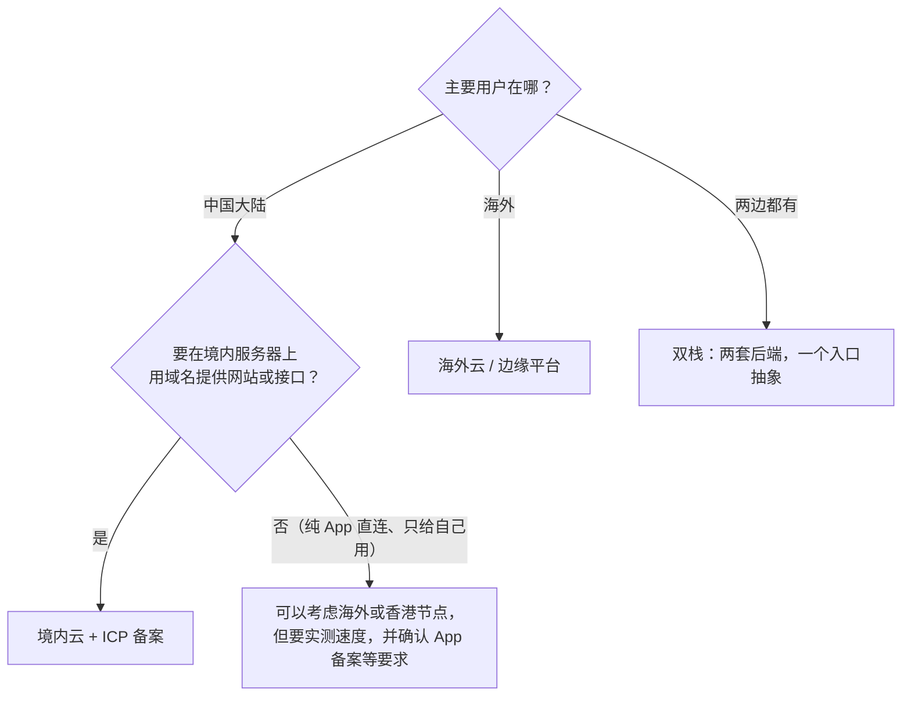
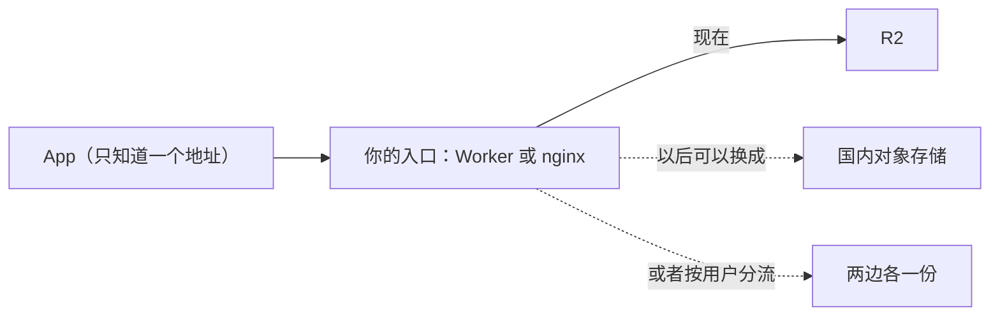

# 国内云与海外云

上一章决定了「用什么形态」，这一章决定「放在哪家、哪个地区」。对身在中国大陆的独立开发者，这个选择比技术选型更早卡住你：用户在国内还是海外，决定了要不要 ICP 备案；备案又决定了服务器只能放在境内；而境内和境外之间的网络质量，会让同一份架构在两边表现完全不同。本章讲清这几个约束怎么相互咬合，以及怎么设计才能不把自己锁死在一边。

出海时的账号风控、付款方式、域名注册和数据驻留，在《出海实务》第 6 章已经讲过；备案的法规和流程在《国内合规实务》第 3 章。本章只讲它们对**技术架构**的影响。

> 备案、数据出境等规定和各家云的产品线都会调整，本章只讲框架，**具体要求以主管部门和服务商的最新规定为准**。

## 先回答三个问题



1. **用户在哪**：决定延迟和合规的基本盘
2. **服务端是否在境内对外提供服务**：在境内服务器上用域名对外提供服务，通常要做 ICP 备案，而且备案要关联到你使用的云服务商（接入商）
3. **数据是什么、存在哪**：处理境内用户的个人信息并传到境外，会进入数据出境的规则范围（《国内合规实务》）

## 两边的差异在哪

| 维度 | 国内云（阿里云、腾讯云、华为云等） | 海外云 / 边缘平台（Cloudflare、AWS、各类 VPS 商） |
|---|---|---|
| 开通 | 实名认证；对外服务的域名要备案 | 邮箱 + 信用卡；不需要备案 |
| 付款与发票 | 人民币、对公转账、增值税发票方便 | 外币信用卡；凭证是境外账单，记账见《财务与税务》 |
| 从国内访问 | 快且稳定 | 取决于线路，晚高峰常见丢包和抖动 |
| 从海外访问 | 境内节点出海一般 | 快 |
| 计费习惯 | 包年包月、按量、资源包并存；带宽按固定带宽或按流量 | 以按量为主；部分服务出网免费或很便宜 |
| 产品形态 | 云服务器、轻量应用服务器、对象存储、CDN、函数计算 | 同类产品齐全；边缘计算更成熟 |
| 封号与停机风险 | 欠费停机、内容违规关停 | 风控封号、地区限制（《出海实务》第 6 章） |

产品线在两边大体能一一对应：

| 需要的东西 | 国内常见选择 | 海外常见选择 |
|---|---|---|
| 虚拟机 | ECS、CVM、轻量应用服务器 | 各类 VPS、EC2、Lightsail |
| 对象存储 | OSS、COS | S3、R2 |
| CDN | 各家 CDN（加速域名要备案） | Cloudflare 等 |
| 函数 / 边缘计算 | 函数计算、云函数 SCF | Workers、Lambda |
| 托管 Postgres | RDS、云数据库 | 各家托管 Postgres |
| 镜像仓库 | ACR、TCR | GHCR、Docker Hub 等 |

对应得上，但**不是一模一样**：对象存储的 S3 兼容程度、函数平台的运行时和限制、CDN 的缓存规则写法，各家都有差异。不要假设「换一家就是改个地址」。

## 跨境网络：先测，再决定

海外节点从国内访问「能用」和「好用」差别很大。表现通常是：白天还行，晚高峰丢包、速度掉一个数量级；同一时刻不同运营商差别也大。这类结论不能靠印象，要用自己的用户分布实测。

### 怎么测

```bash
# 看路径和每一跳的丢包，跑几百个包，晚高峰再跑一次
mtr -rwc 200 your-api.example.com

# 看一次下载的各阶段耗时和平均速度
curl -o /dev/null -s -w 'dns=%{time_namelookup} connect=%{time_connect} tls=%{time_appconnect} ttfb=%{time_starttransfer} total=%{time_total} speed=%{speed_download}\n' \
  -H "Authorization: Bearer $TOKEN" https://your-api.example.com/v1/o/test/10m.bin
```

几条经验：

- **在用户那一侧测**，不是在你的开发机上测。可以写一个小脚本发给几个朋友跑
- **多时段多次**，看中位数和波动，不看单次最好成绩
- 测试文件大小要让下载持续几秒以上，太小只测到了握手

### hatch-recordwall 的实测

唱片墙的曲库放在 Cloudflare 上，国内朋友要从它下歌。作者做了一个测速靶子：桶里放一个 10MB 的测试对象（和普通对象一样要令牌才能读），把测速脚本发给国内的朋友跑。大小是按「国内最慢那次约 512 KB/秒」反推的，保证在脚本 30 秒的上限内能下完。

结论记在它的 README 里：国内中位数大约 700 KB/秒，一首 5MB 的歌约七秒；而且**同一台机器三分钟内的两次测量能差 2.3 倍**。这个数字放在「在线播放」场景下不可接受，但唱片墙是离线优先的：歌在后台下载到手机，之后都从本地放，没人盯着那七秒。于是结论是「够用」，而不是「换国内云」。

同样的数字，换一个产品形态结论就会反过来。**网络够不够用，是由产品的取用方式决定的**。

### 别用平台默认的子域名做正式地址

很多边缘平台会给你一个默认子域名（Cloudflare 的是 `*.workers.dev`）。这类共享域名在国内可能被干扰或污染，hatch-recordwall 就遇到过，所以它的正式地址一律用自己的域名，在 `wrangler.toml` 的 `[[routes]]` 里配置（第 6 章）。另一个好处是：域名在自己手里，以后换后端时客户端不用动。

## 入口抽象：客户端只认你的地址

国内和海外的取舍很难一次赌准：现在海外够用，用户多了可能就不够；现在只做国内，以后可能要出海。降低赌错代价的办法只有一个：

> **客户端只认你自己的入口地址，永远不直连存储或厂商域名。**

hatch-recordwall 的 README 把它列为比「不设公共读」更要紧的一条：客户端只认 Worker 的地址，于是「后面挂 R2 还是国内对象存储」不用现在决定。真跑起来发现从国内太慢，换后端是服务端改一处的事，不用发版、不用让所有人重装。



做到这一点有三个要求：

1. 客户端里只有你的域名，没有 `*.r2.cloudflarestorage.com`、`*.aliyuncs.com` 这类地址
2. 服务端对外的接口是**你定义的**（如 `GET /v1/o/<键>`），不是把厂商的 S3 API 原样透出去
3. 如果用预签名 URL 让客户端直传直下（第 3 章），签名逻辑在服务端，客户端只是拿到一个临时地址，后端换了它也无感

## 双栈：两边都要服务时

用户两边都有时，常见的三种做法，按复杂度递增：

| 做法 | 结构 | 适合 |
|---|---|---|
| 单栈 + 加速 | 一套后端放在一边，另一边靠 CDN 加速静态和下载 | 另一边用户少，或主要是下载流量 |
| 单入口分流 | 入口按用户地区或账号把请求路由到两套存储 | 文件类业务，数据可以各存各的 |
| 两套独立部署 | 国内版和海外版各一套，账号和数据不互通 | 合规要求数据分开，或产品本身就是两个版本 |

对一个人来说，**能单栈就单栈**。第三种意味着两套部署、两套备份、两套监控，运维量翻倍；只有合规要求或商业上确实需要时才走到这一步。

## hatch-counter：典型的境内单栈

hatch-counter 的用户是国内门店，全部放在一家国内云上：

- 一台境内云服务器，Docker Compose 跑 API 和 Postgres，nginx 按子域名分站
- 单据原图放在对象存储的**私有桶**，安装包和前端构建产物放在单独的下载桶
- 镜像由 CI 构建后推到同一家云的镜像仓库，服务器只拉不编
- 域名已备案，接入商就是这家云

全部放在同一家云、同一个地域的好处是：服务器读写对象存储可以走内网（通常不计公网流量费、延迟也低），镜像拉取快，发票和账号都在一处。代价是对这一家的依赖更深，所以它把部署写成脚本、数据库定期备份到另一处，保留「搬得走」的能力。

## 选择清单

| 情况 | 建议 |
|---|---|
| 用户在国内，要网站或 API | 境内云 + 备案，服务器、对象存储、镜像仓库放同一地域 |
| 用户在国内，只给自己和几个朋友用 | 可以用海外边缘平台，先实测速度；用自己的域名 |
| 用户在海外 | 海外云或边缘平台；地区和数据驻留见《出海实务》第 6 章 |
| 两边都有 | 先单栈 + 入口抽象，真有需要再分流 |
| 不确定以后在哪 | 不管放哪，客户端只认你的入口地址 |

## 本章要点

- 先问用户在哪、是否在境内对外服务、数据存在哪，三个问题决定了大方向
- 国内云和海外云的产品能一一对应，但兼容程度、计费习惯、限制各不相同
- 跨境网络要**在用户侧、多时段**实测；够不够用取决于产品的取用方式，离线下载和在线播放的结论可以相反
- 不用平台默认子域名做正式地址，用自己的域名
- 最重要的一条：**客户端只认你自己的入口地址**，后端换厂商、换地区都不用发版
- 一个人能单栈就单栈，双栈意味着运维量翻倍
